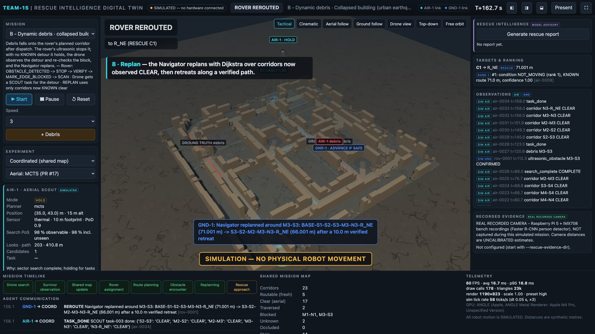
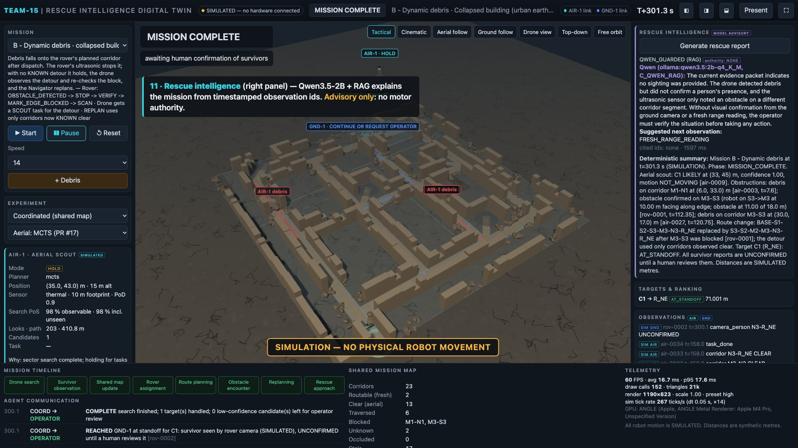

# Dual-robot rescue simulation: demo

> **SIMULATION — NO PHYSICAL ROBOT MOVEMENT.** This demo shows software. It is not evidence of real
> drone flight or real rover motion. For the hardware status, see [HARDWARE_STATUS.md](HARDWARE_STATUS.md).

## Watch

**[▶ Team15_Dual_Robot_Rescue_Demo.mp4](videos/Team15_Dual_Robot_Rescue_Demo.mp4)** (74.5 s, 1080p,
18.5 MB). Chapters and recording method: [VIDEO_INDEX.md](VIDEO_INDEX.md).

[](videos/Team15_Dual_Robot_Rescue_Demo.mp4)

*Frame at 0:47. The rover (GND-1) has replanned around a corridor its ultrasonic sensor found blocked.
Red = blocked, blue = the Navigator's route, cyan = corridors the drone observed clear, hatched amber =
unknown, grey = simulator ground truth (viewer only).*



*Frame at 1:06. Mission complete. Right panel: the guarded Qwen RAG report (authority NONE) and the
deterministic summary, with observation ids.*

## What the simulation does

| Capability | How | Evidence |
|---|---|---|
| Aerial search and coverage | PR #17 `FleetMCTS` belief search; discovery only inside the camera footprint | [BENCHMARKS.md](BENCHMARKS.md#dual-robot-simulation) |
| Survivor confirmation and ranking | 3-look Bayes confirm hover; ranked by condition, then known route, then distance, then confidence | [TEST_RESULTS.md](TEST_RESULTS.md#dual-robot-simulation-tests) |
| Shared map coordination | Corridor states with sources and freshness; UNKNOWN is never CLEAR | `docs/dual_rescue/README.md` |
| Ground route planning | Real `rover.navigator.Navigator` + safety supervisor + Dijkstra on a knowledge graph | [TEST_RESULTS.md](TEST_RESULTS.md) |
| Dynamic obstacle replanning | Ultrasonic STOP / VERIFY / MARK / SCAN, aerial re-check, detour scouting, replan | [video](videos/Team15_Dual_Robot_Rescue_Demo.mp4) at 0:21–0:49 |
| Mission completion and safety | Standoff with human review pending; COMMS_LOST latch; INSUFFICIENT_INFORMATION | [BENCHMARKS.md](BENCHMARKS.md#dual-robot-simulation) |
| Failure injection | 10 faults × 10 seeds, each with an expected behaviour that is checked | [BENCHMARKS.md](BENCHMARKS.md#failure-injection) |
| Rendering | Three.js digital twin, about 60 fps at 1080p–4K on an Apple M4 Pro | [BENCHMARKS.md](BENCHMARKS.md#rendering-performance) |

## Simulation versus real hardware

| | In this demo (SIMULATED) | Real integration elsewhere in the project |
|---|---|---|
| Drone | Simulated airframe running real search code | No drone flight control or flight test exists |
| Rover | Simulated RoverC-Pro physics running the real Navigator + supervisor | Bridge firmware and serial protocol tested on the bench; **real wheel rotation not demonstrated** ([HARDWARE_STATUS.md](HARDWARE_STATUS.md)) |
| Rover sensors | Simulated ultrasonic and camera cues | Grove ultrasonic and RPLIDAR bench results in [HARDWARE_STATUS.md](HARDWARE_STATUS.md#sensors) |
| Camera | No camera image in this video | Real Raspberry Pi 5 + IMX708 + Faster R-CNN on recorded frames ([HARDWARE_STATUS.md](HARDWARE_STATUS.md#raspberry-pi-camera)) |
| Qwen | Live Mac-hosted RAG service (`ollama:qwen3.5:2b-q4_K_M`, `C_QWEN_RAG`), display only | LoRA training and evaluation: [AI_MODEL_EVALUATION.md](AI_MODEL_EVALUATION.md). The service in this video does not show the LoRA adapter loaded |

## Launch locally

```bash
pip install -r requirements.txt
scripts/run_dual_rescue.sh                      # http://localhost:8000/rescue
PORT=8010 scripts/run_dual_rescue.sh            # if port 8000 is busy
```

No Raspberry Pi, robot or internet is needed (three.js is vendored). If the Qwen service is running on
`127.0.0.1:8090`, the script uses it; otherwise the report is the labelled deterministic fallback. In
the browser: Space starts and pauses, P toggles presentation mode, and 1–7 switch cameras. Scenarios
A–E, W, K, O and M are in the Mission menu.

Headless check:

```bash
python3 -m simulation.dual_rescue.mission B --messages        # prints the agent message log
python3 -m pytest -q simulation/dual_rescue/tests
```

## Re-record the video

```bash
python3 -m dashboard.serve --port 8012 --qwen-url http://127.0.0.1:8090    # no --rescue-evidence-dir
pip install playwright                                                     # uses the installed Google Chrome
python3 demo/record_demo.py http://localhost:8012 /tmp/frames
python3 demo/assemble_video.py /tmp/frames demo/videos/Team15_Dual_Robot_Rescue_Demo.mp4   # needs ffmpeg
```

Re-recording reproduces the same mission, because the scenario seed and tick are fixed. Frame timing
depends on the machine.
