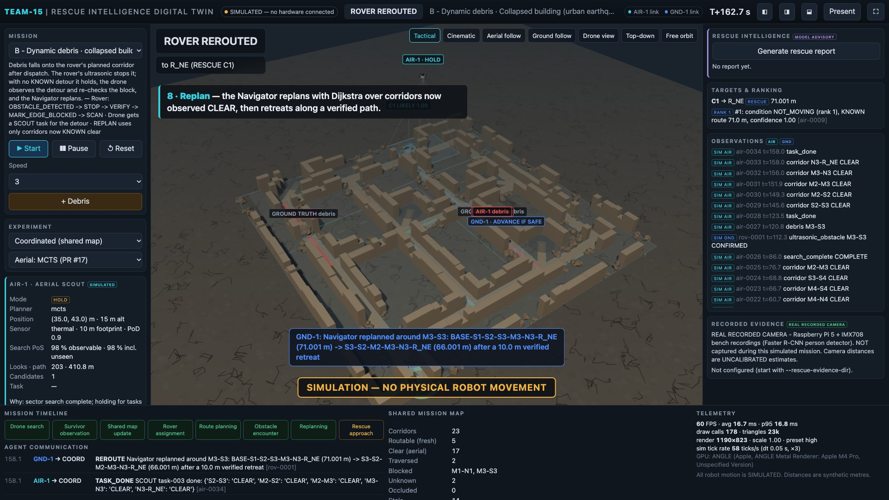
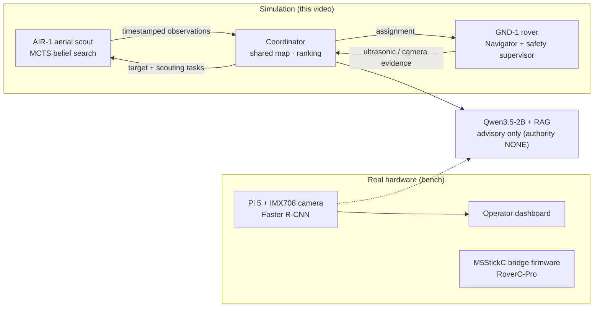

# Team-15 · Rescue Intelligence: judge demo and evidence

**Team-15 (CodeMetal Forge 2026)** builds search-and-rescue software for two cooperating robots: an
aerial scout and a ground rover (M5Stack RoverC-Pro with a Raspberry Pi 5 and camera). Every motion
decision is deterministic and gated by a safety supervisor. A local Qwen3.5-2B model explains the
evidence but **has no motion authority**.

> **Read this first.** The video is a **SIMULATION: no physical robot moves in it.** Real-hardware
> results are kept separate in [HARDWARE_STATUS.md](HARDWARE_STATUS.md). Every number on these pages
> links to its source and says whether it is physical, real-camera, simulated or mocked.

## ▶ Demo video (75 s)

**[Watch: Team15_Dual_Robot_Rescue_Demo.mp4](videos/Team15_Dual_Robot_Rescue_Demo.mp4)** (1080p, 18.5 MB).
Chapters: [VIDEO_INDEX.md](VIDEO_INDEX.md). Launch it yourself: [DEMO.md](DEMO.md).

https://youtu.be/TWNLeU3t4rg

In the video, the drone searches with our Monte-Carlo tree-search planner and finds a survivor. It then
scouts the rover's route, and the rover drives our real navigation stack. Debris falls; the rover stops,
verifies and holds; the drone observes a detour; the rover replans and reaches the survivor. Qwen
explains the mission.

## How it fits together

## Key results

| Area | Result | Evidence type | Details |
|---|---|---|---|
| Dual-robot missions | **1540 / 1540** benchmark runs completed. **0 collisions, 0 entries into unobserved corridors, 0 false rescue claims.** 638/800 rescues; 799/800 correct outcomes | SIMULATED | [BENCHMARKS.md](BENCHMARKS.md#dual-robot-simulation) |
| Failure injection | 10 faults × 10 seeds: **100/100** expected behaviours met | SIMULATED | [BENCHMARKS.md](BENCHMARKS.md#failure-injection) |
| Search planners | MCTS and greedy find the first survivor about **5× faster** than a lawnmower sweep. MCTS ≈ greedy (no gain claimed) | SIMULATED | [BENCHMARKS.md](BENCHMARKS.md#baselines-same-environments-same-seeds-4261-160-runs-per-configuration) |
| Qwen LoRA ckpt-0088 | **218/230** frozen mission steps (94.8 %), 0/182 unsafe requests. Base model on the same runtime: 0/230 | REAL MODEL INFERENCE on synthetic test data (in-distribution) | [AI_MODEL_EVALUATION.md](AI_MODEL_EVALUATION.md) |
| Live Qwen service | base Qwen3.5-2B + RAG + guard. **The LoRA is not served live** (Ollama rejects adapters) | REAL MODEL INFERENCE | [AI_MODEL_EVALUATION.md](AI_MODEL_EVALUATION.md#was-the-lora-adapter-actually-active) |
| Pi camera, rover, sensors | see the hardware page. **Real wheel rotation has not been demonstrated** | PHYSICAL / REAL CAMERA | [HARDWARE_STATUS.md](HARDWARE_STATUS.md) |
| Software tests and CI | see the test page | unit / integration / CI | [TEST_RESULTS.md](TEST_RESULTS.md) |
| 3D rendering | about 60 fps at 1080p–4K (Apple M4 Pro; vsync-capped) | real browser measurement | [BENCHMARKS.md](BENCHMARKS.md#rendering-performance) |

## Simulation versus hardware

| Capability | Simulation | Real hardware |
|---|---|---|
| Drone search and flight | ✅ simulated, real search code | ❌ no drone flight or flight control exists |
| Rover navigation and replanning | ✅ real Navigator in simulation | ⚠️ bridge firmware and STOP path on the bench; **no wheel rotation shown** |
| Person detection | ✅ simulated camera cue | ✅ real Pi 5 + IMX708 frames with Faster R-CNN (recorded) |
| Obstacle sensing | ✅ simulated ultrasonic | ⚠️ Grove ultrasonic and RPLIDAR bench results; see [HARDWARE_STATUS.md](HARDWARE_STATUS.md#sensors) |
| Qwen explanation | ✅ live base + RAG | ✅ live base + RAG on recorded camera evidence; LoRA evaluated offline only |

## Honest limitations

* **No physical robot moved autonomously,** and **no drone flew.**
* The simulation runs on synthetic 48 m sites with simplified sensor models.
* The Qwen LoRA results are in-distribution on synthetic data, the live demo uses the base model, and
  the safety-regression gate failed for every model; the guard blocks unsafe outputs.
* Camera distance is **uncalibrated**: distance stays UNKNOWN or is labelled a camera estimate.
* One open simulation finding: 16 false aerial CLEAR reports in the dynamic environment. The rover's
  ultrasonic caught them all.

## Full reports

* [DEMO.md](DEMO.md): video, screenshots, capabilities, how to run it
* [VIDEO_INDEX.md](VIDEO_INDEX.md): chapters and how the video was recorded
* [BENCHMARKS.md](BENCHMARKS.md): simulation benchmarks, baselines, failure injection, rendering
* [AI_MODEL_EVALUATION.md](AI_MODEL_EVALUATION.md): Qwen + LoRA + RAG
* [HARDWARE_STATUS.md](HARDWARE_STATUS.md): Pi camera, RoverC-Pro, M5StickC bridge, sensors
* [TEST_RESULTS.md](TEST_RESULTS.md): unit and integration tests, CI, pull requests, reproducibility
* [`evidence/`](evidence/): public, redacted evidence files (benchmark data, render telemetry, capture log)
* The team's full experiment registry: [`docs/experiments/EXPERIMENT_REGISTRY.md`](../docs/experiments/EXPERIMENT_REGISTRY.md)
