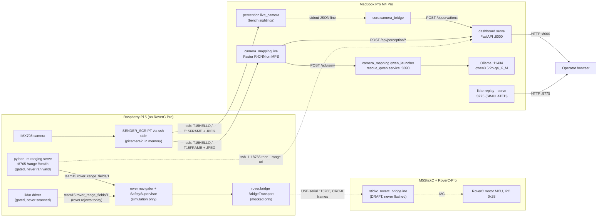
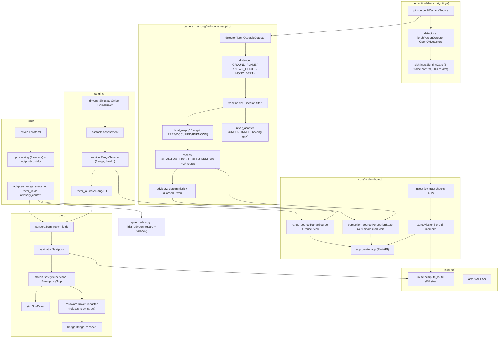
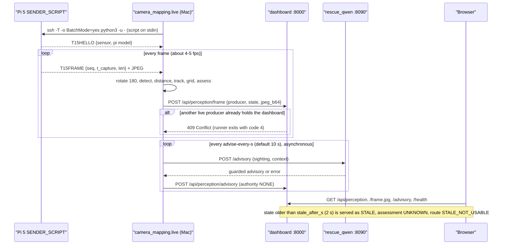
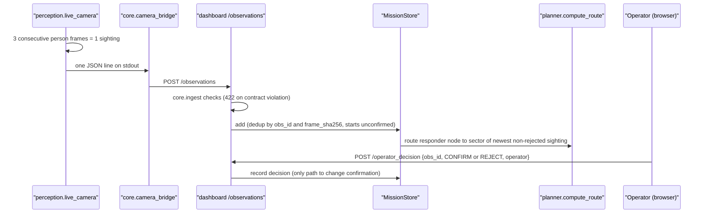
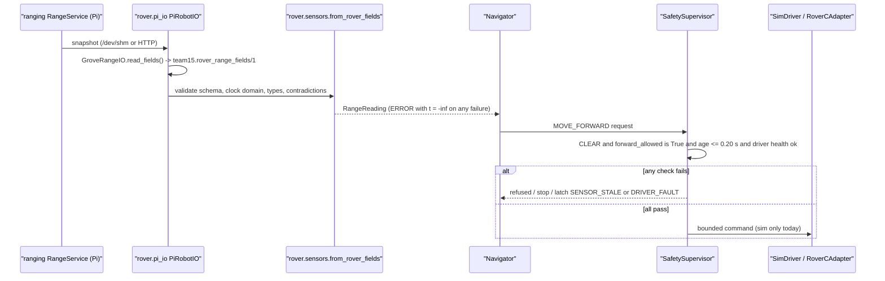

# 01 · System architecture

This document describes the whole Team-15 system as it exists in the code at `d1b607a`. It covers which processes run on which host, what each one sends to the others, the versioned JSON contracts between them, the network ports and HTTP endpoints, and the safety boundaries that separate *advice* from *authority*. The aim is that a new developer can trace any value on the dashboard back to the code that produced it and the host it came from.

**Status:** Implemented. The camera → Mac → dashboard path is hardware-verified (REAL HARDWARE, bench). The rover, ranging and LiDAR paths are simulation-tested only, and their hardware branches are gated off.

**Related:** [00 Overview](00_PROJECT_OVERVIEW.md) · [02 Pi setup](02_RASPBERRY_PI_SETUP.md) · [03 Mac inference](03_MAC_AI_INFERENCE.md) · [16 Dashboard](16_DASHBOARD.md) · [17 Safety architecture](17_SAFETY_ARCHITECTURE.md) · [20 Deployment and runbook](20_DEPLOYMENT_AND_RUNBOOK.md) · [contracts/PI_CAMERA_CONTRACT.md](../contracts/PI_CAMERA_CONTRACT.md) · [contracts/ROVER_NAV_CONTRACT.md](../contracts/ROVER_NAV_CONTRACT.md) · [perception/SIGHTING_FORMAT.md](../perception/SIGHTING_FORMAT.md) · [docs/lidar/LIDAR_C1_DATA_CONTRACT.md](lidar/LIDAR_C1_DATA_CONTRACT.md) · [docs/qwen/QWEN_ADVISORY_CONTRACT.md](qwen/QWEN_ADVISORY_CONTRACT.md)

---

## 1. Problem: what the architecture must guarantee

A rescue robot's software has two jobs that pull against each other:

- **Perceive and advise.** Use heavy models (Faster R-CNN, a 2-billion-parameter language model) to say what might be in front of the robot.
- **Never act on a guess.** Any motion must be bounded, fresh, independently checked, and stoppable.

The architecture answers this with three rules that show up in every package:

1. **Heavy, fallible computation runs off-robot on the Mac**, and its outputs are labelled *advisory* (`authority: "NONE"`, `motion_authority: "NONE"`).
2. **Only deterministic code can be on the motor path.** The planner, navigator and `SafetySupervisor` are deterministic. A static test pins the set of modules allowed to import motor-path code (`MOTOR_PATH_ALLOWED` in `rover/tests/test_issue9_fail_closed.py`).
3. **Every interface is a versioned JSON contract**, named `team15.<name>/<version>`. Consumers validate it and fail closed: they map anything malformed, stale or contradictory to UNKNOWN or ERROR, never to CLEAR.

## 2. Why this split (Pi senses, Mac thinks)

- **Compute.** Faster R-CNN ResNet-50-FPN-v2 ran at a median of about 186 ms per frame on the Mac's MPS GPU (REAL HARDWARE, [EVALUATION §3](camera_mapping/EVALUATION.md)). Running it on the Pi 5 CPU would be far slower. The Hailo-8 HAT is not used by any code on `main`. The reasons are in [03 Mac AI inference](03_MAC_AI_INFERENCE.md).
- **Nothing installed on the Pi.** The camera sender is a Python script piped over SSH stdin (`perception/pi_source.py` `SENDER_SCRIPT`). It writes nothing to the Pi's disk. A remount or reflash cannot leave a stale daemon behind.
- **Clock honesty.** The Pi stamps each frame with its own capture time (`t_capture`). The Mac uses that as `obs_time` and never its arrival time. The dashboard enforces this (`core/ingest.py`; [PI_CAMERA_CONTRACT §3](../contracts/PI_CAMERA_CONTRACT.md)).
- **Motion stays local to the robot.** The rover's range freshness check requires `clock == "time.monotonic@<this host>"`. A reading produced on another machine is rejected as ERROR (`rover/sensors.py` `from_rover_fields`). Motor decisions therefore cannot depend on the network link to the Mac.

## 3. Hosts and processes

### 3.1 Deployment view

Solid arrows have run on real hardware or real processes (see the status column below). Dotted arrows exist in code and tests only.

### 3.2 Process table

| Process (entry point) | Host | Binds | Talks to | Status |
|---|---|---|---|---|
| `SENDER_SCRIPT` in `perception/pi_source.py`, started by the Mac over SSH | Pi | — (stdout over SSH) | Mac receiver | REAL HARDWARE |
| `python3 -m perception.live_camera` | Mac | — | Pi (SSH) or local camera; stdout | REAL HARDWARE (bench) |
| `python3 -m core.camera_bridge` | Mac | — | `POST` to the dashboard `/observations` (default `http://localhost:8000/observations`) | e2e-tested; used live in PR #5 |
| `python3 -m dashboard.serve` | Mac | `127.0.0.1:8000` (`--host`, `--port`) | optional `--range-url`, `--robot-url` | REAL (live demo runs) |
| `python3 -m camera_mapping.live` | Mac | — | Pi (SSH), the dashboard, optional `--qwen-url` | REAL HARDWARE (8 Nov) |
| `python3 -m camera_mapping.qwen_launcher` → `rescue_qwen.service` | Mac | `127.0.0.1:8090` | Ollama `127.0.0.1:11434` | REAL (8 Nov). The service code lives in the private Qwen workspace, not in this repo |
| `python3 -m ranging serve` | Pi (planned) | `127.0.0.1:8765` (`ranging/service.py` `DEFAULT_PORT`) | snapshot file `/dev/shm/team15_range.json`, evidence JSONL | SIMULATED by default; `--hardware` is gated. Real `diagnose` runs: 0/50 valid |
| `python3 -m lidar replay --serve` | Mac | `127.0.0.1:8775` (`lidar/config.py` `DEFAULT_SIM_PORT`) | browser | SIMULATED only (no hardware code path) |
| `python3 -m lidar scan-once` | Pi (planned) | — | RPLIDAR C1 over `/dev/serial/by-id/…` at 460800 baud (`SPEC_BAUD`) | Gated; never run on a device |
| Rover navigator (`rover/navigator.py`) + `rover/pi_io.py` | Pi (planned) | — | `ranging.rover_io.GroveRangeIO` | SIMULATED (`python -m rover.simrun`) |
| `rover/bridge.py` `BridgeTransport` | Pi (planned) | — | `/dev/serial/by-id/…` at 115200 (`open_serial`) | MOCKED |
| `firmware/stickc_roverc_bridge/stickc_roverc_bridge.ino` | M5StickC | — | USB serial; I²C motor block `0x38` | DRAFT, never compiled |
| `team15_starter/homebase.py --sim --web` | any | `0.0.0.0:8080` (`team15_starter/fleet/web.py` default host) | in-process simulated drones | SIMULATED (separate project) |

The comments in `lidar/config.py` reserve two more ports: **8770** for a "robot API" and **8792** for a "camera test". No server on `main` binds either one. The `--robot-url` example in `dashboard/serve.py` (`http://127.0.0.1:8770/robot/status`) refers to a service in the private robotics workspace. **`rover/status_api.py` `rover_router` is not mounted by `dashboard/app.py`**; only its tests mount it. Read `dashboard/serve.py`'s warning too: on the bench Mac, port 8765 is used by an unrelated app. That is why the range URL has no default and goes through an SSH tunnel on 18765.

## 4. Component view

| Package | Responsibility | Key symbols | Detail doc |
|---|---|---|---|
| `perception/` | Pi/local camera source, person detectors, one-sighting-per-person gate, evidence files outside Git | `PiCameraSource`, `open_pi_camera`, `TorchPersonDetector`, `OpenCVDetectors`, `select_trigger` | [04](04_CAMERA_PERCEPTION.md) |
| `camera_mapping/` | Multi-class detection → distance with σ → tracks → robot-relative grid → corridor verdict → advisory routes → advisory text | `PerceptionPipeline`, `TorchObstacleDetector`, `MonoDepth`, `advise`, `stale_view` | [05](05_DEPTH_AND_DISTANCE_ESTIMATION.md), [06](06_OBSTACLE_MAPPING.md), [07](07_PATH_PLANNING.md) |
| `core/` | Observation normalisation and contract checks, mission store, range card view, stdin→HTTP bridge | `MissionStore`, `InvalidObservation`, `range_view` | [16](16_DASHBOARD.md) |
| `dashboard/` | FastAPI app, static page with sector map and panels A–D | `create_app`, `PerceptionStore`, `RangeSource` | [16](16_DASHBOARD.md) |
| `planner/` | SYNTHETIC trail graph, Dijkstra with blocked edges, ALT A\* | `compute_route`, `RouteResult` | [07](07_PATH_PLANNING.md) |
| `rover/` | Navigator state machine, supervisor, simulator, I²C protocol, hardware adapter, USB bridge | `Navigator`, `SafetySupervisor`, `SimDriver`, `RoverCAdapter`, `BridgeTransport` | [12](12_ROVERC_MOTOR_CONTROL.md), [13](13_M5STICKC_BRIDGE.md), [17](17_SAFETY_ARCHITECTURE.md) |
| `ranging/` | Grove ultrasonic drivers, electrical gate, obstacle assessment, service, rover fields | `RangeService`, `GroveRangeIO`, `RangeClient` | [14](14_GROVE_ULTRASONIC.md) |
| `lidar/` | RPLIDAR C1 protocol and driver, sector processing, footprint corridor, adapters, replay server | `make_server`, `to_rover_fields`, `to_advisory_context` | [15](15_RPLIDAR_C1.md) |
| `qwen_advisory/` | LiDAR advisory schema, deterministic reference policy, guard, client with fallback | `lidar_advisory`, `reference_policy` | [11](11_AI_AGENT_AND_TOOLS.md) |
| `contracts/` | Camera provenance helper and contract docs | `camera_provenance.py` | this doc |
| `team15_starter/` | Aurora drone-fleet simulation, a separate system that shares no runtime code with the robot | `homebase.py`, `fleet/`, `sar/`, `link/` | [18](18_SIMULATION.md) |

## 5. Data flows

### 5.1 Camera mapping loop (the judge demo)

The producer id is `<hostname>:<pid>:<source>` (`camera_mapping/live.py`). `PerceptionStore` accepts one live producer at a time. A different producer is refused with 409 until the active one has been silent for more than 2 × `stale_after_s` (4 s). This lock exists because, on 8 Nov, a stray replay runner fed the dashboard at the same time as the live Pi runner ([21](21_TROUBLESHOOTING.md), [EVALUATION §3b](camera_mapping/EVALUATION.md)).

### 5.2 Bench sighting → operator decision → route

The sighting fields are in [perception/SIGHTING_FORMAT.md](../perception/SIGHTING_FORMAT.md). The camera's location is always `SECTOR_ONLY` with `cell_source = OPERATOR_ASSIGNED`. The system never claims a measured position for a person.

### 5.3 Range → rover forward-motion gate (simulation-tested)

## 6. Contracts and schemas

Every cross-component message carries a `schema` (or `schema_version`) string. The table lists every one that a producer emits on `main`, verified by grep at `d1b607a`.

| Schema | Producer | Consumer(s) | Transport | Contract doc |
|---|---|---|---|---|
| Sighting (field set, no schema string; `source_mode`=`LIVE-HW`, `platform`=`BENCH`) | `perception/sightings.py` | `core/ingest.py` | stdout JSON line → `POST /observations` | [SIGHTING_FORMAT](../perception/SIGHTING_FORMAT.md), [PI_CAMERA_CONTRACT](../contracts/PI_CAMERA_CONTRACT.md) |
| `evidence.camera` provenance | `contracts/camera_provenance.py` | `core/ingest.py` | inside the sighting | [PI_CAMERA_CONTRACT §2](../contracts/PI_CAMERA_CONTRACT.md) |
| Pi wire format `T15HELLO` / `T15FRAME` | `SENDER_SCRIPT` | `PiCameraSource` | SSH stdout | private to `perception/pi_source.py` |
| `team15.camera_perception/1` | `camera_mapping/pipeline.py` | `dashboard/perception_source.py` `validate_state` | `POST /api/perception/frame` | [camera_mapping/README](../camera_mapping/README.md) |
| `team15.camera_rescue_advisory/1` | `camera_mapping/advisory.py` `advise` | dashboard panel C | `POST /api/perception/advisory` | [08](08_QWEN_MODEL.md) |
| `team15.range_reading/1` | `ranging/reading.py`; also emitted by `lidar/adapters.py` | `ranging/service.py` | in process | [ranging/INTEGRATION](../ranging/INTEGRATION.md) |
| `team15.obstacle_assessment/1` | `ranging/obstacle.py` | the range snapshot | in process | [ranging/README](../ranging/README.md) |
| `team15.range_snapshot/1` | `ranging/service.py`; `lidar/adapters.py` `to_range_snapshot` (display only) | `dashboard/range_source.py`, `ranging` `RangeClient` | `/dev/shm/team15_range.json`, `GET /range` | [ranging/INTEGRATION](../ranging/INTEGRATION.md), [LIDAR_C1_DATA_CONTRACT §4](lidar/LIDAR_C1_DATA_CONTRACT.md) |
| `team15.range_panel/1` | `core/range_view.py` | browser | `GET /api/range` | [16](16_DASHBOARD.md) |
| `team15.robot_status/1` | private robotics service (fixture in tests) | `dashboard/range_source.py` | `--robot-url` / `--robot-fixture` | [16](16_DASHBOARD.md) |
| **`team15.rover_range_fields/1`** | `ranging/rover_io.py` `GroveRangeIO`; `lidar/adapters.py` `to_rover_fields` | `rover/sensors.py` `from_rover_fields` via `rover/pi_io.py` | in process on the Pi | [ROVER_NAV_CONTRACT §2](../contracts/ROVER_NAV_CONTRACT.md) |
| `team15.rover_nav_status/1` | `rover/navigator.py` `Navigator.status()` | `rover/status_api.py` (not mounted) | `GET /rover/status` | [ROVER_NAV_CONTRACT §3](../contracts/ROVER_NAV_CONTRACT.md) |
| `team15.lidar_scan/1`, `team15.lidar_sectors/1`, `team15.lidar_tracks/1`, `team15.lidar_panel/1` | `lidar/scan.py`, `processing.py`, `tracking.py`, `panel.py` | LiDAR replay server, adapters | in process, `GET /api/lidar` | [LIDAR_C1_DATA_CONTRACT](lidar/LIDAR_C1_DATA_CONTRACT.md) |
| `team15.lidar_advisory_context/1` | `lidar/adapters.py` `to_advisory_context` | `qwen_advisory/lidar.py` | in process | [LIDAR_C1_DATA_CONTRACT §6](lidar/LIDAR_C1_DATA_CONTRACT.md) |
| `rescue-lidar-advisory/0.1` | `qwen_advisory/client.py` `lidar_advisory` | display only | in process | [QWEN_ADVISORY_CONTRACT](qwen/QWEN_ADVISORY_CONTRACT.md) |
| Bridge line protocol (CRC-8 ASCII frames, 8-hex session id, seq-matched acks) | `rover/bridge.py` | StickC firmware (draft) | USB serial | [rover/BRIDGE_PROTOCOL](rover/BRIDGE_PROTOCOL.md) |

### 6.1 The most safety-critical contract: `team15.rover_range_fields/1`

This is the only path by which a sensor can *allow* forward motion. `ranging/rover_io.py` builds it from a range snapshot. It sets `forward_motion_allowed` true only when all of these hold: the snapshot's own verdict allows it, the derived status is `OK`, the reading came from the same host, and it is not stale. The rover then re-validates everything ([ROVER_NAV_CONTRACT §2](../contracts/ROVER_NAV_CONTRACT.md)):

- `schema` must match, and `clock` must equal `time.monotonic@<this host>`;
- `t` must be finite, at most 50 ms in the future, and at most **0.20 s** old for motion. The display uses a separate 0.5 s threshold;
- contradictions are ERROR. Examples: `allowed` with a non-OK status, `allowed` with a range below the threshold, a range above 1.05 × the maximum, NaN or inf;
- any ERROR gets `t = -inf`, so it can never be fresh.

`SafetySupervisor` then gates `MOVE_FORWARD` **again**, independently of the navigator. The RPLIDAR adapter emits the same schema with source `rplidar-c1`. The rover rejects that source today, so LiDAR data maps to UNKNOWN, as intended (PR #11).

### 6.2 Contract between the camera and the dashboard

`validate_state` in `dashboard/perception_source.py` refuses any state where:

- `schema != "team15.camera_perception/1"`;
- `data_source != "CAMERA_ESTIMATE"`;
- `motion_authority != "NONE"`;
- `source_mode` is not one of `LIVE-HW`, `RECORDED`, `SYNTHETIC`;
- any distance label contains `VERIFIED`.

A camera estimate therefore cannot be displayed as a physical measurement, even by a buggy or malicious producer.

### 6.3 Contract with the Qwen service

`camera_mapping/advisory.py` `http_qwen` posts to `<qwen-url>/advisory` with a `sighting` built by `person_sighting()`. The sighting is UGV_GROUND_ROBOT, `how: BEARING_ONLY`, `confidence: null`. The post also carries a `context` with `robot_motion: "STOPPED"` and `camera_calibration.pose_measured`. `scripts/camera_demo.sh` probes `GET /health` and reuses an existing service only if the reply contains `"advisory_only":true`. The service itself (`rescue_qwen.service`) lives in the private Qwen workspace; see [10 RAG pipeline](10_RAG_PIPELINE.md) and [11 AI agent and tools](11_AI_AGENT_AND_TOOLS.md).

## 7. HTTP endpoints

### 7.1 Dashboard (`dashboard/app.py`, default `127.0.0.1:8000`)

| Method and path | Purpose | Notes |
|---|---|---|
| `GET /` | map page (`dashboard/static/index.html`) | |
| `GET /state` | mission state: tracks, history, routes, alerts, graph | polled by the page every 0.5 s (PR #5) |
| `POST /observations` | ingest one sighting | 422 on contract violation (`InvalidObservation`) |
| `POST /operator_decision` | `{obs_id, decision: CONFIRM\|REJECT, operator}` | the only way to change confirmation |
| `GET /evidence/{obs_id}`, `/evidence/{obs_id}/frame` | annotated JPEG / exact PNG | served only from the configured evidence directories |
| `GET /api/range` | forward range card, `team15.range_panel/1` | DISCONNECTED when there is no source |
| `POST /api/perception/frame` | state + JPEG from `camera_mapping.live` | 409 to a second live producer |
| `POST /api/perception/advisory` | rescue advisory | 409 to a non-owner producer |
| `POST /api/perception/health` | camera heartbeat | STREAMING / NO_FRAMES / DISCONNECTED / STOPPED |
| `GET /api/perception`, `/api/perception/frame.jpg`, `/api/perception/advisory`, `/api/perception/health` | panels A–D | the JPEG is held in memory only |

### 7.2 Other services

| Service | Endpoints |
|---|---|
| `ranging` service (`ranging/service.py` `make_http_server`) | `GET /range`, `GET /health`; 404 lists both |
| LiDAR replay (`lidar/server.py`) | `GET /`, `/api/lidar`, `/api/range`, `/api/advisory`, `/api/scenarios` |
| Rover router (`rover/status_api.py`, not mounted) | `GET /rover/status`, `POST /rover/estop`. There is deliberately no reset or start endpoint |
| Qwen service (external) | `GET /health`, `POST /advisory` (as used by this repo) |
| Fleet sim (`team15_starter/fleet/web.py`) | `GET /`, `/stream`, `/leaflet/...`; `POST /control` |

## 8. Configuration and environment

| Variable or file | Read by | Meaning |
|---|---|---|
| `TEAM15_PI_HOST`, `TEAM15_PI_USER`, `TEAM15_PI_KEY` | `perception/pi_source.py` | Pi SSH target when no `--pi-*` flag is given |
| `TEAM15_EVIDENCE_DIR`, `TEAM15_OBSERVATIONS`, `TEAM15_RESPONDER_NODE`, `TEAM15_RANGE_FIXTURE`, `TEAM15_ROBOT_FIXTURE`, `TEAM15_RANGE_URL`, `TEAM15_ROBOT_URL` | `dashboard/app.py`, `dashboard/range_source.py` | set by `dashboard.serve` from its flags. Do not set them by hand |
| `TEAM15_ROBOT_FIXTURES` | `dashboard/tests/test_range_panel.py` | where the private SIMULATED robot fixtures live (tests skip without them) |
| `PORT`, `QWEN_PORT`, `PI_HOST`, `QWEN_ROOT`, `REPLAY_GLOB`, `MAX_RESTARTS` | `scripts/camera_demo.sh` | demo overrides |
| `camera_mapping/configs/imx708_robot.json` | `camera_mapping.config.load_config` | intrinsics (`NOMINAL_DATASHEET`), mount (unmeasured at `d1b607a`), `calibration_status: UNCALIBRATED`, lookahead 1.5 m, stop distance 0.6 m |
| `ranging/configs/*.json` | `ranging` | `pi5_gpio5.UNVERIFIED.json` is refused by the electrical gate |
| `lidar/configs/*.json` | `lidar` | `c1_pi5.UNVERIFIED.json` is refused by the hardware gate |

## 9. Error handling patterns

| Situation | Behaviour | Where |
|---|---|---|
| Pi stream drops | reconnect up to 3 times, then the source reports closed; the runner exits with code 3 | `PiCameraSource`, `camera_mapping/live.py` |
| Camera runner stops | the dashboard shows STALE → UNKNOWN within about 2 s; the demo script restarts the runner up to `MAX_RESTARTS` (5) times | `stale_view`, `scripts/camera_demo.sh` |
| Second camera producer | 409; the runner exits with code 4 | `PerceptionStore`, `ProducerConflict` |
| Qwen down or slow | deterministic summary, labelled; advice is asynchronous and never blocks frames | `camera_mapping/advisory.py` |
| Malformed or contradictory range fields | ERROR, `t = -inf`, forward motion refused | `rover/sensors.py` |
| Controller link dead | `DRIVER_FAULT` latches; `tick()` never raises (fix `14fde0d`) | `rover/motion.py` |
| Unverified hardware config | CLI exits non-zero before opening any device | `ranging`, `lidar` gates (asserted in CI) |

## 10. Security and privacy boundaries

- Every server in the robot stack binds `127.0.0.1` by default. Remote access goes through SSH tunnels. The exception is the separate fleet simulation's web server, which defaults to `0.0.0.0:8080`.
- SSH runs with `BatchMode=yes`. An unknown host key fails instead of being trusted (`build_ssh_command`). Host, user and key come from flags or environment variables, never from code.
- Camera frames and evidence are written outside Git (`~/Team15_evidence/…`). `perception/sightings.py` refuses an evidence directory inside a Git work tree. `dashboard/tests/test_dashboard.py::test_no_photos_tracked_in_git` fails CI if any image is tracked, apart from five vendored Leaflet icons listed by exact path.
- Model weights are git-ignored (`.gitignore` from PR #13) and published only on Hugging Face.

## 11. Limitations of the architecture

- **No localisation.** The planner graph is synthetic, and the camera map is robot-relative with no pose. The map is cleared, never shifted, when the robot moves.
- **A single camera producer**, held in memory. A dashboard restart loses all state; sightings survive in the camera's `sightings.jsonl`.
- **The rover status API is not wired into the dashboard**, and there is no robot-side HTTP service in this repo.
- **Two parallel perception paths** (`perception/` bench sightings and `camera_mapping/`) share weights but not code paths. They should converge.
- **The motor path has never run on hardware.** See [12](12_ROVERC_MOTOR_CONTROL.md) and [13](13_M5STICKC_BRIDGE.md).

## 12. How to extend

- **New sensor:** emit `team15.rover_range_fields/1` with a new `source`. The rover must explicitly accept that source, as it does not yet accept `rplidar-c1`. Add contract tests next to `rover/tests/test_ranging_contract.py`.
- **New dashboard panel:** add a `GET /api/...` route in `dashboard/app.py` that returns provenance-labelled JSON, and validate any posted payload the way `validate_state` does.
- **New advisory source:** return `authority: "NONE"` and make sure the guard falls back to the deterministic policy. Never import anything in `MOTOR_PATH_ALLOWED`; the static test will fail if you do.
