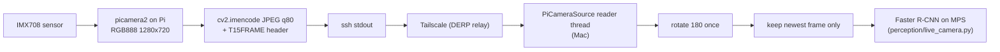
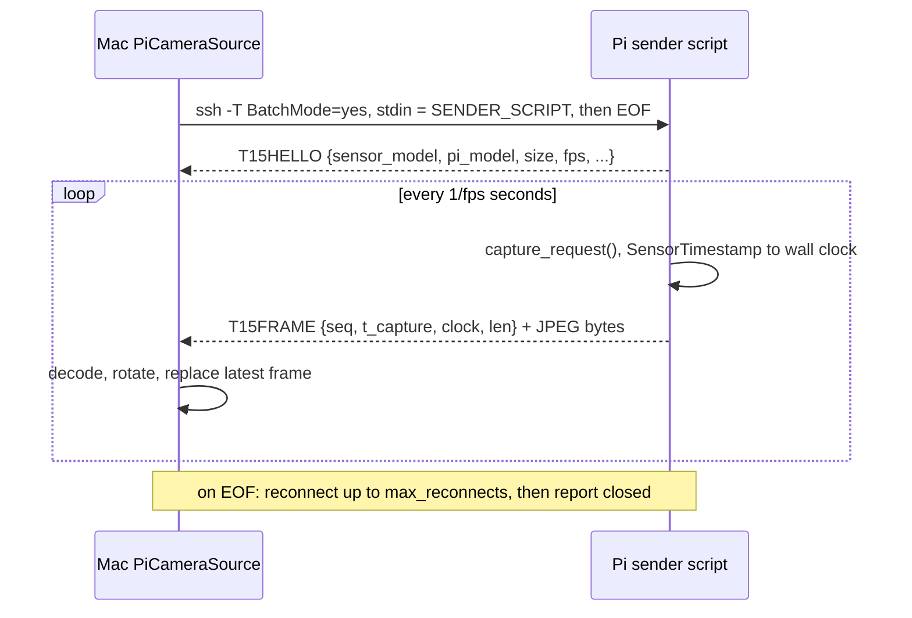

# 02 — Raspberry Pi 5 + IMX708 setup and Pi→Mac camera transport

The robot's eye is a Sony IMX708 camera on a Raspberry Pi 5 (16 GB). The Pi does not run the person detector. It captures frames with **picamera2** and stamps each one with its sensor capture time. It JPEG-encodes them and writes them to the standard output of an SSH session that the Mac opened. On the Mac, `perception/pi_source.py` decodes the frames and rotates them once. It then hands them to the Faster R-CNN detector ([04 Camera perception](04_CAMERA_PERCEPTION.md)). **Nothing is installed or written on the Pi.** The sender script is fed through SSH standard input and runs only in memory. This document covers the hardware and software on the Pi, the transport, the health checks we used, and the power and connectivity failures we actually saw.

**Status:** Hardware-verified for capture and transport (REAL HARDWARE, 2026-11-07/08: Pi 5 + IMX708 → SSH over Tailscale → Mac, ~4.7–5.0 processed fps, median capture→Mac delay 0.19–0.31 s). Not tested: battery endurance beyond 20–90 s camera runs, a direct (non-relayed) Tailscale path, and detection on the Pi's Hailo-8.

**Related:** [04 Camera perception](04_CAMERA_PERCEPTION.md) · [Pi camera contract](../contracts/PI_CAMERA_CONTRACT.md) · [Sighting format](../perception/SIGHTING_FORMAT.md) · [Camera-mapping demo](camera_mapping/DEMO.md) · [Judge demo](camera_mapping/JUDGE_DEMO.md) · [16 Dashboard](16_DASHBOARD.md) · experiment reports [CAM-15 transport and first end-to-end](experiments/reports/CAM-15-pi-transport-and-first-e2e.md), [CAM-20 orientation check](experiments/reports/CAM-20-pi-orientation-check.md), [CAM-23 live person poses](experiments/reports/CAM-23-pi-live-person-poses.md), [CAM-24 live empty and object scenes](experiments/reports/CAM-24-pi-live-empty-and-object.md)

> **Where the evidence lives.** `$TEAM15_EVIDENCE` is the local evidence store on the operator's Mac (`~/Team15_evidence`). It holds JSON/JSONL summaries, frame logs and images. It is **private and not in Git**, because many frames show people. `$PI_HANDOFF` is a second private folder with the Mac↔Pi session handoff notes and a read-only health script. "Session console log" means the engineering console transcript of the Claude Code sessions that ran the hardware. Raw files that existed only on the Pi are known only from those logs.

---

## 1. Problem

The detector (Faster R-CNN ResNet-50 FPN v2) needs PyTorch and about 160–200 ms of Apple-GPU (MPS) time per 720p frame (CAM-01, CAM-27). The Pi has no PyTorch installed, and its Hailo-8 accelerator does not run our model. We therefore needed to:

1. get frames from the IMX708 on the robot to the Mac with low, *measured* delay;
2. keep the **true capture time** of each frame, so that a sighting's `obs_time` is when the photo was taken, not when it reached the Mac;
3. avoid installing services on a shared Pi, and never weaken SSH security;
4. survive Wi-Fi hiccups without stalling the detector behind a backlog.

## 2. Why this technology

| Option considered | What happened / why not |
|---|---|
| `rpicam-vid --listen -o tcp://…` (H.264 over TCP), read with `cv2.VideoCapture` | Proposed on 2026-11-07 (session console log, 20:50 UTC). Not used: the venue Wi-Fi isolates clients, so the Mac could not open a TCP port on the Pi. H.264 also hides per-frame capture times. |
| MJPEG HTTP server on the Pi | Needs a long-running server installed on the Pi, and the network still blocked direct connections. |
| Detect on the Pi's Hailo-8 (YOLOv8s HEF models are installed there) and send only sightings | Listed as a fallback (session console log, 22:15 UTC). **NOT TESTED.** It would be a different detector family with different accuracy. |
| **JPEG frames over an SSH session the Mac opens, through Tailscale** | **Chosen.** SSH was already reachable over Tailscale, which works through the venue's client isolation by relaying. Each frame carries its own header with the sensor timestamp. Nothing is installed on the Pi. A stdin-fed script leaves no files. |

## 3. Concept



The Mac runs `ssh -T -o BatchMode=yes … $PI_HOST python3 -u - W H FPS Q`. It writes the sender script (`SENDER_SCRIPT` in `perception/pi_source.py`) to that process's stdin and then closes stdin. On the Pi, `python3 -` reads the script and runs it. The script writes a binary-safe stream to stdout:

```text
T15HELLO {json}\n                        once: sensor model, Pi model, size, fps, mount rotation, transform
T15FRAME {json}\n<len bytes of JPEG>     per frame: seq, t_capture, clock, len, exposure_us, analogue_gain, lux
```



## 4. Math: timestamps, delay and bandwidth

**Mapping the sensor clock to wall time.** picamera2 reports `SensorTimestamp` in nanoseconds on the kernel's `CLOCK_MONOTONIC` clock. The sender estimates the offset between that clock and wall time:

$$\text{off} = \frac{a + c}{2} - b,\qquad a = \texttt{time()},\ b = \texttt{monotonic()},\ c = \texttt{time()}$$

It takes the tightest of 5 samples (smallest $c-a$), so the offset error is at most $(c-a)/2$, typically microseconds. It re-estimates every 50 frames. Then

$$t_\text{capture} = \frac{\texttt{SensorTimestamp}}{10^9} + \text{off}.$$

If the mapped time is more than 5 s from the Pi's current wall time, or there is no sensor timestamp, the sender falls back to the wall time at request and labels the clock `pi_wall_at_request` instead of `sensor`.

**Capture→Mac delay.** `capture_to_rx_s = rx_time − t_capture`, with `rx_time` taken on the Mac's clock. This compares two clocks, so the figure includes the Pi–Mac clock offset. Both are NTP-synchronised. On 2026-11-07 they agreed to within the SSH round trip, about 0.19 s (session console log, 23:08 UTC). Read sub-100 ms differences between runs with that in mind.

**Bandwidth.** A 1280×720 JPEG at quality 80 measured about 1.4 Mbit/s at 4.86 fps (session console log, 2026-11-07 22:15 UTC), so about 36 KB per frame. The Tailscale relay sustained about 7 Mbit/s, which leaves headroom.

**Frame-rate ceiling.** With one detector call of ~200 ms per frame, the processed rate is bounded by $\min(f_\text{Pi}, 1/t_\text{detect}) \approx \min(5, 5)$ fps. That matches the 4.7–5.0 fps we measured (see §14). Because only the newest frame is kept, a slow detector drops frames (`frames_dropped_stale`) instead of accumulating latency.

## 5. Implementation in the repo

- `perception/pi_source.py`: everything about the Pi stream. That is the sender script, the SSH command builder, the stream parser and the `cv2.VideoCapture`-like reader. Sender and receiver live in one file, so the wire format cannot drift. The format is private to this file and not part of any contract ([PI_CAMERA_CONTRACT.md](../contracts/PI_CAMERA_CONTRACT.md) §1).
- `perception/live_camera.py`: `--source pi` and the `--pi-*` flags; `open_source()` wraps `open_pi_camera()`.
- `perception/orientation_check.py`: grabs one frame with rotation 0 and writes rot0/rot180/compare images and a JSON report. It writes outside Git and never overwrites files.
- `camera_mapping/live.py`: the camera-mapping runner reuses `open_pi_camera()` for `--source pi`. See [06 Obstacle mapping](06_OBSTACLE_MAPPING.md).
- `scripts/camera_demo.sh`: the one-command judge demo. It checks `ssh $PI_HOST true` and checks that no `picamera2`/`rpicam-` process is already using the camera, then starts the dashboard and camera runner ([JUDGE_DEMO.md](camera_mapping/JUDGE_DEMO.md)).

## 6. Key files, symbols and interfaces

| Symbol | File | Role |
|---|---|---|
| `SENDER_SCRIPT` | `perception/pi_source.py` | Runs on the Pi from stdin. picamera2 `create_video_configuration(main={"size": (w,h), "format": "RGB888"}, buffer_count=4, controls={"FrameDurationLimits": …})` |
| `build_ssh_command()` | same | `ssh -T -o BatchMode=yes -o ConnectTimeout=… -o ServerAliveInterval=5 -o ServerAliveCountMax=3 [-i key -o IdentitiesOnly=yes] [-p port] target python3 -u - W H FPS Q`. Never adds `StrictHostKeyChecking=no`. |
| `read_message()` | same | Parses one HELLO/FRAME message. Raises `EOFError` at end of stream and `_BadStream` on malformed input, which the caller skips. |
| `PiCameraSource` | same | `start()`, `read(timeout_s)`, `release()`, `isOpened()`, `wait_first_frame()`, `camera_info()`, `stats` |
| `open_pi_camera()` | same | Start, wait up to `startup_timeout_s` (default 30 s) for the first frame, else raise `PiSourceError` |
| `DEFAULT_PI_ROTATION = 180` | same | Verified upright on the wheeled-robot mount, 2026-11-07 (CAM-20) |
| `ENV_HOST`, `ENV_USER`, `ENV_KEY` | same | `TEAM15_PI_HOST`, `TEAM15_PI_USER`, `TEAM15_PI_KEY` |
| `MAX_HEADER_BYTES = 4096`, `MAX_JPEG_BYTES = 8 MiB` | same | Bounds that stop a corrupt header from allocating unbounded memory |

## 7. Inputs and outputs

- **Inputs:** a Pi host (`--pi-host` or `$TEAM15_PI_HOST`), optional user and key, `--pi-size` (default 1280x720, range 64–4608 × 64–2592), `--pi-fps` (default 5), `--pi-quality` (default 80), `--pi-rotation` ∈ {0, 90, 180, 270} (default 180), `--pi-startup-timeout-s` (default 30).
- **Outputs:** BGR frames (NumPy arrays) via `read()`, plus `last_capture_time`, `last_rx_time`, `last_header`. `camera_info()` returns the `evidence.camera` provenance object ([04 §8](04_CAMERA_PERCEPTION.md#8-data-structures-and-schemas)).
- **Run statistics** (`stats`, copied into each run summary as `pi_stream`): `frames_received`, `frames_delivered`, `frames_dropped_stale`, `malformed`, `decode_failures`, `reconnects`.

## 8. Data structures

The HELLO and FRAME headers are shown in §3. The `evidence.camera` object recorded for a real Pi sighting looks like this. These are real values from `$TEAM15_EVIDENCE/camera_live_test/person-20261108T024843/D1-b1794124127-person_summary.json`, with the capture times shortened:

```json
{"source": "pi5-imx708", "device": "Raspberry Pi camera (remote, bench)",
 "pi_model": "Raspberry Pi 5 Model B Rev 1.1", "sensor_model": "imx708",
 "transport": "ssh-jpeg", "stream_size": [1280, 720], "stream_fps": 5.0, "jpeg_quality": 80,
 "rotation_deg": 180, "rotation_applied_by": "receiver", "sensor_mount_rotation": 180,
 "pi_transform": "<libcamera.Transform 'identity'>", "capture_clock": "sensor",
 "pi_frame_seq": 5, "capture_to_rx_s": 0.184}
```

`source` is built from what the Pi reports at connect time ("Raspberry Pi 5" in `/proc/device-tree/model` → `pi5`, sensor model → `imx708`). It is not hard-coded.

## 9. Configuration

| Item | Where | Value used in our runs |
|---|---|---|
| Pi OS | Pi | Debian 13 (trixie), kernel 6.18 rpt (from the handoff note, 2026-11-08) |
| Python on Pi | Pi system `python3` | picamera2 (present), OpenCV 4.10.0, NumPy 2.2.4, hailo_platform 4.23.0; **no torch** (session console log, 2026-11-07 22:11 UTC) |
| Python on Mac | Mac | Python 3.13, torch 2.12.0, torchvision 0.27.0, OpenCV 4.13.0 (checked during this audit, 2026-11-08). Weights are cached in `~/.cache/torch/hub/checkpoints/`, outside Git. |
| Stream | CLI | 1280×720, 5 fps, JPEG q80, rotation 180 |
| SSH | `~/.ssh/config` on the Mac (an alias for `$PI_HOST`), key via `$TEAM15_PI_KEY` | BatchMode, host key already trusted |
| Network | Tailscale on both machines | Relayed through a Tailscale DERP relay, not a direct path, because the venue Wi-Fi isolates clients |

**Required vs optional**

| Component | Required? | Notes |
|---|---|---|
| Pi 5 + IMX708 + ribbon | Required for live capture | `--source local` (the Mac camera) and the recorded-frame replay in `camera_mapping` need neither |
| picamera2 + OpenCV on the Pi | Required | Already in Raspberry Pi OS; nothing was installed |
| SSH reachable from the Mac, with the host key pre-trusted | Required | BatchMode fails instead of prompting |
| Tailscale | Required on the venue network (client isolation) | Optional on a network that allows direct LAN SSH |
| A 5 V / 5 A supply (the official 27 W adapter was used) | Required for reliable operation | See §12. Weaker supplies caused dropouts. |
| Hailo-8 HAT | Optional, unused by our pipeline | Detected (`/dev/hailo0`), firmware 4.23.0 |
| `rpicam-*` tools | Optional | Used only for inspection (`rpicam-hello --list-cameras`) and one power-load test (`rpicam-vid`) |
| Mac with MPS, torch, torchvision, OpenCV | Required for detection | CPU-only works but is slower: 902 ms/frame on a synthetic input (CAM-01) |

## 10. Dependencies

Pi: `picamera2`, `libcamera`, `cv2`, `json`, Python 3 standard library. Mac: `cv2`, `numpy`, the `ssh` client, and `torch`/`torchvision` for the detector. The transport itself needs only OpenCV and NumPy on the Mac. CI runs `perception/tests` without torch (`.github/workflows/perception.yml`).

## 11. Execution flow

1. `open_pi_camera()` builds the SSH argv and spawns it with stdin, stdout and stderr as pipes. It writes `SENDER_SCRIPT` to stdin and closes stdin.
2. A daemon thread drains stderr into `stderr_tail` (last 20 lines) and logs each line as `[pi] …`.
3. The reader thread (`_run` → `_pump`) loops on `read_message()`. HELLO is stored in `hello`. Each FRAME is decoded with `cv2.imdecode`, rotated once with `rotate()`, and **replaces** `_latest`. If the previous frame was never delivered, it counts in `frames_dropped_stale`.
4. `read()` waits on a condition variable for a frame newer than the last one delivered. A local counter, not the Pi's `seq`, decides "new", because `seq` restarts at 1 after a reconnect.
5. On EOF the thread stops ssh and backs off for `min(2·attempt, 6)` s, then respawns, up to `max_reconnects` (default 3). A connection that streamed for 30 s or more (`STABLE_S`) earns a fresh budget. After that the source reports closed, and `live_camera` exits with code 3.

## 12. Error handling, and the power and connectivity issues we actually saw

| Situation | What the code does |
|---|---|
| No camera on the Pi | The sender writes `T15ERR no camera detected by libcamera` to stderr and exits 4. The Mac reports `PiSourceError` with the stderr tail. |
| Unknown host key, no key, auth failure | `BatchMode=yes`: ssh fails immediately, with no prompt. The source raises an error and the CLI exits 3 with a hint to `ssh` once by hand. |
| Malformed header or truncated JPEG | Skipped and counted (`malformed`, `decode_failures`). The parser resynchronises on the next tag. |
| No frame for 60 s during a run | `live_camera` stops with exit code 3 (`PI_STALL_S = 60`). |
| Camera already in use | `scripts/camera_demo.sh` refuses to start and kills nothing. |

**Observed incidents** (all REAL HARDWARE; times UTC unless marked):

| When | Symptom | Evidence | Cause | Outcome |
|---|---|---|---|---|
| 2026-11-07 20:09 and 20:50 | Pi unreachable over the venue Wi-Fi: ping 100% loss, port 22 silent, no ARP entry. About 44 other ARP-listed devices also failed to answer. | Session console log | **Client isolation** on the venue Wi-Fi (most likely; it fits every observation) | Fixed by joining both machines to Tailscale; SSH then worked through a DERP relay |
| 2026-11-07 22:15 | Tailscale path relayed, not direct: 78–177 ms round trip, ~7 Mbit/s | Session console log (dashboard-integration session) | Same isolation: no direct peer-to-peer path | Accepted. It adds ~0.1–0.2 s to each frame's delay. |
| 2026-11-07 ~23:00–23:07 | Pi offline on Tailscale after being moved onto the wheeled robot and its power source | Session console log | **Power**, most likely. The robot-side supply was suspected of not meeting 5 V / 5 A. Not measured. | Back online at 23:08 after the CanaKit wall adapter was reconnected; `throttled=0x0`, EXT5V 5.18 V |
| 2026-11-08 00:52–00:53 | Load test: `rpicam-vid` 640×480 at 30 fps for 60 s, nothing written to disk | Robotics session report relayed in the session console log | — | `throttled=0x0` in all 35 samples; EXT5V 5.139–5.198 V; 43.3–46.6 °C. A first attempt exited at once (libav could not infer a format for `/dev/null`). |
| 2026-11-08 07:08–08:07 | Seven 20 s camera runs on a **portable power supply** | `pi_health.jsonl` + `run_report.json` per run in `$TEAM15_EVIDENCE/camera_live_test/` | — | `throttled=0x0` in every sample; EXT5V 5.187–5.285 V; 46.1–50.5 °C; max 902 MB RAM used |
| 2026-11-08 ~06:37–06:44 local (EST) | Pi offline; after it came back, it reported only 3000 mA supply current available (5000 mA on the wall supply) | Rover-navigation session console log | The Pi's USB-C was apparently fed from a USB-C hub on a power bank (from a photo). **Inferred, not measured.** | Rebooted at ~06:44 local; `throttled=0x0` after reboot |
| 2026-11-08 (this audit) | Pi unreachable: Tailscale SSH timeout | Coordinator brief | Unknown | No hardware commands were run for this documentation |

**Lesson:** the Pi 5 with camera and Hailo HAT needs a supply that negotiates 5 A. Check `max_current` (5000 mA expected) and `get_throttled` before any camera run. Software tweaks such as `usb_max_current_enable` are not a fix, and the handoff note forbids them.

## 13. Safety and security

- **No weakened SSH.** `build_ssh_command()` always sets `BatchMode=yes` and never disables host-key checking. `perception/tests/test_pi_source.py::test_ssh_command_is_batch_mode_and_never_weakens_host_keys` checks this.
- **Nothing persists on the Pi.** The script runs from stdin. `LIBCAMERA_LOG_LEVELS` is set for that process only.
- **No credentials in the repo.** Host, user and key come from flags or environment variables. Documentation uses `$PI_HOST`. (Older commits contain real addresses; commit `b0f30db` redacted the current docs, but Git history still holds the old values.)
- **Images of people stay off the Pi and out of Git.** Evidence is written on the Mac, and `ensure_evidence_dir()` refuses any directory inside a Git work tree.
- **One camera user at a time.** libcamera allows a single owner. The demo script checks for an existing camera process and refuses to start; it never kills it.
- **The camera has no motor authority.** Nothing in `perception/` talks to the rover ([17 Safety architecture](17_SAFETY_ARCHITECTURE.md)).

## 14. Tests and observed results

**Automated tests (MOCKED Pi).** `perception/tests/test_pi_source.py` runs a fake sender that writes the same HELLO/FRAME stream. It covers: capture time preserved (not arrival time), rotation applied on arrival, newest-only with no repeats, malformed and truncated frames, the reconnect budget, ssh failure stderr, BatchMode, and an end-to-end `live_camera --source pi` run. `tests/e2e/test_pi_camera_integration.py` (11 tests) drives the real `live_camera --source pi` code through `core.camera_bridge` into the dashboard store, using upside-down fake frames. During this audit (2026-11-08, macOS, Python 3.13), `python3 -B -m pytest -q -p no:cacheprovider perception/tests` gave **39 passed**. These tests prove the transport logic and nothing about image quality or real network behaviour.

**Real-hardware transport results** (REAL HARDWARE, Pi 5 + IMX708 → Tailscale relay → Mac, 1280×720 @ 5 fps requested, q80):

| ID | Date (UTC) | Frames | Processed fps | Capture→Mac median / max (s) | Stale drops | Malformed / reconnects | Evidence |
|---|---|---|---|---|---|---|---|
| CAM-15 | 2026-11-07 22:15 | 40/40 | 4.86 (transport only) | 0.256 mean / 0.460 | — | — | session console log only |
| CAM-16 | 2026-11-07 ~22:40 | — | 5.17 (stream only) | 0.201 / 0.411 | — | — | session console log only |
| CAM-18 | 2026-11-07 22:28 | 448 | 4.97 | 0.218 / 0.388 (from frame log) | 3 | 0 / 0 | `D1-b1794090489-pi-e2e_summary.json` |
| CAM-19 | 2026-11-07 ~22:47 | 88 | 4.36 (after warm-up fix) | 0.192 / 0.582 (stage timing) | — | — | session console log only |
| CAM-23 | 2026-11-08 07:08 | 96 | 4.75 | 0.290 / 0.386 | 7 | 0 / 0 | `run_annotation.json` |
| CAM-24 | 2026-11-08 07:25 | 101 | 5.01 (object runner) | 0.189 / 0.275 | 1 | 0 / 0 | `run_report.json` |
| CAM-25 | 2026-11-08 07:28 | 96 | 4.76 | 0.307 / 0.421 | 6 | 0 / 0 | `run_report.json` |
| CAM-27 | 2026-11-08 07:48 | 94 | 4.68 | 0.296 / 0.435 | 7 | 0 / 0 | `run_annotation.json` |
| CAM-28 | 2026-11-08 07:59 | 94 | 4.69 | 0.293 / 0.387 | 8 | 0 / 0 | `run_annotation.json` |
| CAM-29 | 2026-11-08 08:07 | 94 | 4.66 | 0.264 / 0.410 | 9 | 0 / 0 | `run_annotation.json` |

Across all logged Pi runs there were **0 malformed frames, 0 decode failures and 0 reconnects**. Every run was 20–90 s long, so long-run stability is **NOT MEASURED**.

## 15. Limitations

- The transport has run only through a Tailscale **relay**. A direct path is NOT TESTED.
- The longest logged Pi stream is 90 s (CAM-18). Endurance on battery is NOT MEASURED.
- Pi CPU load and Wi-Fi signal during streaming were NOT MEASURED (the handoff recorded −46 dBm at idle on 2026-11-07).
- JPEG q80 is lossy. The PNG saved as evidence is the *decoded* JPEG, not the raw sensor image.
- `capture_to_rx_s` includes the Pi–Mac clock offset (±~0.1–0.2 s).
- Exposure is left to libcamera auto-exposure. One check before the robot mount found nearly black frames (mean ≈16/255, exposure at its 66.7 ms cap), probably a covered or obstructed lens (CAM-19). Low-light behaviour is NOT TESTED.
- Physical camera aim and tilt were fixed by hand. There is no measured mount pose, so all camera distances are **UNCALIBRATED** ([05 Depth and distance](05_DEPTH_AND_DISTANCE_ESTIMATION.md)).

## 16. How to reproduce

These commands exist at `d1b607a` (checked against `--help`). Use your own `$PI_HOST`, and make sure the host key is already trusted (`ssh $PI_HOST true` once by hand).

```bash
# Read-only health check on the Pi (no camera use)
ssh -o BatchMode=yes -o ConnectTimeout=10 "$PI_HOST" \
  'cat /proc/device-tree/model; echo; vcgencmd get_throttled; vcgencmd measure_temp; \
   vcgencmd pmic_read_adc EXT5V_V; rpicam-hello --list-cameras -t 1 2>&1 | sed -n 3p'

# Orientation check after any remount (keep people out of frame)
python3 -m perception.orientation_check --pi-host "$PI_HOST" --out-dir "$TEAM15_EVIDENCE/orientation_checks"

# Live person detector on the Pi stream (consenting people only)
export TEAM15_PI_HOST="$PI_HOST"
python3 -B -m perception.live_camera --source pi --sector G --duration-s 30 \
  --out-dir "$TEAM15_EVIDENCE/camera"
```

`get_throttled` bits: `0x1` under-voltage now, `0x2` ARM frequency capped, `0x4` throttled, `0x8` soft temperature limit. The same bits shifted left by 16 (`0x10000`, …) mean "has occurred since boot". **Stop if the value is anything other than `0x0`.** The fuller read-only script we used (`$PI_HANDOFF/pi_health.sh`) is not in the repo. It also prints `max_current` from the device tree, kernel under-voltage messages, the network state and USB devices from sysfs, without opening serial ports.

## 17. How to extend

- **Direct path:** move both machines onto a network without client isolation and compare `capture_to_rx_s`. Report it as a separate run.
- **Hardware timestamps end to end:** the sensor clock is already used. Measuring the Pi–Mac clock offset per run (for example with `chronyc tracking` on both machines) would make the delay figures absolute.
- **Hailo-8:** a Pi-side detector should emit its own `detector` / `detector_family` labels and must not reuse `PERSON_DETECTOR` until it has been validated separately.
- **Lower bandwidth:** reduce `--pi-size` or `--pi-quality`, and re-measure detection, because the detector's accuracy depends on resolution.
