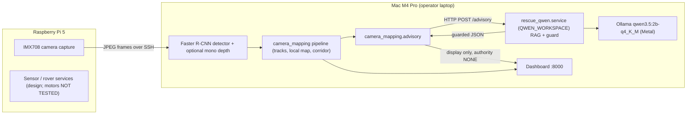
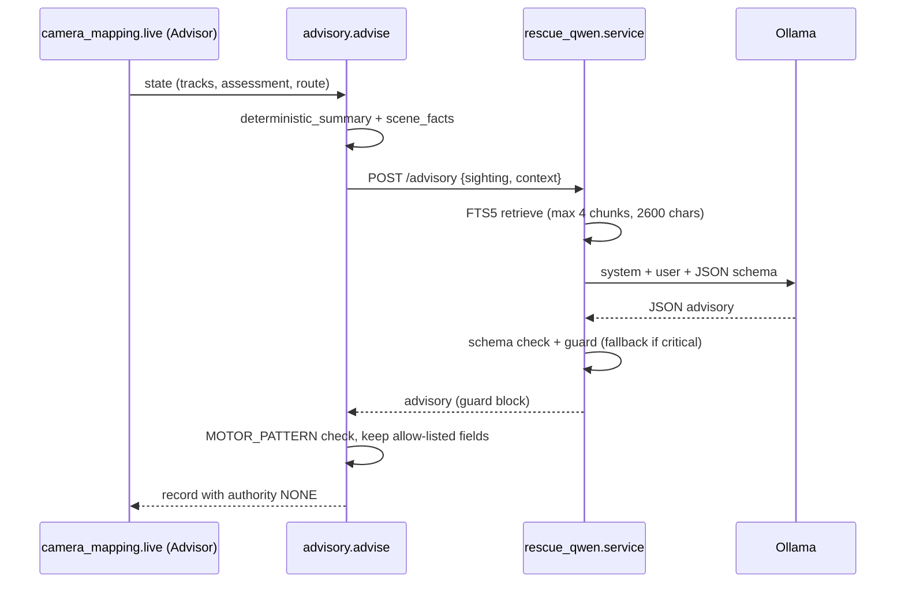

# 03 Mac AI inference

All of Team-15's neural inference runs on the operator's Apple Silicon Mac (an M4 Pro with 24 GB of unified memory). That covers the Faster R-CNN person and obstacle detector, optional monocular depth, and the Qwen3.5-2B advisory model. The Raspberry Pi 5 captures camera frames and, in the rover design, would host sensor and motor services. This document explains why the work is split that way. It covers the runtimes we tried for Qwen (Ollama with Metal, Hugging Face transformers on MPS, and llama.cpp on the Pi CPU), what we measured on each, and how `camera_mapping/qwen_launcher.py` connects the camera demo to the Qwen service.

**Status:** Implemented. Mac inference was measured on real hardware (Ollama, transformers/MPS). We also measured Qwen inference on the Pi 5 (llama.cpp) on real hardware, but it is **not used** because it is too slow. MLX was **not used** anywhere.

**Related:** [08 Qwen model](08_QWEN_MODEL.md) · [09 LoRA training](09_LORA_TRAINING.md) · [10 RAG pipeline](10_RAG_PIPELINE.md) · [11 AI agent and tools](11_AI_AGENT_AND_TOOLS.md) · [02 Raspberry Pi setup](02_RASPBERRY_PI_SETUP.md) · [04 Camera perception](04_CAMERA_PERCEPTION.md) · [camera_mapping EVALUATION](camera_mapping/EVALUATION.md) · [Runtime benchmark report](experiments/reports/QWN-004-runtime-benchmarks-mac-pi.md)

> **Evidence locations.** `$QWEN_WORKSPACE` is the private Qwen workspace, a separate local Git repository that is **not** part of this repo. `$TEAM15_EVIDENCE` is the local camera evidence store. Neither is published. When this document cites a file there, it gives the file name and, for key results, its SHA-256.

---

## 1. Problem

A rescue rover needs three kinds of computation:

1. **Perception.** Find people and obstacles in camera frames.
2. **Explanation.** Turn structured facts into short, cited, operator-readable advice.
3. **Control.** Read sensors and command motors under hard real-time limits.

The first two are neural workloads that need many GFLOPs per frame or token. The third must be deterministic, small and fail-closed. Running all three on a Raspberry Pi 5 CPU would starve the control loop. It would also make each Qwen advisory take close to a minute (see §14).

## 2. Why this technology

| Option | What it gives | Why we chose or rejected it |
|---|---|---|
| **Mac M4 Pro, Ollama 0.40.2 (Metal GPU), Q4_K_M GGUF** | about 1.7 s per RAG advisory, 2.2 GiB resident memory, JSON-schema-constrained decoding | **Chosen** for the live advisory. It was already installed, it is fast, and its grammar-constrained output parses every time |
| Mac M4 Pro, Hugging Face transformers 5.22.2, bf16 on MPS | The only runtime here that can load a PEFT LoRA adapter | **Used for LoRA training and comparisons only**. It is slower (about 4 s per tool step for the base model) and uses 5–10 GB, with no grammar |
| Raspberry Pi 5 16 GB, llama.cpp CPU (3 threads) | Runs Qwen3.5-2B multimodal correctly on the robot | **Rejected for interactive use**: 47.6 s median per RAG advisory (n=3) |
| Pi AI HAT (Hailo-8) | NPU for vision models | **Not used for Qwen**. The vendor documentation, as recorded in `$QWEN_WORKSPACE/docs/QWEN_DEPLOYMENT.md`, says Hailo-8/8L do not support LLMs |
| MLX | Apple-native ML framework | **Not used.** No code or log in `$QWEN_WORKSPACE` refers to it |

## 3. Concept: where the time goes in LLM inference

Generating text with a decoder-only model has two phases:

- **Prefill (prompt processing).** All prompt tokens go through the network in parallel. This is compute-bound. A RAG advisory prompt is about 2,000 tokens (`prompt_tokens: 1965` in the Pi benchmark JSON).
- **Decode.** Output tokens are produced one at a time. Each one needs every weight to be read from memory once, so decode is **memory-bandwidth-bound**.

A rough model: for a model with *P* parameters stored at *b* bytes each, on a device with memory bandwidth *B*,

$$t_{\text{token}} \gtrsim \frac{P \cdot b}{B}$$

Qwen3.5-2B has about 2.2 B parameters. At Q4_K_M (about 4.5 bits per weight) the weights are about 1.2 GB (the Ollama pull log shows a 1.2 GB layer). So decode speed depends mostly on how fast the device can stream 1.2 GB. Apple Silicon's unified memory and GPU stream it far faster than four Cortex-A76 cores. That is why we measured 123–126 tok/s decode on the Mac and 8.3 tok/s on the Pi (§14).

Quantization (bf16 → Q4) cuts *b* roughly fourfold. That speeds up decode and saves memory, at some accuracy cost. We did **not** isolate that cost (see [QWN-018](experiments/reports/QWN-018-runtime-comparison-audit.md)).

## 4. Math: the latency budget

An advisory with about 2,000 prompt tokens and about 130–350 output tokens costs approximately

$$T \approx \frac{N_\text{prompt}}{r_\text{prefill}} + \frac{N_\text{out}}{r_\text{decode}}$$

Pi measurement (3 threads): prefill about 40 tok/s and decode about 8.3 tok/s. That gives about 1965/40 ≈ 49 s of prefill alone, consistent with the measured 47.6 s median. The Mac with Ollama measured 1.7 s median. Prompt caching in Ollama makes its prefill rate unreliable, so we only report end-to-end latency for the Mac.

## 5. Implementation in this repo

Only the **integration glue** is in this repository. The Qwen service, RAG index, guard and model servers live in `$QWEN_WORKSPACE`.

| In this repo | What it does |
|---|---|
| `camera_mapping/qwen_launcher.py` | Starts `rescue_qwen.service` from `$QWEN_WORKSPACE` with an Ollama backend, after patching `sqlite3.connect` to `check_same_thread=False`. It refuses to run unless `sqlite3.threadsafety == 3` |
| `camera_mapping/advisory.py` | Builds the timestamped evidence packet, calls the service over HTTP (`http_qwen`) and discards motor-like text (`MOTOR_PATTERN`). It always produces a deterministic summary (`deterministic_summary`) |
| `camera_mapping/live.py` | The camera runner. `--qwen-url` enables the advisor, and `--advise-every-s` (default 10 s) sets its cadence |
| `scripts/camera_demo.sh` | The one-command demo: it starts the dashboard, the Qwen launcher (unless `--no-qwen`) and the camera runner |
| `qwen_advisory/client.py` | A stdlib-only LiDAR advisory client (`lidar_advisory`, `http_model`) with an 8 s timeout and deterministic fallback |

### Why the launcher exists

`rescue_qwen.service.create_app` builds an in-memory SQLite FTS5 index in the main thread. FastAPI runs synchronous endpoints in worker threads, and Python's `sqlite3` refuses to use a connection from another thread by default. Every `C_QWEN_RAG` request therefore failed with `sqlite3.ProgrammingError` (HTTP 500). This was observed on 2026-11-08 and recorded in the `camera_mapping/qwen_launcher.py` docstring and [camera_mapping EVALUATION §6](camera_mapping/EVALUATION.md#6-qwen-advisory-real-calls).

The launcher works around it without modifying `$QWEN_WORKSPACE`. This is safe only because:

1. the index is read-only after it is built; and
2. the interpreter's SQLite is compiled in serialized mode (`sqlite3.threadsafety == 3`). The launcher checks this and exits with status 2 otherwise.

The proper fix (one connection per thread, or a read-only connection pool) belongs in the Qwen workspace and is **not done**.

## 6. Key files, symbols and interfaces

- `camera_mapping/qwen_launcher.py`, `main()`. Flags: `--qwen-root`, `--host` (127.0.0.1), `--port` (8090), `--config` {`A_DETERMINISTIC`, `B_QWEN_BASE`, `C_QWEN_RAG`} (default `C_QWEN_RAG`), `--model` (`qwen3.5:2b-q4_K_M`), `--ollama-url` (`http://127.0.0.1:11434`), `--timeout-s` (15).
- `camera_mapping/advisory.py`: `advise(state, qwen=None, question=None)`, `http_qwen(url, timeout_s=10.0)`, `scene_facts`, `deterministic_summary`, `person_sighting`, `MOTOR_PATTERN`.
- HTTP: `POST /advisory` (schema `rescue-advisory/0.1`, defined in `$QWEN_WORKSPACE/rescue_qwen/schema.py`) and `GET /health`, which returns `advisory_only: true`.

## 7. Inputs and outputs

- **Input to the service:** `{sighting, context}`. `sighting` is the strongest VALID person track, shaped by `person_sighting`. `context` carries `scene_notes` (each fact prefixed with its id and timestamp), `question`, `robot_motion: "STOPPED"`, `platform_type: "UGV_GROUND_ROBOT"` and `camera_calibration`.
- **Output:** a `team15.camera_rescue_advisory/1` record with `advisory_only: true`, `authority: "NONE"`, a `deterministic` summary, the `evidence` list, optional `qwen` fields, and `qwen_status`. `qwen_status` is one of `NOT_CONFIGURED`, `UNAVAILABLE (...)`, `INVALID_RESPONSE`, `DISCARDED_MOTOR_COMMAND_PATTERN`, `QWEN_FELL_BACK_TO_DETERMINISTIC`, `DETERMINISTIC_SERVICE` or `QWEN_GUARDED`.

## 8. What the Pi does and what the Mac does



| Task | Host | Evidence |
|---|---|---|
| Camera capture (IMX708) | Pi 5 | [02 Raspberry Pi setup](02_RASPBERRY_PI_SETUP.md), [camera_mapping EVALUATION](camera_mapping/EVALUATION.md) |
| Person/obstacle detection, mono depth | Mac | [04 Camera perception](04_CAMERA_PERCEPTION.md) |
| Qwen advisory (live demo) | Mac, Ollama | §14 |
| Qwen LoRA training and adapter evaluation | Mac, transformers on MPS | [09 LoRA training](09_LORA_TRAINING.md) |
| Qwen on the Pi | Measured once (llama.cpp); **not used** | [QWN-004](experiments/reports/QWN-004-runtime-benchmarks-mac-pi.md) |
| Motor control | Pi → USB → M5StickC (design). Real wheel motion **NOT TESTED** | [17 Safety architecture](17_SAFETY_ARCHITECTURE.md) |

## 9. Configuration

- Ollama model tag `qwen3.5:2b-q4_K_M` (4-bit). The default tag `qwen3.5:2b` is mxfp8.
- Service timeouts: `rescue_qwen.service` default `--timeout-s 8`; the launcher passes 15 s; `camera_mapping.advisory.http_qwen` waits 10 s.
- Decoding (Ollama backend, `$QWEN_WORKSPACE/rescue_qwen/llm/backend.py`, class `OllamaBackend`): `temperature 0`, `seed 7`, `think: false`, `num_ctx 8192`, and `format` = JSON schema when one is given (grammar-constrained).
- Decoding (HF backend, `$QWEN_WORKSPACE/rescue_qwen/llm/hf_backend.py`, class `HFBackend`): greedy, `enable_thinking=False`, **no grammar**, model `Qwen/Qwen3.5-2B` at revision `15852e8c16360a2fea060d615a32b45270f8a8fc`.

## 10. Dependencies

- Mac: Ollama 0.40.2; Python with `fastapi`, `uvicorn` and `jsonschema` (imported by `rescue_qwen`); stdlib `sqlite3` with FTS5.
- LoRA runtime (separate virtual environment in `$QWEN_WORKSPACE`): torch 2.12.0 (MPS), transformers 5.22.2, peft 0.21.2.
- Nothing in this repo's `requirements.txt` was changed for Qwen. `qwen_advisory/` is stdlib only.

## 11. Execution flow



## 12. Error handling

- An Ollama outage, timeout or any exception sets `qwen_status = "UNAVAILABLE (<ExceptionName>)"`. The deterministic summary is still shown (`advise`). `scripts/camera_demo.sh` checks Ollama before it starts and falls back to deterministic-only if Ollama is down.
- A non-dict response gives `INVALID_RESPONSE`.
- Motor-like text gives `DISCARDED_MOTOR_COMMAND_PATTERN`, and none of the Qwen fields are kept.
- Operational risk seen on 2026-11-07: the Ollama desktop app quit cleanly twice (18:04 and 18:27 ET), cause unidentified. Every in-flight request fell back. One v0.1 train-split evaluation run was invalidated by this ([QWN-001](experiments/reports/QWN-001-v01-frozen-eval-ollama.md)).

## 13. Safety and security

- The service binds to `127.0.0.1` by default.
- Qwen output never reaches the map, the assessment or any rover interface. `camera_mapping/tests/test_advisory_rover_dashboard.py` checks this with `test_qwen_output_never_changes_perception_state`, `test_qwen_motor_command_is_discarded` and `test_advisory_and_mapping_modules_import_no_motor_code`.
- `rover/tests/test_issue9_fail_closed.py` `test_nothing_outside_the_allow_list_can_reach_the_motor_path` scans every non-test `.py` file. It fails if Qwen, dashboard, perception or ranging code mentions a motor-path module or symbol. See [11 AI agent and tools §13](11_AI_AGENT_AND_TOOLS.md#13-safety-and-security).
- The LoRA trainer has a memory watchdog and a "demo guard" so that training cannot run during the live camera demo (`$QWEN_WORKSPACE/LORA_EXPERIMENT_CONFIG.yaml`, `safety`).

## 14. Tests and observed results

| Measurement | Host / runtime | Result | Date (ET) | Evidence | Label |
|---|---|---|---|---|---|
| RAG advisory latency, Qwen3.5-2B Q4_K_M | Mac M4 Pro, Ollama 0.40.2 | 10/10 schema-valid; latency 1.65–2.56 s (first call 2.56 s, rest ≈1.7 s); RSS 2.2 GiB | 2026-11-07 17:45 | `$QWEN_WORKSPACE/results/bench_mac-m4pro_qwen3.5_2b-q4_K_M.json` (sha256 `acb0c604…4cb49`) | REAL HARDWARE (inference) |
| Same, mxfp8 2B / 0.8B | Mac, Ollama | 2B: ≈2.27 s; 0.8B: ≈1.2 s; both 10/10 valid | 2026-11-07 17:47–17:48 | `bench_mac-m4pro_qwen3.5_2b.json`, `bench_mac-m4pro_qwen3.5_0.8b.json` | REAL HARDWARE |
| RAG advisory latency | Pi 5 16 GB, llama.cpp v0.9.0, CPU 3 threads | 97.8 s (cold), 47.6 s, 46.8 s; 3/3 valid; decode ≈7.6–8.1 tok/s; 55→70 °C, `throttled=0x0` | 2026-11-07 18:46 | `$QWEN_WORKSPACE/results/bench_pi5_qwen3.5-2b-q4_k_m.json` (sha256 `4464cdaa…62275`) | REAL HARDWARE (inference only; no camera or sensors) |
| Qwen advisory while the live detector runs | Mac, Ollama, via `camera_mapping.qwen_launcher` | 4.0–5.9 s, all `QWEN_GUARDED`; during the full-stack run 5.2–5.7 s; Ollama RSS 3.3 GB | 2026-11-08 06:42–06:50 | [camera_mapping EVALUATION §6–7](camera_mapping/EVALUATION.md) | REAL HARDWARE inference on RECORDED HARDWARE frames (the Pi dropped off at 06:38) |
| HF transformers bf16 (MPS) base tool step | Mac | median 4.14 s, p90 5.64 s per step | 2026-11-07 22:01 | `$QWEN_WORKSPACE/logs/tools_test_hf_base.log` | REAL HARDWARE (inference) on SYNTHETIC data |
| HF + LoRA ckpt-0088 tool step | Mac | median 2.27 s, p90 3.71 s per step | 2026-11-07 22:17 | `$QWEN_WORKSPACE/logs/tools_test_hf_lora.log` | REAL HARDWARE on SYNTHETIC data |

Unit tests check the plumbing (fallbacks, motor-pattern discard, import isolation). They do **not** measure model quality or physical safety.

## 15. Limitations

- Latency numbers come from single sessions with small n (10 Mac calls, 3 Pi calls). They are not distributions.
- Ollama's sampler defaults (`presence_penalty 1.5`, `top_k 20`, `top_p 0.95`) and the quantization differ from the HF runtime. They were not isolated ([QWN-018](experiments/reports/QWN-018-runtime-comparison-audit.md)).
- **The LoRA adapter cannot be served by Ollama 0.40.2.** It reports "LoRA adapters are no longer supported". Serving it would need a merge and GGUF conversion with llama.cpp tooling, which was not installed on the Mac. This is the main deployment blocker ([08 Qwen model §5](08_QWEN_MODEL.md#5-why-the-live-demo-uses-base-qwen--rag)).
- The Mac is a single point of failure for all AI features. The rover's safety does not depend on it, because the deterministic supervisor runs without Qwen.

## 16. How to reproduce

```bash
# 1. Ollama with the quantized model (on the Mac)
ollama pull qwen3.5:2b-q4_K_M
curl -s localhost:11434/api/version

# 2. The Qwen advisory service, via the launcher in this repo
python3 -B -m camera_mapping.qwen_launcher --qwen-root "$QWEN_WORKSPACE" --port 8090 --model qwen3.5:2b-q4_K_M
curl -s localhost:8090/health          # expect "advisory_only": true

# 3. The full demo (dashboard + Qwen + camera); --no-qwen for deterministic only, --replay without a Pi
scripts/camera_demo.sh --replay
```

The Pi benchmark used a `llama-server` built on the Pi. It is described in `$QWEN_WORKSPACE/docs/QWEN_DEPLOYMENT.md` and is not reproduced here, because the Pi was unreachable during this documentation audit.

## 17. How to extend

- **Fix the threading bug at its source** in `rescue_qwen.service`: one connection per request or per thread. The launcher monkey-patch can then be removed.
- **Serve the adapter.** Merge ckpt-0088 into the base weights, convert to GGUF with llama.cpp, and load that into Ollama or `llama-server`. Then re-run the frozen benchmarks **with the grammar** to get a same-runtime comparison ([QWN-018](experiments/reports/QWN-018-runtime-comparison-audit.md) E6).
- **Try Qwen3.5-0.8B** as a faster fallback. It was benchmarked for latency only and was never evaluated on a frozen set.
