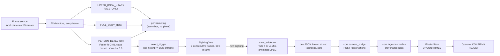
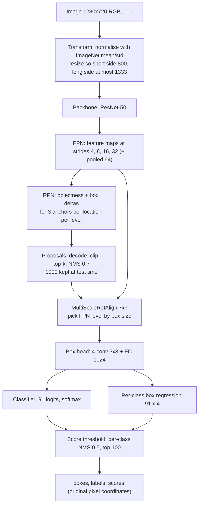
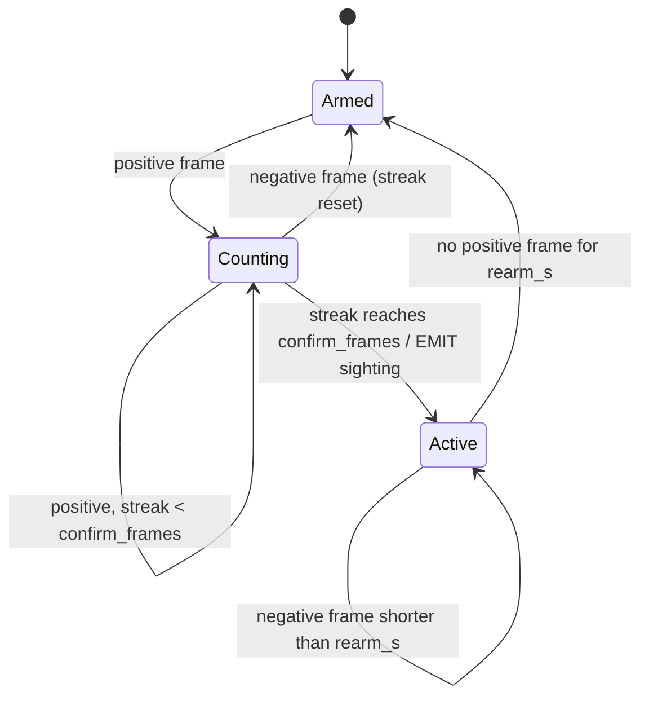

# 04 — Camera perception: person detection, sightings and provenance

This document explains how Team-15 turns camera frames into **person sightings** that an operator can confirm or reject. We use a COCO-pretrained **Faster R-CNN ResNet-50 FPN v2** from torchvision, running on the Mac's Apple GPU (MPS). Classical OpenCV detectors (HOG+SVM full body, Haar upper body, Haar face) run alongside it. Their results stay labelled by family and, by default, never raise a sighting. A small state machine turns frame-level hits into **one sighting per person**. Every sighting is `LIVE-HW` / `BENCH` / `SECTOR_ONLY` with an **operator-assigned** sector. It carries the exact evidence frame's SHA-256 and full camera provenance, and starts **UNCONFIRMED**. We explain the detector from first principles, then the code, then what the real runs showed.

**Status:** Hardware-verified on a bench (REAL HARDWARE). One consenting person was detected in **94/94 to 97/97 frames** in standing, seated, feet-first-lying and side-view-lying poses at about 1.5–2 m, indoors. One genuinely empty 20 s Pi scene raised **0 false alerts (0/96 frames)**. Real false alerts were recorded from window reflections (CAM-12). No aerial use. No calibrated confidence. No measured location.

**Related:** [02 Raspberry Pi setup](02_RASPBERRY_PI_SETUP.md) · [05 Depth and distance](05_DEPTH_AND_DISTANCE_ESTIMATION.md) · [06 Obstacle mapping](06_OBSTACLE_MAPPING.md) · [16 Dashboard](16_DASHBOARD.md) · [Sighting format](../perception/SIGHTING_FORMAT.md) · [Pi camera contract](../contracts/PI_CAMERA_CONTRACT.md) · reports: [CAM-01 latency](experiments/reports/CAM-01-detector-latency-benchmark.md), [CAM-03 Mac bench poses](experiments/reports/CAM-03-mac-bench-person-poses.md), [CAM-09 Mac empty scene](experiments/reports/CAM-09-mac-empty-scene-60s.md), [CAM-15 Pi end-to-end](experiments/reports/CAM-15-pi-transport-and-first-e2e.md), [CAM-20 orientation](experiments/reports/CAM-20-pi-orientation-check.md), [CAM-23 Pi person poses](experiments/reports/CAM-23-pi-live-person-poses.md), [CAM-24 Pi empty/object](experiments/reports/CAM-24-pi-live-empty-and-object.md)

> `$TEAM15_EVIDENCE` is the private local evidence store on the operator's Mac (`~/Team15_evidence`). It is **not in Git** because frames show people. "Session console log" means the Claude Code engineering transcripts that recorded the hardware runs. No images are reproduced anywhere in these docs.

---

## 1. Problem

A search-and-rescue operator needs to know **whether there is a person in front of the robot**. They also need to be able to **check that claim**: see the exact frame, the box, the score and which camera took it. Four requirements follow:

1. **Recall across poses.** A casualty may be lying down, seated or seen from behind. Classical full-body detectors are trained mostly on upright pedestrians.
2. **No alert storms.** At 5 fps, one person produces 5 hits per second. The operator should get one alert per person, not hundreds.
3. **No false certainty.** Detector scores are not probabilities. A face is not a body. A sector assigned by the operator is not a measured position.
4. **Traceable evidence.** Every alert must point to a lossless frame with a checksum, and to the camera and clock that produced it.

## 2. Why this technology

| Candidate | Evidence | Decision |
|---|---|---|
| OpenCV HOG + linear SVM (the original "full-body" detector) | Mac bench, 2026-11-07: found a standing teammate in 61/97 frames (63%) and a seated-from-behind teammate in **0/98** (CAM-06, CAM-08). Pi, 2026-11-08: **0/94** seated, 0/94 lying. | Kept as a labelled secondary detector only |
| OpenCV Haar frontal face | Fired on a blank wall in 80/97 frames (CAM-06) and cannot see a body | Kept, labelled `FACE_ONLY`, never a person hit |
| OpenCV Haar upper body | Fired on ceiling ductwork (PR #3) | Kept, labelled `UPPER_BODY_HAAR` |
| torchvision Faster R-CNN MobileNet-V3-Large FPN | 29 ms/frame on MPS on a synthetic 720p input (CAM-01). COCO box mAP 32.8 (torchvision metadata). | Available as `--dnn-model frcnn_mbv3_fpn`. Accuracy on our scenes NOT MEASURED. |
| **torchvision Faster R-CNN ResNet-50 FPN v2** | 158 ms/frame on MPS on a synthetic input (CAM-01). COCO box mAP 46.7 (torchvision metadata). Live: 94/94–97/97 person frames across poses. | **Default** (`DEFAULT_DNN_MODEL = "frcnn_r50_fpn_v2"`) |
| YOLOv8s on the Pi's Hailo-8 | Model files exist on the Pi | NOT TESTED |

We chose a two-stage, region-proposal detector for robustness to unusual poses and partial views. It runs on the Mac's GPU at the stream rate (5 fps), it needs no training, and its pretrained weights come from a reproducible public recipe (torchvision PR 5763).

## 3. Concept



## 4. Faster R-CNN from first principles

Faster R-CNN (Ren et al., 2015) answers two questions for every image: **where** might objects be, and **what** is each one? It does this in two stages that share one convolutional feature extractor.



### 4.1 Pre-processing

torchvision's `GeneralizedRCNNTransform` normalises each channel, $x' = (x - \mu)/\sigma$ with $\mu = (0.485, 0.456, 0.406)$ and $\sigma = (0.229, 0.224, 0.225)$. It then resizes by $s = \min(800/\text{short},\ 1333/\text{long})$. A Pi frame (1280×720) gives $s = \min(1.111, 1.041) = 1.041$, so it becomes about 1333×750. A MacBook frame (1920×1080) gives $s = 0.694$ and also becomes 1333×750. Output boxes are scaled back to the original pixels. We feed RGB in [0, 1] (`TorchPersonDetector.detect_all` converts BGR→RGB and divides by 255).

### 4.2 Backbone and Feature Pyramid Network (FPN)

ResNet-50 is a stack of residual blocks, $y = F(x) + x$. The identity shortcut lets gradients flow through 50 layers. Its stages output feature maps at strides 4, 8, 16 and 32 relative to the input. Deep maps are semantically strong but coarse; shallow maps are fine but semantically weak. FPN combines them top-down:

$$P_5 = \text{conv}_{1\times1}(C_5),\qquad P_l = \text{conv}_{1\times1}(C_l) + \text{upsample}_{2\times}(P_{l+1}),$$

followed by a 3×3 conv on each $P_l$ (256 channels). A max-pooled level at stride 64 is added. Small people are then detected on fine levels and large people on coarse ones.

### 4.3 Region Proposal Network (RPN) and anchors

At every location of every FPN level, the RPN considers **anchors**: reference boxes of one size per level and three aspect ratios. In the model we use (checked by instantiating it during this audit), the sizes are 32, 64, 128, 256 and 512 px for the five levels, with ratios $h/w \in \{0.5, 1, 2\}$, so 3 anchors per location. For each anchor a small conv head predicts:

- an **objectness** logit $o$ ("is something here?"), and
- four **deltas** $(t_x, t_y, t_w, t_h)$ that move and stretch the anchor.

With an anchor of centre $(x_a, y_a)$ and size $(w_a, h_a)$, the box parametrisation is

$$t_x = \frac{x - x_a}{w_a},\quad t_y = \frac{y - y_a}{h_a},\quad t_w = \log\frac{w}{w_a},\quad t_h = \log\frac{h}{h_a},$$

and decoding inverts it: $x = x_a + t_x w_a$, $w = w_a e^{t_w}$, and so on. Logs make scale changes symmetric, and dividing by the anchor size makes the targets scale-invariant. At test time torchvision keeps the top 1000 proposals per level by objectness, clips them to the image, and removes near-duplicates with **non-maximum suppression** at IoU 0.7. It keeps 1000 proposals in total.

**Intersection over Union (IoU)** of boxes $A$ and $B$ is $\text{IoU} = |A \cap B| / |A \cup B|$. **NMS:** sort the boxes by score, keep the best, delete every remaining box with IoU above the threshold against it, and repeat.

### 4.4 RoI Align

Each proposal has a different size, but the classifier needs a fixed-size input. **RoI Pooling** (Fast R-CNN) snapped the box to the feature grid and max-pooled. The snapping shifts the box by up to one feature cell (8–32 px), which hurts localisation. **RoI Align** (Mask R-CNN) avoids rounding. It divides the box into a 7×7 grid, samples 2×2 points per cell (`sampling_ratio=2`) with **bilinear interpolation**, and averages them:

$$f(x, y) = \sum_{i,j} f(x_i, y_j)\,\max(0, 1 - |x - x_i|)\,\max(0, 1 - |y - y_j|).$$

`MultiScaleRoIAlign` picks the FPN level from the box size, $k = \lfloor k_0 + \log_2(\sqrt{wh}/224) \rfloor$ with $k_0 = 4$, clamped to levels 2–5. A 224×224 box uses stride 16. Larger boxes go to coarser levels.

### 4.5 Classification and box regression heads

In the v2 model the 256×7×7 RoI features pass through `FastRCNNConvFCHead`: four 3×3 conv + BatchNorm + ReLU layers, then a fully connected layer to 1024 features (confirmed by printing the model). Two linear layers then predict:

- **class logits** $z \in \mathbb{R}^{91}$ (COCO's 91-slot index: 80 real classes plus background and unused slots; `person` is index 1, `COCO_PERSON_LABEL = 1`), turned into scores with softmax, $p_c = e^{z_c} / \sum_j e^{z_j}$;
- **per-class box refinements** $(t_x, t_y, t_w, t_h)$ for each class, decoded against the proposal as in §4.3.

The model was trained by torchvision on COCO with $L = L_\text{cls}^{\text{RPN}} + L_\text{reg}^{\text{RPN}} + L_\text{cls} + L_\text{reg}$ (cross-entropy plus smooth-L1). **We did not train or fine-tune it.**

### 4.6 Post-processing and what "confidence" means

For each class, torchvision drops boxes below `box_score_thresh`. We pass **0.6** for the person detector (`--person-thresh`; the library default is 0.05). It then runs per-class NMS at IoU 0.5 and keeps at most 100 detections. `TorchPersonDetector.detect_all` keeps only label 1 (`person`) with score ≥ `score_thresh`.

**The softmax score is not a calibrated probability.** A score of 0.99 does not mean the box is a person 99% of the time in our scenes. Window reflections of people scored up to 0.998 (CAM-12). That is why every sighting has `"confidence": null`, and the raw score travels as `detector_score` with `detector_score_kind: "frcnn_class_score"`.

### 4.7 HOG + linear SVM baseline (Dalal & Triggs, 2005)

1. Compute gradients $g_x, g_y$, magnitude $m = \sqrt{g_x^2 + g_y^2}$ and unsigned orientation $\theta = \arctan(g_y/g_x) \in [0°, 180°)$.
2. In each 8×8-pixel cell, build a 9-bin orientation histogram weighted by $m$.
3. Normalise each 2×2-cell block (16×16 px) with L2-Hys. Blocks overlap with stride 8.
4. A 64×128 detection window gives 7×15 blocks × 36 values = **3780 features** $x$.
5. A linear SVM scores the window as $s = w^\top x + b$. A window is "person" if $s > 0$. `HOGDescriptor_getDefaultPeopleDetector()` provides OpenCV's pretrained $w, b$.
6. Slide the window over an image pyramid (`winStride=(8,8)`, `scale=1.05`, `padding=(8,8)`). OpenCV groups overlapping hits. `OpenCVDetectors` first downsizes frames wider than 640 px to 640 px wide.

The weights OpenCV returns are SVM margins (`hog_svm_margin`), not probabilities. HOG encodes upright silhouettes, so it fails on seated, lying or partly hidden people, which is what we measured.

**Haar cascades** (Viola & Jones) compute rectangle-difference features in O(1) using an integral image. A boosted cascade rejects most windows early. `detectMultiScale3(..., outputRejectLevels=True)` returns a level weight (`haar_level_weight`) per hit, with `scaleFactor=1.1` and `minNeighbors=5`; the minimum size is 60×60 for faces and 80×80 for the upper body.

## 5. Implementation in the repo

- `perception/detectors.py`: `Detection` (bbox `[x, y, w, h]`, detector, score, score_kind, family), `OpenCVDetectors.detect_all()`, `TorchPersonDetector.detect_all()`, `best()`. The family constants `PERSON_DETECTOR`, `FULL_BODY_HOG`, `UPPER_BODY_HAAR`, `FACE_ONLY` and the model table `DNN_MODELS` (`frcnn_r50_fpn_v2`, `frcnn_mbv3_fpn`; both use `COCO_V1` weights).
- `perception/live_camera.py`: the CLI. Opens the source (`open_source()`), warms up every detector on one discarded frame (`warm_up()`), runs all detectors on every frame, writes the per-frame log, selects the trigger (`select_trigger()`), gates (`SightingGate`), saves evidence, prints the sighting, and writes a run summary.
- `perception/sightings.py`: `SightingGate`, `make_sighting()`, `save_evidence()`, `ensure_evidence_dir()` (refuses Git work trees), `validate_sector()`.
- `perception/pi_source.py`: the Pi stream ([02](02_RASPBERRY_PI_SETUP.md)).
- `perception/orientation_check.py`: the one-frame rotation check (CAM-20).
- `contracts/camera_provenance.py`: `camera_kind()`, `camera_label()`, `clock_label()`, and the allowed transports and clocks.
- `core/camera_bridge.py`: `forward()` POSTs each stdin line unchanged to `/observations`, retrying for `--retry-s` (default 30 s), and reports `NOT DELIVERED` rather than dropping silently.
- `core/ingest.py`: `normalise()` and `_check_camera()` enforce the sighting contract (§8, §12).
- `core/store.py`: `MissionStore.add_observation()` always sets `confirmation = "unconfirmed"` and dedups by `obs_id` and `frame_sha256`. `MissionStore.decide()` is the only way to confirm or reject.
- `camera_mapping/detector.py`: `TorchObstacleDetector` reuses the same builders and cached weights but keeps `SUPPORTED_CLASSES` (person + 18 COCO obstacle classes; person ≥ 0.6, others ≥ `DEFAULT_OBSTACLE_THRESH = 0.5`). COCO has **no box/carton class** (`UNSUPPORTED_REQUESTED`). Its output feeds [05](05_DEPTH_AND_DISTANCE_ESTIMATION.md) and [06](06_OBSTACLE_MAPPING.md).

## 6. Key files, symbols and interfaces

| Interface | Signature / contract |
|---|---|
| `TorchPersonDetector(model="frcnn_r50_fpn_v2", score_thresh=0.6, device=None)` | `device` defaults to `mps` if available, else `cpu`. `name = "torchvision_<model>_coco"`. |
| `OpenCVDetectors(families=(FULL_BODY_HOG, UPPER_BODY_HAAR, FACE_ONLY))` | Every family runs; none short-circuits |
| `select_trigger(dets, families, min_box_h)` | Best detection, in family priority order, from boxes ≥ `min_box_h` px tall |
| `SightingGate(confirm_frames=3, rearm_s=60.0).update(t, present) -> bool` | True exactly when a new sighting should be emitted |
| `make_sighting(...) -> dict` | Builds the record in §8 |
| `POST /observations` (`dashboard/app.py`) | Body: one sighting. Reply: `{obs_id, duplicate, track_id[, duplicate_of]}`, or 422 on a contract violation. |
| `POST /operator_decision` (`dashboard/app.py`) | Body: `{obs_id, decision: CONFIRM or REJECT, operator}`. `operator` is required. |
| Exit codes (`live_camera`) | 0 = sighting emitted; 2 = none (`EXIT_NO_PERSON`); 3 = camera unavailable (`EXIT_CAMERA_UNAVAILABLE`); 1 = bad arguments |

## 7. Inputs and outputs

- **Input:** BGR frames from `cv2.VideoCapture(index)` (`--source local`) or `PiCameraSource` (`--source pi`).
- **stdout:** exactly one JSON line per new sighting. Diagnostics go to stderr, so stdout can be piped into `core.camera_bridge`.
- **Files** (in `--out-dir`, default `~/Team15_evidence/camera`; must be outside Git):
  - `<run_id>_frames.jsonl`: one line per processed frame, holding `t` (capture time), `rel_s`, `rx`, per-family `counts`, the `best` box per family, and `all` boxes. Boxes only, never pixels.
  - `<obs_id>.png`: the exact evidence frame, lossless. `<obs_id>_annotated.jpg`: all boxes drawn on it.
  - `sightings.jsonl`: an append-only copy of every sighting.
  - `<run_id>_summary.json`: frames, fps, `frames_with` per family, `first_hit_s`, sightings, attached frames, plus `pi_stream` and `camera` for Pi runs.

## 8. Data structures and schemas

A sighting (full field table in [SIGHTING_FORMAT.md](../perception/SIGHTING_FORMAT.md)):

| Field | Value / rule |
|---|---|
| `obs_id` | `{drone}-{boot}-{seq:06d}`, e.g. `D1-b1794124127-000001`. `boot_id = b<epoch at run start>`, so IDs never collide across runs. |
| `source_mode`, `platform` | Always `LIVE-HW`, `BENCH` from this tool |
| `sensor`, `kind`, `how` | `rgb`, `PERSON_VISUAL`, `SECTOR_ONLY` |
| `cell`, `cell_source` | Sector letter from `--sector`; `OPERATOR_ASSIGNED`. Never measured. |
| `obs_time`, `obs_time_iso` | The capture time of the evidence frame. For the Pi this is the sensor timestamp mapped to the Pi wall clock. |
| `confidence` | Always `null` |
| `evidence.frame_ref`, `frame_sha256` | The lossless PNG and its SHA-256, computed from the file just written |
| `evidence.bbox`, `frame_size` | Trigger box `[x, y, w, h]` in the rotated, upright frame |
| `evidence.detector`, `detector_family`, `detector_score`, `detector_score_kind` | e.g. `torchvision_frcnn_r50_fpn_v2_coco`, `PERSON_DETECTOR`, 0.9999, `frcnn_class_score` |
| `evidence.count_in_frame` | Number of trigger-family boxes in the frame. **A box count, not a head count.** It was 2 for one lying person (CAM-28). |
| `evidence.detections_in_frame` | Every box from every family |
| `evidence.camera` | Provenance (see [02 §8](02_RASPBERRY_PI_SETUP.md#8-data-structures)): `source` (`pi5-imx708` or `local`), `transport` (`ssh-jpeg` or `local`), `capture_clock` (`sensor`, `pi_wall_at_request` or `receiver_wall_at_read`), `rotation_deg`, `capture_to_rx_s`, … |

**How the provenance labels map.** The docs use REAL HARDWARE / RECORDED HARDWARE / SIMULATED / MOCKED / SYNTHETIC. In the data:

| Docs label | Sighting fields | Where it comes from |
|---|---|---|
| REAL HARDWARE (bench) | `source_mode: LIVE-HW`, `platform: BENCH` | `perception/live_camera.py` (Mac or Pi camera) |
| REAL HARDWARE (airborne) | `LIVE-HW` + `AIRCRAFT` | Allowed by `core/ingest.py`; **never produced** in this project |
| RECORDED HARDWARE | `RECORDED-IMAGERY` (ingest), and the `RECORDED` label in `camera_mapping` replay | `camera_mapping.live --source replay` |
| SIMULATED | `SIMULATED`, `SIM` | Simulators (see 18 Simulation) |

The dashboard badge (`badge_for()` in `core/store.py`) shows these labels. A Pi sighting must be `LIVE-HW`/`BENCH`/`SECTOR_ONLY`/`OPERATOR_ASSIGNED` or ingest rejects it.

## 9. Configuration

| Flag (`perception.live_camera`) | Default | Why |
|---|---|---|
| `--trigger` | `person` | Only `PERSON_DETECTOR` can raise a sighting. `any` also allows HOG and Haar. |
| `--person-thresh` | 0.6 | Score floor for person boxes. Never tuned on a labelled set. Chosen at the start and kept fixed across all runs. |
| `--min-box-frac` | 0.15 | Box height ≥ 15% of the frame height (162 px at 1080p, 108 px at 720p). Tuned on window reflections at the bench (80–130 px boxes). 0 turns it off. |
| `--confirm-frames` | 3 | Consecutive positive frames before the first sighting (≈0.6 s at 5 fps) |
| `--rearm-s` | 60 | Absence needed before a new sighting from the same run |
| `--dnn-model` | `frcnn_r50_fpn_v2` | Or `frcnn_mbv3_fpn` |
| `--no-dnn` | off | OpenCV only. Requires `--trigger any`. |
| `--start-delay-s` | 0 | Discard frames while the operator steps out (8 s was used for the bench) |
| `--sector` | required | The operator-assigned sector letter A–Z |

## 10. Dependencies

`torch` and `torchvision` (Faster R-CNN; weights downloaded once to `~/.cache/torch/hub/checkpoints/`: `fasterrcnn_resnet50_fpn_v2_coco-dd69338a.pth`, about 167 MB, and the MobileNet weights, about 74 MB). `opencv-python` (HOG, Haar, image I/O). `numpy`. The dashboard side uses FastAPI/uvicorn (`dashboard/serve.py`). CI (`.github/workflows/perception.yml`) installs OpenCV <5 without torch. The Faster R-CNN blank-frame test is skipped there.

## 11. Execution flow



1. Validate the sector and the evidence directory. Build the detectors (`TorchPersonDetector` unless `--no-dnn`, then `OpenCVDetectors`).
2. Open the source. **Warm up**: run every detector once on one real frame and discard the result. On MPS the first Faster R-CNN call took 3.7 s. Without the warm-up, the first Pi run managed only 0.68 fps (CAM-17), against 4.36 fps afterwards (CAM-19).
3. For each frame: read it, take `obs_time` (the Pi capture time, or the read time for local), run every detector, and log every box.
4. `select_trigger()` takes the best `PERSON_DETECTOR` box at least `min_box_frac × H` tall.
5. `SightingGate.update(obs_time, trigger is not None)`. On emit, `save_evidence()` writes the PNG and its SHA-256 plus the annotated JPEG, `make_sighting()` builds the record, and it is printed and appended.
6. When the duration ends, the summary JSON is written. A run interrupted with Ctrl-C leaves its frame log but **no summary**; that is what happened to `D1-b1794082672` (CAM-22).
7. Downstream: `core.camera_bridge` → `POST /observations` → `normalise()` → `MissionStore.add_observation()` (UNCONFIRMED) → operator `POST /operator_decision`.

## 12. Error handling

| Case | Behaviour |
|---|---|
| Camera will not open, or gives only black frames (mean < 2.0) | `CameraUnavailable` with a macOS camera-permission hint. Exit 3. **No frame is faked.** |
| More than 60 empty or black frames in a row mid-run | Exit 3 |
| Evidence directory inside Git | Refused (`ValueError`), exit 1 |
| PNG write fails | `OSError`. No sighting without its evidence file. |
| Dashboard down | The bridge retries for 30 s, then logs `NOT DELIVERED`. The line stays in `sightings.jsonl`. |
| Ingest violations (422) | Missing field; malformed `obs_id`; unknown `source_mode`/`platform`/`how`; cell not on the map; coordinates on a `SECTOR_ONLY` sighting; `obs_time_iso` more than 1 s from `obs_time`; Pi camera with the wrong transport or clock; `obs_time` ≠ `camera.capture_time` by more than 2 ms (`CAPTURE_TIME_TOLERANCE_S`); unknown camera source |
| Capture time more than 2 s ahead of the dashboard clock | Flagged `clock_skew`, not hidden (`CLOCK_SKEW_S` in `core/store.py`) |
| A sender tries to set `confirmation` | Overwritten with `unconfirmed` |

## 13. Safety and security

- **Human in the loop.** A sighting is a *candidate*. Only an operator, by name, can confirm or reject it (`MissionStore.decide()`). The camera has no motor authority.
- **No invented location or certainty.** `SECTOR_ONLY` sightings cannot carry coordinates (ingest rejects `xy_m`, `lat`, `lon`, `alt_m`, `bearing_deg`). `confidence` is null.
- **No inference about the person.** The pipeline does not estimate identity, injury, medical state or distance from a person image.
- **Privacy.** Frames of people are saved only outside Git. Evidence directories inside a work tree are refused (`test_evidence_dir_refused_inside_git`). Bystanders appear in some 2026-11-07 bench frames; those images are kept locally only and never shared. The orientation-check images include part of a person whose consent was not recorded; a `DO_NOT_TRAIN_OR_DISTRIBUTE.txt` notice sits beside them. The 2026-11-08 Pi runs record consent in `run_annotation.json` (typed "yes" at capture for the person scenes). No image is reproduced in this documentation.
- **Consent safeguards in the live-test runner.** The empty and object scenes cannot store person images (see CAM-24). That runner is on an **unmerged local branch** (`test/camera-live-countdown`, file *perception/live_test.py*). It is not on `main`.

## 14. Tests and observed results

**Automated (MOCKED, synthetic frames).** `perception/tests/` has 39 tests. They cover the gate (confirm frames, continuous presence → one sighting, drop-outs and pose changes, re-arm after 60 s, empty scene never fires), sighting shape and labels, `best()` by family, the Git-refusal rule, the PNG matching the frame pixel for pixel, the small-box filter, warm-up, rotation defaults and the Pi source. Audit run, 2026-11-08: **39 passed**. GitHub CI runs without torch: 38 passed and 1 skipped (PR #3). `tests/e2e/test_live_camera_integration.py` and `tests/e2e/test_pi_camera_integration.py` drive the CLI through the bridge into the store. **These tests prove plumbing and invariants. They do not prove detection accuracy on real people.**

**Real-hardware person detection** (REAL HARDWARE, bench, indoors, one consenting person, operator-declared scene):

| ID | Date (UTC) | Camera | Scene (operator-declared) | Frames | PERSON_DETECTOR frames | Score range | HOG frames | Sightings | Report |
|---|---|---|---|---|---|---|---|---|---|
| CAM-06 | 2026-11-07 19:11 | MacBook 1920×1080 | standing, full body | 97 | 97/97 (PR #3: 96–97 on the teammate) | — | 61/97 | 1 | [CAM-03](experiments/reports/CAM-03-mac-bench-person-poses.md) |
| CAM-07 | 2026-11-07 19:14 | MacBook | seated, profile; bystanders in view | 98 | 98/98 (includes bystanders) | — | 20/98 | 1 | same |
| CAM-08 | 2026-11-07 19:19 | MacBook | seated, back to camera | 98 | **98/98** | 0.617–0.993 | **0/98** | 1 | same |
| CAM-23 | 2026-11-08 07:08 | Pi IMX708 1280×720 | standing (scene requested "empty", person present) | 96 | 96/96 | 0.9995–0.9998 | 96/96 | 1 | [CAM-23](experiments/reports/CAM-23-pi-live-person-poses.md) |
| CAM-27 | 2026-11-08 07:48 | Pi | seated, facing camera, ~1.5–2 m | 94 | 94/94 | 0.9997–0.9999 | **0/94** | 1 | same |
| CAM-28 | 2026-11-08 07:59 | Pi | lying, feet towards camera, floor-level camera | 94 | 94/94 | 0.9845–0.9971 | 0/94 | 1 | same |
| CAM-29 | 2026-11-08 08:07 | Pi | lying on back, side view, whole body | 94 | 94/94 | 0.9913–0.9978 | 0/94 | 1 | same |

**Empty scenes and false alerts:**

| ID | Date (UTC) | Camera | Scene | Frames | Person-box frames | Sightings | Verdict |
|---|---|---|---|---|---|---|---|
| CAM-09/10/11 | 2026-11-07 19:22–19:43 | MacBook | open office | 291–296 | 185–294 (63–99%) | 1 each | CONTAMINATED (real people in view) |
| CAM-12 | 2026-11-07 19:48 | MacBook | windows, room empty | 294 | 294/294 (1,767 boxes, all on the glass) | **1 false** (0.991) | **FAIL**: reflections |
| CAM-13 | 2026-11-07 19:55 | MacBook | painted wall | 290 | 141/290; 0 boxes from 5–30 s | 1 | CONTAMINATED (a real hand at the edge) |
| CAM-14 | 2026-11-07 19:57 | MacBook | wall + closed blinds | 295 | 295/295, all on one seated bystander | 1 | CONTAMINATED; the rest of the frame was clean for 60 s |
| CAM-25 | 2026-11-08 07:28 | Pi | genuinely empty room (operator statement) | 96 | **0/96** (all four families) | **0** (replayed trigger rule) | **PASS**. 95% upper bound on the per-frame FP rate ≈ 3/96 ≈ 3.1% (rule of three). |
| CAM-24 | 2026-11-08 07:25 | Pi | empty chair, no people | 101 | 0/101 person boxes ≥ 0.5 | n/a | Chair 101/101 (0.9915–0.9965), never labelled person. False labels: "surfboard" up to 0.99, "tv", "bench", "couch", "dining table". |

**Latency and frame rate** (REAL HARDWARE, Mac MPS; full table in [CAM-01](experiments/reports/CAM-01-detector-latency-benchmark.md)):

| Metric | Value | Source |
|---|---|---|
| Faster R-CNN R50 v2 per frame, live 720p, inside the person pipeline | median 195–200 ms, max 223–241 ms | CAM-27/28/29 `run_report.json` (`frcnn_s_median_max`) |
| All four detector families per frame | median 207–213 ms | same |
| Faster R-CNN alone (object runner) | median 190 ms, max 243 ms | CAM-24 |
| First Faster R-CNN call on MPS (kernel compilation) | 3.71 s | CAM-19 (session console log) |
| Processed fps, Pi stream at 5 fps | 4.66–5.01 | CAM-18, CAM-23–29 |
| Processed fps, MacBook camera at 1080p | 4.33–4.93 | CAM-03–14 summaries |
| First person frame → sighting (3-frame gate) | 0.4–0.6 s | CAM-27/28/29 |
| Live capture → dashboard receive | 0.499 / 0.593 / 0.508 s | CAM-27 / 28 / 29 `run_annotation.json` (`live_delivery`) |

## 15. Limitations

- **Ground truth is the operator's statement** plus a visual check of a downscaled copy by the session assistant (deleted afterwards). There are no annotated boxes, no IoU and no labelled test set. "94/94" means "a person box in every frame of a scene the operator said had one person". It does not mean every box was correct.
- **Tiny sample:** one participant per pose, one room, one viewpoint, about 20 s each, daylight indoor lighting. Not tested: multiple people, occlusion, low light, outdoors, motion blur, distance beyond ~2 m, face-down, a partly covered person.
- **Reflections** are a known real false-alert mode (CAM-12). The only mitigation is to aim the camera away from glass.
- **`min_box_frac` can hide distant people.** A lying person 180–203 px tall at ~1.5–2 m passed the 108 px floor. Farther away the box may fall below it, so the detector would see the person but raise no alert. NOT TESTED.
- **No identity:** two people in view at once give one sighting, and `count_in_frame` counts boxes, not people.
- **Scores are uncalibrated**, and the threshold (0.6) was never tuned on labelled data.
- **COCO classes:** there is no "drone", "box" or "rubble" class. In our room, non-person labels were unreliable (CAM-24, CAM-26).
- The bench sighting `D1-b1794091323-000001` is upside down (taken before the robot mount; CAM-17). It is kept unchanged as historical evidence.

## 16. How to reproduce

Commands checked against `--help` at `d1b607a`. Only run with consenting people, and keep bystanders out of view.

```bash
# Unit and integration tests (no camera, no Pi)
python3 -B -m pytest -q -p no:cacheprovider perception/tests
python3 -B -m pytest -q tests/e2e/test_live_camera_integration.py tests/e2e/test_pi_camera_integration.py

# Bench run on the Mac camera, 8 s to step out of view, 60 s capture
python3 -B -m perception.live_camera --declare-drone D1 --sector G --start-delay-s 8 --duration-s 60

# Pi camera to the dashboard (dashboard on :8000 started separately: python3 -B -m dashboard.serve --port 8000)
python3 -B -m perception.live_camera --source pi --pi-host "$PI_HOST" --sector G --duration-s 1800 \
  | python3 -B -m core.camera_bridge --post http://localhost:8000/observations

# Replay the trigger rule over a frame log (no images needed)
python3 - "$TEAM15_EVIDENCE/camera_live_test/empty-20261108T022809/D1-b1794122894-empty_frames.jsonl" <<'EOF'
import json, sys
H, streak, alerts = 720, 0, 0
for line in open(sys.argv[1]):
    f = json.loads(line)
    ok = any(d["family"] == "PERSON_DETECTOR" and d["bbox"][3] >= 0.15 * H for d in f["all"])
    streak = streak + 1 if ok else 0
    alerts += streak == 3
print("alerts the 3-frame rule would raise:", alerts)
EOF
```

(The replay ignores the 60 s re-arm, which is fine for counting first alerts.)

## 17. How to extend

- **Measure accuracy properly:** collect consented frames, annotate boxes, and report precision/recall and IoU at fixed thresholds per pose and distance. Then calibrate scores (for example with temperature scaling) before any `confidence` is filled in.
- **Distance sweep:** repeat the lying-person test at 2, 4 and 6 m to see where `min_box_frac` starts suppressing alerts.
- **Reflection handling:** an operator-drawn ignore mask would change what is watched without changing thresholds. It was proposed and never built.
- **New detector families** (e.g. a Hailo YOLO on the Pi, or an open-vocabulary detector for drones) must use new `detector`/`family` labels and stay out of the person trigger until they are validated.
- **Head count:** group overlapping boxes per frame (an analysis-only grouping exists on the unmerged branch; see CAM-29) before showing "people in frame".
