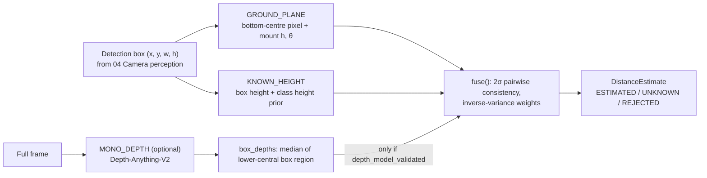
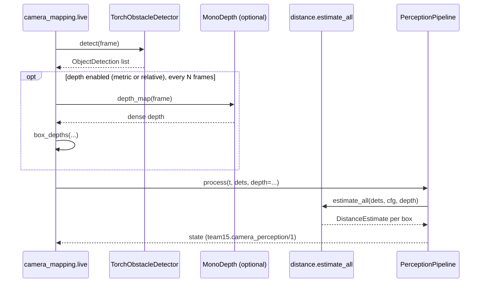

# 05 Depth and distance estimation (camera-only)

This document explains how `camera_mapping/` turns a 2-D detection box from the Raspberry Pi 5 IMX708 camera into a forward distance, or refuses to. It covers the pinhole camera model, the intrinsics we derived from the datasheet, the mount extrinsics (height and pitch), a full derivation of ground-plane contact-point ranging, known-height ranging, the optional Depth-Anything-V2 monocular depth cross-check, the uncertainty model and fusion rule, and the failure cases. The detector that produces the boxes is covered in [04 Camera perception](04_CAMERA_PERCEPTION.md). What happens to the distances afterwards is covered in [06 Obstacle mapping](06_OBSTACLE_MAPPING.md) and [07 Path planning](07_PATH_PLANNING.md).

> **Every camera distance is UNCALIBRATED.** The physical tape calibration in [camera_mapping/CALIBRATION.md](camera_mapping/CALIBRATION.md) has **not** been done. The camera mount height and pitch have **not** been measured. The shipped config `camera_mapping/configs/imx708_robot.json` says `"calibration_status": "UNCALIBRATED"` and `"mount": {"measured": false}`. Until that changes, the best label any camera distance can carry is `UNCALIBRATED_ESTIMATE`. No accuracy number exists, and none is claimed here (see [MAP-09](experiments/reports/MAP-09-tape-distance-calibration.md)).

**Status:** Implemented and unit-tested (SYNTHETIC geometry). It ran on the live Pi camera stream (REAL HARDWARE), but with the mount unmeasured. Distance accuracy is **NOT MEASURED**.

**Related:** [04 Camera perception](04_CAMERA_PERCEPTION.md) · [06 Obstacle mapping](06_OBSTACLE_MAPPING.md) · [07 Path planning](07_PATH_PLANNING.md) · [14 Grove ultrasonic](14_GROVE_ULTRASONIC.md) · [15 RPLIDAR C1](15_RPLIDAR_C1.md) · [17 Safety architecture](17_SAFETY_ARCHITECTURE.md) · [camera_mapping/CALIBRATION.md](camera_mapping/CALIBRATION.md) · [camera_mapping/EVALUATION.md](camera_mapping/EVALUATION.md) · [package README](../camera_mapping/README.md)

---

## 1. Problem

The rescue robot must answer a simple question: *is there something in front of me, and how far away is it?* The only sensor that worked during the hackathon was the camera. The Grove ultrasonic sensor returned 0 of 50 valid readings in both real-hardware runs (see [14 Grove ultrasonic](14_GROVE_ULTRASONIC.md)), and a real RPLIDAR C1 scan is NOT VERIFIED (see [15 RPLIDAR C1](15_RPLIDAR_C1.md)).

A camera measures **directions**, not distances. Each pixel tells you the angle of a ray of light, but not how far along the ray the surface was. To get metres from a single image you must add an assumption:

- the object stands on a **flat floor** at a **known camera height and pitch** (ground-plane ranging);
- the object has a **known physical size** (known-height ranging);
- a neural network has **learned typical scene scales** (monocular depth).

Each assumption fails in predictable ways. The design goal of `camera_mapping/distance.py` is to use an assumption only where it holds, to attach an honest uncertainty, and to say `UNKNOWN` otherwise.

## 2. Why this technology

| Option | Why it was / was not used |
|---|---|
| Ground-plane intersection | Needs only the camera height and pitch. These can be measured with a tape and a phone inclinometer in a few minutes. It works for any class that stands on the floor. **Primary method** once the mount is measured. |
| Known object height | No mount measurement needed. It works only for upright, fully visible objects with a narrow size distribution (standing adult, chair). **Secondary method.** |
| Monocular depth network (Depth-Anything-V2) | Gives a dense depth map without any mount data, but its metres come from training-set priors, not from our camera. **Optional cross-check only**, never fused until validated. |
| Stereo camera / structured light | No second camera or projector on the robot. Not available. |
| Range sensor (ultrasonic, LiDAR) | The right tool for ranging, and the only thing the rover's forward-motion gate accepts. Hardware not working or not verified (see §13). |

## 3. Concept: the pinhole camera

A pinhole camera maps a 3-D point onto the image plane along a straight line through the lens centre. Two sets of numbers describe it:

- **Intrinsics** describe the camera itself: focal length in pixels (`fx`, `fy`) and the principal point (`cx`, `cy`), the pixel the optical axis passes through. Lens distortion would add more terms; here it is assumed to be zero.
- **Extrinsics** describe where the camera sits on the robot: height of the lens above the floor `h` and downward pitch `θ`. (`setback_m` and `lateral_offset_m` also exist in `MountGeometry`; see §9.)



### Coordinate conventions (from `camera_mapping/geometry.py`)

- **Robot frame:** origin on the floor directly below the camera lens; `x` forward, `y` **left**, `z` up.
- **Camera pitch** `θ` is positive when tilted **down**.
- **Image:** `u` to the right, `v` down; `(cx, cy)` is the principal point.
- **Bearings** are positive to the left (`bearing_rad`), matching the robot frame.

## 4. Math

### 4.1 Intrinsics from the datasheet (`camera_mapping/config.py`)

The IMX708 (Camera Module 3, standard lens) has 1.4 µm pixels and a 4.74 mm focal length. The key fact, measured on the Pi on 2026-11-08 06:08 ET, is that a picamera2 video configuration with `main=1280×720` selects the 2×2-binned sensor mode 1536×864 with **ScalerCrop (784, 456, 3072, 1728)**. The image is a centre crop of 3072×1728 sensor pixels, **not** the full 4608×2592 array. So one output pixel covers 3072/1280 = 2.4 sensor pixels.

```
effective pixel pitch  p = 1.4 µm × 3072 / 1280 = 3.36 µm
focal length in pixels fx = f / p = 4.74 mm / 3.36 µm = 1410.7 px     (nominal_imx708_fx)
fy = fx  (square pixels: 1728/720 = 2.4 as well)
cx = (1280 − 1)/2 = 639.5,   cy = (720 − 1)/2 = 359.5               (pixel-centre convention)
HFOV = 2·atan(1280 / (2·1410.7)) = 48.8°
VFOV = 2·atan( 720 / (2·1410.7)) = 28.6°
```

These values are in the shipped config with `"source": "NOMINAL_DATASHEET"`. They are **not** a checkerboard calibration, and distortion is assumed to be zero. If you had used the full-sensor width (4608 px) you would have computed fx ≈ 940 px and a 68° HFOV, which is 1.5× wrong. That mistake would scale every known-height distance by 1.5. `CameraModel.scaled` keeps the same crop when the output resolution changes: `fx' = fx·sx`, `cx' = (cx + 0.5)·sx − 0.5`.

Provenance: the ScalerCrop and LensPosition values were read from the Pi (REAL HARDWARE, session console log 2026-11-08 ~11:08 UTC). fx and the FOVs are derived (arithmetic on datasheet numbers).

### 4.2 Back-projecting a pixel into a ray

Normalised image coordinates (`normalized`):

```
a = (u − cx) / fx        (right of the axis)
b = (v − cy) / fy        (below the axis)
```

In the camera frame (right, down, forward) the ray direction is `(a, b, 1)`. Rotate it into the robot frame for a camera pitched down by `θ`:

- the optical axis `(0, 0, 1)` points forward by `cos θ` and down by `sin θ`;
- the image-down axis `(0, 1, 0)` points forward by `−sin θ` and down by `cos θ`;
- the image-right axis `(1, 0, 0)` points to robot `−y` (right).

So the ray, scaled by a free parameter `t ≥ 0`, is:

```
forward(t) = t · (cos θ − b sin θ)
down(t)    = t · (sin θ + b cos θ)
left(t)    = −t · a
```

### 4.3 Ground-plane intersection (derivation of `ground_point`)

The lens is at height `h`. The ray hits the floor when it has gone down by exactly `h`:

```
t · (sin θ + b cos θ) = h      ⇒      t = h / (sin θ + b cos θ)
```

Substituting back:

```
x = h · (cos θ − b sin θ) / (sin θ + b cos θ)      (forward distance from the point under the lens)
y = −h · a / (sin θ + b cos θ)                     (lateral offset, + = left)
```

This is exactly what `ground_point(cam, u, v, height_m, pitch_deg)` computes. It returns `None` when the denominator is ≤ 0 (the ray points level or upward and never reaches the floor) or when `x ≤ 0`.

**Horizon row.** The ray is level when `sin θ + b cos θ = 0`, that is `b = −tan θ`:

```
v_horizon = cy − fy · tan θ                (horizon_row)
```

Pixels at or above this row can never be a floor contact.

**Blind zone.** The nearest floor the camera can see is where the bottom image row (`v = 719`) meets the floor: `nearest_visible_floor`. Anything nearer is invisible.

**Inverse.** `ground_row` maps a forward distance back to a row on the optical-axis column: `φ = atan2(h, x)`, `v = cy + fy · tan(φ − θ)`. The unit test `test_ground_point_inverts_ground_row` checks that the two functions invert each other.

### 4.4 Why ground-plane error grows with the square of distance

Write the depression angle of the ray below horizontal as `α = θ + atan(b)`. On the optical-axis column `x = h / tan α`. Differentiate:

```
dx/dα = −h / sin²α = −(x² + h²) / h  ≈ −x² / h      (for x ≫ h)
```

So an angle error `δα` (from pitch error, or from the box bottom being a few pixels off) causes a distance error of about `x²·δα / h`. Two consequences:

1. **A low camera is a poor rangefinder at distance.** With an illustrative `h = 0.135 m` (the example value in `camera_mapping/calibrate.py`; **not** a measurement of our robot), 1° of pitch error at 2 m gives roughly 4 / 0.135 × 0.0175 ≈ 0.52 m of error.
2. **Pitch must be measured, or fitted from tape samples.** This is why `calibrate fit-pitch` exists.

Illustrative numbers from the repo's own functions, using a hypothetical mount `h = 0.135 m`, `θ = 4°` (SYNTHETIC, computed during this audit; not robot data):

| True forward distance | Image row | Pixels per metre | Reading if pitch is +1° off | Reading if box bottom is +4 px off | Reading if height is +1 cm off |
|---|---|---|---|---|---|
| 0.5 m | 636.5 | 745 | 0.47 m | 0.50 m | 0.54 m |
| 1.0 m | 450.4 | 188 | 0.88 m | 0.98 m | 1.07 m |
| 2.0 m | 356.1 | 47 | 1.59 m | 1.92 m | 2.15 m |
| 3.0 m | 324.4 | 21 | 2.16 m | 2.82 m | 3.22 m |
| 4.0 m | 308.6 | 12 | 2.64 m | 3.69 m | 4.30 m |

For this hypothetical mount the horizon is at row 260.9 and the blind zone ends at 0.41 m. At 4 m one pixel is worth about 8 cm.

### 4.5 Ground-plane uncertainty (`_ground_sigma`)

The code does not linearise. It perturbs each input by its 1-σ value, recomputes the floor point, and adds the three distance changes in quadrature:

```
σ_x = sqrt( Δx(h + σ_h)² + Δx(θ + σ_θ)² + Δx(v + σ_v)² )
σ_h = mount.height_sigma_m = 0.01 m
σ_θ = mount.pitch_sigma_deg = 1.5°
σ_v = CONTACT_SIGMA_PX = 4 px       (how well a detector box bottom marks the floor contact)
```

If any perturbation pushes the ray above the horizon, σ is infinite. The method then returns `UNKNOWN` with `GEOMETRY_TOO_UNCERTAIN`; it does the same when `σ > 0.5·x + 0.2 m`. With the hypothetical mount above, `ground_plane` gives σ = 0.06 m at 0.5 m, 0.18 m at 1 m, 0.59 m at 2 m and 1.14 m at 3 m. The roughly quadratic growth matches §4.4. These sigmas are **priors**; nobody has measured them on our robot.

### 4.6 Known-height ranging (`known_height_range`, `known_height`)

For an upright object of height `H` whose full extent spans `h_px` image rows, the pinhole relation gives the range along the optical axis:

```
Z = fy · H / h_px
```

Height priors (`HEIGHT_PRIORS` in `distance.py`), deliberately wide:

| Class | H (mean ± 1σ) | Upright aspect required (h/w) |
|---|---|---|
| person | 1.70 ± 0.12 m (standing adult; children are outside this prior) | ≥ 1.8 |
| chair | 0.88 ± 0.12 m | ≥ 0.9 |

Relative uncertainty combines the prior spread, a 5 % box-height error (`BOX_H_SIGMA_FRAC`) and 3 % for the small-pitch cosine approximation:

```
σ_Z / Z = sqrt( (σ_H/H)² + 0.05² + 0.03² )
person: sqrt(0.0706² + 0.05² + 0.03²) = 9.2 %
chair:  sqrt(0.136²  + 0.05² + 0.03²) = 14.8 %
```

The lateral offset is `y = −Z · a` at the box centre.

**Why boxes cut by the frame edge are refused (`BOX_TRUNCATED_BY_FRAME`).** If any box edge is within `EDGE_MARGIN_PX = 4` px of the image border, the visible part may be only part of the object. Then `h_px` is too small and `Z = fy·H/h_px` is too **large**: the object reads *farther* than it is, which is the dangerous direction. This is not hypothetical. In the second live Pi run (2026-11-08 11:52–11:53 UTC, [MAP-06](experiments/reports/MAP-06-live-pi-run-2-person-chair.md), REAL HARDWARE), a chair cut by the **left** frame edge (box x = 0.3 px and 1.6 px) was given known-height distances of **7.91 m** (h_px = 156.9, score 0.65) and then **6.76 m** (h_px = 183.8, score 0.55) by the code at that time: 1410.7 × 0.88 / 156.9 = 7.91. The check then covered only the top and bottom edges. Commit `73539a7` extended it to all four edges, with the regression test `test_known_height_refuses_side_truncated_box`.

**Why head-clipped people are refused.** A rover camera is low. Take the hypothetical 0.135 m / 4° mount: the top of the image is only 28.6/2 − 4 = 10.3° above horizontal. A standing person's head (1.70 m) is 1.565 m above the lens, so the head is in frame only when the person is farther than 1.565 / tan 10.3° ≈ **8.6 m**, beyond the 4 m map. Closer than that, the box top is the frame edge. So known-height **almost never applies to standing people** at useful range on this robot, and the feet (ground plane) are the only distance cue for a person. The test `test_low_rover_camera_cuts_off_standing_person` documents this. In every recorded and live run in the evidence store, every person box was refused with `BOX_TRUNCATED_BY_FRAME`.

Other refusals: `BOX_TOO_SMALL` (h_px < 24), `NOT_UPRIGHT_OR_PARTLY_HIDDEN` (aspect below the threshold: seated, lying, partly hidden), `NO_HEIGHT_PRIOR_FOR_CLASS`.

### 4.7 Monocular depth (`camera_mapping/depth.py`)

`MonoDepth` wraps two Hugging Face checkpoints of **Depth Anything V2** (both "Small"; the code docstring says about 25 M parameters):

| Checkpoint (constant) | Output | How the code treats it |
|---|---|---|
| `depth-anything/Depth-Anything-V2-Small-hf` (`RELATIVE_SMALL`) | **Relative**, affine-invariant inverse depth | **Never** converted to metres. `box_depths` returns `UNKNOWN` with `RELATIVE_DEPTH_ONLY (value …, no metres)` |
| `depth-anything/Depth-Anything-V2-Metric-Indoor-Small-hf` (`METRIC_INDOOR`) | Metres, trained on the synthetic Hypersim indoor set | `ESTIMATED` with reason `METRIC_UNVALIDATED` and σ = 25 % (`UNVALIDATED_REL_SIGMA`, a placeholder) |

**Relative vs metric, and the scale ambiguity.** A single image of a room and an image of a perfectly scaled 1:10 model of that room are identical. No algorithm can recover absolute scale from one image without prior knowledge. A *relative* model sidesteps this: it predicts inverse depth only up to an unknown scale `s` and shift `t`, so `d_pred = s/Z + t`. You can tell that A is nearer than B, not by how many metres. A *metric* model resolves the ambiguity by learning typical sizes of indoor scenes from its training data. Its metres are therefore only as right as the match between our scene and that data. Our camera sits about 10–15 cm above the floor with a 48.8° HFOV, a viewpoint that is rare in indoor datasets. So the metric output is a hypothesis to be tested against the tape, not a measurement.

**Sampling a box.** `box_depths` takes the median depth over the lower-central part of each box: x from 30 % to 70 % of the width, y from 55 % to 90 % of the height. That is where the object is, rather than the background beside it or the floor below. Values outside 0.1–20 m are `OUT_OF_RANGE`.

**Fusion gate.** `distance.estimate` appends a `MONO_DEPTH` result to the per-method list. It is included in the fused value **only if** `config.depth_model_validated` is `True`. Only `calibrate report --apply` sets that flag, and only when the mono-depth method passes the same gate as the geometry (§9). It is `false` in the shipped config. On the dashboard the depth model shows as `METRIC_UNVALIDATED` with `used_in_fusion: false`.

Observed (RECORDED HARDWARE, one recorded Pi frame `D1-b1794091323-000001.png`, 2026-11-08 ~11:26 UTC, Mac M4 Pro / MPS): the metric model gave the person **0.41 m** (whole frame 0.31–1.95 m), median latency about 117 ms. The relative model gave a unitless 2.16. No ground truth exists for that frame, so these numbers show only that the code runs and gives a plausible value. See [MAP-03](experiments/reports/MAP-03-mono-depth-recorded-frame.md).

### 4.8 Fusion (`fuse`) and rejection

Every method that returned `ESTIMATED` is a candidate. If none did, the result is `UNKNOWN` with `NO_METHOD_APPLICABLE`. If one did, it is used as is. If two or more did, **every pair** must agree within 2 σ:

```
|d_a − d_b| ≤ 2 · sqrt(σ_a² + σ_b²)      for all pairs (a, b)
```

If any pair disagrees, the estimate is `REJECTED` with `INCONSISTENT_METHODS (…)`. Two confident methods that disagree mean at least one assumption is broken, and averaging them would hide that. If all pairs agree, they are combined by inverse-variance weighting:

```
w_i = 1/σ_i²      d = Σ w_i d_i / Σ w_i      σ = sqrt(1 / Σ w_i)
lateral: y = d · (Σ w_i (y_i/d_i)) / Σ w_i       (the lateral offset scales with range along the bearing)
```

A fused result outside `0 < d ≤ 2 · max_range_m` (8 m) is `UNKNOWN` / `OUT_OF_RANGE`.

**Labels.** `label_for` returns `UNCALIBRATED_ESTIMATE` or `CALIBRATED_ESTIMATE` for an estimated distance, otherwise `UNKNOWN`. Every record also carries `"kind": "CAMERA_ESTIMATE"`. **Nothing in the package can produce a VERIFIED label**, and the dashboard rejects any posted state whose distance label contains `VERIFIED` (`dashboard/perception_source.py` `validate_state`).

## 5. Implementation in the repo

| File | Role |
|---|---|
| `camera_mapping/config.py` | `CameraModel`, `MountGeometry`, `PerceptionConfig`, `load_config`, `save_config`, `nominal_imx708_fx`, status constants (`UNCALIBRATED`, `CALIBRATED`, `CALIBRATION_FAILED`) |
| `camera_mapping/geometry.py` | `normalized`, `horizon_row`, `ground_point`, `ground_row`, `nearest_visible_floor`, `bearing_rad`, `known_height_range` |
| `camera_mapping/distance.py` | `ground_plane`, `known_height`, `fuse`, `estimate`, `estimate_all`, `label_for`, `_ground_sigma`, `_iou_lower_occlusion`, `HEIGHT_PRIORS`, `MethodResult`, `DistanceEstimate` |
| `camera_mapping/depth.py` | `MonoDepth`, `box_depths`, `METRIC_INDOOR`, `RELATIVE_SMALL` |
| `camera_mapping/calibrate.py` | Tape calibration CLI: `capture`, `set-mount`, `fit-pitch`, `report`; `metrics`, `gate`, `evaluate`, `fit_pitch`, `GATE` |
| `camera_mapping/configs/imx708_robot.json` | The shipped config: nominal intrinsics, mount unmeasured, `UNCALIBRATED`, `depth_model_validated: false` |
| `camera_mapping/detector.py` | `FLOOR_CLASSES`: classes allowed to use the ground plane (see [04](04_CAMERA_PERCEPTION.md) for the detector) |

## 6. Key interfaces

```python
estimate(det: ObjectDetection, cfg: PerceptionConfig, others=(), depth_result=None) -> DistanceEstimate
estimate_all(dets: list[ObjectDetection], cfg, depth: dict[int, MethodResult] | None) -> list[DistanceEstimate]
ground_plane(det, cfg, others=()) -> MethodResult      # method "GROUND_PLANE"
known_height(det, cfg) -> MethodResult                 # method "KNOWN_HEIGHT"
MonoDepth(model_id=METRIC_INDOOR).depth_map(frame_bgr) -> np.ndarray
box_depths(dmap, dets, metric: bool) -> dict[int, MethodResult]   # method "MONO_DEPTH"
```

`estimate_all` passes every other box in the frame as `others`, so that `_iou_lower_occlusion` can tell when a nearer box hides this box's floor contact.

## 7. Inputs and outputs

- **Input:** `ObjectDetection(label, bbox=[x, y, w, h] in full-frame pixels, score)` from `TorchObstacleDetector`; the `PerceptionConfig`; optionally a depth map.
- **Output:** `DistanceEstimate.to_json()`:

```json
{"status": "ESTIMATED | UNKNOWN | REJECTED", "distance_m": 1.02, "sigma_m": 0.18, "lateral_m": -0.05,
 "method": "GROUND_PLANE | KNOWN_HEIGHT | FUSED(GROUND_PLANE+KNOWN_HEIGHT) | null",
 "calibration_status": "UNCALIBRATED", "label": "UNCALIBRATED_ESTIMATE | CALIBRATED_ESTIMATE | UNKNOWN",
 "reason": "NO_METHOD_APPLICABLE | INCONSISTENT_METHODS (...) | OUT_OF_RANGE | null",
 "upper_bound_m": 0.41, "bearing_deg": -3.2, "unit": "m", "kind": "CAMERA_ESTIMATE",
 "methods": [{"method": "GROUND_PLANE", "status": "...", "reason": "MOUNT_UNMEASURED", "...": "..."}]}
```

(Values in this example are illustrative.) `upper_bound_m` is set when a box is cut by the frame **bottom**. The object is then nearer than the floor at the bottom row, so the bottom-row distance is an upper bound. [07 Path planning](07_PATH_PLANNING.md) uses it to report BLOCKED.

## 8. Data structures

`MethodResult(method, status, distance_m, sigma_m, lateral_m, reason, upper_bound_m)` is one method's verdict. `DistanceEstimate` adds the fused value, `calibration_status`, every method's result (including those not fused, for transparency) and `bearing_deg`. The full per-frame record schema (`team15.camera_perception/1`) is in [06 Obstacle mapping](06_OBSTACLE_MAPPING.md) §8.

## 9. Configuration (`camera_mapping/configs/imx708_robot.json`)

| Key | Shipped value | Meaning |
|---|---|---|
| `camera.fx`, `fy`, `cx`, `cy` | 1410.71, 1410.71, 639.5, 359.5 | Nominal, from the datasheet and the measured crop |
| `camera.source` | `NOMINAL_DATASHEET` | Would become `CHECKERBOARD` after an intrinsic calibration (none done) |
| `mount.height_m`, `mount.pitch_deg` | `null`, `null` | **UNMEASURED.** `MountGeometry.usable` is False, so `GROUND_PLANE` returns `MOUNT_UNMEASURED` |
| `mount.height_sigma_m`, `pitch_sigma_deg` | 0.01, 1.5 | Priors for σ propagation |
| `mount.setback_m` | 0.0 | Lens behind the robot front; shifts lookahead and stop distance ([07](07_PATH_PLANNING.md)) |
| `mount.lateral_offset_m` | 0.0 | Defined but **not used by any computation** at `d1b607a` |
| `mount.pitch_source` | `UNMEASURED` | `INCLINOMETER` or `FITTED_FROM_TAPE` once set |
| `calibration_status` | `UNCALIBRATED` | Becomes `CALIBRATED` or `CALIBRATION_FAILED` only via `calibrate report --apply` |
| `robot_width_m` | 0.2 (`robot_width_measured: false`) | Placeholder |
| `max_range_m` | 4.0 | Map depth; fused distances above 8 m are discarded |
| `depth_model_validated` | `false` | Mono depth is never fused while false |

**The calibration gate** (`GATE` in `calibrate.py`) for `CALIBRATED`: at least 4 distinct tape distances, median relative error ≤ 10 %, P90 relative error ≤ 20 %, and failure rate (no estimate) ≤ 20 %. A missed detection counts as a failure (`test_missed_detection_counts_as_failure`). Height is always tape-measured; only pitch may be fitted, and only from `--role fit` samples, so the evaluation samples stay independent.

## 10. Dependencies

`numpy`; `torch` + `transformers` for `MonoDepth` (imported lazily); `opencv-python` (`cv2`) for colour conversion. The depth checkpoints come from the Hugging Face Hub cache; their weights are not in Git.

## 11. Execution flow



## 12. Error handling

Each refusal is a named `reason`, never an exception: `MOUNT_UNMEASURED`, `CLASS_MAY_NOT_TOUCH_FLOOR`, `CONTACT_BELOW_FRAME` (with `upper_bound_m`), `CONTACT_OCCLUDED`, `CONTACT_AT_OR_ABOVE_HORIZON`, `GEOMETRY_TOO_UNCERTAIN`, `NO_HEIGHT_PRIOR_FOR_CLASS`, `BOX_TOO_SMALL`, `BOX_TRUNCATED_BY_FRAME`, `NOT_UPRIGHT_OR_PARTLY_HIDDEN`, `RELATIVE_DEPTH_ONLY`, `OUT_OF_RANGE`, `INCONSISTENT_METHODS`, `NO_METHOD_APPLICABLE`. The dashboard shows the reason next to `UNKNOWN`, so the operator can see *why* there is no number.

`calibrate report` refuses to run with a missing or empty samples file ("no measurement is ever invented"). `capture` records the operator-entered tape distance and `--by` (who measured it) on every sample.

## 13. Safety: why camera ranging cannot replace a range sensor

Even after a passing tape calibration, a camera distance is a **model-based estimate** that depends on assumptions a range sensor does not need:

1. **No detection, no range.** Ranging happens only for boxes from the detector's COCO classes. A cardboard box (COCO has no box class), a cable, glass, a hole or a step produces no box, and so no distance at all. A range sensor reports the nearest reflecting surface whatever it is.
2. **Flat-floor assumption.** Ground-plane ranging assumes the contact point lies on the same plane as the robot. Slopes, thresholds and rubble break it silently.
3. **Error grows as x²/h** (§4.4). For a low camera, small pose errors become large range errors beyond about 1.5 m.
4. **Size priors are population averages.** A child or a seated person violates the 1.70 m prior. The aspect check catches some, not all, of these cases.
5. **Learned depth is domain-dependent** (§4.7). It has not been validated on this camera, viewpoint or scene.
6. **The calibration covers only the conditions it sampled**: the classes, distances, lighting and floor it was run with.

For these reasons the code enforces a hard boundary. `camera_mapping/rover_adapter.py` `as_range_reading()` always raises `NotARangeSensor`, and the adapter never produces a `rover.sensors.RangeReading`, never uses the Grove source name and never claims `hardware=True`. The rover's forward-motion gate still requires its own range sensor (see [12 RoverC motor control](12_ROVERC_MOTOR_CONTROL.md) and [17 Safety architecture](17_SAFETY_ARCHITECTURE.md)). Every perception state carries `"motion_authority": "NONE"` and the sentence `"camera distances are estimates, never physical range-sensor measurements"`. To use camera distances for motion you would need, at minimum: a passing tape calibration on the actual robot; validation across the floor types, lighting and object classes of the deployment; an independent range sensor that the camera can only make *more* conservative; and a separate safety review. None of these exists.

## 14. Tests and observed results

| What | Result | Label | Evidence |
|---|---|---|---|
| Geometry and distance unit tests (`camera_mapping/tests/test_geometry_distance.py`, part of the 97-test `camera_mapping/tests` run) | Pass at `d1b607a` (local, Python 3.13, this audit) | SYNTHETIC | Synthetic boxes from `camera_mapping/tests/helpers.py`; they check the code's math, not the camera |
| Calibration metrics and gate (`test_metrics_and_percentiles`, `test_gate_requires_four_distances_and_low_error`, `test_evaluate_and_fit_pitch_on_synthetic_samples`) | Pass | SYNTHETIC | Arithmetic only |
| Recorded Pi frame regression (`test_recorded_pi_frame_person_detection_pipeline`) | Pass when the private frame is present (it was, this audit). Person detected; distance `UNKNOWN` (`NO_METHOD_APPLICABLE`) | RECORDED HARDWARE | `$TEAM15_EVIDENCE/camera_pi_validation/D1-b1794091323-000001.png` (private store, not in Git); it skips elsewhere |
| Live Pi run 2: side-cut chair 7.91 m / 6.76 m with the pre-fix code | Bug found and fixed (`73539a7`) | REAL HARDWARE | [MAP-06](experiments/reports/MAP-06-live-pi-run-2-person-chair.md) |
| All recorded runs on the Pi validation frame (5 runs, 1,026 states) | Every person: `GROUND_PLANE` `MOUNT_UNMEASURED`, `KNOWN_HEIGHT` `BOX_TRUNCATED_BY_FRAME` → `UNKNOWN` | RECORDED HARDWARE | `$TEAM15_EVIDENCE/camera_mapping/<run>/perception.jsonl` |
| Mono depth on one recorded frame | Metric 0.41 m (unvalidated), relative 2.16 (no unit), ≈117 ms | RECORDED HARDWARE | [MAP-03](experiments/reports/MAP-03-mono-depth-recorded-frame.md) |
| **Distance accuracy against tape** | **NOT MEASURED** | — | [MAP-09](experiments/reports/MAP-09-tape-distance-calibration.md) |

Passing unit tests show that the formulas are implemented as intended. They do **not** show that the camera measures distance accurately.

## 15. Limitations

- All distances are **UNCALIBRATED**. The mount is unmeasured, so `GROUND_PLANE` never ran on real data, and the only real-data `ESTIMATED` values ever produced were the erroneous side-cut chair estimates in MAP-06.
- The intrinsics are nominal; distortion is unmodelled.
- σ values are priors, not measured.
- `lateral_offset_m` is defined but not applied.
- Ground-plane ranging assumes a flat floor and a correct floor-contact class.
- A metric mono-depth result is fused only if validated, but `UNVALIDATED_REL_SIGMA = 0.25` is a placeholder; even a validated model would keep that σ unless the code is changed.

## 16. How to reproduce

```bash
# unit tests (no hardware)
python3 -B -m pytest -q camera_mapping/tests

# print the derived intrinsics
python3 -B -c "from camera_mapping.config import load_config; c=load_config('camera_mapping/configs/imx708_robot.json').camera; print(c.fx, c.hfov_deg, c.vfov_deg)"

# calibration (robot stationary; needs the Pi camera; see docs/camera_mapping/CALIBRATION.md)
python3 -B -m camera_mapping.calibrate set-mount --height-m <tape m> --pitch-deg <deg, + down> --by "<name>"
python3 -B -m camera_mapping.calibrate capture --source pi --pi-host "$PI_HOST" --distance-m 1.00 \
    --object chair --role eval --frames 10 --depth --by "<name>" --samples "$TEAM15_EVIDENCE/calibration/samples.jsonl"
python3 -B -m camera_mapping.calibrate report --samples "$TEAM15_EVIDENCE/calibration/samples.jsonl" \
    --out "$TEAM15_EVIDENCE/calibration/report" --apply
```

`$TEAM15_EVIDENCE` is the private local evidence store (by default `~/Team15_evidence`), which is not in Git. Calibration frames may show people and must never be committed. Commit only the updated config, never the frames.

## 17. How to extend

- **Checkerboard intrinsics:** calibrate with OpenCV, write `fx/fy/cx/cy/dist` and `source: "CHECKERBOARD"`, then undistort the box corners before `normalized`.
- **Use `lateral_offset_m`:** add it to `y` in `ground_point` callers and to the corridor centre in `assess`.
- **New height priors:** add to `HEIGHT_PRIORS` and `UPRIGHT_MIN_ASPECT` only with a cited, wide distribution, plus a test.
- **Measured σ:** replace `CONTACT_SIGMA_PX`, `BOX_H_SIGMA_FRAC` and `UNVALIDATED_REL_SIGMA` with values from the calibration report's residuals.
- **Never** add a path from a camera estimate to `RangeReading`; extend [14](14_GROVE_ULTRASONIC.md) / [15](15_RPLIDAR_C1.md) instead.
