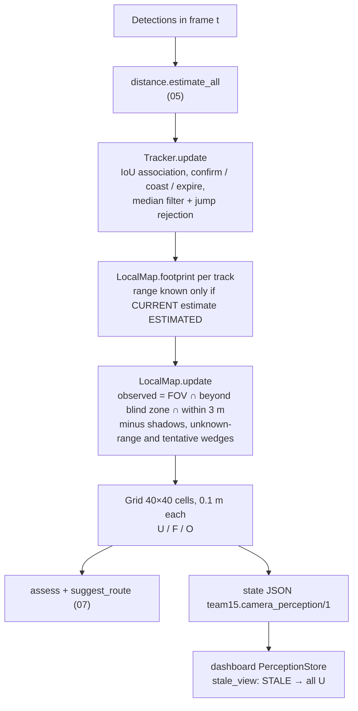
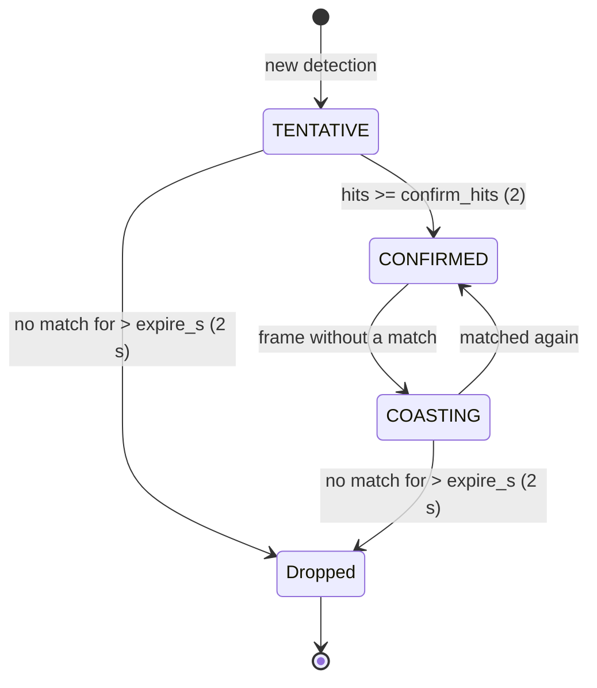
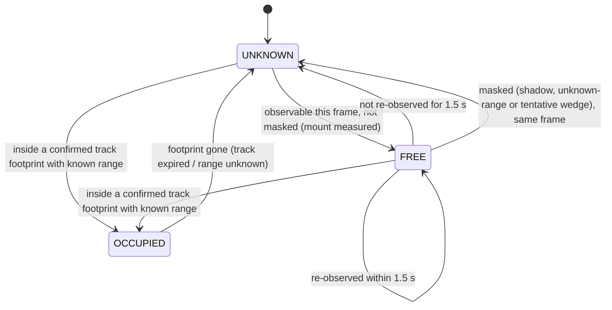

# 06 Obstacle mapping (camera-only, robot-relative)

This document explains how per-frame camera detections become a small **robot-relative occupancy grid** with three honest states (UNKNOWN, FREE, OCCUPIED). It covers temporal tracking and distance filtering (`camera_mapping/tracking.py`), the grid and its semantics (`camera_mapping/local_map.py`), occlusion shadows, freshness and stale-data handling (`camera_mapping/pipeline.py`), the live runner (`camera_mapping/live.py`) and the rover adapter (`camera_mapping/rover_adapter.py`). It also records the false-free-space and stale-map bugs that the PR #16 review found and fixed. Distances come from [05 Depth and distance estimation](05_DEPTH_AND_DISTANCE_ESTIMATION.md); the corridor verdict and routes built on the map are in [07 Path planning](07_PATH_PLANNING.md).

> All map distances are **UNCALIBRATED camera estimates**. With the shipped config the mount height and pitch are unmeasured, so **no cell can ever be FREE**: every real run recorded so far shows a map of 1,600 UNKNOWN cells and no FREE cells. That is the designed behaviour, not a fault.

**Status:** Implemented and unit-tested (SYNTHETIC). It ran on the live Pi camera (REAL HARDWARE) and on recorded Pi frames (RECORDED HARDWARE) with the mount unmeasured, so only the UNKNOWN path has been exercised on real data. It has never run on a moving robot.

**Related:** [04 Camera perception](04_CAMERA_PERCEPTION.md) · [05 Depth and distance](05_DEPTH_AND_DISTANCE_ESTIMATION.md) · [07 Path planning](07_PATH_PLANNING.md) · [16 Dashboard](16_DASHBOARD.md) · [12 RoverC motor control](12_ROVERC_MOTOR_CONTROL.md) · [17 Safety architecture](17_SAFETY_ARCHITECTURE.md) · [camera_mapping/EVALUATION.md](camera_mapping/EVALUATION.md) · [package README](../camera_mapping/README.md)

---

## 1. Problem

A single detection in a single frame is a poor basis for decisions. Detectors flicker: a chair is found in one frame and missed in the next. Distances jump when a box edge moves by a few pixels. A naive system would turn every frame's box into a "new obstacle" and treat every pixel that has no box as "free".

Both are dangerous:

- duplicates inflate the obstacle count;
- calling unobserved space "free" invites the robot to drive into what the camera could not see.

The map has to remember what was seen, forget it at the right time, and keep a clear line between **"I looked and saw nothing I recognise"** and **"I don't know"**.

## 2. Why this technology

| Choice | Alternatives | Why |
|---|---|---|
| Robot-relative 2-D grid | SLAM / global map | No odometry, IMU or pose source is wired into the camera pipeline, and the robot is stationary in the demo. A global map would need a pose we don't have, so claiming one would be fiction. |
| Three-state cells (UNKNOWN / FREE / OCCUPIED) | Probabilistic log-odds occupancy | Log-odds needs a calibrated sensor model (P(hit given occupied)). Our camera has none. Three explicit states with timestamps are easier to audit and fail toward UNKNOWN. |
| Greedy IoU tracker | SORT / DeepSORT / Kalman | A handful of objects at 2–5 fps. IoU with a same-class constraint is enough to merge duplicates. It is deterministic and testable. A Kalman filter would need a motion model; the objects and the robot are static. |
| Median distance filter + jump rejection | Mean / Kalman | The median is robust to single-frame outliers (a box that briefly grows). Explicit jump rejection with a persistence rule separates a glitch from a real scene change. |

## 3. Concept



### Frames and the grid

- **Frame:** `ROBOT_RELATIVE`. The origin is on the floor below the camera lens, `x` points forward and `y` left (the same as [05](05_DEPTH_AND_DISTANCE_ESTIMATION.md)).
- **Size:** `LocalMap(cfg, res_m=0.1, y_half_m=2.0, free_ttl_s=1.5, free_max_m=3.0)`. That is `x ∈ [0, max_range_m = 4.0]` and `y ∈ [−2, +2]`: 40 × 40 = **1,600 cells** of 10 cm.
- **Indexing:** row `i` is the forward index (near → far); column `j = 0` is the far left. `cell(x, y)` returns `(floor(x/res), floor((y_half − y)/res))`.
- **Precomputed per-cell arrays:** `X`, `Y`, `R` (range) and `B` (bearing, + left).

## 4. Math and rules

### 4.1 Tracking (`Tracker`)

**Association.** For every (track, detection) pair of the **same class**, compute the intersection-over-union:

```
IoU(A, B) = area(A ∩ B) / (area(A) + area(B) − area(A ∩ B))
```

Pairs with IoU ≥ `iou_min = 0.3` are sorted by IoU and matched greedily, one-to-one. Unmatched detections start new tracks. A different class is always a new track (`test_different_class_is_a_new_track`). (The module docstring mentions a centre-distance fallback for small boxes; the code at `d1b607a` does not implement one.)

**Lifecycle.**



Records show `validity` = `VALID` (confirmed), `TENTATIVE` or `COASTING`. Coasting tracks are still reported, so a briefly missed obstacle does not vanish from the map.

**Distance filter (`Track.filtered`, `_accept_estimate`).** Each track keeps the last `window = 5` accepted `(t, d, σ, lateral)` samples. The filtered value is the **median** of each component. A new estimate is a *jump* if:

```
|d_new − d_filt| > max(jump_abs_m = 0.5, jump_rel = 0.35 · d_filt)   AND   |d_new − d_filt| > 3 · max(σ_filt, σ_new)
```

A jump is held in `pending_jump` and counted in `rejected_jumps`. If `jump_persist = 3` jumps arrive with no accepted sample in between, the scene has really changed, so the history is replaced by the pending samples. A non-ESTIMATED estimate is never added to the history (`test_unknown_estimates_do_not_poison_filter`).

### 4.2 Footprints (`LocalMap.footprint`)

For a track with a valid **current** estimate, filtered distance `d`, σ `s` and lateral `y`:

```
half_w  = max(0.10 m, d · (w_px / fx) / 2)        (box width projected at range d)
x_near  = max(0, d − 2s)
x_far   = d + OBSTACLE_DEPTH_M (0.30 m) + 2s      (unknown depth behind the visible face)
lateral band = half_w + 2s · max(0.2, |y| / max(x, 0.1))
```

The bearing span `[bearing_lo, bearing_hi]` comes from the left and right box edges (`bearing_rad`).

**Range counts as known only while the *current* estimate is `ESTIMATED`.** This rule is the fix for the first review finding (§12). If an object that was tracked at 1.5 m moves close enough to be cut by the frame bottom, its current estimate becomes `UNKNOWN`. The old, farther median must not be used. The footprint then becomes `range_known = False`.

### 4.3 Cell states (`LocalMap.update`)

At each update, at time `t`:

1. **Observable cells** are those inside the horizontal FOV (`|B| ≤ HFOV/2 = 24.4°`), beyond the blind zone (`X ≥ nearest_visible_floor`) and within `free_max_m = 3 m`. **If the mount is unmeasured, the blind zone is unknown and no cell is observable**, so the map can never mark FREE.
2. For each track, `wedge` = the cells whose bearing lies inside the track's bearing span. Then:
   - **TENTATIVE** track: the whole wedge is `masked` (never FREE).
   - **Range unknown:** the whole wedge is masked ("something is there, range unknown").
   - **Range known:** the footprint rectangle is marked `occ`, and the wedge beyond `x_near` is masked: the occlusion shadow behind the object's face.
3. `observed &= ~masked`; `last_obs[observed] = t`; **`last_obs[masked] = −∞`**. The last step means earlier FREE does not survive behind or inside a detection.
4. `state = UNKNOWN`. Cells with `t − last_obs ≤ free_ttl_s (1.5 s)` become FREE. `occ` cells become OCCUPIED (written last, so they win).



### 4.4 What the three states mean (and do not mean)

| State | Means | Does **not** mean |
|---|---|---|
| **UNKNOWN** (`U`) | Never observed, outside the FOV, in the blind zone, beyond 3 m, in an occlusion shadow, inside the wedge of an unknown-range or tentative detection, not observed for 1.5 s, or the mount is unmeasured | "Occupied". UNKNOWN is the default and the safe assumption |
| **FREE** (`F`) | Observed within the last 1.5 s, and **no detected obstacle** there | Clear of obstacles. The camera cannot see untrained classes, glass, holes, cables or low clutter. `free_meaning` in the JSON says: *"no DETECTED obstacle (detector classes only); not a range-sensor measurement"* |
| **OCCUPIED** (`O`) | Footprint of a confirmed track with an estimated range, inflated by 2σ | A measured obstacle outline. It is a box-width rectangle with an assumed 0.30 m depth |

### 4.5 Stale observations and motion

- **Time decay:** FREE decays to UNKNOWN 1.5 s after the last observation (`test_free_space_expires_without_new_observations`).
- **Track expiry:** tracks expire 2 s after their last match (`test_scene_change_removes_old_obstacle_after_expiry`).
- **Robot motion without a pose:** `PerceptionPipeline.process(..., robot_moving=True)` calls `LocalMap.reset()` and clears every track's `history` and `pending_jump`. The map is cleared, never shifted into a guessed frame (`test_robot_motion_without_pose_resets_map`, `test_motion_reset_clears_track_histories`). **`camera_mapping/live.py` never passes `robot_moving`**: there is no odometry or motion feed. So the map is only valid while the robot is stationary, which the demo requires.
- **Dashboard staleness:** `stale_view(state, now, stale_after_s=2.0)` marks a state older than 2 s as `STALE`. It forces the assessment to `UNKNOWN` and the route to `STALE_NOT_USABLE`, rewrites every map row to all `U` and empties the footprints. The browser applies the same rule on its own clock if polling fails (see [16 Dashboard](16_DASHBOARD.md)).

## 5. Implementation in the repo

| File | Key symbols |
|---|---|
| `camera_mapping/tracking.py` | `iou`, `Track` (`filtered`), `Tracker` (`update`, `_match`, `_accept_estimate`, `confirmed`), states `TENTATIVE`, `CONFIRMED`, `COASTING` |
| `camera_mapping/local_map.py` | `LocalMap` (`cell`, `blind_zone_m`, `reset`, `footprint`, `update`, `counts`, `to_json`), `Footprint`, `UNKNOWN/FREE/OCCUPIED`, `OBSTACLE_DEPTH_M`, `MIN_HALF_WIDTH_M` |
| `camera_mapping/pipeline.py` | `PerceptionPipeline.process`, `stale_view`, `corridor_position` |
| `camera_mapping/live.py` | `main` (runner CLI), `ReplaySource`, `open_source`, `annotate`, `Advisor`, `post`, `ProducerConflict` |
| `camera_mapping/rover_adapter.py` | `camera_detections`, `log_observations`, `as_range_reading` (always raises `NotARangeSensor`), `CAMERA_SOURCE`, `OBS_KIND` |

## 6. Interfaces

```python
PerceptionPipeline(cfg, source_mode="LIVE-HW" | "RECORDED" | "SYNTHETIC", camera_info=None, **tracker_kw)
    .process(t, dets, *, frame_size=None, latency_ms=None, frame_seq=None, depth=None,
             robot_moving=False, rx_time=None) -> dict   # pure: no I/O, no motors
stale_view(state, now, stale_after_s=2.0) -> dict
rover_adapter.camera_detections(state) -> list[rover.sensors.CameraDetection]   # bearing only
rover_adapter.log_observations(state, log: rover.observations.ObservationLog)    # UNCONFIRMED only
```

`PerceptionPipeline.process` is deliberately pure given (detections, timestamp). That is why most behaviour can be unit-tested without a camera.

**Rover adapter status.** `rover_adapter` is exercised only by tests (`test_camera_never_becomes_a_range_reading`, `test_camera_observations_are_unconfirmed_and_never_block_routes`, `test_camera_detections_bearing_only`). At `d1b607a` no runtime module calls it, and `camera_mapping.live` sends nothing to the rover. Its outputs are bearing-only `CameraDetection`s and `UNCONFIRMED` observations of kind `camera_obstacle_estimate`. UNCONFIRMED observations never block a route edge in `rover/navigator.py`; a human must confirm them (see [12 RoverC motor control](12_ROVERC_MOTOR_CONTROL.md)).

## 7. Inputs and outputs

- **Input:** detections and per-detection `DistanceEstimate`s, the capture timestamp, and the frame size (if it differs from the config, the camera model is `scaled`).
- **Output:** one state dict per frame (§8), POSTed by `live.py` to `POST /api/perception/frame` with an annotated JPEG (held in dashboard memory only), and optionally appended without images to `--jsonl`.

## 8. Data structures: `team15.camera_perception/1`

Top-level keys produced by `PerceptionPipeline.process`:

| Key | Content |
|---|---|
| `schema`, `t`, `rx_time`, `frame_seq`, `frames_processed` | Identity and timing (`t` = capture time) |
| `source_mode` | `LIVE-HW`, `RECORDED` or `SYNTHETIC`. Replays are always `RECORDED`, never LIVE |
| `data_source` | Always `CAMERA_ESTIMATE` |
| `camera`, `camera_model`, `mount`, `calibration_status`, `calibration_ref` | Provenance of the geometry |
| `objects[]` | Per track: `track_id`, `object_class`, `category`, `bbox`, `detection_confidence` (with `confidence_kind: "frcnn_class_score (not a calibrated probability)"`), `distance`, `filtered_distance`, `distance_method`, `uncertainty_m`, `corridor_position`, `timestamp`, `data_source`, `source_mode`, `validity`, `track_hits`, `rejected_jumps` |
| `persons[]` | The PERSON subset of `objects` |
| `map` | `LocalMap.to_json()`: `frame`, `origin`, `res_m`, `x_max_m`, `y_half_m`, `nx`, `ny`, `encoding`, `rows` (strings of `U/F/O`), `counts`, `hfov_deg`, `blind_zone_m`, `free_space_enabled`, `free_meaning`, `footprints[]`, `resets` |
| `assessment`, `route` | See [07](07_PATH_PLANNING.md) |
| `latency_ms` | `detector_ms`, `mapping_ms`, `capture_to_rx_ms`, and from `live.py` `annotate_ms`, `total_ms`, optional `depth_ms` |
| `motion_authority` | Always `NONE` |
| `never` | `"camera distances are estimates, never physical range-sensor measurements"` |

`map.rows[i]` is the forward index `i` (near → far); character `j` runs from `+y_half` (left) to `−y_half` (right).

## 9. Configuration

Tracker: `Tracker(confirm_hits=2, expire_s=2.0, iou_min=0.3, window=5, jump_abs_m=0.5, jump_rel=0.35, jump_persist=3)`, passed through `PerceptionPipeline(**tracker_kw)`. Map: `LocalMap(res_m=0.1, y_half_m=2.0, free_ttl_s=1.5, free_max_m=3.0)` with `x_max = cfg.max_range_m`. There are no CLI flags for these; they are code defaults. The runner flags that matter here are `--source pi|local|replay`, `--replay`, `--replay-fps`, `--config`, `--dashboard`, `--duration-s`, `--jsonl` and `--depth`.

## 10. Dependencies

`numpy` (grid), `opencv-python` (annotation, JPEG), and `torch`/`torchvision` (the detector, via `perception/detectors.py`). For the Pi source, `perception.pi_source.open_pi_camera` (SSH JPEG stream; see [02 Raspberry Pi setup](02_RASPBERRY_PI_SETUP.md)).

## 11. Execution flow (`camera_mapping/live.py`)

1. Load the config and log `intrinsics …, mount measured=…, calibration …`.
2. Build `TorchObstacleDetector`. Open the source (`open_source`): `pi`, `local` or `replay`. If it fails, POST health `DISCONNECTED` and exit 3.
3. Warm up the detector on the first frame (discarded).
4. For each frame: detect → optional depth every `--depth-every` frames → `pipe.process` → `annotate` → POST `{producer, state, jpeg_b64}` with a 1 s timeout → `Advisor.offer` (a background thread; see [16](16_DASHBOARD.md)).
5. **No frames:** POST `NO_FRAMES` every 20 failures. After 300 failures, or if the source closes, POST `DISCONNECTED` and exit 3.
6. **HTTP 409 from the dashboard** (another runner is live): raise `ProducerConflict`, log it and exit 4. Before `73539a7` the runner kept posting.
7. **Ctrl-C:** POST `STOPPED`, release the camera, exit 0.

## 12. Error handling and the bugs that were fixed

Before PR #16 was merged, a separate reviewer (2026-11-08 ~11:40 UTC, session console log) checked the pipeline against four invariants: (a) nothing is VERIFIED, (b) no obstacle reads CLEAR, (c) no unobserved space reads FREE, and (d) stale data reads UNKNOWN. The reviewer reproduced several violations with synthetic scripts. Each fix landed in commit `c7ed6c5` (2026-11-08 06:51 ET) with a regression test:

| # | Bug (how it showed) | Root cause | Fix | Regression test |
|---|---|---|---|---|
| 1 | **Stale distance after a close approach.** A chair tracked at 1.5 m then fills the frame bottom; the current estimate is UNKNOWN ("nearer than 0.37 m"), yet the corridor reads **CLEAR** and the cells in front stay FREE (reviewer repro, lookahead 0.6 m / stop 0.3 m) | Once a track had history, `range_known` stayed True forever; the `not tr.history` guard could never fire | Range is known only while the **current** estimate is ESTIMATED (`footprint`: `current_ok`); the bottom-cut upper bound then gives BLOCKED in `assess` | `test_tracked_obstacle_cut_by_frame_bottom_is_never_clear` |
| 2 | **Incorrect free space behind obstacles.** After empty frames a chair appears at 1.0 m: its first (TENTATIVE) frame read **CLEAR**, and once confirmed all 96 cells behind it were still FREE for up to 1.5 s | Shadow and wedge masks only stopped `last_obs` from being refreshed. FREE comes from `t − last_obs ≤ 1.5 s`, so older FREE survived | Build one `masked` array (shadow ∪ unknown-range wedge ∪ tentative wedge) and set `last_obs[masked] = −∞` in the same frame | `test_space_behind_new_obstacle_loses_old_free_immediately`, `test_tentative_single_frame_detection_never_clear` |
| 3 | **Stale map still drawn.** A stale or NO_DATA view replaced the assessment and route but still carried `F`/`O` rows and footprints, which panel B drew in green and red | `stale_view` did not touch `map` | `stale_view` rewrites all rows to `U`, empties the footprints and sets `map.stale = true` | `test_stale_view_draws_no_free_or_occupied_cells` |
| 4 | **Browser kept the last state** when `/api/perception` stopped answering (panel C kept showing a big status, panel D "FRESH") | The JS kept `pState` with `fresh: true` | `clientStale()` in `dashboard/static/index.html` blanks the map, forces UNKNOWN and `STALE_NOT_USABLE` after `P_STALE_S = 2 s` without an answer | Browser code; checked by headless-Chrome screenshot in the session (no automated JS test) |
| 5 | **Motion reset left track histories.** `reset()` cleared the grid but not the tracker's medians | Missing clear | `process(robot_moving=True)` also clears `history` and `pending_jump` | `test_motion_reset_clears_track_histories` |

Two more issues came from evidence rather than the review:

- **Route through unobserved space with the mount unmeasured** (pre-commit code, REAL HARDWARE evidence). In live Pi run 1 (2026-11-08 11:22:51 UTC, 117 frames, [MAP-01](experiments/reports/MAP-01-live-pi-run-1-latency.md)), every state reported route `ROUTE_THROUGH_UNOBSERVED_SPACE` even though the mount was unmeasured and no cell could be FREE. By the first commit, `f482f21` (06:31 ET), `suggest_route` returns `NO_SUPPORTED_ROUTE` whenever the mount is unusable (`test_no_route_when_mount_unmeasured`). Every later run shows `NO_SUPPORTED_ROUTE`.
- **Mixed producers** (REAL HARDWARE + RECORDED). A stray replay runner and the live Pi runner fed one dashboard at the same time, so states flipped between LIVE and RECORDED. Commit `73539a7` added the single-producer lock ([16 Dashboard](16_DASHBOARD.md), [DSH-02](experiments/reports/DSH-02-dashboard-duplicate-producer.md)).

**Still open at `d1b607a`** (from the same review, not fixed): pending-jump samples must arrive without an accepted sample between them, but they need not agree with *each other* before they replace the history. `lateral_offset_m` is unused. And there is no motion feed (above).

## 13. Safety and security

- The map is advisory. `motion_authority` is `NONE` in every state, and the dashboard refuses states that claim otherwise.
- Every failure mode degrades toward UNKNOWN: no mount, stale data, camera loss, tentative tracks, unknown range.
- `rover_adapter.as_range_reading` raises, so a camera estimate can never reach the Grove forward-motion gate.
- Frames may show people. `live.py` keeps the annotated JPEG only in dashboard memory, and `--jsonl` writes state without images. `scripts/camera_demo.sh` writes logs to `~/Team15_evidence/camera_mapping/<timestamp>/`, outside Git.

## 14. Tests and observed results

Unit tests (SYNTHETIC) in `camera_mapping/tests/test_tracking_map_assess.py` cover duplicate frames (one track), confirmation/coasting/expiry, class separation, jump rejection, map coordinates, the unmeasured-mount never-FREE rule, FOV limits, shadows, unknown-range wedges, FREE expiry, motion reset, scene changes and camera disconnect. The full `camera_mapping/tests` run passed with **97 tests** at `d1b607a` (local, macOS, Python 3.13, this audit).

Real and recorded runs (each its own row; mount unmeasured in all of them):

| ID | When (UTC, 2026-11-08) | Source | States | Map result | Label |
|---|---|---|---|---|---|
| [MAP-01](experiments/reports/MAP-01-live-pi-run-1-latency.md) | 11:22:51, 24.8 s | Pi camera, empty scene (wall) | 117 | 0 detections; corridor UNKNOWN; mapping median 1.9 ms (pre-commit code; route `ROUTE_THROUGH_UNOBSERVED_SPACE`) | REAL HARDWARE |
| MAP-02 | 11:19:30, 20.2 s | Replay of earlier bench evidence frames | 41 | 666 multi-class detections (chair 288, person 155, tv 117…); corridor UNKNOWN | RECORDED HARDWARE |
| [MAP-04](experiments/reports/MAP-04-full-stack-resource-check.md) | 11:41:57–11:45:35 | Replay of one Pi frame + depth + Qwen | 434 | 1,600 U; person UNKNOWN range | RECORDED HARDWARE |
| [MAP-05](experiments/reports/MAP-05-camera-loss-stale-restart.md) | 11:47:47–11:53:02 | Replay; runner killed and restarted | 46 + 486 | STALE → UNKNOWN; restart gap 9.98 s | RECORDED HARDWARE |
| [MAP-06](experiments/reports/MAP-06-live-pi-run-2-person-chair.md) | 11:52:06–11:53:17 | Pi camera, people + chair | 266 | 24 frames with detections; 1,600 U | REAL HARDWARE |
| MAP-07 | 11:55:21, 24.7 s | Replay (shutdown test) | 50 | 1,600 U | RECORDED HARDWARE |
| MAP-08 | 12:16:32, 4.5 s | Replay on merged main | 10 | 1,600 U | RECORDED HARDWARE |

What these runs prove: the pipeline runs continuously on real frames, tracks one object across hundreds of frames as one track (for example, track #1 VALID in 433 of 434 states in MAP-04), and refuses to invent free space. What they do **not** prove: anything about FREE/OCCUPIED accuracy, occlusion handling on real scenes, or behaviour while moving. None of those has been exercised on real data.

## 15. Limitations

- No pose and no motion feed: the map is valid only for a stationary robot.
- The narrow 48.8° FOV sees little beside the robot; most detours read "through unobserved space".
- FREE is limited to the detector's classes (COCO), so it is not obstacle-free space.
- Obstacle depth is assumed (0.30 m), and the width comes from the box.
- Real-data evidence covers only the UNKNOWN path (mount unmeasured).

## 16. How to reproduce

```bash
python3 -B -m pytest -q camera_mapping/tests            # 97 tests, no hardware

# recorded frames (always labelled RECORDED); dashboard on :8000 in another terminal
python3 -B -m dashboard.serve --port 8000
python3 -B -m camera_mapping.live --source replay --replay "$TEAM15_EVIDENCE/camera_pi_validation/*.png" \
    --dashboard http://127.0.0.1:8000 --duration-s 30 --jsonl "$TEAM15_EVIDENCE/camera_mapping/manual/perception.jsonl"

# live Pi camera (robot stationary; Pi camera must be free)
python3 -B -m camera_mapping.live --source pi --pi-host "$PI_HOST" --dashboard http://127.0.0.1:8000
# or everything at once (preflight, dashboard, Qwen advisor, runner auto-restart):
scripts/camera_demo.sh            # --replay | --no-qwen | --depth ; env PORT, QWEN_PORT, PI_HOST, QWEN_ROOT, REPLAY_GLOB
```

`$TEAM15_EVIDENCE` is the private local evidence store (not in Git). Create the output directory first. Replay frames should come from the Pi camera; the IMX708 intrinsics are meaningless for other recordings (`ReplaySource.camera_info` says so).

## 17. How to extend

- **Add a pose:** feed odometry or IMU into `process` and shift `last_obs` and the tracks by the robot's motion instead of resetting. Until then, pass `robot_moving=True` from any motion source.
- **Probabilistic cells:** replace the three states with log-odds only after the calibration report gives hit and miss rates.
- **Fuse range sensors:** a verified LiDAR or ultrasonic reading could mark cells FREE or OCCUPIED independently of the detector. It should only ever make the map *more* conservative than the camera alone.
