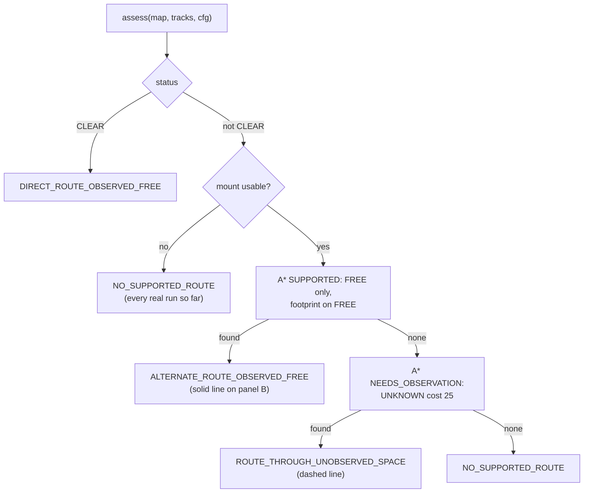
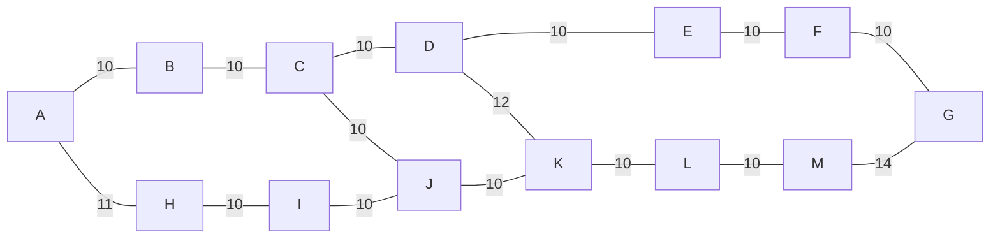

# 07 Path planning: corridor assessment, advisory routes and trail-graph routing

Team-15 has **two** planners at two scales. Both are advisory or simulated; neither drives a motor directly.

1. **Local, camera-based** (`camera_mapping/assess.py`). It intersects a robot-width forward corridor with the camera's local map ([06 Obstacle mapping](06_OBSTACLE_MAPPING.md)), returns `CLEAR`, `CAUTION`, `BLOCKED` or `UNKNOWN`, and suggests an **advisory** detour by A\* on the grid. The deterministic rescue summary (`camera_mapping/advisory.py`) turns these into operator text.
2. **Global, trail-graph** (`planner/`). It finds the shortest walking route between named nodes of a **SYNTHETIC** trail graph (`fixtures/trail_graph_synthetic.json`) with Dijkstra (`planner/route.py`). It has an optional A\* benchmark with a landmark (ALT) heuristic (`planner/astar.py`). The reference result is **A→G = 60 m**.

The rover navigator's reroute state machine (`rover/navigator.py`) calls the same Dijkstra; it is covered in [12 RoverC motor control](12_ROVERC_MOTOR_CONTROL.md).

**Status:**
- Corridor assessment and grid routes: implemented and unit-tested (SYNTHETIC). On real camera data they have **only ever returned `UNKNOWN` / `NO_SUPPORTED_ROUTE`**, because the mount is unmeasured.
- Trail-graph routing: implemented and tested (SYNTHETIC graph). It is used by the dashboard and by the rover simulation.

**Related:** [05 Depth and distance](05_DEPTH_AND_DISTANCE_ESTIMATION.md) · [06 Obstacle mapping](06_OBSTACLE_MAPPING.md) · [12 RoverC motor control](12_ROVERC_MOTOR_CONTROL.md) · [16 Dashboard](16_DASHBOARD.md) · [17 Safety architecture](17_SAFETY_ARCHITECTURE.md) · [08 Qwen model](08_QWEN_MODEL.md) · [TEAM15_DRONE_SEARCH_BUILD.md](../TEAM15_DRONE_SEARCH_BUILD.md)

---

## Part A: forward-corridor assessment (`camera_mapping/assess.py`)

### 1. Problem

Given the local map, decide whether the strip of floor the robot would sweep if it drove straight ahead is known to be free of detected obstacles. If it is not, say why, and suggest which side might be passable. The answer must never be more optimistic than the evidence.

### 2. Why this design

A rule-based verdict over the grid is **deterministic and auditable**: every status comes with human-readable `reasons` and the IDs of the tracks that caused it. A learned policy or an LLM could not offer that. Qwen is deliberately kept out of this decision; see [08 Qwen model](08_QWEN_MODEL.md). A\* on a 40×40 grid takes a few milliseconds, so there is no need for anything faster.

### 3. Concept: the corridor

```
half-width  = robot_width_m / 2 + width_margin_m  = 0.20/2 + 0.05 = 0.15 m       (corridor_half; robot width is a PLACEHOLDER)
lookahead   = lookahead_m + setback_m       = 1.5 m + 0     (measured from the lens; setback moves it to the robot front)
stop        = stop_distance_m + setback_m   = 0.6 m + 0
corridor cells = { |Y| ≤ half-width, blind zone ≤ X ≤ lookahead }
```

`near_bearing_rad` gives the corridor's half-angle at its nearest observed range: `atan2(half-width, max(blind zone, 0.3 m))`. It is used to decide whether a detection with **unknown range** points into the corridor.

### 4. Rules (`assess`)

Each footprint escalates the status. The order is `CLEAR < UNKNOWN < CAUTION < BLOCKED`, and the worst one wins.

| Status | Condition (from the code) |
|---|---|
| **BLOCKED** | A confirmed obstacle with a known range has a core lateral extent overlapping the corridor, and either its range `x ≤ lookahead` or its 2σ near edge `x_near ≤ stop`. **Or** a detection with unknown range lies in the corridor bearing and its `upper_bound_m` (box cut by the frame bottom) is `≤ lookahead`: it is nearer than that bound, so it is treated as in the way |
| **CAUTION** | The obstacle overlaps the corridor only once its uncertainty band `2σ·max(0.2, |y|/x)` is included, and `x_near ≤ lookahead` |
| **UNKNOWN** | A detection with unknown range lies in the corridor bearing (no upper bound within the lookahead); **or** the mount is unmeasured; **or** any corridor cell between the blind zone and the lookahead is not FREE (`coverage_free < 100 %`) |
| **CLEAR** | None of the above: every corridor cell is FREE and no detected obstacle overlaps. The `reasons` say *"no detected obstacle in the observed corridor"*. CLEAR is **not** a safety clearance |

Output (`assess` return value):

```json
{"status": "UNKNOWN", "reasons": ["person #1 in corridor bearing, range UNKNOWN",
  "mount height/pitch unmeasured: free space cannot be established"],
 "blocking_track_ids": [1],
 "corridor": {"half_width_m": 0.15, "lookahead_m": 1.5, "stop_distance_m": 0.6,
              "measured_from": "lens (lookahead/stop from robot front + setback 0.000 m)",
              "robot_width_m": 0.2, "robot_width_measured": false, "blind_zone_m": null, "coverage_free": 0.0},
 "scope": "detector classes only; camera estimate; advisory - never a motion permission", "advisory": true}
```

The `reasons` above are the real reasons recorded in every replay run on the Pi validation frame (for example `$TEAM15_EVIDENCE/camera_mapping/20261108-064151/perception.jsonl`, RECORDED HARDWARE).

`pipeline.corridor_position` labels each object `IN_CORRIDOR`, `LEFT_OF_CORRIDOR` or `RIGHT_OF_CORRIDOR`. For unknown-range objects it uses `IN_CORRIDOR_BEARING`, `LEFT_BEARING` or `RIGHT_BEARING`, with the same bearing rule as `assess`, so the table and the verdict agree (`test_corridor_position_matches_assessment_for_unknown_range`).

## Part B: advisory grid route (`suggest_route`)

### 5. Concept

If the corridor is not CLEAR, look for a detour across the grid from the robot's cell to any cell on the goal row (`lookahead + 0.5 m = 2.0 m`, capped by the map). The search runs in two modes, stopping at the first that finds a path:

| Mode | FREE cost | UNKNOWN cost | Extra constraint | Status if found |
|---|---|---|---|---|
| `SUPPORTED` | 1 | ∞ (impassable) | The robot's whole half-width must lie on FREE cells (`not_free` mask, inflated by `floor(half/res)` = 1 cell) | `ALTERNATE_ROUTE_OBSERVED_FREE` |
| `NEEDS_OBSERVATION` | 1 | 25 | — | `ROUTE_THROUGH_UNOBSERVED_SPACE`, with the caveat *"crosses UNKNOWN cells … observe before considering it"* |

In both modes:

- OCCUPIED cells, and the **entire wedge** of every unknown-range detection, are hazards. They are inflated by `ceil(half/res)` = 2 cells (a disc) and impassable (`_inflate`, `_shift_mask`).
- The unobservable blind band straight ahead, `|Y| ≤ half` with `X < blind zone`, costs 1. It can never be observed, and without this the start cell would be unreachable. This was review finding 6, fixed in `c7ed6c5` (`test_supported_route_found_around_side_obstacle`).
- If the corridor is CLEAR, the route is `DIRECT_ROUTE_OBSERVED_FREE`: `[[0,0],[lookahead,0]]`.
- **If the mount is unmeasured, the route is `NO_SUPPORTED_ROUTE` with no waypoints** (`test_no_route_when_mount_unmeasured`).

### 6. Math: grid A\* (`_astar`)

- 8-connected moves. Step cost = `cost[cell] × hypot(di, dj)` (1 or √2 times the cell cost).
- Heuristic `h = |goal_row − i|`, in cells. Every forward row costs at least 1 because every passable cell costs ≥ 1. So `h` never overestimates, and A\* returns the cheapest path.
- The path is simplified by dropping collinear points (`_simplify`, a cross-product test). `side` is LEFT, RIGHT or STRAIGHT from the mean lateral offset of the waypoints (±0.05 m deadband).
- `through_unknown_cells` counts the UNKNOWN cells on the path, excluding the blind band.

Every route dict carries `advisory: true`, `validated_for_driving: false`, `frame: "ROBOT_RELATIVE"`, `note: "suggestion for operator review / simulation only"`, and caveats including *"camera estimate only; detector classes only"*, *"not validated for autonomous driving"* and the blind-zone note.



### 7. Deterministic advisory text (`camera_mapping/advisory.py`)

`deterministic_summary(state)` maps the status to a fixed recommended action (`RECON_ACTIONS`). For example, BLOCKED gives *"Hold position. Operator review of the obstacle; observe an alternate side before any motion."*, and CLEAR gives *"No detected obstacle in the observed corridor. Any motion still needs the rover's safety supervisor and range gate."* It also adds one line per route status. `scene_facts(state)` builds the timestamped evidence list. `advise(state, qwen)` optionally calls the guarded Qwen service (`http_qwen`, POST `/advisory`, schema `rescue-advisory/0.1`). Any reply text that matches `MOTOR_PATTERN` is discarded (`DISCARDED_MOTOR_COMMAND_PATTERN`). The output always has `advisory_only: true` and `authority: "NONE"`, and it is never fed back into the map, the assessment or the rover (`test_qwen_output_never_changes_perception_state`). Qwen itself is documented in [08 Qwen model](08_QWEN_MODEL.md).

### 8. Observed results on real data

| Run (see [06](06_OBSTACLE_MAPPING.md) §14) | Assessment | Route | Label |
|---|---|---|---|
| MAP-01 live Pi run 1, 117 states (pre-commit code) | UNKNOWN ×117 | `ROUTE_THROUGH_UNOBSERVED_SPACE` ×117. This is the code-revision artefact fixed before `f482f21` | REAL HARDWARE |
| MAP-04, MAP-05, MAP-07, MAP-08 replays (1,026 states in total, including MAP-05's 46 + 486) | UNKNOWN ×all | `NO_SUPPORTED_ROUTE` ×all | RECORDED HARDWARE |
| MAP-06 live Pi run 2, 266 states | UNKNOWN ×266 | `NO_SUPPORTED_ROUTE` ×266 | REAL HARDWARE |

**No CLEAR, CAUTION or BLOCKED verdict, and no alternate route, has ever been produced from real camera data.** Those paths are covered only by SYNTHETIC unit tests (`test_in_corridor_obstacle_blocks`, `test_edge_obstacle_is_caution`, `test_far_obstacle_beyond_lookahead_is_not_blocked`, `test_side_obstacle_outside_corridor_is_not_blocking`, `test_bottom_cut_box_in_corridor_is_blocked_by_upper_bound`, `test_alternate_route_avoids_obstacle_and_never_enters_occupied`, `test_route_needs_observation_when_only_unknown_detour`, `test_route_never_crosses_unknown_range_wedge`, `test_clear_route_is_direct`, `test_setback_extends_corridor_from_robot_front`). The judge script's BLOCKED and alternate-route steps ([camera_mapping/JUDGE_DEMO.md](camera_mapping/JUDGE_DEMO.md) §2–4) therefore require `calibrate set-mount` to be run first. With the shipped config they would show UNKNOWN and `NO_SUPPORTED_ROUTE`. Registry entry: PLN-03 (NOT RUN on real data).

### 9. Limitations (local planner)

- It is a 2-D corridor straight ahead with a placeholder robot width (0.20 m, `robot_width_measured: false`).
- It knows only about detector classes. "CLEAR" has nothing to say about undetected obstacles.
- The goal is a row, not a target position. Routes are robot-relative, valid only for a stationary robot, and recomputed every frame.
- `validated_for_driving` is hard-coded `false`. No consumer executes these waypoints: the rover adapter forwards only bearings and UNCONFIRMED observations.

---

## Part C: trail-graph routing (`planner/`)

### 10. Problem and data

The search-and-rescue mission (see [TEAM15_DRONE_SEARCH_BUILD.md](../TEAM15_DRONE_SEARCH_BUILD.md) §3.2) is set on a trail map: sector cells A–Z, joined by walkable trail edges with lengths in metres. A responder at A needs the shortest walking route to the sector where a candidate was sighted, avoiding edges reported as blocked.

`fixtures/trail_graph_synthetic.json` is **SYNTHETIC**. Its `_note` reads *"SYNTHETIC trail graph from TEAM15_DRONE_SEARCH_BUILD.md section 3.2; undirected; distances in metres; Q-Z have no known trail edges"*. It has 26 nodes and 15 undirected edges; only A–M have edges.



### 11. Dijkstra (`planner/route.py` `compute_route`)

Dijkstra's algorithm finds shortest paths from one source when every edge weight is non-negative. It keeps a priority queue (`heapq`) of tentative distances. It repeatedly settles the closest unsettled node `u`, relaxing each neighbour `v` with `dist[v] = min(dist[v], dist[u] + w(u, v))`. Once a node is popped, its distance is final, because any other path to it would have to pass through a node at least as far away. Complexity is O((V + E) log V).

Implementation details:

- `blocked` accepts `("J","K")`, `"J-K"` or `frozenset({"J","K"})`, always undirected (`_normalise_blocked`). Blocked edges are skipped during relaxation.
- The search stops early when the destination is settled.
- Statuses: `OK`, `NO_KNOWN_ROUTE` (with a reason such as *"Q has no known walkable connection"*) and `UNKNOWN_NODE`.
- `reason` names any blocked edges that exist in the graph: *"edge J-K blocked by responder report"*.
- `RouteResult(status, path, edges, length_m, reason)` has a `.to_dict()`.

### 12. A\* with ALT landmarks (`planner/astar.py`): benchmark only

The trail graph has no coordinates, so a Euclidean heuristic is impossible. ALT (A\*, Landmarks, Triangle inequality) precomputes the exact distances `d(L, ·)` from a few landmark nodes `L`. For any node `n` and target `t`, the triangle inequality gives `d(n, t) ≥ |d(L, t) − d(L, n)|`, so

```
h(n) = max over L of |d(L, t) − d(L, n)|
```

is **admissible**: it never overestimates. Blocking edges only makes shortest paths longer, so landmark distances computed on the unblocked graph stay admissible under any set of blocked edges. `AltHeuristic._pick` chooses `k = 3` landmarks by farthest-point selection; on the fixture these are A, G and K, and `h(A, G) = 60`, which is exact. `astar_route` returns `(RouteResult, nodes_expanded)`. The module docstring is explicit: Dijkstra (`compute_route`) remains the route used for navigation, and A\* is compared against it and never replaces it.

### 13. Results (SYNTHETIC graph; local run during this audit at `d1b607a`, Python 3.13)

| Query | Path | Length | Source |
|---|---|---|---|
| `A G` | A-B-C-D-E-F-G | **60 m** | `python3 -B -m planner.route A G`; `test_route_a_to_g_60` |
| `C K` | C-J-K | 20 m | `test_route_c_to_k_20` |
| `C K --block J-K` | C-D-K | 22 m | CLI; `test_blocked_jk_reroutes_22` (4 spellings of the edge) |
| `C G` | C-D-E-F-G | 40 m | CLI; `test_route_c_to_g_40` |
| `A G --block E-F` | A-B-C-J-K-L-M-G | 74 m | CLI (this audit) |
| `A Q` | — | `NO_KNOWN_ROUTE` ("Q has no known walkable connection") | CLI; `test_y_no_known_route` covers Y |
| A\* `A G` | A-B-C-D-E-F-G | 60 m, 7 nodes expanded | `test_a_to_g_60_and_expands_no_more_than_dijkstra_nodes` |

`planner/tests`: **19 passed** (this audit). This includes a networkx cross-check of every node pair with and without J–K blocked (`test_cross_check_networkx_all_pairs`), an exhaustive admissibility check of the ALT heuristic over all pairs (`test_heuristic_admissible_all_pairs`), and A\* = Dijkstra on every ordered pair under five blocked-edge sets (`test_astar_matches_dijkstra`). Registry: PLN-01 and PLN-02; report [PLN-01](experiments/reports/PLN-01-trail-graph-route-tests.md). These results prove the algorithms are correct on this graph. They say nothing about real terrain, since every distance is synthetic.

### 14. Where the trail planner is used

- **Dashboard** (`core/store.py` `MissionStore._replan`): the route from the responder node (default A) to the newest non-rejected sighting. A new route version is made only when the start, destination or blocked-edge set changes (see [16 Dashboard](16_DASHBOARD.md)).
- **Rover navigation simulation** (`rover/navigator.py` `Navigator._plan`): `compute_route(start, dest, blocked=self.log.blocked_edges(), graph=self.g)`. The state machine marks an edge blocked only after several consistent fresh range readings from a trusted pose and heading. It then enters `REPLAN_SHORTEST_ROUTE` and verifies the detour. **Camera observations are UNCONFIRMED and never block an edge.** This is simulation-tested only; real wheel motion is NOT TESTED. Details: [12 RoverC motor control](12_ROVERC_MOTOR_CONTROL.md).

### 15. How to reproduce

```bash
python3 -B -m planner.route A G                      # {"status": "OK", ..., "length_m": 60, ...}
python3 -B -m planner.route C K --block J-K          # 22 m via C-D-K
python3 -B -m planner.route A G --graph fixtures/trail_graph_synthetic.json
python3 -B -m pytest -q planner/tests                # 19 tests
python3 -B -m pytest -q camera_mapping/tests/test_tracking_map_assess.py   # corridor + grid routes (SYNTHETIC)
```

`planner.route` exits 0 for `OK` and 1 otherwise.

### 16. How to extend

- **Real trail data:** supply a new JSON with `nodes` and `edges[{a, b, m}]` through `--graph`. `load_graph` rejects unknown nodes, self-loops and negative lengths.
- **Coordinates:** if nodes gain coordinates, a Euclidean heuristic can be added next to ALT. Keep Dijkstra as the reference and keep the equivalence test.
- **Local planner:** make `robot_width_m` measured, add a target position instead of a goal row, and only then consider whether `validated_for_driving` could ever become true. That would need a separate safety review ([17](17_SAFETY_ARCHITECTURE.md)).
