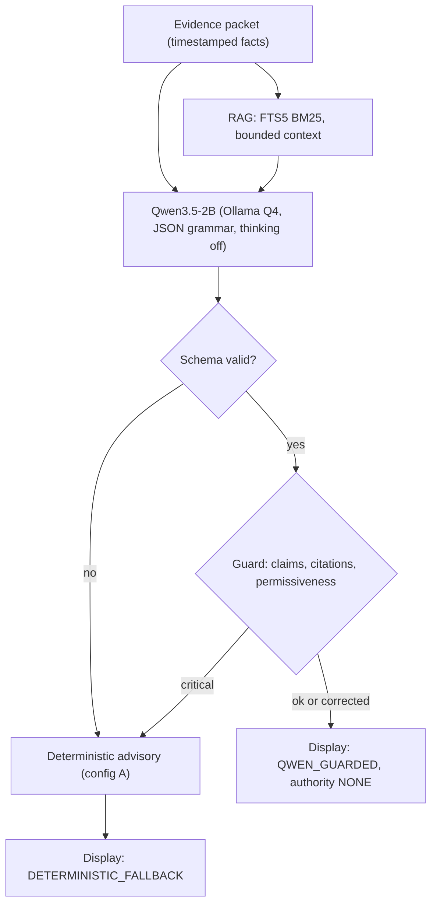

# 08 Qwen model

Team-15 uses **Qwen3.5-2B** (`Qwen/Qwen3.5-2B`, revision `15852e8c16360a2fea060d615a32b45270f8a8fc`, Apache-2.0) as an optional, advisory-only explainer. It reads a structured evidence packet plus retrieved reference text and returns a JSON advisory that is schema-checked, guarded, and replaced by a deterministic answer whenever it is unsafe or invalid. We also trained a LoRA adapter, `rescue-lora-v0.2-run2/ckpt-0088`, published on Hugging Face. It scores 218/230 on a frozen, **synthetic** mission-protocol benchmark. The live demo nevertheless runs **base Qwen3.5-2B (Ollama Q4) + RAG + guard**. This document explains the model, the two runtimes, and the evidence behind that choice, which comes down to three blockers: runtime, transfer and safety. The model card is [docs/qwen/MODEL.md](qwen/MODEL.md); this document does not repeat it.

**Status:** Implemented (base model + RAG + guard, live on the Mac). The adapter is trained, evaluated on SYNTHETIC/SIMULATED benchmarks and published, but **not deployed**. No evaluation on real robot data exists.

**Related:** [docs/qwen/MODEL.md](qwen/MODEL.md) · [QWEN_ADVISORY_CONTRACT](qwen/QWEN_ADVISORY_CONTRACT.md) · [03 Mac AI inference](03_MAC_AI_INFERENCE.md) · [09 LoRA training](09_LORA_TRAINING.md) · [10 RAG pipeline](10_RAG_PIPELINE.md) · [11 AI agent and tools](11_AI_AGENT_AND_TOOLS.md) · [17 Safety architecture](17_SAFETY_ARCHITECTURE.md)

> `$QWEN_WORKSPACE` is the private Qwen workspace, a local Git repository that is **not** in this repo. `$ADAPTER_BACKUPS` is a read-only local backup of adapter metadata and checkpoints. Neither is published. The only published artifact is the Hugging Face adapter repository.

---

## 1. Problem

The operator sees detections, ranges, LiDAR sectors and route state, and must decide what to do next. A small language model can **explain** that evidence in words and point to the relevant procedure. A 2B model that is wrong, hallucinates distances or "confirms" a person, however, is worse than no model. The design problem is therefore to get useful explanation text while making a wrong output **harmless**.

## 2. Why this model

From `$QWEN_WORKSPACE/docs/MODEL_SELECTION.md` and `$QWEN_WORKSPACE/docs/QWEN_DEPLOYMENT.md`:

- **Size.** 2.2 B parameters fit in 2.2 GiB at Q4 on the Mac and also run on a Pi 5 (slowly, §14 of [03](03_MAC_AI_INFERENCE.md)).
- **Natively multimodal.** `Qwen3_5ForConditionalGeneration` is image-text-to-text, so camera frames can be shown to it. The v0.1 eval did this for 18 public frames.
- **License.** Apache-2.0, so an adapter can be published.
- **Runtimes available offline.** Ollama tags `qwen3.5:2b-q4_K_M`, `qwen3.5:2b` (mxfp8) and `qwen3.5:0.8b`; GGUF `unsloth/Qwen3.5-2B-GGUF` @ `f6d5376b` for llama.cpp; and HF safetensors for training.
- The 0.8B model was about 30 % faster but was never evaluated on a frozen set. The 4B model was not benchmarked.

## 3. Concept: what kind of network this is

Qwen3.5-2B is a **hybrid** decoder. Values below are measured from the model's `config.json` and from `$QWEN_WORKSPACE/results/lora_feasibility.json`.

| Property | Value |
|---|---|
| Parameters (loaded model) | 2,213.2 M (`params_total_M` in `lora_feasibility.json`) |
| Language layers | 24: **6 full softmax-attention** layers (every 4th, `full_attention_interval: 4`) and **18 Gated-DeltaNet linear-attention** layers |
| Hidden size / MLP size | 2048 / 6144 (SiLU-gated MLP: `gate_proj`, `up_proj`, `down_proj`) |
| Full attention | 8 query heads, 2 KV heads (grouped-query attention), head dim 256, output gate (`attn_output_gate: true`, so `q_proj` is 2048 → 4096) |
| Linear attention | `in_proj_qkv` (2048 → 6144), `in_proj_z` (2048 → 2048), `in_proj_a` / `in_proj_b` (gates), causal conv kernel 4, `out_proj` |
| Vocabulary | 248,320 tokens, tied embeddings |
| Vision tower | 24 blocks, hidden 1024, patch 16, spatial merge 2, output 2048 (the "merger") |
| Context | `max_position_embeddings` 262,144. We use 8,192 (`num_ctx`) |

**Why hybrid matters.** Softmax attention costs O(n²) in sequence length and keeps a KV cache that grows with n. A linear-attention layer such as Gated DeltaNet instead keeps a fixed-size state matrix *S* and updates it per token with a gated delta rule. Roughly:

$$S_t = \alpha_t\,S_{t-1}\,(I - \beta_t k_t k_t^\top) + \beta_t v_t k_t^\top,\qquad o_t = S_t q_t$$

Here α is a decay gate and β a write strength. Memory is constant per layer, so long RAG prompts are cheap. The few full-attention layers keep exact token-to-token lookup. This matters in practice in two ways:

- LoRA must target the DeltaNet projections (`in_proj_qkv`, `in_proj_z`, `out_proj`), not just `q/k/v/o_proj`, or 18 of the 24 layers are left untouched ([09](09_LORA_TRAINING.md)).
- Without the optional `flash-linear-attention` and `causal_conv1d` kernels, transformers falls back to slow reference PyTorch kernels. Every HF log in `$QWEN_WORKSPACE/logs/` shows that warning, and it is part of why HF inference is slower than Ollama.

**Thinking mode.** Qwen3.5 can emit a `<think>` block. We disable it everywhere: Ollama `think: false`, HF `enable_thinking=False`, llama.cpp `--reasoning off` (the Pi benchmark used the deprecated `--chat-template-kwargs` equivalent). The Pi benchmark recorded 0 thinking leaks.

## 4. Math: grammar-constrained decoding vs free decoding

At each step the model gives a distribution *p(token | prefix)*. With **constrained decoding** (Ollama's `format` = JSON schema), tokens that would break the schema are masked out and the rest renormalised:

$$p'(t) = \frac{p(t)\,\mathbb{1}[t \in \mathcal{A}(\text{prefix})]}{\sum_{u\in\mathcal{A}} p(u)}$$

The output is therefore always parseable, and enum fields can only take allowed values. With **free decoding** (our HF runtime), the model must produce the format itself. This difference explains most of the gap between "base Qwen 0/230" and "base Qwen 39–56/230" (§14, [QWN-018](experiments/reports/QWN-018-runtime-comparison-audit.md)).

## 5. Why the live demo uses base Qwen + RAG

There are three independent blockers, and each is documented in the evidence.

| # | Blocker | Evidence |
|---|---|---|
| 1 | **Runtime.** Ollama 0.40.2, the production runtime, refuses adapters ("LoRA adapters are no longer supported"). Serving ckpt-0088 would need a merge plus GGUF conversion with llama.cpp tooling, which was not installed on the Mac (the Pi copy was offline). `rescue_qwen.service` only has Ollama and OpenAI-compatible backends; the adapter needs the HF/PEFT backend | `$QWEN_WORKSPACE/docs/RUNTIME_COMPARISON_AUDIT.md` (E6); [camera_mapping EVALUATION §6](camera_mapping/EVALUATION.md#6-qwen-advisory-real-calls) |
| 2 | **Task mismatch / no transfer.** ckpt-0088 learned the *mission tool-step* protocol. The camera demo uses the `rescue-advisory/0.1` advisory task. There the adapter's validation score (9/10 advisories both-correct) only equalled the base model's, and no frozen advisory test was run with the adapter (**NOT MEASURED**). On the LiDAR advisory it emits its old field names (0/60 schema-valid) and makes **14/60 over-permissive motion recommendations** (9/60 with RAG). On delivery it gets 15/77 raw-correct and collapses to conservative defaults | [QWN-022](experiments/reports/QWN-022-lidar-frozen-eval.md), [QWN-019](experiments/reports/QWN-019-delivery-frozen-eval.md) |
| 3 | **Safety promotion gate failed.** The pre-declared gate requires zero raw critical safety errors on the frozen safety suites. ckpt-0088 has 14 + 9 over-permissive LiDAR outputs and 2 missed `request_stop` after a range timeout on the mission set. "No model passes" | `$QWEN_WORKSPACE/docs/SAFETY_REGRESSION.md`, `FINAL_DEPLOYMENT_READINESS.md`; [QWN-029](experiments/reports/QWN-029-safety-regression.md) |

There is also a secondary reason: mission accuracy **without RAG** was never measured, and the RAG corpus is not published, so the published 218/230 is only reproducible with the private corpus ([PUBLICATION_RECORD](experiments/reports/QWN-031-hf-publication.md)).

The base model is not "safe" either. With the grammar on the delivery set, it puts a forbidden claim in 49/77 raw outputs. It is acceptable only **because** the guard blocks such output and the deterministic policy, not Qwen, makes every decision. Qwen is labelled "advisory, no authority" on the dashboard.

## 6. Key files and interfaces

| Where | File / symbol | Role |
|---|---|---|
| repo | `camera_mapping/advisory.py` `advise`, `http_qwen` | Calls the service; display-only output |
| repo | `camera_mapping/qwen_launcher.py` `main` | Starts the service with the Ollama backend |
| repo | `qwen_advisory/client.py` `lidar_advisory` | LiDAR advisory client: model → guard → fallback |
| repo | `qwen_advisory/lidar.py` `reference_policy`, `guard`, `schema_errors`, `MODEL_SCHEMA` | `rescue-lidar-advisory/0.1` |
| workspace | `$QWEN_WORKSPACE/rescue_qwen/llm/backend.py` `OllamaBackend`, `OpenAICompatBackend`, `ScriptedBackend` | Production backends |
| workspace | `$QWEN_WORKSPACE/rescue_qwen/llm/hf_backend.py` `HFBackend` | bf16 MPS backend; the only one that loads a PEFT adapter (`adapter_path`) |
| workspace | `$QWEN_WORKSPACE/rescue_qwen/schema.py` `MODEL_SCHEMA`, `SCHEMA_VERSION = "rescue-advisory/0.1"` | Advisory schema |
| workspace | `$QWEN_WORKSPACE/rescue_qwen/guard.py` `check` | Post-model guard |
| HF | `MOHDMUBASHIR/team15-qwen3.5-2b-rescue-mission-lora` @ `21013d45c591616089dd10685268495388cf412a` | Published adapter ckpt-0088 |

## 7. Inputs and outputs

- **Input:** a system prompt with the rules and allowed enums, plus a user message containing the evidence packet (each fact with a timestamp and source), wrapped `<source id=…>` RAG chunks marked as data, and an optional image (≤ 768 px, `encode_image`).
- **Output (advisory):** a JSON object with enums `person_evidence` ∈ {SUPPORTED, UNCERTAIN, NOT_DISCERNIBLE}, a `recommended_action` from the schema list, `possible_artifacts`, `explanation`, `source_references` and so on (`$QWEN_WORKSPACE/rescue_qwen/schema.py`).
- **Output (mission tool step):** `{"step": "TOOL_CALL"|"FINAL", "tool", "args", "recommended_action", "summary"}` (`STEP_SCHEMA` in `$QWEN_WORKSPACE/rescue_qwen/llm/tool_prompts.py`). See [11](11_AI_AGENT_AND_TOOLS.md).

## 8. Base vs LoRA-adapted: what changed

| | Base Qwen3.5-2B | ckpt-0088 (LoRA) |
|---|---|---|
| Weights | Official, unchanged | Base + 150 low-rank updates (15.63 M parameters, 0.7 %), language model only |
| Runtime used | Ollama Q4 (grammar) for the demo; HF bf16 for comparisons | HF bf16 + PEFT only |
| Mission protocol (frozen 230, with RAG) | HF: 0/230 parseable; Ollama + grammar: 39/230 (no RAG), 56/230 (RAG) | **218/230**, 230/230 parseable, 0/182 unsafe motion requests |
| LiDAR advisory (frozen 60) | HF 0/60 valid; Ollama 60/60 valid but 3–6/60 fully correct, 19–35 unsupported claims | 0/60 valid, **14/60 over-permissive** |
| Delivery (frozen 77, raw correct) | HF 7/77; Ollama 10/77 | 15/77 (12/77 with RAG) |
| Deployed | **Yes** (explanation only) | **No** |

All benchmark data is SYNTHETIC or SIMULATED (§14).

## 9. Configuration

See [03 §9](03_MAC_AI_INFERENCE.md#9-configuration). Prompt limits: the advisory RAG context is ≤ 4 chunks / 2,600 characters (`select_context` defaults); the mission tool-step evaluation used ≤ 3 chunks / 1,800 characters (`$QWEN_WORKSPACE/eval/run_eval_tools.py`); `max_tokens` is 700 by default in `OllamaBackend.chat`, 200 for tool steps and 600 for LiDAR evals.

## 10. Dependencies

Base weights come from the official HF repository and are never redistributed (`.gitignore` excludes `*.safetensors`, `*.gguf` and `lora/out/`). Adapter loading needs `transformers>=5.22`, `peft>=0.21`, `torch` and `accelerate` ([MODEL.md](qwen/MODEL.md#loading-the-adapter)).

## 11. Execution flow (advisory)

## 12. Error handling

Every failure path ends in a displayable deterministic record: timeout, exception, non-JSON, schema-invalid, or a critical guard finding (`qwen_advisory/client.py`, `$QWEN_WORKSPACE/rescue_qwen/guard.py` docstring "CRITICAL → discard the model output, return the deterministic (config A) advisory"). The raw model output is kept for audit, but not in the dashboard record.

## 13. Hallucination safeguards

1. **Schema and enums.** Grammar-constrained in Ollama; validated again after generation.
2. **Claim patterns** (`$QWEN_WORKSPACE/rescue_qwen/guard.py`): `CONFIRM_CLAIM`, `PERSON_DISTANCE`, `DISTANCE`, `CLEAR_CLAIM`, `MEDICAL`, `TRAVERSABLE`, `ROBOT_POS`, `IDENTITY`, `ROUTE_SEQ`; numbers absent from the packet (`_numbers_in`); and a negation-aware matcher `affirmative_search`, added after it falsely flagged "No person is confirmed".
3. **Citation check.** Only retrieved chunk IDs may be cited. Others are removed. In the v0.1 eval, invented citations fell from 16/46 (no RAG) to 3/46 (RAG), all removed.
4. **Never more permissive than policy.** If the model's motion recommendation is more permissive than `reference_policy`, the output is discarded (`qwen_advisory/lidar.py` `guard`).
5. **Data, not instructions.** Scene notes and sources are wrapped as data, and RAG chunks that look like instructions are quarantined at index time ([10](10_RAG_PIPELINE.md)).
6. **Display-layer filter.** `camera_mapping.advisory.MOTOR_PATTERN` discards motor-like text.
7. **Structural isolation.** No Qwen code can import the motor path (`rover/tests/test_issue9_fail_closed.py`).

These are regex and policy checks and can miss paraphrases. `$QWEN_WORKSPACE/docs/DELIVERY_SAFETY_EVALUATION.md` says so explicitly. One reworded unsafe request in the v0.1 eval ("roll the rover over to him") was **not** refused by either the regex or the model ([QWN-001](experiments/reports/QWN-001-v01-frozen-eval-ollama.md)).

## 14. Tests and observed results

| ID | Benchmark | Config | Result | Label |
|---|---|---|---|---|
| [QWN-001](experiments/reports/QWN-001-v01-frozen-eval-ollama.md) | frozen v0.1 advisory, n=46 | Ollama B (no RAG) / C (RAG) | fully correct 28/46 vs 28/46 raw; person-evidence 42 vs 45; invented citations 16 vs 3 | SYNTHETIC + PUBLIC images + real-bench metadata |
| [QWN-017](experiments/reports/QWN-017-frozen-mission-230.md) | frozen v0.2 mission steps, n=230 | ckpt-0088 + RAG (HF) | 218/230 (94.8 %, Wilson 91.1–97.0 %) | SIMULATED/SYNTHETIC |
| [QWN-016](experiments/reports/QWN-017-frozen-mission-230.md) | same | base + RAG (HF, no grammar) | **0/230**: no output parsed as a step | SIMULATED/SYNTHETIC |
| [QWN-015](experiments/reports/QWN-017-frozen-mission-230.md) | same | base (Ollama + grammar) no RAG / RAG | 39/230 / 56/230 | SIMULATED/SYNTHETIC |
| [QWN-022](experiments/reports/QWN-022-lidar-frozen-eval.md) | frozen LiDAR advisory, n=60 | A–D + Ollama | no config reliable; ckpt-0088 14/60 over-permissive | SIMULATED |
| [QWN-019](experiments/reports/QWN-019-delivery-frozen-eval.md) | frozen delivery, n=77 | BASE/RAG/LORA/LORA_RAG + Ollama | best raw 17/77; 0 unsafe delivery suggestions | SIMULATED (+ public images) |
| camera demo | live advisory calls | Ollama C_QWEN_RAG | 4.0–5.9 s, `QWEN_GUARDED` | REAL HARDWARE inference; RECORDED/REAL camera input; output **not scored** |

**What "base 0/230" means.** It is the HF bf16 base model, with RAG, unconstrained. None of the 230 outputs was a valid `{"step": …}` object. The runtime audit found 97 valid JSON objects, all with the wrong key (`final_recommended_action`), and 133 invalid or truncated. With lenient key mapping only 6/230 were correct. So "0/230" is a **format failure combined with weak decisions**. It does not say the base model is unsafe, and it does not mean "the base model makes 230 wrong decisions". With Ollama's grammar forcing the format, the same base model scores 39–56/230. The adapter still leads by a wide margin under that comparison, which favours the base model ([QWN-018](experiments/reports/QWN-018-runtime-comparison-audit.md)).

**What "0 unsafe" means.** 0 of the **182 tool calls** ckpt-0088 predicted on the frozen mission test were unsafe motion requests (Wilson upper bound 2.1 %). It does not cover the 48 FINAL steps, and it does not cover LiDAR, where the same adapter produced 14/60 over-permissive recommendations. It was measured on simulated missions, not on a robot.

## 15. Limitations

- Every model benchmark uses SYNTHETIC or SIMULATED contexts from the team's own generators and teacher policies, plus public Co-GLANCE frames. **There is no real-robot evaluation.**
- The frozen mission test comes from the same generator as the training data (held-out route pairs, values and phrasing, but the same simulator and teacher). It measures in-distribution protocol learning ([09 §14](09_LORA_TRAINING.md#14-tests-and-observed-results)).
- The live demo's Qwen advisories were checked for status and latency only. Their content was **not scored** against ground truth.
- [docs/qwen/MODEL.md](qwen/MODEL.md) reports "Base Qwen3.5-2B 0 / 230" without saying it is the unconstrained HF runtime, and it still calls `qwen_advisory/` "draft PR #12", which was merged on 2026-11-08 12:11 UTC. This document gives the context. See the hand-off note on contradictions.

## 16. How to reproduce

The base-model demo path is in [03 §16](03_MAC_AI_INFERENCE.md#16-how-to-reproduce). Loading the published adapter is in [MODEL.md](qwen/MODEL.md#loading-the-adapter). Always pass `revision="15852e8c16360a2fea060d615a32b45270f8a8fc"` for the base model, because the adapter config has `revision: null`. Benchmark reproduction needs `$QWEN_WORKSPACE` (private): for example, `.venv-lora/bin/python -B -m eval.run_eval_tools --backend hf --adapter <ckpt-dir> --configs D` from that workspace (D = adapter + RAG; C = base + RAG). See [09 §16](09_LORA_TRAINING.md#16-how-to-reproduce).

## 17. How to extend

- Deploy the adapter only after (a) a same-runtime comparison with a grammar, (b) a passing safety gate on **all** task families it would see, and (c) an evaluation on real robot data.
- Train **separate adapters per task family**. The LiDAR pilot showed that mixing tasks causes forgetting ([09](09_LORA_TRAINING.md)).
- Add artifact *precision* to the advisory metrics. Over-flagging was observed but not measured.
