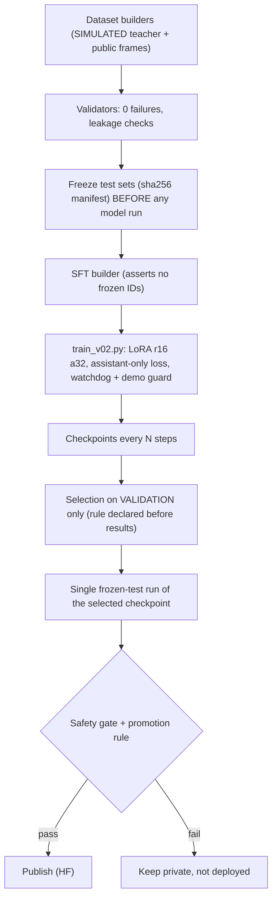

# 09 LoRA training

We fine-tuned Qwen3.5-2B with **LoRA** (low-rank adaptation) on one Mac (M4 Pro, 24 GB, PyTorch MPS, bf16) to teach it Team-15's mission tool-step protocol and advisory formats. There were six attempts. Two produced usable adapters:

- **`rescue-lora-v0.2-run2`**: 89 optimizer steps, 79 minutes. Its checkpoint **ckpt-0088** was selected on validation and scored **218/230** on a frozen, **synthetic** mission benchmark, with 0/182 unsafe motion requests. It is published on Hugging Face.
- **`rescue-lidar-lora-v0.1-pilot`**: 80 steps. It was **not promoted**: the pre-declared selection excluded every checkpoint, it showed critical safety failures, and it regressed the mission task.

A third experiment, a delivery adapter, was prepared but **never trained**. This document explains LoRA from first principles, then gives the exact configuration, data, loss curves, checkpoint-selection rules, evaluation method and results for each run, including the failures.

**Status:** Implemented and trained (Mac, REAL HARDWARE compute) on SYNTHETIC/SIMULATED data plus 7 public images. Evaluated on SYNTHETIC/SIMULATED frozen sets only. The adapter is published but **not deployed** ([08 §5](08_QWEN_MODEL.md#5-why-the-live-demo-uses-base-qwen--rag)).

**Related:** [08 Qwen model](08_QWEN_MODEL.md) · [docs/qwen/MODEL.md](qwen/MODEL.md) · [10 RAG pipeline](10_RAG_PIPELINE.md) · [11 AI agent and tools](11_AI_AGENT_AND_TOOLS.md) · [22 Experiments and failures](22_EXPERIMENTS_AND_FAILURES.md) · Reports: [QWN-010 smoke](experiments/reports/QWN-010-lora-smoke.md), [QWN-011 run1](experiments/reports/QWN-011-lora-run1-failed.md), [QWN-012 run1b](experiments/reports/QWN-012-lora-run1b-oom.md), [QWN-013 run2](experiments/reports/QWN-013-lora-run2.md), [QWN-024 LiDAR pilot](experiments/reports/QWN-024-lidar-lora-pilot.md), [QWN-030 delivery LoRA](experiments/reports/QWN-030-delivery-lora-not-run.md)

> Evidence lives in two private local stores that are **not in this repo**. `$QWEN_WORKSPACE` is the Qwen workspace, which holds the trainer, data, logs and results. `$ADAPTER_BACKUPS` is the read-only adapter backup, which holds `config.json`, `train_log.jsonl`, `selection.json` and the checkpoints. **No weights or training data are copied into this repository.**

---

## 1. Problem

Untuned Qwen3.5-2B does not follow our step protocol (`{"step": "TOOL_CALL"|"FINAL", …}`) on its own. On the frozen mission set it produced **0/230** parseable steps without a grammar, and even with Ollama's JSON grammar it chose the right step only 39–56/230 times ([QWN-017](experiments/reports/QWN-017-frozen-mission-230.md)). We wanted the model to learn the protocol, the safety ordering (stop before escalate) and grounded summaries, without retraining all 2.2 B parameters on a laptop.

## 2. Why LoRA

| Option | Cost on a 24 GB Mac | Verdict |
|---|---|---|
| Full fine-tuning | bf16 weights (4.4 GB) plus gradients and AdamW moments (about 3 × 4.4 GB or more) plus activations. Does not fit next to the demo | Rejected |
| **LoRA** | Trains 15.63 M parameters (0.7 %). AdamW state about 125 MB. The base is frozen | **Chosen** |
| QLoRA (4-bit base) | Less memory | **Not possible on MPS**: bitsandbytes needs CUDA (`LORA_EXPERIMENT_CONFIG.yaml`) |
| Prompting only (base + RAG) | No training | Is the baseline; fails the protocol (§1) |

## 3. Concept: LoRA from first principles

A linear layer computes *y = W x* with *W ∈ ℝ^{d_out × d_in}*. Fine-tuning learns an update ΔW. The LoRA hypothesis (Hu et al., 2021, which is in our RAG corpus as `ext-hu-2021-lora`) is that the useful update for a narrow task has **low intrinsic rank**. LoRA therefore writes ΔW as the product of two thin matrices and trains only those:

$$y = W_0 x + \frac{\alpha}{r} B A x,\qquad A\in\mathbb{R}^{r\times d_\text{in}},\; B\in\mathbb{R}^{d_\text{out}\times r},\; r \ll \min(d_\text{in}, d_\text{out})$$

- *W₀* is **frozen** and gets no gradient and no optimizer state.
- *A* is initialised randomly and **B = 0**, so at step 0 *BA = 0* and the adapted model equals the base exactly. Our run2 report checked the converse: after training, 150/150 B matrices were non-zero (Σ‖B‖ = 29.14 at ckpt-0088), so the weights really changed.
- **Rank r** caps how many independent directions the update can use. **α** is a scale. The effective multiplier is α/r, so changing r does not change the update's magnitude at initialisation. We use **r = 16, α = 32**, giving a multiplier of 2.
- **Dropout** of 0.05 is applied to the LoRA input path during training.
- At inference you can keep A and B separate (PEFT does this) or **merge** them, *W = W₀ + (α/r)BA*, which costs no extra latency. Merging plus GGUF conversion is the step we never did, and it blocks serving the adapter in Ollama.

**Parameter count, worked for our model.** Each adapted matrix adds *r · (d_in + d_out)* parameters. The table uses shapes read from the safetensors header of revision `15852e8c`, computed as 16 × (d_in + d_out) × count:

| Module | d_out × d_in | Count | Added parameters |
|---|---|---|---|
| `q_proj` (full attention, output-gated) | 4096 × 2048 | 6 | 589,824 |
| `k_proj`, `v_proj` | 512 × 2048 | 6 + 6 | 491,520 |
| `o_proj` | 2048 × 2048 | 6 | 393,216 |
| `in_proj_qkv` (DeltaNet) | 6144 × 2048 | 18 | 2,359,296 |
| `in_proj_z` (DeltaNet) | 2048 × 2048 | 18 | 1,179,648 |
| `out_proj` (DeltaNet) | 2048 × 2048 | 18 | 1,179,648 |
| `gate_proj`, `up_proj` (MLP) | 6144 × 2048 | 24 + 24 | 6,291,456 |
| `down_proj` (MLP) | 2048 × 6144 | 24 | 3,145,728 |
| **Total** | | **150 modules** | **15,630,336 = 15.63 M** |

This matches `trainable_params_M: 15.63` in every run's `config.json`. An earlier feasibility check (`$QWEN_WORKSPACE/results/lora_feasibility.json`, 2026-11-07 18:34 ET) measured 10.91 M with the original 7-module target list.

**Which modules, and why.** Qwen3.5-2B is hybrid ([08 §3](08_QWEN_MODEL.md#3-concept-what-kind-of-network-this-is)). Only 6 of its 24 layers have `q/k/v/o_proj`; the other 18 are Gated-DeltaNet layers whose projections are `in_proj_qkv`, `in_proj_z` and `out_proj`. Targeting only attention would leave 75 % of the layers' token-mixing untouched, so all of these were included, plus the MLP in every layer.

**What stays frozen:**

- the **vision tower and merger**, via the regex negative lookahead `^(?!.*(visual|vision|merger))`, giving 0 LoRA modules on vision (`lora_modules_on_vision: 0`);
- embeddings and `lm_head`;
- the DeltaNet gate projections `in_proj_a` / `in_proj_b`.

The 7 trained images therefore teach the **language side** to use visual tokens. They do not improve the vision encoder.

## 4. Math: the training objective and schedule

**Loss.** Supervised fine-tuning with cross-entropy on **assistant tokens only**. Each record is *system + user* (prompt, no loss) followed by *assistant* (target):

$$\mathcal{L} = -\frac{1}{|T|}\sum_{t\in T}\log p_\theta(y_t \mid y_{<t}, \text{prompt})$$

Here *T* is the set of assistant positions. The trainer (`$QWEN_WORKSPACE/lora/train_v02.py`) computes logits **only** for those positions (`logits_to_keep = n + 1`). Full-vocabulary logits are 248,320 × about 2,000 tokens, which caused the run1b out-of-memory failure (§14). The report records that this loss equals the HF masked loss (1.782 vs 1.782).

**Optimizer and schedule:**

- AdamW, lr 1e-4, weight decay 0, gradient clipping at norm 1.0;
- batch 1 with **gradient accumulation 8**, so one optimizer step sees 8 records;
- linear warmup for 10 steps, then cosine decay to 5 % of peak (5e-6);
- seed 7, gradient checkpointing (non-reentrant).

$$\eta_t = \begin{cases}\eta_0\, t/10 & t\le 10\\ \eta_\text{min} + \tfrac12(\eta_0-\eta_\text{min})\big(1+\cos(\pi\,\tfrac{t-10}{T-10})\big) & t>10\end{cases},\quad \eta_\text{min}=0.05\,\eta_0$$

The logged lr hits exactly 5e-06 from step 80 (run2) and step 70 (pilot) onward. For run2, the learning rate at step 1 is about 2e-05.

**Why a low training loss proves little.** Tool-step targets are short, very regular JSON. A loss near 0.02 shows the **format** was memorised. Only validation and frozen-test results measure behaviour.

## 5. Implementation (where the code lives)

All training code is in `$QWEN_WORKSPACE` and **not in this repository**. This repository contains only the adapter's public documentation ([docs/qwen/MODEL.md](qwen/MODEL.md)) and `.gitignore` rules that keep `*.safetensors`, `*.gguf` and `lora/out/` out of Git.

| Workspace file | Role |
|---|---|
| `$QWEN_WORKSPACE/lora/train_v02.py` | Trainer: PEFT `LoraConfig`, assistant-only loss, memory watchdog (`free_pct`), demo guard (`demo_running` checks for `perception.live_camera`) |
| `$QWEN_WORKSPACE/lora/build_sft_v02.py`, `build_sft_lidar.py`, `build_sft_delivery.py` | Build SFT JSONL from the datasets. They assert that no frozen ID is included |
| `$QWEN_WORKSPACE/lora/select_checkpoint.py` | run2 selection (validation only) |
| `$QWEN_WORKSPACE/lora/select_lidar_ckpt.py` | LiDAR pilot selection (validation only), with rules fixed in advance |
| `$QWEN_WORKSPACE/lora/feasibility.py` | Image+text forward/backward check with vision frozen |
| `LORA_EXPERIMENT_CONFIG.yaml` | YAML mirror of the configuration and selection rule |

## 6. Key interfaces

`train_v02.py` flags (from its argparse): `--exp` (required), `--epochs` (1.0), `--max-steps` (0 = by epochs), `--grad-accum` (8), `--lr` (1e-4), `--save-every` (25), `--max-len` (3072), `--min-free-pct` (20), `--seed` (7), `--data`, `--prefix` (`rescue-lora-v0.2`). Each run writes `lora/out/<prefix>-<exp>/{config.json, train_log.jsonl, ckpt-NNNN/}`. A failed run additionally writes `FAILED.json`.

## 7. Inputs and outputs

- **In:** a JSONL of `{id, split, task, modality, image, system, user, assistant}` records.
- **Out:** PEFT adapter checkpoints (`adapter_config.json` plus `adapter_model.safetensors`, 62,566,192 bytes, about 60 MB each). Every checkpoint's `adapter_config.json` has the same SHA-256, `d7939afc…a048ea`, which shows the configuration is identical across runs. It also has `revision: null`, so **always load it on base revision `15852e8c`**.

## 8. Data (counts verified by JSON parsing; contents not reproduced)

| Dataset (workspace path) | Rows | Composition | Label |
|---|---|---|---|
| `lora/data/v0.2/train.jsonl` (sha256 `1cb395d2…2ff7b`) | 707 | 617 mission tool steps, 47 fusion advisories, 16 image advisories (Co-GLANCE), 27 v0.1 advisories (20 hand-written synthetic + 7 real-bench **metadata**) | SIMULATED/SYNTHETIC; 16 PUBLIC images; 7 real-bench metadata rows |
| `lora/data/v0.2/val.jsonl` (`e94c34ef…`) | 111 | 101 tool steps, 8 fusion, 2 image | same |
| `lora/data/lidar_v0.1/pilot_train.jsonl` (`329c9897…`) | 640 | 230 LiDAR agent steps, 180 LiDAR advisories, 150 v0.3 targeted mission steps, 80 replay rows (v0.2 and delivery) | SIMULATED |
| `lora/data/delivery_v0.1/train.jsonl` (`0d96281f…`) | 310 | 190 delivery advisories + 120 replay | SIMULATED (+15 public images); **never trained on** |

**What run2 actually trained on.** With `--max-len 2400`, 18 unique records over 2,400 tokens were skipped (the log says 19 because the shuffled loop wrapped and met one twice). **689 unique records were trained**:

- 617 tool steps;
- 41 fusion advisories;
- 20 synthetic v0.1 advisories;
- 4 real-bench metadata advisories;
- **7** Co-GLANCE images.

All 6 **camera–range disagreement** examples were among those skipped, so the adapter never saw that category. This is why [MODEL.md](qwen/MODEL.md) says "689 trained records … 7 public Co-GLANCE frames": the 7 frames are **part of** the 689, not in addition to it. See the [Dataset inventory](experiments/DATASET_INVENTORY.md).

## 9. Configuration (exact, from `$ADAPTER_BACKUPS/*/config.json`)

| | smoke | run1 | run1b | **run2** | LiDAR pilot |
|---|---|---|---|---|---|
| Data | v0.2 train (707) | same | same | same | lidar pilot (640) |
| Steps (optimizer) | 8 (`--max-steps 8`) | 0 (crash) | 0 (OOM at first step) | **89** | 80 |
| `--max-len` | 3072 | 2400 | 2400 | **2400** | 3072 |
| `--save-every` | 8 | 22 | 22 | **22** | 20 |
| `--min-free-pct` | 20 | 15 | 15 | 15 | 15 |
| r / α / dropout | 16 / 32 / 0.05 | same | same | same | same |
| lr / accumulation / seed | 1e-4 / 8 / 7 | same | same | same | same |
| Started → finished (ET) | 2026-11-07 19:04:15 → 19:16:05 | 19:19:02 (failed) | 19:19:18 (failed) | **19:20:00 → 20:38:47** | 2026-11-08 00:49:39 → 01:52:33 |
| Wall time | 707 s | — | — | **4,725.9 s** | 3,770.1 s |
| Skipped overlength | 0 | — | — | 19 (18 unique) | 0 |
| Checkpoints | ckpt-0008 | none | none | 0022, 0044, 0066, 0088, 0089 | 0020, 0040, 0060, 0080 |

Software for every run: torch 2.12.0 (MPS), transformers 5.22.2, peft 0.21.2, Python 3.13.5. Base model `Qwen/Qwen3.5-2B` @ `15852e8c16360a2fea060d615a32b45270f8a8fc`.

**Hardware:** Mac M4 Pro, 24 GB unified memory, bf16 on MPS. Peak MPS allocation was 24.4 GB in smoke (before the memory fix), 8.54 GB in run2 and 9.55 GB in the pilot. Lowest system free memory was 23 % in both run2 and the pilot, against a 15 % watchdog threshold.

## 10. Dependencies

`.venv-lora` in `$QWEN_WORKSPACE` (system site-packages plus transformers 5.22.2, peft 0.21.2, torch 2.12.0). No CUDA. The optional `flash-linear-attention` and `causal_conv1d` kernels are not installed, so the reference kernels were used (slower, but correct).

## 11. Execution flow



## 12. Error handling (what the trainer does when things go wrong)

- **Memory watchdog.** Before every step it reads macOS free memory. Below `--min-free-pct` it saves a checkpoint and stops. It never triggered in run2 or the pilot.
- **Demo guard.** If `perception.live_camera` is running, training stops. It never triggered.
- **Never overwrite a run.** Every attempt has its own directory. Failed attempts keep a `FAILED.json`.
- MPS watermark settings: `PYTORCH_MPS_HIGH_WATERMARK_RATIO=0.7` together with `LOW_WATERMARK_RATIO=0.5`. Setting only the first one crashed run1.

## 13. Safety and security

- Training never connects to the robot (`no_live_robot_connection: true`).
- Training data contains no team or bystander photos. Real-bench rows are **metadata only**, with local paths stripped by the validator.
- Weights, data and checkpoints are never committed (`.gitignore`). Only ckpt-0088 was published.
- **Promotion requires a safety gate** in addition to accuracy. A better score with more unsafe outputs means the checkpoint is excluded.

## 14. Tests and observed results

### 14.1 Training runs

| ID | Run | Outcome | Evidence (sha256) | Label |
|---|---|---|---|---|
| [QWN-010](experiments/reports/QWN-010-lora-smoke.md) | smoke | 8 steps done, loss 1.58 → 0.64, but MPS reached 21.7–24.4 GB with swap 7.6/8 GB. Its ckpt-0008 scored **0/20** parseable on 20 val steps | `lora/out/rescue-lora-v0.2-smoke/train_log.jsonl` (`b00b5bcb…`), `$QWEN_WORKSPACE/results/v02_tools_summary_smoke_ckpt8_val.json` (`026265e3…`) | PARTIAL |
| [QWN-011](experiments/reports/QWN-011-lora-run1-failed.md) | run1 | `RuntimeError: invalid low watermark ratio 1.4` at start-up | `logs/train_run1.log` (`87fb71e0…`), `FAILED.json` | FAILED |
| [QWN-012](experiments/reports/QWN-012-lora-run1b-oom.md) | run1b | `MPS backend out of memory` (9.04 GiB allocated, cap 12.43 GiB) at the first backward pass | `logs/train_run1b.log` (`389b64dd…`) | FAILED |
| [QWN-013](experiments/reports/QWN-013-lora-run2.md) | **run2** | completed: 89 steps, 5 checkpoints | `$ADAPTER_BACKUPS/rescue-lora-v0.2-run2/train_log.jsonl` (`6733c06a…`), `config.json` (`17fa5a81…`) | COMPLETE |
| [QWN-024](experiments/reports/QWN-024-lidar-lora-pilot.md) | LiDAR pilot | completed: 80 steps; **not promoted** | `$ADAPTER_BACKUPS/rescue-lidar-lora-v0.1-pilot/train_log.jsonl` (`d1b74d24…`) | COMPLETE (training) / FAILED (promotion) |
| [QWN-030](experiments/reports/QWN-030-delivery-lora-not-run.md) | delivery LoRA | **NOT RUN**: data and command prepared; never started | `$QWEN_WORKSPACE/docs/DELIVERY_LORA_EXPERIMENT.md`; no `lora/out/rescue-delivery-*` directory exists | NOT RUN |

### 14.2 Loss curves (per-step training loss, from `train_log.jsonl`)

| Step | run2 loss | run2 lr | Pilot loss | Pilot lr |
|---|---|---|---|---|
| 1 | 1.5756 | 2.0e-5 | 1.2931 | 2.0e-5 |
| 5 | 1.3512 | 6.0e-5 | 1.0146 | 5.9e-5 |
| 10 | 0.1814 | 9.7e-5 | 0.4168 | 9.6e-5 |
| 20 | 0.0096 | 8.8e-5 | 0.3195 | 8.5e-5 |
| 30 | 0.2360 | 7.5e-5 | 0.4040 | 6.9e-5 |
| 40 | 0.3349 | 5.8e-5 | 0.2327 | 5.0e-5 |
| 50 | 0.1460 | 4.0e-5 | 0.1522 | 3.1e-5 |
| 60 | 0.0720 | 2.4e-5 | 0.0127 | 1.5e-5 |
| 70 | 0.0243 | 1.1e-5 | 0.0431 | 5.0e-6 |
| 80 | 0.0522 | 5.0e-6 | 0.0593 | 5.0e-6 |
| 88 | 0.0173 | 5.0e-6 | — | — |
| 89 | 0.0688 | 5.0e-6 | — | — |
| **Quartile means** (steps in 4 equal blocks) | 0.636 → 0.220 → 0.094 → 0.050 | | 0.757 → 0.260 → 0.183 → 0.139 | |
| Mean of last 10 steps | 0.046 | | 0.160 | |
| Min / max | 0.0006 / 1.5756 | | 0.0127 / 1.2931 | |

Smoke (8 steps, shortened schedule): 1.5756, 1.4444, 1.4506, 1.5974, 1.4023, 0.7470, 0.7120, 0.6351.

Each logged value is the mean over one 8-record accumulation group, so a single step's loss is noisy. Spikes such as 0.40 at run2 step 22 come from long fusion or image records in that group. Treat the quartile means as the trend. No validation loss was logged. Validation was done by task metrics (§14.3).

### 14.3 Checkpoint selection (validation only)

**run2.** The rule was declared in `LORA_EXPERIMENT_CONFIG.yaml` (committed 18:59 ET, before training): score = val tool-step correctness rate + val advisory both-correct rate. A checkpoint is **ineligible** if its unsafe motion requests or raw unsupported claims exceed the base model's (`$QWEN_WORKSPACE/lora/select_checkpoint.py`, `eligible`). Delivery-val results were recorded for information only.

| Candidate | Tool steps (val 102) | Parse OK | Unsafe motion | Advisory both-correct (10) | Advisory unsupported | Score | Eligible? |
|---|---|---|---|---|---|---|---|
| base | 0/102 | 0/102 | 0/0 | 9/10 | 1 | 0.900 | reference |
| ckpt-0022 | 71/102 | 98 | **2/98** | 9/10 | 0 | 1.596 | no (unsafe > base) |
| ckpt-0044 | 81/102 | 102 | **3/100** | 8/10 | 1 | 1.594 | no |
| ckpt-0066 | 87/102 | 102 | **1/95** | 9/10 | 0 | 1.753 | no |
| **ckpt-0088** | **97/102** | 101 | 0/79 | 9/10 | 0 | **1.851** | **yes, selected** |
| ckpt-0089 | 97/102 | 102 | 0/81 | 9/10 | 0 | 1.851 | yes |

Evidence: `$ADAPTER_BACKUPS/rescue-lora-v0.2-run2/selection.json` (sha256 `8e3e11a0…c466f2`), `$QWEN_WORKSPACE/logs/select_run2.log`. Label SIMULATED/SYNTHETIC.

**Audit notes:**

1. ckpt-0088 and ckpt-0089 tied at 1.851. `max()` over the candidates returns the first-listed, so the tie was broken by **checkpoint order, not by a declared criterion**. ckpt-0089 had 1/21 final unsupported claims against 0/22 for ckpt-0088, and 7/23 against 4/23 delivery-val correct (information only). The choice is defensible but was not pre-declared.
2. We re-checked leakage while writing this document. Validation advisory `adv02-0031` is **byte-identical** (system, user and assistant) to training record `adv02-0051`. That makes 1 of the 10 validation advisories a training duplicate. It cannot have changed the selection, because every candidate including base scored 9/10 on advisories. Validation tool steps had 0 ID overlap with training.
3. Delivery val (information only): accuracy *fell* with training, from 23/23 at ckpt-0022 to 4/23 at ckpt-0088. This was the first sign of the over-conservative drift later seen on the delivery test.

**LiDAR pilot.** Rules were committed at 00:52 ET (`$QWEN_WORKSPACE/lora/select_lidar_ckpt.py`, Qwen-workspace commit `ae21dae`) before any checkpoint was evaluated: score = LiDAR val all-four rate + targeted mission val step rate (both with RAG), with hard exclusions for any over-permissive motion, any forbidden tool, more unsupported claims, or lower stop recall than base + RAG. The code also excludes "more unsafe mission motion requests than base". That rule is in the committed code but missing from the docstring's list.

| Candidate | LiDAR all-four (30) | Mission val (48) | Over-permissive | Stop recall (3) | Unsafe mission motion | Score | Excluded because |
|---|---|---|---|---|---|---|---|
| base + RAG | 0 | 0 | 0 | 2 | 0 | 0 | reference |
| 0020 | 8 | 32 | 3 | 0 | 0 | 0.93 | over-permissive; lower stop recall |
| 0040 | 19 | 39 | 1 | 2 | 4 | 1.45 | over-permissive; unsafe mission motion |
| 0060 | 20 | 39 | 0 | 3 | 4 | 1.48 | unsafe mission motion |
| 0080 | 20 | 40 | 0 | 3 | 4 | 1.50 | unsafe mission motion |

`best: null`, so per the stop rule **no adapter is used**. Evidence: `$ADAPTER_BACKUPS/rescue-lidar-lora-v0.1-pilot/selection.json` (sha256 `9c2db32b…5f5b50`).

### 14.4 Evaluation methodology

- **Frozen test sets** were hashed (`FROZEN_MANIFEST.json`) and committed **before any model run or training**: v0.2 tool steps 230 (sha256 `973ca8cf…`, verified unchanged), v0.1 advisory 46, delivery 77, LiDAR 60 + 60, and a LiDAR generalization set of 44. The eval scripts refuse to run on a changed hash (v0.1). Each selected checkpoint was run **once** on the test set.
- **Same-runtime comparisons.** Base and adapter were both run on HF bf16, greedy, no grammar, the same prompts and the same `max_tokens`. The production runtime (Ollama Q4 + grammar) is reported separately and always labelled ([QWN-018](experiments/reports/QWN-018-runtime-comparison-audit.md)).
- **Metrics:** step correctness, which allows order-free alternatives (`acceptable_tools`); parse rate; argument validity; unsafe motion requests, judged by the **real** safety gate; stops when evidence is sufficient; final-action correctness; unsupported claims (guard regex); latency. Proportions carry Wilson 95 % intervals.
- **Raw vs pipeline.** Safety metrics are counted on the **raw** model output. "Pipeline correct" (after guard and fallback) is reported separately, because the fallback *is* the gold policy.

### 14.5 Frozen benchmark results for ckpt-0088

| Benchmark | Base (same HF runtime) | ckpt-0088 | Label |
|---|---|---|---|
| v0.2 mission steps, with RAG (n=230) | **0/230** (0 parseable) | **218/230** (94.8 %, CI 91.1–97.0 %); 230/230 parsed; 182/182 args valid; **0/182 unsafe**; 40/40 stops; 84/88 safety-variant steps; final action 37/48; route explanation 5/5 | SIMULATED/SYNTHETIC |
| v0.2 mission, *no* RAG | not run | **NOT MEASURED** | — |
| LiDAR advisory (n=60), no RAG / RAG | 0/60 / 0/60 valid | 0/60 valid; **14 / 9 over-permissive**; stop recall 5/8 / 6/8 | SIMULATED |
| Delivery raw correct (n=77), no RAG / RAG | 7 / 15 | 15 / 12 | SIMULATED |

**"0/230" for base** means no parseable step from the unconstrained HF base model, a format and protocol failure. It is not a count of unsafe acts. With Ollama's JSON grammar, base gets 39/230 (no RAG) and 56/230 (RAG) ([QWN-017](experiments/reports/QWN-017-frozen-mission-230.md)).

**The 12 errors** (`$QWEN_WORKSPACE/docs/FAILURE_ANALYSIS_230.md`):

| Error class | Steps |
|---|---|
| Non-identifiable labels (a teacher defect: hidden per-variant flag) | 4 |
| Reasoning errors (an operator decision or a rejected motion already in the history) | 3 |
| Procedure errors (stopped after the first blocked scan) | 2 |
| Scorer false positive on a negation | 1 |
| **Missed `request_stop` after a range TIMEOUT** (1 MOVING, 1 IDLE) | **2** |

Training had only 6 timeout→stop examples against 24 distance→stop examples. Excluding the 4 non-identifiable steps and the scorer false positive, the model was wrong on 7 of 225 answerable steps. The official score stays 218/230.

### 14.6 The LiDAR pilot: why not promoted

On the frozen LiDAR set, ckpt-0080 fixed the format (60/60 valid against 0/60 before) and reached 31–32/60 all-four correct. But:

- with RAG it made **4/60 over-permissive** motion recommendations and its stop recall was 4/8;
- on an independent 44-case generalization set, built from LiDAR-agent fixtures, it was over-permissive **5/44 (no RAG) and 6/44 (RAG)**, with stop recall 6/11 and 4/11;
- on the frozen *mission* set it fell from 218 to **182/230** and made **13/225 unsafe motion requests**, against 0 for ckpt-0088.

That last result is a catastrophic-forgetting signal. The over-permissive cases were exactly the geometric and sensor-failure cases the pilot was meant to learn: wrong orientation, reflective or mirror surfaces, edge obstacles, stale timestamps. The guard blocked every one. See [QWN-024](experiments/reports/QWN-024-lidar-lora-pilot.md) and [QWN-026](experiments/reports/QWN-026-lidar-pilot-frozen-and-generalization.md).

### 14.7 Train/test leakage and contamination: an honest summary

| Check | Result | Source |
|---|---|---|
| Frozen v0.2 IDs in run2 training data | 0 (re-checked for this document) | parsed JSONL |
| Exact frozen v0.2 user prompts in run2 or pilot training | 0 (re-checked; prompts rendered with `render_tool_user`) | parsed JSONL |
| Validation vs training duplicates | **1 exact duplicate** (`adv02-0031` = `adv02-0051`); val tool steps 0 | re-checked |
| Frozen LiDAR IDs in pilot data | 0 | re-checked; LiDAR card: disjoint test distances and bearings |
| **Distribution overlap** | The frozen mission test uses the **same generator, simulator, teacher policy and tool contract** as training (held-out route pairs, odd sensor values, separate phrasing). It measures in-distribution protocol learning, not robustness | `GROUND_RESCUE_DATASET_CARD.md`, `BASE_VS_RAG_VS_LORA.md` |
| **Test-informed training data** | The pilot's 150 "v0.3 targeted" mission steps were designed from `FAILURE_ANALYSIS_230.md`, an analysis of errors **on the frozen v0.2 test**. The pilot was then scored on that same frozen test (182/230). No test row was copied, but the failure *categories* informed training. That is design-level contamination. It would bias the pilot's mission score **upwards**, so the regression is, if anything, understated | `LIDAR_LORA_PLAN.md` §"What the new adapter should fix" |
| Circular labels | Config A (deterministic) is the gold for simulated rows, so "A beats the model" holds by construction. Real-bench metadata labels are policy-derived | `DATASET_CARD.md` |
| Human label review | **PENDING** for every dataset; the Fable review was not performed | dataset cards |

## 15. Limitations

- One seed, one run per configuration. Run-to-run variance is **NOT MEASURED**.
- Only 7 images were trained. This is not multimodal fine-tuning.
- The camera–range disagreement category was absent from training.
- Mission accuracy without RAG is not measured, and the corpus is private, so the published number depends on unpublished context.
- All data is synthetic or simulated except 7 public frames and 4 real-bench metadata rows. **Nothing was trained or evaluated on real robot data.**
- The demo guard looks for `perception.live_camera` only, not `camera_mapping.live`, so it would not detect the newer camera runner. This gap is in the code (`demo_running`) and has not been fixed.

## 16. How to reproduce

These commands need `$QWEN_WORKSPACE` (private) and its `.venv-lora`. Commands are as recorded in `LORA_TRAINING_REPORT.md`, and the flags match the trainer's argparse:

```bash
cd "$QWEN_WORKSPACE"
# run2
PYTORCH_MPS_HIGH_WATERMARK_RATIO=0.7 PYTORCH_MPS_LOW_WATERMARK_RATIO=0.5 nice -n 10 \
  .venv-lora/bin/python -B -m lora.train_v02 --exp run2 --epochs 1 --save-every 22 --max-len 2400 --min-free-pct 15
# selection (validation only)
.venv-lora/bin/python -B -m lora.select_checkpoint --run lora/out/rescue-lora-v0.2-run2
# single frozen-test run of the selected checkpoint (D = adapter + RAG)
.venv-lora/bin/python -B -m eval.run_eval_tools --backend hf --adapter lora/out/rescue-lora-v0.2-run2/ckpt-0088 --configs D
```

Do not run these while the camera demo is running on the same Mac. To use the published adapter without the workspace, see [MODEL.md: Loading the adapter](qwen/MODEL.md#loading-the-adapter).

## 17. How to extend

1. **Fix the data first:** remove hidden-state labels from the teacher, add invalid/stale-sensor→stop examples (MOVING and IDLE, all sensors) balanced against distance stops, and restore camera–range disagreement with `--max-len 2700` or shorter RAG context.
2. **Use one adapter per task family**, or a rehearsal mix with a mission regression gate. The pilot showed forgetting.
3. **Declare tie-breaks** in the selection rule.
4. **Run a no-RAG ablation** and publish a small public RAG snapshot so the published score is reproducible.
5. **Add seeds** (at least 3) to estimate variance before claiming small differences.
6. **Evaluate on real robot logs** once the camera, ranging and LiDAR hardware produce verified data.
