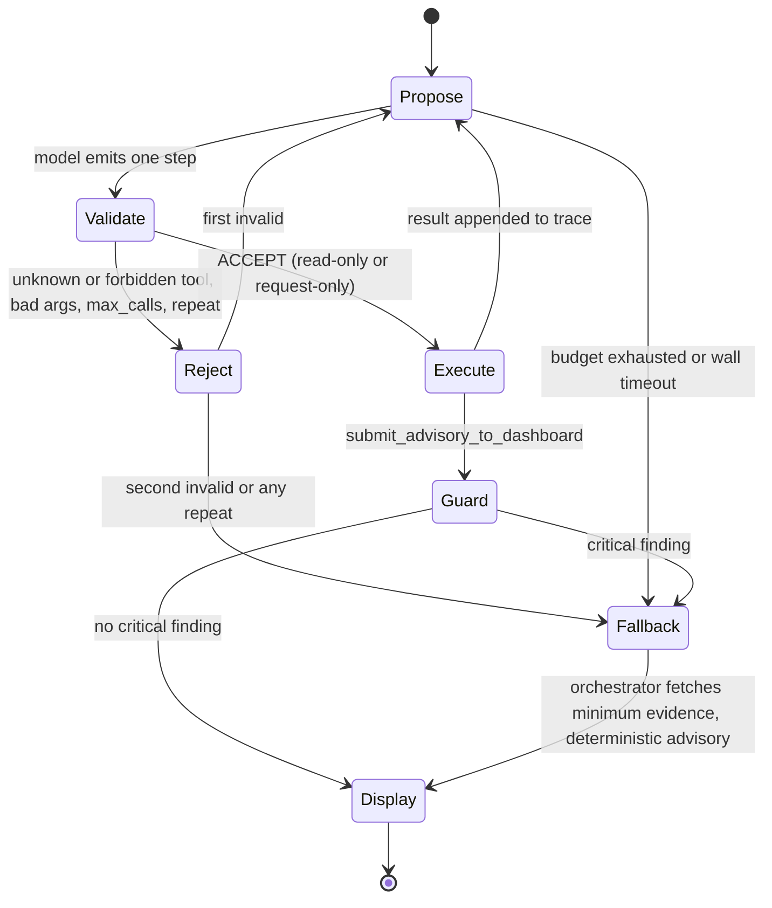
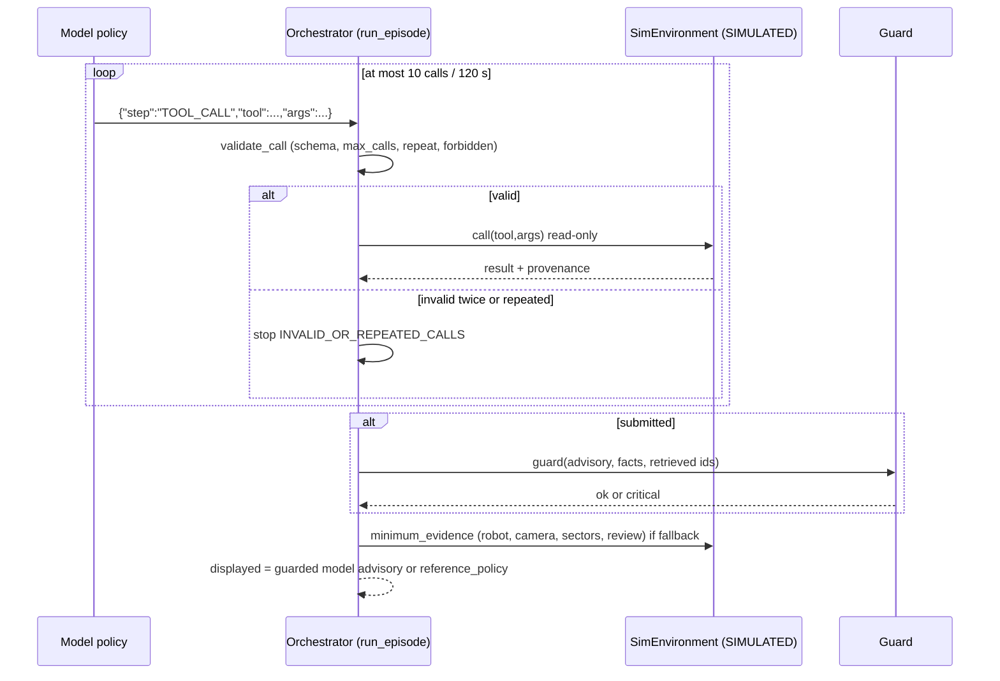

# 11 AI agent and tools

The Qwen "agent" is deliberately weak. It may **request** one tool per step from a small, versioned, read-only (or request-only) registry. A deterministic validator and safety gate decide whether to execute each request, a hard budget stops the episode, and every path ends in a deterministic, guarded advisory that is display-only (`authority: "NONE"`). Qwen has **no motor authority**: no tool can move a wheel, release a gripper or reset an e-stop, and a repository-wide test fails if Qwen code even names the motor-path modules. This document describes the three contracts (mission tools, LiDAR agent tools, and the in-repo advisory contract), the guard, the fallback, and what our benchmarks show about the model as an agent.

**Status:** The contracts, gate, guard and fallback are implemented and unit-tested. Model-driven agent episodes were run in **SIMULATION only**: 0/120 benchmark episodes were completed with a valid advisory of the model's own, and 0 forbidden-tool attempts were made in 665 calls. Nothing was tested on hardware, and no agent is connected to the rover.

**Related:** [docs/qwen/QWEN_ADVISORY_CONTRACT.md](qwen/QWEN_ADVISORY_CONTRACT.md) · [08 Qwen model](08_QWEN_MODEL.md) · [10 RAG pipeline](10_RAG_PIPELINE.md) · [17 Safety architecture](17_SAFETY_ARCHITECTURE.md) · Reports: [QWN-028 agentic traces](experiments/reports/QWN-028-agentic-tool-traces.md), [QWN-022 LiDAR eval](experiments/reports/QWN-022-lidar-frozen-eval.md), [QWN-017 mission benchmark](experiments/reports/QWN-017-frozen-mission-230.md), [QWN-029 safety regression](experiments/reports/QWN-029-safety-regression.md)

> `$QWEN_WORKSPACE` is the private Qwen workspace (`rescue_qwen/`, `eval/`, `tests/`), which is not in this repository. In this repository: `qwen_advisory/`, `camera_mapping/advisory.py`, `camera_mapping/qwen_launcher.py`, and the motor-path allow-list test in `rover/tests/test_issue9_fail_closed.py`.

---

## 1. Problem

"Agentic" LLMs plan by calling tools. On a robot, a tool call can be a physical act, and a 2B model that hallucinates a tool name, repeats itself or misreads a sensor must not be able to cause one. We still want the model to gather evidence in a sensible order and explain it. The contract therefore has to make the **worst possible model output harmless** while letting a good output be useful.

## 2. Why this design

| Choice | Alternative | Reason |
|---|---|---|
| **One tool request per step**, as JSON `{"step":"TOOL_CALL","tool","args"}` or `{"step":"FINAL",…}` | Free-form multi-call plans | Each request can be validated, gated and audited before anything runs, and the episode can be cut at any step |
| **Read-only / request-only tools** | Motion tools callable by the model | A request can be refused. An act cannot be undone |
| **Deterministic gate and fallback** | Trust the model, or ask it to self-check | A 2B model's self-check is no more reliable than the model itself. Code rules are testable |
| **Hard budgets** (10 or 12 calls, 120 s) | Unbounded loops | We observed models repeating identical calls, so the loop must stop |
| **Minimum-evidence fallback** | Fallback built only from what the model fetched | Found unsafe during evaluation: a fallback built from too little evidence understated a hazard (§12) |

## 3. Concept: the observe → request → gate loop



## 4. Math: why bounded, gated loops are safe by construction

Let *𝒯* be the set of tools. Each tool *τ* has a side-effect class *s(τ)* ∈ {observe, request, motion}. The safety property we want is:

> For **every** model output sequence *m₁…m_k*, the set of executed side effects contains no motion that the deterministic gate would refuse.

The property holds *for every model*, not just for good ones, if:

1. the executed set ⊆ {τ : gate(τ, world) = ACCEPT};
2. the gate is a pure function of world state, not of model text; and
3. *k* ≤ K (the budget).

In the LiDAR agent contract the motion class is **empty**: s(τ) ∈ {observe, request} for every τ. The property then holds trivially. In the mission contract, motion tools exist **only in the simulated mock world** and need an operator approval token plus fresh sensor evidence, all checked by code (§6).

Display safety relies on a second invariant: *displayed = guard(model) if guard passes, else policy(evidence)*, together with the rule that the model is **never more permissive than the policy** about motion.

## 5. Implementation: three contracts

| Contract | Version | Where | Tools | Used for |
|---|---|---|---|---|
| Mission tools | `rescue-tools/0.1` | `$QWEN_WORKSPACE/rescue_qwen/tools.py` | 11: 7 observe, 2 request, 2 motion (gated, mock only) | v0.2 mission benchmark; LoRA run2 training |
| LiDAR agent tools | `rescue-agent-tools/0.1` | `$QWEN_WORKSPACE/rescue_qwen/agent.py` | 10: read-only or request-only; **no motion tool** | LiDAR agent episodes; agentic demo traces |
| LiDAR advisory (single shot, no tools) | `rescue-lidar-advisory/0.1` | **this repo**: `qwen_advisory/lidar.py`, `qwen_advisory/client.py` | none (advisory only) | Integration with the LiDAR agent's `team15.lidar_advisory_context/1` |
| Camera rescue advisory | `team15.camera_rescue_advisory/1` | **this repo**: `camera_mapping/advisory.py` | none (calls `rescue_qwen.service` `/advisory`) | Live camera demo |

## 6. Key files, symbols and interfaces

### 6.1 Mission tools (`rescue-tools/0.1`)

`TOOL_SCHEMAS` in `$QWEN_WORKSPACE/rescue_qwen/tools.py`:

- **Observe:** `get_robot_state`, `get_camera_observation`, `get_ultrasonic_range`, `get_current_route`, `get_blocked_edges`, `plan_shortest_route(start, goal)` (Dijkstra on a **SYNTHETIC** graph; nodes match `^[A-Z]$`), `get_operator_review(observation_id)`.
- **Request (no motion):** `request_operator_approval(action ∈ {DIRECTIONAL_SCAN_LEFT, DIRECTIONAL_SCAN_RIGHT, BOUNDED_MOVE_FORWARD, RESUME_ROUTE}, reason)`, `request_stop(reason)`.
- **Motion (gated, mock world only):** `request_directional_scan(direction ∈ {LEFT, RIGHT}, approval_id)` and `request_bounded_move(direction = FORWARD, duration_ms 100–500, approval_id)`.

`safety_gate(call, world)` → ACCEPT / REJECT. It rejects on:

- invalid args, including any argument key matching `FORBIDDEN_ARG_KEYS` (lat, lon, x_m, y_m, heading, yaw, speed, velocity, pwm, register, coord);
- budget reached (`MAX_CALLS_PER_EPISODE = 12`);
- tool unavailable.

For motion tools it additionally rejects on: e-stop engaged, link not OK, controller FAULT or unverified, battery below 15 %, no matching APPROVED operator approval, and, for a bounded move, no fresh valid front range (age ≤ 1.0 s) or a front echo under 30 cm. The module docstring says: "Nothing here talks to real hardware."

Step format: `STEP_SCHEMA` in `$QWEN_WORKSPACE/rescue_qwen/llm/tool_prompts.py` allows `step` ∈ {TOOL_CALL, FINAL}, a `tool` from the enum, `args`, a `recommended_action` from the action list, and a `summary` of ≤ 700 characters. `TOOL_SYSTEM` states the procedure (OBSERVE → INTERPRET → REQUEST SAFE ACTION → gate → controller → OBSERVE AGAIN) and the rules:

- read the robot state first;
- request a stop first if the front echo is under 30 cm or invalid while moving;
- never repeat a rejected call;
- a range is "the nearest echo in a 15-degree beam, not the person's distance";
- the rover has no odometry.

### 6.2 LiDAR agent tools (`rescue-agent-tools/0.1`)

`TOOLS` in `$QWEN_WORKSPACE/rescue_qwen/agent.py`, each with `timeout_s`, `max_calls`, `provenance` and `stale_after_s`:

| Tool | Max calls | Stale after | Provenance |
|---|---|---|---|
| `get_robot_status` | 1 | 2.0 s | rover navigator status subset |
| `get_latest_camera_observation` | 2 | 300 s | camera sighting store |
| `inspect_candidate_evidence(candidate_id)` | 2 | 300 s | sighting evidence (no pixels) |
| `get_lidar_scan_summary` | 2 | 0.5 s | LiDAR agent assessment |
| `get_obstacle_sectors` | 2 | 0.5 s | LiDAR `to_advisory_context` |
| `get_operator_review_state(candidate_id)` | 2 | — | dashboard operator decisions |
| `retrieve_rescue_knowledge(query)` | 2 | — | RAG corpus (documentation, not live facts) |
| `inspect_known_route(start, goal)` | 1 | — | Dijkstra on a SYNTHETIC graph |
| `request_additional_observation(kind, reason)` | 1 | — | queued for the operator (no motion) |
| `submit_advisory_to_dashboard(advisory)` | 1 | — | display only; must pass the guard |

`FORBIDDEN_TOOLS = ("move", "drive", "motor", "gripper", "release", "servo", "gpio", "pwm", "power", "estop_reset")`. A proposed tool name containing any of these is logged as a "forbidden actuation tool". `MAX_CALLS = 10`, `WALL_TIMEOUT_S = 120.0`. Stop conditions in `run_episode`:

1. advisory submitted;
2. budget exhausted;
3. a repeated identical call;
4. a second invalid output;
5. wall timeout.

### 6.3 In-repo advisory contract (`rescue-lidar-advisory/0.1`)

`qwen_advisory/client.py` `lidar_advisory(context, model=None, timeout_s=8.0, retrieved_ids=None)`:

1. Compute `L.reference_policy(context)`.
2. With no model, return it as `source: DETERMINISTIC`.
3. Otherwise run the model in a worker thread with a hard timeout. A timeout or exception returns `DETERMINISTIC_FALLBACK`.
4. Run `L.guard(raw, context, retrieved_ids)`. If there are critical findings, return `DETERMINISTIC_FALLBACK`. Otherwise return `QWEN_GUARDED`.

It never raises. `http_model(url)` wraps an HTTP endpoint. Fields and rules are in [QWEN_ADVISORY_CONTRACT](qwen/QWEN_ADVISORY_CONTRACT.md); it is not repeated here.

## 7. Inputs and outputs

- **Agent input:** the trace so far (each entry has tool, args, result, provenance, `stale_after_s`) and the scenario spec. All of it is SIMULATED (`labels: {"simulated": true, "hardware": false}`).
- **Agent output:** `{stop_reason, orchestrator_fetched, trace, audit, queued_requests, submitted_raw, guard, displayed_advisory, displayed_is_fallback, labels, tools_version}`. Every proposal, accepted or rejected, is in `audit`.

## 8. Data structures: the guard

`$QWEN_WORKSPACE/rescue_qwen/guard.py` `check(model_out, packet, retrieved_ids, route, …)` classifies findings by severity:

- **CRITICAL** → discard the output and show the deterministic (config A) advisory, with `fell_back_to_deterministic: true`;
- **CORRECTED** → keep the output with the offending field fixed (for example, citations that were not retrieved are removed);
- **NOTE** → logged only.

Patterns: `CONFIRM_CLAIM`, `DISTANCE`, `PERSON_DISTANCE`, `CLEAR_CLAIM`, `ROUTE_SEQ`, `MEDICAL`, `TRAVERSABLE`, `ROBOT_POS`, `IDENTITY`, and coordinate-like strings (`COORD_LIKE`). `affirmative_search` ignores negated matches ("No person is confirmed"); it was added after the mission benchmark exposed a false positive. The repo's `qwen_advisory/lidar.py` `guard` adds the **permissiveness rule**: a `forward_motion_recommendation` more permissive than `reference_policy` is critical. `UNSAFE_REQ` / `is_unsafe_request` refuse imperatives ("move…", "drive…") but answer questions ("Is it safe to…?").

## 9. Configuration

Budgets: mission 12 calls; LiDAR agent 10 calls / 120 s. Client timeout 8 s (`qwen_advisory`), 10 s (`camera_mapping.advisory.http_qwen`). Staleness per tool (§6.2). Mission gate thresholds: front stop under 30 cm, range age ≤ 1.0 s, battery ≥ 15 %, bounded move 100–500 ms.

## 10. Dependencies

`rescue_qwen.agent` uses `jsonschema` (Draft 2020-12). `qwen_advisory/` is **stdlib only** and runs in its own CI workflow (`.github/workflows/qwen.yml`, Python 3.11, `pytest==8.3.4`, no model, no Ollama, no hardware).

## 11. Execution flow (LiDAR agent episode)



## 12. Error handling: the fallback, and a safety bug we found

Originally the fallback advisory was built **only from tools the model had called**. When a model never read robot status or LiDAR, the dashboard *understated* a hazard. In demo scenario 2 (contradictory camera and LiDAR while moving) it showed "do not request motion" instead of "recommend deterministic stop".

The fix: on any fallback the orchestrator itself fetches `CORE_EVIDENCE` (robot status, latest camera, obstacle sectors) plus the operator review for any candidate, logs each fetch in the audit, and rebuilds the advisory (`minimum_evidence`). This is tested by `test_fallback_fetches_minimum_evidence_itself` (`$QWEN_WORKSPACE/tests/test_lidar.py`). An offline re-score of the 120 benchmark episodes changed displayed-correct from 13/13/19/19/14/10 (of 20, per configuration) to 20/20 for all six configurations, with **0** displayed advisories more permissive than the reference (`$QWEN_WORKSPACE/results/lidar_episode_fallback_rescore.json`, sha256 `2de4eb71…ba22b4`). Label SIMULATED.

## 13. Safety and security

**Why Qwen has no direct motor authority, at four levels:**

1. **No tool.** The LiDAR agent registry has no motion tool. The mission registry's motion tools exist only in the mock world, behind operator approval and sensor gates.
2. **No path at display.** `camera_mapping/advisory.py` discards any text matching `MOTOR_PATTERN` and never feeds Qwen output into the map, the assessment or the rover. `qwen_advisory` records carry `authority: "NONE"`.
3. **No import path.** `rover/tests/test_issue9_fail_closed.py` `test_nothing_outside_the_allow_list_can_reach_the_motor_path` walks every non-test `.py` file in the repository. It fails if any file outside `MOTOR_PATH_ALLOWED` (`rover/motion.py`, `rover/hardware.py`, `rover/protocol.py`, `rover/navigator.py`, `rover/sim.py`, `rover/simrun.py`, `rover/bridge.py`) contains any of `MOTOR_PATH_NAMES`: `rover.motion`, `rover.hardware`, `rover.protocol`, `rover.bridge`, `SafetySupervisor`, `RoverCAdapter`, `BridgeTransport`, `open_serial`, `encode_motor_block`, `approve_motion`. The test's own comment names "Qwen/LLM glue" as code that must not appear on that path. It matches text, not just imports, which is why commit `1f5c8db` had to remove those symbol names even from prose in `camera_mapping`. `camera_mapping/tests/test_advisory_rover_dashboard.py` `test_advisory_and_mapping_modules_import_no_motor_code` adds a local check.
4. **Independent supervisor.** The rover's `SafetySupervisor` refuses MOVE_FORWARD unless the assessment is CLEAR, `forward_allowed` is True, and the readings are fresh. It works identically with Qwen off. See [17 Safety architecture](17_SAFETY_ARCHITECTURE.md).

**Limits of these defences.** The allow-list test is a text scan. It cannot see code in `$QWEN_WORKSPACE`, which is outside the repository, or dynamic imports built from strings. Guard patterns can miss paraphrases. Unit tests show that the contracts behave as coded. **They do not show physical motor safety. Real wheel motion has never been tested.**

## 14. Tests and observed results

| What | Result | Label | Evidence |
|---|---|---|---|
| `qwen_advisory/tests/test_lidar_contract.py` (23 cases from 9 test functions, 8 fixtures) | **23 passed** (re-run locally for this document on 2026-11-08, Python 3.13, at `d1b607a`; also CI workflow `qwen-advisory`) | SIMULATED fixtures | repo |
| Allow-list test and `camera_mapping/tests/test_advisory_rover_dashboard.py` | 1 passed; 26 passed (same local re-run) | MOCKED / RECORDED frame | repo |
| Workspace port parity | policy 314/314, schema validity on recorded outputs, guard verdicts (`$QWEN_WORKSPACE/tests/test_team_port_parity.py`) | SIMULATED | `$QWEN_WORKSPACE` commit `bc45978` |
| Mission tool protocol, ckpt-0088 + RAG (230 frozen steps) | 218/230 correct; 182/182 args valid; **0/182 unsafe motion requests**; 2 gate-rejected (the camera-unavailable scenario); **2 missed `request_stop`** after a range timeout | SIMULATED/SYNTHETIC | [QWN-017](experiments/reports/QWN-017-frozen-mission-230.md) |
| Mission protocol, base Ollama + grammar + RAG | 56/230; **2/230 unsafe motion requests**, both blocked by the gate | SIMULATED | [QWN-017](experiments/reports/QWN-017-frozen-mission-230.md) |
| LiDAR agent episodes (6 configurations × 20) | **0/120** completed with the model's own valid advisory; invalid tool calls 22–40 per configuration; **0 forbidden-tool attempts in 665 calls**; no budget or wall-time exhaustion | SIMULATED | [QWN-022](experiments/reports/QWN-022-lidar-frozen-eval.md) |
| LiDAR pilot ckpt-0080 + RAG episodes | 10/20 completed with its own advisory (1 over-permissive submission, replaced by the guard) | SIMULATED | [QWN-026](experiments/reports/QWN-026-lidar-pilot-frozen-and-generalization.md) |
| Agentic demo (3 scenarios, reference vs Ollama) | Every Ollama episode stopped INVALID_OR_REPEATED and fell back; the displayed result equals the reference | SIMULATED | [QWN-028](experiments/reports/QWN-028-agentic-tool-traces.md) |

**Typical model failure patterns** (from `AGENTIC_TOOL_TRACE_REPORT.md`): repeating an identical call; `candidate_id: null`; a field name passed as an enum value; free text or a whole tool result submitted inside enum fields. Never observed: a forbidden tool, budget exhaustion, a timeout.

**Grounded recommendations.** A displayed recommendation is either the deterministic policy's or a guarded model output that (a) passed schema checks, (b) cited only retrieved chunks, (c) made no forbidden claim, and (d) was not more permissive than the policy. Each fact in the camera advisory's evidence carries its id, timestamp and source (`scene_facts`).

## 15. Limitations

- The model is **not competent as an agent** on the LiDAR task (0/120). The value of the agent layer today is the audit trail and the bounded orchestration, not autonomy.
- The mission adapter's 218/230 is in-distribution and simulated.
- Both mission timeout-stop misses are exactly the kind of error that the supervisor, not Qwen, must cover.
- Episode stop-recall is not meaningful: only 1 of the 20 sampled episodes is a stop case.
- No agent run has ever been connected to the real rover, camera store, LiDAR or dashboard decision store.

## 16. How to reproduce

In this repo:

```bash
python -B -m pytest -q -p no:cacheprovider qwen_advisory/tests
python -B -m pytest -q rover/tests/test_issue9_fail_closed.py -k allow_list
python -B -m pytest -q camera_mapping/tests/test_advisory_rover_dashboard.py
```

In `$QWEN_WORKSPACE` (private): `python3 -B -m pytest -q tests/test_lidar.py`, and `.venv-lora/bin/python -B -m eval.run_eval_lidar --backend hf --tag <name> --episode-stride 3` for the episode benchmark.

## 17. How to extend

- Add a tool: give it a schema, `max_calls`, `timeout_s`, `provenance` and `stale_after_s`. Make it read-only or request-only, and add a test showing that the gate rejects misuse. **Never add a motion tool to the agent registry.** Motion stays with the deterministic controller and the operator.
- Teach the model the protocol with a per-task adapter, then re-run the episode benchmark **and** the safety gate before showing any model-chosen advisory.
- Extend the allow-list test to the Qwen workspace if it is ever merged into this repository.
