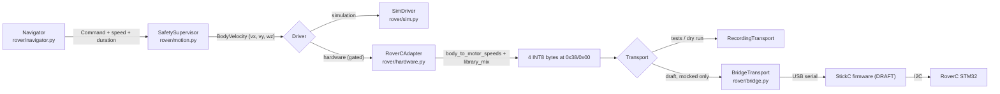
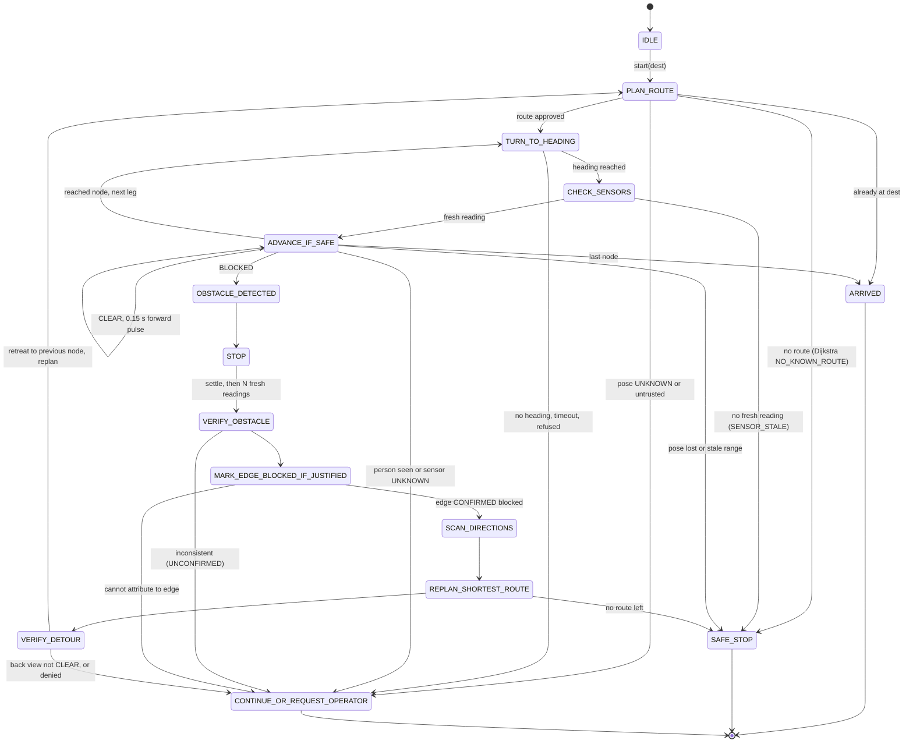
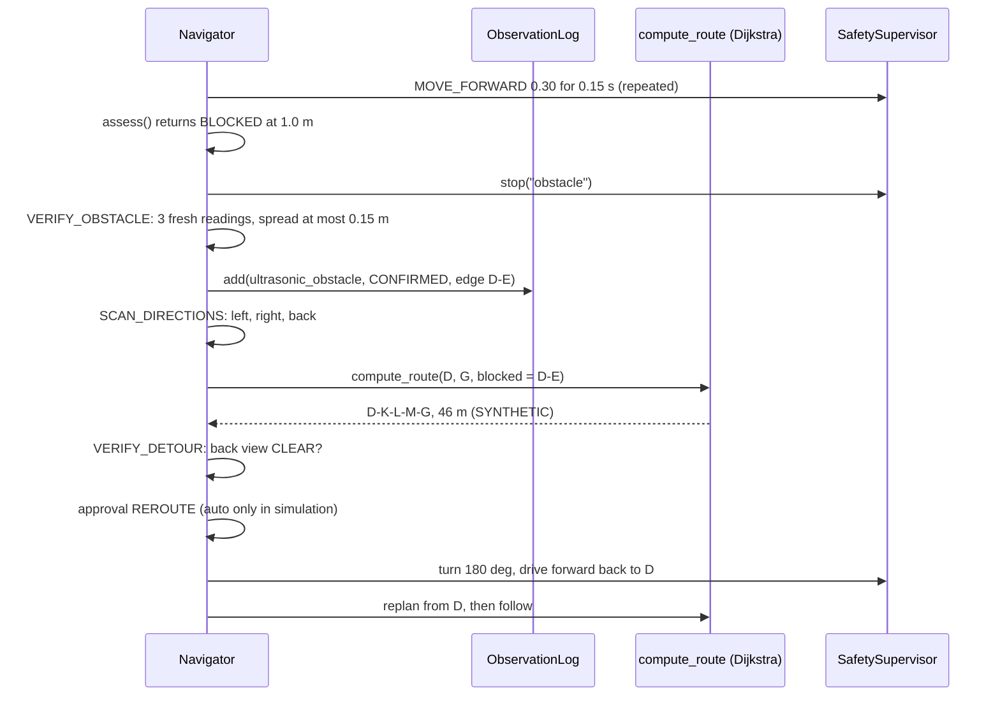

# 12 RoverC-Pro motor control and navigation

This document explains how Team-15's ground-robot software would drive the M5Stack RoverC-Pro, a small four-wheel mecanum chassis. It starts from first principles: what a mecanum wheel is, how a body velocity (forward, sideways, turn) becomes four wheel speeds, and how `rover/protocol.py` implements the mixing with a port of the M5Stack library. Then it covers the bounded motion primitives in `rover/motion.py`, the navigator state machine and Dijkstra rerouting in `rover/navigator.py`, scanning by rotating the whole robot (there is no servo), the battery constraints, and the integration contract in `contracts/ROVER_NAV_CONTRACT.md`. Every result here comes from simulation or from mocked unit tests. **No RoverC-Pro wheel has ever been driven by this code.**

**Status:** Implemented. **Simulation-tested only** (284 rover tests and scenarios A–H, labelled SIMULATED/MOCKED). Real wheel movement: **NOT TESTED**. Hardware gate 5 (physical motor tests): **not passed**. Wheel register mapping: **UNKNOWN**. Motor controller (M5StickC): **NOT DETECTED** in every reported check ([13](13_M5STICKC_BRIDGE.md)).

**Related:** [13 M5StickC bridge](13_M5STICKC_BRIDGE.md) · [17 Safety architecture](17_SAFETY_ARCHITECTURE.md) · [18 Simulation](18_SIMULATION.md) · [07 Path planning](07_PATH_PLANNING.md) · [14 Grove ultrasonic](14_GROVE_ULTRASONIC.md) · [Rover safety and limitations](rover/SAFETY_AND_LIMITATIONS.md) · [Hardware readiness](rover/HARDWARE_READINESS.md) · [Bench runbook](rover/BENCH_RUNBOOK.md) · [Rover navigation contract](../contracts/ROVER_NAV_CONTRACT.md) · Experiment reports [SIM-01](experiments/reports/SIM-01-rover-scenario-suite.md), [ROV-01](experiments/reports/ROV-01-issue9-fail-closed-tests.md), [ROV-02](experiments/reports/ROV-02-controller-connectivity-inspection.md)

---

## Contents
1. [Problem](#1-problem)
2. [Why this technology](#2-why-this-technology)
3. [Concept: the RoverC-Pro and its control chain](#3-concept-the-roverc-pro-and-its-control-chain)
4. [Math: mecanum wheel kinematics](#4-math-mecanum-wheel-kinematics)
5. [Implementation: how the repo turns a velocity into register bytes](#5-implementation-how-the-repo-turns-a-velocity-into-register-bytes)
6. [Key files, symbols and interfaces](#6-key-files-symbols-and-interfaces)
7. [Motion primitives and their limits](#7-motion-primitives-and-their-limits)
8. [The navigator: state machine and Dijkstra rerouting](#8-the-navigator-state-machine-and-dijkstra-rerouting)
9. [Scanning by rotating the wheels (no servo)](#9-scanning-by-rotating-the-wheels-no-servo)
10. [Inputs, outputs and data structures](#10-inputs-outputs-and-data-structures)
11. [Configuration](#11-configuration)
12. [Battery and power constraints](#12-battery-and-power-constraints)
13. [Error handling and safety](#13-error-handling-and-safety)
14. [Tests and observed results](#14-tests-and-observed-results)
15. [Limitations](#15-limitations)
16. [How to reproduce](#16-how-to-reproduce)
17. [How to extend](#17-how-to-extend)

---

## 1. Problem

The mission is search and rescue on a trail network. A responder robot has to move between waypoints, stop when something is in the way, look around, and choose another route if a trail is blocked. Physically, the team was issued an M5Stack RoverC-Pro (SKU K036-B): a palm-sized chassis with four mecanum wheels, a small STM32 motor controller, and an M5StickC microcontroller plugged on top as its "brain".

The software problem has three layers:

1. **Kinematics.** Turn "go forward at speed s", "turn left" or "slide sideways" into four individual wheel speeds.
2. **Bounded control.** Never let a command run open-ended. Stop immediately when anything is uncertain: a stale sensor, an unknown battery state, a dead link.
3. **Navigation.** Follow a route on a graph, detect and confirm blockages, and replan with Dijkstra, without inventing positions the robot cannot measure.

There is a hard constraint behind all three. The RoverC-Pro has **no wheel encoders, no documented battery register and no documented watchdog** (`rover/protocol.py` module docstring). The robot cannot measure how far it travelled, and if the link dies the wheels may keep turning. Much of the design below exists because of that.

## 2. Why this technology

| Choice | Why | Alternative considered |
|---|---|---|
| **Mecanum wheels** (fixed by the issued hardware) | Holonomic: the chassis can turn in place and slide sideways without steering. Turning in place is what lets one forward-facing ultrasonic sensor look left, right and back ([section 9](#9-scanning-by-rotating-the-wheels-no-servo)). | A servo-mounted sensor. The RoverC-Pro has servo registers, but the package deliberately never writes them (`REG_SERVO_ANGLE`, `REG_SERVO_PULSE` are "documented, never written"). |
| **Port of the M5Stack library mixing** (`library_mix`) instead of a textbook mixer | The library is the only published reference for how the STM32's four registers combine. Matching it byte for byte means a later bench test can compare against known-good vendor behaviour. | Writing our own mixer from the textbook formula. That would add a second unknown (does our formula match the board's wiring?) on top of the first. |
| **Normalised velocities (−1…1)** instead of m/s | Without encoders there is no calibration from register value to metres per second. Claiming m/s would be a fabricated number. | Physical units, once a bench test measures them (not done). |
| **A safety supervisor between every caller and the driver** | One choke point makes the safety rules checkable and testable. | Checks scattered across callers. |
| **Dijkstra on an explicit graph** (`planner.route.compute_route`) | Deterministic, exact, and easy to audit on a 26-node synthetic graph. The project's whole route story was built on it from the first build guide (PR #1). | A* with ALT landmarks exists in `planner/astar.py` as a benchmark only; it is not used for control. |

## 3. Concept: the RoverC-Pro and its control chain

### 3.1 What is documented and what is not

From M5Stack documentation, encoded as constants in `rover/protocol.py` (read 2026-11-07, not checked on our unit):

| Fact | Value | Source |
|---|---|---|
| I²C address of the motor MCU | `0x38` (`I2C_ADDRESS`) | K036-B protocol page |
| Motor registers | `0x00–0x03` (`REG_MOTOR`), one INT8 each, −127…127; 0 stops | same |
| Servo registers | `0x10/0x11` angle, `0x20–0x23` pulse | same; **never written** |
| Library clamp | ±100 per wheel (`LIBRARY_CLAMP`) | `M5_RoverC.cpp` |
| Battery | 16340, 700 mAh, charged through the StickC | product page ([safety report](rover/SAFETY_AND_LIMITATIONS.md) §1) |
| I²C pins on the StickC | SDA = G0, SCL = G26 | product pinmap; to be confirmed on our board |

Not documented, so it must be measured before any physical motion:

- **which register drives which physical wheel**, and which sign means forward;
- **whether the STM32 stops by itself** when commands stop arriving. The code assumes it does **not**;
- **battery voltage**: there is no RoverC register for it;
- **encoders, IMU or odometry**: none in the register map.

### 3.2 The control chain



The supervisor is the **only** route to a driver's `apply`. In the repository today the only driver that has ever executed is `SimDriver`, plus test doubles. `RoverCAdapter` refuses to be constructed until a person fills in a complete `HardwareVerification` record ([section 13](#13-error-handling-and-safety)), and nobody has.

Why a bridge at all? The StickC is the I²C master on the RoverC bus. Wiring the Pi into the same bus (for example through a Grove I²C port) would create two masters, which the board does not support. So the Pi talks to the StickC over USB serial, and the StickC talks I²C to the STM32. See [13 M5StickC bridge](13_M5STICKC_BRIDGE.md).

## 4. Math: mecanum wheel kinematics

### 4.1 What a mecanum wheel does

A mecanum wheel carries free-spinning rollers around its rim, each at γ = 45° to the wheel's axle. When the wheel turns, the contact patch pushes along the wheel's rolling direction, but the roller under it can slide freely along its own axis. The net effect: each wheel can only *enforce* velocity along one diagonal direction. With four wheels whose rollers form an "X" seen from above, combinations of wheel speeds produce any planar body motion: forward, sideways, rotation, or a mix.

### 4.2 Frames and symbols

Body frame (the same one `BodyVelocity` uses):

- `vx`: forward, `vy`: left, `wz` (ω): counter-clockwise rotation, seen from above.
- Wheel *i* sits at (x_i, y_i): front-left (+l_x, +l_y), front-right (+l_x, −l_y), rear-left (−l_x, +l_y), rear-right (−l_x, −l_y). l_x is half the wheelbase and l_y is half the track width.
- R is the wheel radius and w_i is the wheel's angular speed.

### 4.3 Derivation

**Step 1: velocity of each wheel's contact point.** A rigid body moving with (vx, vy) and rotating at ω gives point (x_i, y_i) the velocity

```
v_ix = vx − ω · y_i
v_iy = vy + ω · x_i
```

**Step 2: the roller constraint.** For 45° rollers the wheel's rim speed must equal the contact velocity projected onto the wheel's driven diagonal. With tan 45° = 1 this reduces to

```
R · w_i = v_ix + s_i · v_iy        s_i = −1 for FL and RR, +1 for FR and RL (X layout)
```

**Step 3: substitute each wheel.**

```
FL (+lx, +ly), s = −1:  R·w_FL = vx − ω·ly − (vy + ω·lx) = vx − vy − (lx+ly)·ω
FR (+lx, −ly), s = +1:  R·w_FR = vx + ω·ly + (vy + ω·lx) = vx + vy + (lx+ly)·ω
RL (−lx, +ly), s = +1:  R·w_RL = vx − ω·ly + (vy − ω·lx) = vx + vy − (lx+ly)·ω
RR (−lx, −ly), s = −1:  R·w_RR = vx + ω·ly − (vy − ω·lx) = vx − vy + (lx+ly)·ω
```

**Matrix form (inverse kinematics: body velocity → wheel speeds).** With L = l_x + l_y:

```
⎡w_FL⎤         ⎡ 1  −1  −L ⎤
⎢w_FR⎥ = 1/R · ⎢ 1   1   L ⎥ · ⎡vx⎤
⎢w_RL⎥         ⎢ 1   1  −L ⎥   ⎢vy⎥
⎣w_RR⎦         ⎣ 1  −1   L ⎦   ⎣ω ⎦
```

**Forward kinematics (wheel speeds → body velocity),** using the pseudo-inverse of the 4×3 matrix. Four equations and three unknowns, so a least-squares fit:

```
vx = R/4     · ( w_FL + w_FR + w_RL + w_RR)
vy = R/4     · (−w_FL + w_FR + w_RL − w_RR)
ω  = R/(4L)  · (−w_FL + w_FR − w_RL + w_RR)
```

Forward kinematics is what odometry would use. The RoverC-Pro has no wheel encoders, so w_i is never measured and **this equation is never evaluated on hardware**. That is why `traveled` is `UNKNOWN` on real hardware.

**Sanity checks.**

| Body command | FL | FR | RL | RR | Physical meaning |
|---|---|---|---|---|---|
| forward (vx > 0) | + | + | + | + | all wheels roll forward |
| strafe left (vy > 0) | − | + | + | − | the diagonals oppose |
| rotate CCW (ω > 0) | − | + | − | + | left side back, right side forward |

### 4.4 Saturation

Register values are bounded (±100 in the library). Mixing forward with rotation can push a wheel past the limit. A simple clamp would distort the direction of motion, because one wheel saturates while the others don't. The M5Stack library avoids most of that by **shrinking the translation when rotating**: if z ≠ 0, x and y are multiplied by (100 − |z|)/100 before mixing, and only then is each wheel clamped. Rotation keeps priority; translation gives way.

## 5. Implementation: how the repo turns a velocity into register bytes

### 5.1 `library_mix(x, y, z)`: the vendor mixer

`rover/protocol.py` `library_mix` is a direct port of `M5_RoverC.cpp setSpeed(x, y, z)`:

```
if z != 0:  x = int(x·(100−|z|)/100);  y = int(y·(100−|z|)/100)
registers 0x00..0x03 = (y + x − z,  y − x + z,  y − x − z,  y + x + z), each clamped to ±100
```

Compare this with the matrix in [section 4.3](#43-derivation). It matches the textbook mixer exactly **if** three things hold:

1. library **y** is forward (y = vx);
2. library **x** points to the robot's **right** (x = −vy);
3. library **z** is counter-clockwise, and the registers are ordered FL, FR, RL, RR.

Under that hypothesis, register 0 = vx − vy − ω (FL), register 1 = vx + vy + ω (FR), and so on. **That is a hypothesis, not a verified fact.** The library does not document which register drives which wheel, and the code says so ("The library does not document which wheel each register drives"). The `WHEELS = ("FL", "FR", "RL", "RR")` tuple is a naming convention only.

### 5.2 `body_to_motor_speeds`: from normalised velocity to library inputs

`body_to_motor_speeds(vx, vy, wz, mapping)` refuses to run unless the `WheelMapping` is verified. Then it does:

```
y = round(forward_sign    · vx · 100)
x = round(strafe_left_sign · vy · 100)
z = round(ccw_sign         · wz · 100)
return library_mix(x, y, z)
```

`WheelMapping` holds three measured signs, each +1 or −1, plus an `evidence` string naming who did the wheels-lifted test, when, and what each wheel did (`WheelMapping.missing()` lists anything absent). Under the hypothesis in 5.1 the values would be `forward_sign = +1`, `strafe_left_sign = −1`, `ccw_sign = +1`. **They have never been measured**, so the default `WheelMapping()` has all three as `None` and every conversion raises `PermissionError`.

Worked examples. These come from running `body_to_motor_speeds` locally with a *hypothetical* mapping (+1, −1, +1). They are SYNTHETIC: computed, not measured.

| BodyVelocity (vx, vy, wz) | Registers 0x00–0x03 | Note |
|---|---|---|
| (0.30, 0, 0) | (30, 30, 30, 30) | forward at the bench speed limit |
| (0, 0.30, 0) | (−30, 30, 30, −30) | strafe left |
| (0, 0, 0.30) | (−30, 30, −30, 30) | rotate CCW |
| (0.30, 0, 0.30) | (−9, 51, −9, 51) | y scaled to int(30·0.7) = 21 first, then mixed |
| (0.30, 0.30, 0) | (0, 60, 60, 0) | diagonal |

The supervisor never produces the last two rows. Its commands are single-axis primitives ([section 7](#7-motion-primitives-and-their-limits)). Combined motion would only come from a future caller.

### 5.3 `encode_motor_block`: bytes on the wire

`encode_motor_block(speeds)` checks for exactly four ints in −127…127 and packs them as two's-complement bytes for one block write starting at register `0x00`. Example: `(1, −1, 127, −127)` → `01 FF 7F 81` (asserted in `rover/tests/test_protocol_hardware.py`). `STOP_BLOCK` is `00 00 00 00`.

### 5.4 `RoverCAdapter`: the gated hardware driver

`rover/hardware.py` `RoverCAdapter`:

- **construction** raises `HardwareNotVerified` unless `HardwareVerification.missing()` is empty. The fields are controller model, controller firmware, RoverC revision, link, wiring verifier, power verifier, a measured `stop_on_link_loss_ms` > 0, and a verified `WheelMapping`;
- **on construction** it immediately calls `stop()`, so the first frame is always `STOP_BLOCK`;
- **`apply(v)`** → `body_to_motor_speeds` → `encode_motor_block` → `transport.write_block(0x38, 0x00, bytes)`;
- **`health()`** delegates to the transport. A physical transport without `health()` returns "transport reports no link health", which the supervisor treats as a fault (Issue #9, PR #14).

There are two transports. `RecordingTransport` (`physical=False`) records frames for dry runs and tests. `BridgeTransport` in `rover/bridge.py` speaks the USB-serial protocol to the draft StickC firmware; it has only ever run against a Python model of that firmware.

## 6. Key files, symbols and interfaces

| File | Key symbols | Role |
|---|---|---|
| `rover/protocol.py` | `I2C_ADDRESS`, `REG_MOTOR`, `library_mix`, `encode_motor_block`, `STOP_BLOCK`, `WheelMapping`, `body_to_motor_speeds`, `HardwareVerification` | Documented RoverC register facts; mixing; the verification record |
| `rover/motion.py` | `Command`, `BodyVelocity`, `MotionLimits`, `Driver`, `SafetySupervisor`, `EmergencyStop`, `SafetyStop`, `DirectionEvidence`, `Decision` | Bounded commands, latches, watchdog, e-stop ([17](17_SAFETY_ARCHITECTURE.md)) |
| `rover/hardware.py` | `RoverCAdapter`, `Transport`, `RecordingTransport`, `HardwareNotVerified` | Hardware driver; refuses to exist until verified |
| `rover/navigator.py` | `Navigator`, `State`, `NavConfig`, `Pose`, `RobotIO`, `TRUSTED_FOR_MOTION` | Route following, obstacle confirmation, scans, rerouting |
| `rover/observations.py` | `ObservationLog`, `Observation`, `canonical_edge`, `suggest_viewpoints` | Timestamped obstacle map the planner reads |
| `rover/sensors.py` | `RangeReading`, `HeadingReading`, `PowerReading`, `CameraDetection`, `Assessment`, `NoEchoPolicy`, `assess`, `combine`, `from_rover_fields` | Reading types and the conservative CLEAR/BLOCKED/UNKNOWN assessment |
| `rover/sim.py` | `SimWorld`, `SimDriver`, `SimConfig`, `SimObstacle`, `SIM_NODE_XY` | Deterministic simulator ([18](18_SIMULATION.md)) |
| `rover/simrun.py` | `build`, `scenario`, `SimIO`, `Sim`, `SCENARIOS`, `SIM_ROBOT_WIDTH_M`, `main` | Scenario wiring and CLI |
| `rover/pi_io.py` | `PiRobotIO`, `clock_domain` | Real-Pi IO: ranging only; heading, power, camera and pose are all `None`/`UNKNOWN` |
| `rover/status_api.py` | `rover_router`, `REQUIRED_STATUS_KEYS` | Optional FastAPI router: `GET /status`, `POST /estop` |
| `rover/bridge.py` | `BridgeTransport`, `crc8`, `frame`, `parse`, `open_serial` | USB-serial bridge ([13](13_M5STICKC_BRIDGE.md)) |
| `planner/route.py` | `compute_route`, `RouteResult` | Dijkstra |
| `fixtures/trail_graph_synthetic.json` | (data) | 26 nodes, 15 edges, SYNTHETIC metres |

**`Driver` protocol** (`rover/motion.py`): `name`, `physical`, `apply(BodyVelocity)`, `stop()`, and optionally `health() -> str` (`""` = healthy). `health()` is **required** for a physical driver.

**`RobotIO` protocol** (`rover/navigator.py`): `clock`, `read_range`, `read_heading`, `read_power`, `read_camera`, `pose`, `bearing`, `traveled`. There are two implementations. `SimIO` (in `rover/simrun.py`) reads the simulator. `PiRobotIO` (in `rover/pi_io.py`) reads the real Pi, reports only the ranging service, and has **no driver**.

## 7. Motion primitives and their limits

### 7.1 The command set

`Command` and the unit vectors in `rover/motion.py` (`_UNIT`):

| Command | (vx, vy, wz) unit | Speed cap | Extra requirement |
|---|---|---|---|
| `MOVE_FORWARD` | (1, 0, 0) | `max_linear` 0.30 | Forward fail-closed check (Issue #9): CLEAR + `forward_allowed is True` + fresh reading (+ hardware status OK) |
| `MOVE_BACKWARD` | (−1, 0, 0) | 0.30 | Fresh `DirectionEvidence` from an operator, because no sensor faces backwards |
| `TURN_LEFT` / `TURN_RIGHT` | (0, 0, ±1) | `max_yaw` 0.30 | Fresh range reading, power, driver health |
| `STRAFE_LEFT` / `STRAFE_RIGHT` | (0, ±1, 0) | 0.30 | Fresh `DirectionEvidence` |
| `STOP` | (0, 0, 0) | n/a | Always accepted, instant |
| `EMERGENCY_STOP` | (0, 0, 0) | n/a | Trips the latched `EmergencyStop` and latches `ESTOP` |
| `MOVE_TO_WAYPOINT` | n/a | n/a | **Always refused** by the supervisor: "not a raw motor command; it needs verified localization" |

Every accepted command carries a **duration** in (0, `max_command_s` = 1.0] s and a speed in (0, cap]. "Move until told otherwise" doesn't exist. The navigator re-issues 0.15 s commands (`NavConfig.cmd_s`), each one only after a fresh sensor check.

### 7.2 Ramping: speed up slowly, stop instantly

`SafetySupervisor._ramp` runs on every `tick()`, per axis:

- target 0, or a sign reversal → output drops to **0 at once** (it never reverses through a ramp);
- slowing down → jump to the target immediately;
- speeding up → step by at most `max_accel_per_s · dt`.

With the defaults (1.0 per second) and the simulator's 50 ms tick, forward 0.30 is reached after 6 ticks (0.30 s). The asymmetry is deliberate. A late stop is dangerous; a slow start only costs time.

### 7.3 What the numbers mean physically

**Nothing yet.** The values are normalised. The simulator assumes 1.0 = 2 m/s and 1.0 yaw = 90°/s (`SimConfig.lin_mps_per_unit`, `yaw_dps_per_unit`, both labelled "synthetic"), so 0.30 ≈ 0.6 m/s in the sim. The real RoverC speed per register unit is **NOT MEASURED**. `ranging/obstacle.py` uses `max_speed_mps = 0.30` and `decel_mps2 = 0.5` for its stopping-distance threshold, and those are also marked "PLACEHOLDERS, RoverC-Pro not yet measured".

## 8. The navigator: state machine and Dijkstra rerouting

### 8.1 State machine

`rover/navigator.py` `State` and `Navigator._mission` / `_follow` / `_advance` / `_obstacle`:



`ARRIVED`, `SAFE_STOP` and `CONTINUE_OR_REQUEST_OPERATOR` are terminal (`TERMINAL`). The mission generator ends there. It only starts again through `Navigator.resume(operator)` or `Navigator.respond(req_id, approve, operator)`, both of which need a named operator. **Nothing restarts by itself.**

### 8.2 What justifies each action

These rules are from the module docstring, and the code enforces them.

- **Rotate to a heading** only with a fresh, *measured* heading (`HeadingReading` ≤ 0.20 s old). Timed open-loop turns are never trusted as angles. No heading → `HEADING_UNAVAILABLE` operator request.
- **Drive forward** only with a trusted pose on the edge, a heading within `align_tol_deg` (4°) of the edge bearing, a fresh range reading, and a CLEAR corridor of `min(lookahead_m, remaining edge)`.
- **Mark an edge blocked** only if all of these hold:
  - `verify_samples` (3) fresh readings agree within `verify_spread_m` (0.15 m);
  - the pose is trusted and on that edge;
  - the heading is aligned with the edge;
  - the obstacle lies strictly inside the edge (`_associate`), not at or beyond the far node.
- **Detour** means going back to the previous node: rotate 180°, check that the back view showed a CLEAR robot-width corridor, then drive *forward*. It never reverses blind.
- **Never** a local side-step around the obstacle. One forward ranger cannot measure the obstacle's depth, so side clearances are recorded as evidence only (`"local_bypass": "NOT_ATTEMPTED..."`).

### 8.3 Which poses are trusted

`Pose.source` ∈ {`SIM_TRUTH`, `OPERATOR_CONFIRMED`, `UNKNOWN`}. `TRUSTED_FOR_MOTION = {SIM_TRUTH}`: **only the simulator's ground truth can authorise autonomous motion.** `PiRobotIO.pose()` always returns `UNKNOWN`, so on the real Pi the navigator immediately raises `POSE_UNKNOWN`: "operator-assisted waypoint execution only". This is an honest consequence of having no encoders and no localisation.

### 8.4 Dijkstra rerouting

Routes come **only** from `planner.route.compute_route(start, dest, blocked=log.blocked_edges(), graph=g)`, which is plain Dijkstra with a binary heap. The navigator never invents a route.



Dijkstra in one paragraph: keep a priority queue of (distance-so-far, node). Repeatedly pop the closest unfinished node, mark it done, and relax its neighbours (if going through it is shorter, update and push). Blocked edges are skipped. With non-negative edge weights, the first time the destination is popped its distance is optimal. On this graph (26 nodes, 15 edges) that is microseconds, so the cost of always replanning from scratch is irrelevant.

Clearing a blocked edge needs an **independent** source (a source different from every observation blocking it) plus a named operator (`ObservationLog.clear_edge`). After clearing, Dijkstra automatically returns the shorter route (scenario F).

## 9. Scanning by rotating the wheels (no servo)

The robot has one forward-facing ultrasonic sensor and no pan servo. To look left, right or back, it **rotates the whole chassis in place** on its mecanum wheels (a pure ω command: wheel signs −, +, −, + under the hypothesis in section 5.1). That is `Navigator._directional_scan` and `_sweep`.

- **Views:** left at h₀ + `scan_step_deg` (+45°), right at h₀ − 45°, and back at h₀ + 180° (only if the robot is more than `node_tol_m` from the previous node).
- **Width coverage:** each view samples centre, +δ and −δ, where

  ```
  δ = min(30°, atan2(robot_width/2 + width_margin, required_m))
  ```

  so the beam sweeps a corridor as wide as the robot plus margin at the required distance. With the 0.20 m placeholder width, 0.05 m margin and 1.0 m required: δ = atan2(0.15, 1.0) ≈ 8.5°.
- **Bounded closed-loop rotation:** `_face` turns at a speed proportional to the heading error (between `min_yaw_speed` 0.05 and `max_yaw_speed` 0.30), stops at ±`heading_tol_deg` (2°), splits turns into segments of at most `max_rotation_segment_deg` (90°), and gives up after `2 s + angle / min_expected_yaw_dps` (a stall or wheel slip).
- **Settle:** after each rotation it waits for `scan_settle_readings` fresh readings. The sim default is 1; hardware should use at least 3, because PR #7's decision range is a rolling median that lags a rotation.
- **Combination:** `combine()` takes the worst case (UNKNOWN beats BLOCKED, BLOCKED beats CLEAR). A camera person in view forces UNKNOWN: a person is a dynamic hazard, not evidence of free space.
- **Camera:** each view raises a `camera_requests` entry (bearing only, no coordinates).

**On real hardware this whole procedure is refused**, because `PiRobotIO.read_heading()` returns `None`: there is no calibrated heading source. The StickC has an IMU, but it has never been read or calibrated ([hardware readiness](rover/HARDWARE_READINESS.md) §3).

## 10. Inputs, outputs and data structures

**Inputs per navigator tick** (`Navigator.tick`): range (`RangeReading`), heading (`HeadingReading`), power (`PowerReading`), and camera detections (`CameraDetection`, polled every `camera_period_s` = 0.5 s). The tick also calls `sup.heartbeat()` and feeds the forward assessment to the supervisor.

**`RangeReading`** (`rover/sensors.py`): `t` (capture time, monotonic), `status` (`OK`/`NO_ECHO`/`ERROR`), `range_m`, `max_range_m`, `source`, `seq`, `forward_allowed` (strict tri-state True/False/None), `blocked_threshold_m`, `hardware`, `service_status`, `reason`. A hardware reading with `forward_allowed=None` cannot be constructed. The full field table is in [the navigation contract](../contracts/ROVER_NAV_CONTRACT.md) §2.

**Output:** `Navigator.status()`, schema `team15.rover_nav_status/1`, with the keys listed in `REQUIRED_STATUS_KEYS`. Notable fields:

- `distances`: `route_total_m`, `route_remaining_m`, `route_completed_m`, `original_route_m` (all SYNTHETIC graph metres) and `traveled`, which is `SIMULATED_GROUND_TRUTH` in the sim and `UNKNOWN` on hardware. These are kept apart on purpose. Traveled is **never** derived from the plan.
- `motion`: the supervisor's `status()`, with active command, output, e-stop, latch and approver.
- `claims`: `autonomous_navigation_operational: false`, `physical_motion_verified: false`, and `localization: SIMULATED | NONE`. These are hard-coded honesty flags.

**Example output.** Scenario C, run locally at d1b607a on 2026-11-08, SIMULATED. Abridged from `python3 -m rover.simrun C`:

```
state ARRIVED · route D-K-L-M-G 46 m · original_route_m 60 · reroute_count 1
blocked_edges ["D-E"] · traveled 83.895 m (SIMULATED_GROUND_TRUTH) · claims.autonomous_navigation_operational false
```

## 11. Configuration

| Parameter | Default | Where | Meaning |
|---|---|---|---|
| `max_linear`, `max_yaw` | 0.30 | `MotionLimits` | normalised speed caps (the library allows 1.0 = 100) |
| `max_accel_per_s` | 1.0 | `MotionLimits` | ramp-up rate |
| `max_command_s` | 1.0 s | `MotionLimits` | longest single command |
| `watchdog_timeout_s` | 0.25 s | `MotionLimits` | heartbeat deadline → `COMMS_LOST` |
| `sensor_max_age_s` | 0.20 s | `MotionLimits`, `NavConfig` | range freshness for motion (display uses 0.5 s, kept separate) |
| `min_voltage_v` | `None` | `MotionLimits` | `None` → physical motion refused |
| `power_max_age_s` | 5.0 s | `SafetySupervisor(...)` | power freshness |
| `robot_width_m` | **required** | `NavConfig` | the sim uses `SIM_ROBOT_WIDTH_M = 0.20` (SYNTHETIC placeholder) |
| `lookahead_m` | 1.0 m | `NavConfig` | forward corridor that must be clear |
| `forward_speed`, `cmd_s` | 0.30, 0.15 s | `NavConfig` | the advance pulse |
| `heading_tol_deg`, `align_tol_deg` | 2°, 4° | `NavConfig` | rotation and alignment tolerances |
| `scan_step_deg`, `max_rotation_segment_deg` | 45°, 90° | `NavConfig` | scan geometry; 2 × step must be ≤ segment |
| `verify_samples`, `verify_spread_m` | 3, 0.15 m | `NavConfig` | obstacle confirmation |
| `no_echo_policy` | `UNKNOWN` | `NavConfig` | `CLEAR_TO_MAX` is simulation only; refused with physical IO |
| `auto_approve` | `False` | `NavConfig` | simulation only; `PermissionError` with a physical driver |
| `scan_settle_readings` | 1 | `NavConfig` | use 3 or more on hardware |

`rover.simrun.build` sets `auto_approve=True` and `no_echo_policy=CLEAR_TO_MAX`, because the synthetic world has no walls. Both are refused for physical IO by `Navigator.__init__`.

## 12. Battery and power constraints

- **The RoverC battery** (16340, 700 mAh per the documentation) has **no voltage register**. Whether the StickC's PMIC reading reflects the RoverC battery is **UNVERIFIED**.
- **The supervisor refuses all physical motion** while `MotionLimits.min_voltage_v` is `None` ("no measured undervoltage threshold configured"). It also refuses when the power reading is missing, older than 5 s, non-finite, or dated in the future. While moving, a power problem latches `POWER_UNKNOWN` or `UNDERVOLTAGE`.
- **`PiRobotIO.read_power()` returns `None`.** On real hardware, every motion command would therefore be refused today. That is the intended fail-closed state.
- **The simulator** reports a constant 4.0 V (`SimWorld.power_v`), labelled source `"sim"`.
- **The Pi itself** is mains-powered and must not ride on the rover ([hardware readiness](rover/HARDWARE_READINESS.md) §2). During the 2026-11-08 test attempts it rebooted twice on a 3 A source. See [ROV-02](experiments/reports/ROV-02-controller-connectivity-inspection.md).

What closes this gap: measure the battery with a meter at rest and under load, choose a threshold, and record `power_verified_by` ([bench runbook](rover/BENCH_RUNBOOK.md) step 0).

## 13. Error handling and safety

The full safety model is in [17 Safety architecture](17_SAFETY_ARCHITECTURE.md). In summary, for motor control:

- **Zero by default.** The supervisor calls `driver.stop()` in its constructor, and `RoverCAdapter` sends `STOP_BLOCK` when it is constructed.
- **Latches.** `SafetyStop` = `ESTOP`, `COMMS_LOST`, `SENSOR_STALE`, `UNDERVOLTAGE`, `POWER_UNKNOWN`, `DRIVER_FAULT` or `LOCALIZATION_LOST`. A latch zeroes the output, **revokes approval**, and needs `reset_latch(operator)` and then a fresh `approve_motion(operator)`.
- **Driver exceptions.** `_apply` catches them, latches `DRIVER_FAULT` and tries `driver.stop()`. Since PR #14 (commit `14fde0d`), `tick()` never raises on a dead link: `_zero_never_raise` records `DRIVER_STOP_FAILED` and relies on the firmware watchdog.
- **Hardware gate.** `RoverCAdapter` will not construct until a complete `HardwareVerification` exists. In the repository the only "complete" instances are test fixtures, explicitly labelled `"TEST FIXTURE - not a real bench result"`.
- **Motor-path allow-list.** Only seven reviewed files may import the motor path. A static test fails if any other module (Qwen, dashboard, perception, ranging, `rover/pi_io.py`, `rover/status_api.py`) does ([17](17_SAFETY_ARCHITECTURE.md) §8).

## 14. Tests and observed results

All results below are **SIMULATED** or **MOCKED**. They show that the logic does what it says. **They do not show that a RoverC-Pro moves, stops, or stops in time.** Unit tests cannot establish motor safety on hardware.

| Suite | Tests | What it covers | Label | Result at d1b607a |
|---|---|---|---|---|
| `rover/tests/test_protocol_hardware.py` | 10 | documented constants; `library_mix` against 5 reference vectors; INT8 encoding; unverified mapping refused; adapter writes nothing when unverified, zero first when "verified" (fixture) | MOCKED | pass |
| `rover/tests/test_supervisor.py` | 21 | zero default, approval, bounds, expiry, ramp, forward gate, evidence, watchdog, stale, undervoltage, e-stop, stop file, driver fault | MOCKED | pass |
| `rover/tests/test_issue9_fail_closed.py` | 40 | Issue #9 fail-closed forward policy; link health; power validation; allow-list | MOCKED/SIMULATED | pass ([ROV-01](experiments/reports/ROV-01-issue9-fail-closed-tests.md)) |
| `rover/tests/test_scenarios.py` | 10 | scenarios A–H, determinism | SIMULATED | pass ([SIM-01](experiments/reports/SIM-01-rover-scenario-suite.md)) |
| `rover/tests/test_scanning.py` | 16 | left/right/back views, settle readings, bounded segments, heading loss, NO_ECHO not clear, localization loss, e-stop during scan | SIMULATED | pass |
| `rover/tests/test_distances.py` | 21 | completed + remaining = total; traveled vs hand count | SIMULATED | pass |
| `rover/tests/test_observations.py` | 6 | blocking rules, staleness, independent clearing | MOCKED | pass |
| `rover/tests/test_grove_adapter.py` | 82 | `from_rover_fields` validation with PR #7's real `rover_io`/`RangeClient` | MOCKED | pass |
| `rover/tests/test_ranging_contract.py` | 11 | pins the rover to the in-repo ranging copy and interface | MOCKED | pass |
| `rover/tests/test_status_contract.py` | 4 | status keys, router has e-stop only | MOCKED | pass |
| `rover/tests/test_bridge.py` | 63 | USB bridge vs the firmware model ([13](13_M5STICKC_BRIDGE.md)) | MOCKED | pass ([BRG-01](experiments/reports/BRG-01-bridge-watchdog-mocked-tests.md)) |
| **Total** `python3 -m pytest -q rover/tests` | **284** | | | **284 passed in 2.14 s** (local run, 2026-11-08, macOS, Python 3.13.5) |

History (each row a different revision; not merged into one experiment):

| Revision | rover/tests | Source |
|---|---|---|
| PR #8 head `dac82f4` (2026-11-07) | 181 passed | PR #8 description |
| PR #14 (Issue #9) | 221 passed | PR #14 description |
| PR #15 (bridge) | 284 passed | PR #15 description |
| d1b607a (main after PR #17) | 284 passed | local run for this document |

**Real hardware:** no motor test has been run. Two attempts on 2026-11-08 (about 11:37 UTC and 12:28 UTC) stopped at the read-only detection step, because the controller did not enumerate on the Pi's USB bus. No motor command was sent. See [ROV-02](experiments/reports/ROV-02-controller-connectivity-inspection.md).

## 15. Limitations

> **Related work on an unmerged branch.** Open PR #6 contains a separate RoverC keyboard/Wi-Fi control path. On that branch, a teammate claims a StickC Plus was flashed from their own Mac, with a receiver firmware that reads back motor registers. Its own documentation says this does not prove wheel rotation, and it lists powered direction/stop behaviour as a pending gate. It shares no code with `rover/`. See [13 §13](13_M5STICKC_BRIDGE.md#a-separate-stickc-effort-on-an-unmerged-branch-pr-6).


1. **The wheel mapping is a hypothesis.** `WheelMapping` can only flip three global signs. If the bench test shows that registers drive the wheels in a different *order* than FL, FR, RL, RR (a permutation), three signs cannot fix it: a strafe command would come out as a rotation. That case would need a code change (a per-register permutation), not just configuration. The bench runbook's step 3 would reveal it.
2. **No odometry.** There are no encoders, so forward kinematics is never evaluated, pose is `UNKNOWN`, and `traveled` is `UNKNOWN`.
3. **No heading source.** Scanning and edge-following are refused on hardware.
4. **No measured speed scale.** Normalised units only, and the stopping distances are placeholders.
5. **Mecanum slip** on real surfaces is not modelled. The sim is topological and edge-local (`SimWorld`), with no friction and no wheel dynamics: `SimWorld.step` integrates `BodyVelocity` directly and never sees wheel speeds. **The mixing code and the simulator never meet.** Mixing is tested only by unit vectors.
6. **Strafing is not modelled.** `SimWorld.step` marks the robot lost if `vy ≠ 0`.
7. **Robot width is unmeasured** (0.20 m placeholder).
8. **Single forward ranger.** No local bypass, and backward/strafe need operator evidence.
9. **Battery** unmeasured; no threshold; physical motion refused.

## 16. How to reproduce

All of these are simulation or unit tests. They touch no hardware. From the repository root:

```bash
python3 -m pytest -q rover/tests                 # 284 passed at d1b607a
python3 -m rover.simrun --list                   # A..H
python3 -m rover.simrun C                        # final status JSON for scenario C (SYNTHETIC distances)
python3 -c "from rover.protocol import library_mix; print(library_mix(0, 50, 0), library_mix(50, 0, 0), library_mix(0, 0, 40))"
python3 -m planner.route --help                  # Dijkstra CLI (planner/route.py main)
```

`rover.simrun` exits 0 when the final state is ARRIVED, SAFE_STOP or CONTINUE_OR_REQUEST_OPERATOR.

**Do not** construct `RoverCAdapter` with a hand-filled `HardwareVerification` to "try it". That is exactly the gate the bench runbook exists to fill honestly. Hardware steps are in [rover/BENCH_RUNBOOK.md](rover/BENCH_RUNBOOK.md) and need a named operator, written approval, wheels lifted, and the RoverC power switch within reach.

## 17. How to extend

- **After a bench test:** record the signs and evidence in `WheelMapping`. If the test shows a register permutation, add a per-register permutation to `protocol.py` and a test for it. Don't hide it inside the signs.
- **A heading source:** implement `RobotIO.read_heading` with a calibrated IMU, and only after the protractor test in the runbook (step 4: error ≤ 5°, drift ≤ 2°/min). Add the source name to the documentation, but do **not** add it to `TRUSTED_FOR_MOTION` for pose without localisation evidence.
- **Combined motions** (for example arc turns): add a new `Command` with explicit unit vectors and evidence rules, and extend the tests. Remember the library's translation-scaling behaviour when |z| > 0.
- **A new transport:** implement `Transport.write_block` and `health()`. `health()` must report a fault when acknowledgements stop. Add the file to `MOTOR_PATH_ALLOWED` only through review.
- **A new range source** (for example the RPLIDAR): `from_rover_fields` accepts only `"grove-ultrasonic"` today. Allow-listing another source is a reviewed safety change ([15 RPLIDAR C1](15_RPLIDAR_C1.md), `lidar/adapters.py`).
