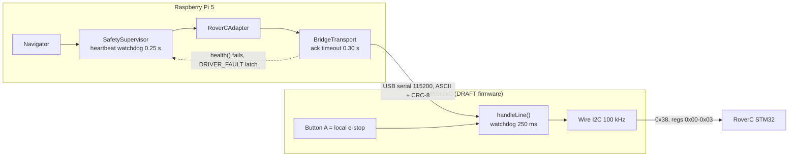
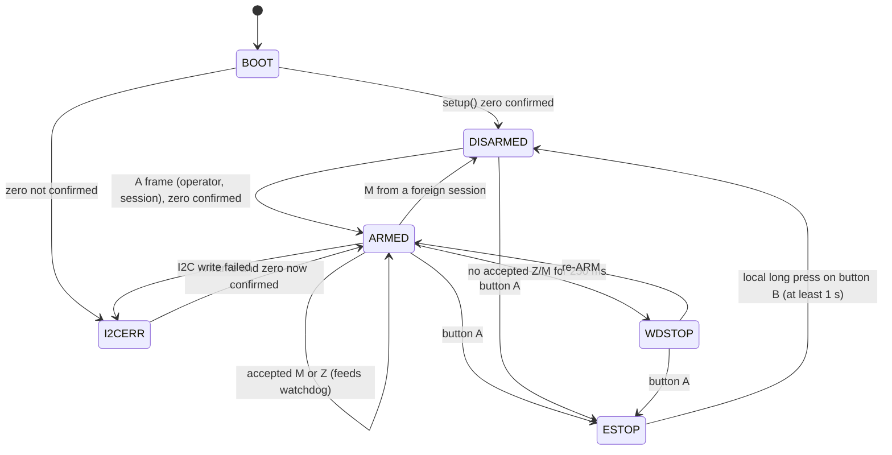
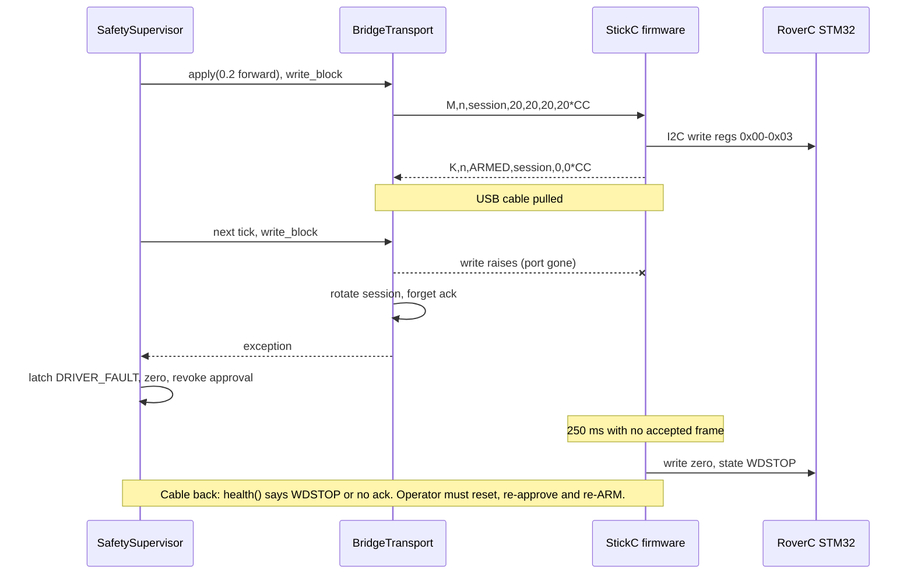

# 13 M5StickC USB-serial bridge

This document explains the link that would connect the Raspberry Pi 5 to the RoverC-Pro's motors. The Pi sends short, checksummed text frames over USB serial to an M5StickC. Draft firmware on the StickC turns the frames into I²C writes to the RoverC's STM32 motor controller, and zeroes the motors on its own if valid frames stop arriving. It covers the frame format and CRC-8, arming and sessions, the two independent watchdogs (firmware-side and Pi-side), what happens when the link is lost, the Python firmware model used for mocked tests, and the evidence that the controller has never been seen by either computer. The protocol reference is [docs/rover/BRIDGE_PROTOCOL.md](rover/BRIDGE_PROTOCOL.md). This page explains it and does not repeat every detail.

**Status:** Pi side (`rover/bridge.py`) implemented and **MOCKED-tested** (63 tests against a Python model of the firmware). Firmware (`firmware/stickc_roverc_bridge/stickc_roverc_bridge.ino`) is a **DRAFT: never compiled, never flashed, never run**. The M5StickC controller was **NOT DETECTED** on the Pi or the Mac in every reported read-only check (2026-11-07 and 2026-11-08). Link-loss stop time on hardware: **NOT MEASURED**.

**Related:** [12 RoverC motor control](12_ROVERC_MOTOR_CONTROL.md) · [17 Safety architecture](17_SAFETY_ARCHITECTURE.md) · [Bridge protocol](rover/BRIDGE_PROTOCOL.md) · [Hardware readiness](rover/HARDWARE_READINESS.md) · [Bench runbook](rover/BENCH_RUNBOOK.md) · Reports [BRG-01](experiments/reports/BRG-01-bridge-watchdog-mocked-tests.md), [ROV-02](experiments/reports/ROV-02-controller-connectivity-inspection.md)

---

## Contents
1. [Problem](#1-problem)
2. [Why a USB-serial bridge](#2-why-a-usb-serial-bridge)
3. [Concept](#3-concept)
4. [Math: CRC-8 and timing budgets](#4-math-crc-8-and-timing-budgets)
5. [Implementation in the repo](#5-implementation-in-the-repo)
6. [Frame format](#6-frame-format)
7. [Arming, sessions and the firmware state machine](#7-arming-sessions-and-the-firmware-state-machine)
8. [Two watchdogs: firmware-side and Pi-side](#8-two-watchdogs-firmware-side-and-pi-side)
9. [Link-loss behaviour](#9-link-loss-behaviour)
10. [Configuration and dependencies](#10-configuration-and-dependencies)
11. [The firmware model `rover/tests/bridge_model.py`](#11-the-firmware-model-rovertestsbridge_modelpy)
12. [Tests and observed results](#12-tests-and-observed-results)
13. [Controller detection evidence: NOT DETECTED](#13-controller-detection-evidence-not-detected)
14. [Residual hardware risks and limitations](#14-residual-hardware-risks-and-limitations)
15. [How to reproduce](#15-how-to-reproduce)
16. [How to extend, and what remains before a wheel test](#16-how-to-extend-and-what-remains-before-a-wheel-test)

---

## 1. Problem

The RoverC-Pro's motors are set by four registers on an STM32 at I²C address `0x38`. Three facts make reaching them hard:

1. **The Pi has no path to that bus.** The StickC plugged into the RoverC is the I²C master. Adding the Pi as a second master on the same bus is unsupported ([12](12_ROVERC_MOTOR_CONTROL.md) §3.2).
2. **The STM32 has no documented watchdog.** If commands stop, assume the wheels **keep their last speed indefinitely** (`rover/protocol.py`).
3. **A host-side watchdog alone cannot fix point 2.** If the Pi crashes, or the cable is pulled, the Pi can't send a stop.

So the component that can always stop the motors must be the one wired directly to the motor bus: the StickC.

## 2. Why a USB-serial bridge

| Option | Verdict | Reason |
|---|---|---|
| Pi as a second I²C master through a Grove port | Rejected | Two masters on one bus; no watchdog anyway |
| StickC firmware with commands over **Wi-Fi UDP** | Considered ([safety report](rover/SAFETY_AND_LIMITATIONS.md) §1) | Adds a radio, pairing and network latency; venue Wi-Fi is shared |
| StickC firmware with commands over **USB serial** | **Chosen** (PR #15) | Wired, simple, deterministic; the StickC already exposes a USB-UART; the firmware watchdog runs on the StickC's own clock |

The chosen design keeps the safety logic on the Pi (`SafetySupervisor`, [17](17_SAFETY_ARCHITECTURE.md)), and adds a small, independently timed stop on the StickC. Each side assumes the other may fail.

## 3. Concept



Every motor frame carries a sequence number, a session ID and a CRC. The firmware acknowledges every frame with its state. The Pi treats the link as healthy only while it keeps getting fresh acknowledgements that say ARMED for *its own* session. The firmware treats the link as alive only while accepted motion or zero frames keep arriving.

## 4. Math: CRC-8 and timing budgets

### 4.1 CRC-8, polynomial 0x07

A cyclic redundancy check treats the bytes as one long binary polynomial, divides it by a fixed generator polynomial, and keeps the remainder. Here the generator is x⁸ + x² + x + 1 (0x07), the initial value is 0, and the bits are not reflected. This is often called CRC-8/SMBUS. Any single-bit error, any odd number of bit errors, and any error burst of up to 8 bits changes the remainder, so the receiver detects it. For random corruption beyond that, the chance of a corrupted frame passing is about 1/256 per frame. The CRC is an integrity check against line noise and garbage. **It is not authentication** (that would need a key).

Both sides implement the same bitwise loop: `crc8` in `rover/bridge.py`, and `crc8()` in the `.ino`:

```
c = 0
for each byte b:  c ^= b;  repeat 8 times:  c = ((c << 1) ^ 0x07) & 0xFF if c & 0x80 else (c << 1) & 0xFF
```

Check value: `crc8(b"123456789") == 0xF4`. It is asserted in `test_crc_known_vector_and_roundtrip`, and was re-run for this document.

### 4.2 Timing budget

| Quantity | Value | Where | Why |
|---|---|---|---|
| Firmware watchdog | **250 ms** (`WATCHDOG_MS`) | `.ino` and `rover/bridge.py` | must be ≤ 300 ms (bench requirement) |
| Pi ack timeout | **0.30 s** (`ACK_TIMEOUT_S`), must be in (0, 0.30] | `BridgeTransport` | stale link → `health()` fault |
| Supervisor heartbeat watchdog | 0.25 s | `MotionLimits.watchdog_timeout_s` | control loop stalled → `COMMS_LOST` |
| Firmware zero retry | 20 ms | `ZERO_RETRY_MS` | keep re-zeroing until the bus confirms |
| I²C timeout | 20 ms | `I2C_TIMEOUT_MS` | a stuck bus must not stall `loop()` past the watchdog |
| Task watchdog | 1 s | `TASK_WDT_MS` | a hung `loop()` resets the chip, and `setup()` zeroes first |
| Serial read cap | 256 bytes per loop | `MAX_BYTES_PER_LOOP` | the watchdog check runs even under a serial flood |

The serial line itself is fast. A motor frame like `M,2,0a1b2c3d,30,30,30,30*1E\n` is 28 bytes. At 115 200 baud with 10 bits per byte, that is about 2.4 ms on the wire. The 250 ms watchdog therefore allows many missed frames before it trips, while still stopping the wheels within roughly a quarter of a second of the last good frame.

**Worst-case stop latency after a cable pull** (design estimate, not measured): up to the 250 ms watchdog, plus one `loop()` iteration (about 1 ms of `delay(1)`, plus up to a 20 ms I²C timeout), plus the STM32's own response, which is UNKNOWN. That is why the bench test must *measure* `stop_on_link_loss_ms` with the wheels lifted.

## 5. Implementation in the repo

| File | What it is | State |
|---|---|---|
| `rover/bridge.py` | Pi side: `crc8`, `frame`, `parse`, `encode_motor`, `Ack`, `Port`, `BridgeTransport`, `open_serial` | Implemented; MOCKED tests only |
| `firmware/stickc_roverc_bridge/stickc_roverc_bridge.ino` | StickC firmware (M5Unified, Arduino `Wire`, `esp_task_wdt`) | **DRAFT. Not compiled, not flashed, not run.** `arduino-cli` was not installed on the Mac |
| `rover/tests/bridge_model.py` | `BridgeFirmwareModel`, `FakeI2C`: an executable Python model of the `.ino` | Test code |
| `rover/tests/test_bridge.py` | 63 tests: protocol, arming, watchdog, faults, end to end | pass at d1b607a |
| `docs/rover/BRIDGE_PROTOCOL.md` | Protocol and safety rules, residual risks, read-only detection commands | reference |

**`BridgeTransport`** implements the `Transport` interface that `RoverCAdapter` uses (`write_block(address, register, data)` plus `health()`):

- It only carries the 4-byte motor block at `0x38/0x00`. Anything else raises `PermissionError`, so the servo registers are unreachable through it.
- An all-zero block becomes a `Z` frame; anything else becomes an `M` frame. `encode_motor` refuses |speed| > 100 *before* sending.
- After each write it calls `poll()`. If the latest matched reply was a refusal, it raises `IOError`, and the supervisor latches `DRIVER_FAULT`.
- Replies are matched to the frames they answer **by sequence number** (`_match`). Ack freshness is measured from the matched frame's **send** time (`Ack.t`), not from when the ack was read. So acks that piled up in a buffer while the Pi was stalled do not look fresh.
- The buffer is capped at 4096 bytes (it keeps the last 512 on overflow). A garbage flood cannot grow memory, and a partial line is never trusted.
- On any port write exception it **forgets the ARM**: it picks a new session, clears `last_ack` and the outstanding frames, and re-raises.

**`open_serial(path, baud=115200)`** accepts only `/dev/serial/by-id/...` paths, so an unstable name like `/dev/ttyACM0` cannot point at the wrong device after a re-plug. It imports pyserial lazily, and opens the port with **DTR and RTS deasserted**. On StickC boards those lines drive the ESP32's EN/G0 auto-reset circuit. Toggling them can reset the controller, or hold G0 low and enter download mode, where nothing zeroes the motors. `open_serial` is never called by tests (it is marked `pragma: no cover`).

## 6. Frame format

ASCII, newline-terminated. The CRC covers every byte before `*` and is written as two uppercase hex digits. Example frames, generated by `rover.bridge.frame` / `encode_motor` for this document (SYNTHETIC values):

| Direction | Frame | Example |
|---|---|---|
| Pi → MCU motor | `M,<seq>,<session>,<s0>,<s1>,<s2>,<s3>*CC` | `M,2,0a1b2c3d,30,30,30,30*1E` |
| Pi → MCU zero | `Z,<seq>*CC` | `Z,1*66` |
| Pi → MCU arm | `A,<seq>,<operator>,<session>*CC` | `A,3,alice,0a1b2c3d*D6` |
| Pi → MCU ping | `P,<seq>*CC` | `P,4*FA` |
| MCU → Pi ack | `K,<seq>,<state>,<session>,<wd_trips>,<i2c_errs>*CC` | session `-` when not armed |
| MCU → Pi refusal | `N,<seq>,<reason>*CC` | reasons: `not-armed-<STATE>`, `session`, `range`, `bad-speed`, `i2c`, `unknown`, `estop-local-reset` |

Parsing rules (identical in `parse`, the `.ino`'s `handleLine`, and `bridge_model.py`):

- the line is split at the **last** `*`; it needs exactly 2 hex digits and a matching CRC, otherwise it is **silently dropped**;
- fields are split by hand, so empty fields are kept (the firmware comment notes that `strtok` would collapse them);
- `seq` is 1–9 digits; `session` is exactly 8 lowercase hex characters; speeds are an optional `-` then 1–4 digits, within ±100;
- operator names match `^[A-Za-z0-9_.@-]{1,32}$`;
- lines over 95 characters are dropped whole;
- `frame()` refuses payloads containing `*` or newline, so no frame can be injected through a field.

Speeds `s0..s3` are the values for registers `0x00..0x03`, after `library_mix` ([12](12_ROVERC_MOTOR_CONTROL.md) §5).

## 7. Arming, sessions and the firmware state machine



The rules, all in the `.ino` and the model:

1. **Zero first.** `setup()` begins I²C and writes zero **before** `M5.begin()` (display, PMIC and IMU init can take hundreds of ms), and again after it. The output counts as *unknown* until a zero is confirmed (`outputUnknown`).
2. **ARM is explicit and named.** `A,<seq>,<operator>,<session>` needs a non-empty operator and a valid session, and it succeeds only if a zero write is confirmed on the bus. In ESTOP, ARM is refused (`estop-local-reset`). On the Pi, `BridgeTransport.arm(operator)` is the only way to send it, and nothing calls it automatically.
3. **Sessions.** Each `BridgeTransport` picks 8 random hex characters (`secrets.token_hex(4)`). The firmware accepts `M` only from the session that armed it. An `M` from any other session **zeroes the motors and disarms**. So a restarted, duplicated or reconnected Pi process can never drive motors that an earlier process armed, even inside the 250 ms watchdog window.
4. **Refusals zero too.** Bad speed, out-of-range speed or a not-armed `M` all zero the motors as well as being refused.
5. **The local e-stop** is button A: zero, then ESTOP. **Only a local long press on button B** clears it, and only to DISARMED. The Pi can never clear it.
6. **Only registers `0x00–0x03`** are ever written.

## 8. Two watchdogs: firmware-side and Pi-side

They protect against different failures and run on different clocks.

| | Firmware watchdog | Pi-side watchdogs |
|---|---|---|
| Runs on | StickC `millis()` | Pi `time.monotonic` |
| Trigger | no **accepted** `Z`/`M` (or successful ARM) for 250 ms while ARMED | (a) supervisor: no `heartbeat()` for 0.25 s → `COMMS_LOST`; (b) transport: no matched ack for a frame sent ≤ 0.30 s ago → `health()` fault → `DRIVER_FAULT` |
| What it protects against | Pi crash, cable pull, hung Pi process, USB-UART failure | stalled control loop, dead or unresponsive controller, refusals |
| Action | zero the motors, WDSTOP, `wd_trips += 1` | latch, zero the output, revoke approval |
| Recovery | operator re-ARM | operator `reset_latch` + `approve_motion` (+ `Navigator.resume`) |
| Fed by | accepted motion/zero frames only; **pings, refused, unknown, bad-CRC, malformed and oversized frames do not feed it** | `heartbeat()` from `Navigator.tick`; acks |

**Keepalive.** While the Pi is healthy, `SafetySupervisor.tick()` re-applies its output on every cycle, so a stopped robot sends `Z` frames. That keeps the firmware watchdog fed without ever sending a non-zero speed (tested by `test_stopped_supervisor_keeps_the_firmware_watchdog_fed`).

**Why both are needed.** The Pi watchdog cannot stop wheels if the cable is gone. The firmware watchdog cannot know that the Pi's *sensor* went stale; only the supervisor knows that. Neither is sufficient alone.

## 9. Link-loss behaviour



What the mocked end-to-end test shows (`test_end_to_end_motion_then_cable_pull_stops_both_sides`), re-measured for this document on the mock clock with 50 ms supervisor ticks:

- the host side latched `DRIVER_FAULT` on the first tick after the cut (0.05 s: "serial port disconnected");
- the firmware model reached WDSTOP with all registers at zero 0.30 s after the cut, on the 50 ms step grid. The watchdog itself is 250 ms;
- with 1 ms steps, the model's watchdog tripped **0.251 s** after the last accepted frame.

These are **MOCKED** timings of a Python model on a simulated clock. They are not StickC measurements.

Other link cases that are tested, all MOCKED:

- USB reconnect inside the watchdog window: a re-ARM is still required;
- a hung firmware (no acks): the host latches `DRIVER_FAULT`, and the firmware watchdog holds;
- a firmware reboot: it comes up at zero and DISARMED;
- a restarted Pi process: it cannot drive motors armed by the old one.

## 10. Configuration and dependencies

| Item | Value |
|---|---|
| Baud | 115 200 (`open_serial` default, `Serial.begin(115200)`) |
| I²C | 100 kHz, SDA G0, SCL G26: from RoverC documentation, **to be verified on the identified StickC model** |
| Pi dependency | pyserial, lazily imported by `open_serial` only |
| Firmware dependencies | M5Unified, Arduino `Wire`, `esp_task_wdt` (the API differs between ESP32 Arduino core 2.x and 3.x; the `.ino` has both branches) |
| Toolchain | `arduino-cli`: **not installed** on the Mac at the time of PR #15 |

## 11. The firmware model `rover/tests/bridge_model.py`

Python can't run the `.ino`, so `BridgeFirmwareModel` re-implements it line by line: the same states, frames, parsing regexes, watchdog rule, zero-retry and session rules. `FakeI2C` stands in for the bus. Its registers are a dict, `fail` makes writes fail, and `partial` models a NACK after the first data byte (register 0 changes but the write reports failure), which is why a failed write marks the output *unknown*. `LoopbackPort` (in the test file) connects `BridgeTransport` to the model. It can delay replies by one read, like a real UART, and can be cut.

The model **does not** cover the physical differences: the display, DTR/RTS auto-reset, download mode, the task watchdog, real I²C timing and the STM32's behaviour. Those need bench tests ([BRIDGE_PROTOCOL.md](rover/BRIDGE_PROTOCOL.md), "Residual hardware risks").

**Lockstep risk.** The model and the `.ino` are kept in lockstep by hand. The independent review of PR #15 found and fixed divergences between them. Until the sketch is compiled and run, the `.ino` itself has **zero** executed tests. Every bridge test result is evidence about the *model*.

## 12. Tests and observed results

`rover/tests/test_bridge.py`: **63 tests, all passing** at d1b607a (included in the 284 rover tests; local run, 2026-11-08, macOS, Python 3.13.5). Label: **MOCKED**.

| Group | Examples |
|---|---|
| Protocol | CRC check value; malformed and bad-CRC frames rejected; out-of-range speeds and bad sessions refused before sending; injection refused |
| Arming | boot is zero and DISARMED; `M` refused until armed; ARM needs a named operator |
| Watchdog | zero within 300 ms of the last frame; a re-ARM needed after a trip; corrupted frames, pings and refused frames don't feed it |
| Faults | button e-stop; I²C error; partial I²C write → output unknown and zero retried; boot with a failing bus → I2CERR with retries; remote ARM cannot clear the local e-stop |
| Host | `health()` fails when acks stop; ack timeout above 0.30 s refused; seq matching and a late NAK surfacing; stale buffered acks; foreign replies ignored; `open_serial` refuses unstable paths and deasserts DTR/RTS |
| End to end | supervisor → adapter → bridge → model: a cable pull stops both sides; STOP sends `Z`; the stopped supervisor keeps the watchdog fed; session and restart cases |

The full write-up is in [BRG-01](experiments/reports/BRG-01-bridge-watchdog-mocked-tests.md). These tests show the *design* is internally consistent. **They do not show** that the firmware compiles, that the StickC zeroes the RoverC, or how long the wheels take to stop.

## 13. Controller detection evidence: NOT DETECTED

Every reported check of whether the M5StickC is reachable as a USB device was **read-only**. They read sysfs, `lsusb`, the kernel log, `ioreg` and `system_profiler`. None opened a serial port, because opening it can toggle DTR/RTS and reset the ESP32. None transmitted on I²C or Bluetooth.

| When (UTC) | Host | Result | Source |
|---|---|---|---|
| 2026-11-07 ~23:27 | Mac | `/dev/cu.*` shows only Bluetooth and debug-console ports; no USB-serial device | session console log, 2026-11-07 23:27 UTC |
| 2026-11-07 ~23:49 | Pi | `lsusb`: four root hubs only; no `/dev/ttyUSB*`, `/dev/ttyACM*` or `/dev/serial/by-id`; I²C adapters `i2c-11` (camera: IMX708 at 0x1a, VCM at 0x0c), `i2c-13`, `i2c-14`; header bus `i2c-1` **not enabled**; nothing on 0x38 (`i2cdetect` deliberately not run, because it transmits) | session console log; [hardware readiness](rover/HARDWARE_READINESS.md) §2 |
| 2026-11-07 ~23:49 | Mac | `ioreg -p IOUSB`: only the built-in USB host controllers | session console log |
| 2026-11-08 ~00:46 | Pi | USB root hubs only, no StickC/serial bridge; I²C1 not enabled; GPIO2–27 unclaimed | `$ROBOT_WORKSPACE/IMPLEMENTATION_JOURNAL.md` (19:46 ET entry) |
| 2026-11-08 ~10:22 | Pi | no non-root USB devices; no serial devices; "header I2C not enabled in config.txt" | session console log |
| 2026-11-08 ~11:38 | Mac | `system_profiler SPUSBDataType`: no devices; `/dev/cu.*`: Bluetooth and debug console only | session console log (first wheel-test request) |
| 2026-11-08 ~11:46 | Pi | up 2 min after a reboot; `lsusb` root hubs only; no `/dev/serial/by-id`, `/dev/ttyUSB*`, `/dev/ttyACM*` | session console log |
| 2026-11-08 ~12:28 | Pi | up under 1 min after another reboot; "no USB devices", "no serial tty"; no attach attempt or descriptor error in the kernel log | session console log (second wheel-test request) |

Label: **REAL HARDWARE** (read-only inspection of the real hosts). Verdict: **NOT DETECTED**. The controller model (StickC, Plus or Plus2) is **UNKNOWN**, because no USB VID:PID was ever read.

The operator twice reported the controller as connected by USB (2026-11-08, around 11:37 and 12:28 UTC) and asked for a first wheels-off-ground test. Both requests stopped at detection. No motor command was sent. The session's own diagnosis of likely causes was: the StickC plugged into a USB hub or power bank rather than the Pi; a charge-only cable; or a port without data. It is **UNVERIFIED** which of these applied. The Pi was also on a 3 A source at the time, and rebooted twice in about 30 minutes. The full analysis is in [ROV-02](experiments/reports/ROV-02-controller-connectivity-inspection.md).

The read-only detection commands to use when the controller is plugged in are in [BRIDGE_PROTOCOL.md](rover/BRIDGE_PROTOCOL.md) ("Read-only USB detection"). Typical USB-UART IDs to expect are FTDI FT231X `0403:6015`, WCH CH9102 `1a86:55d4` and CH340 `1a86:7523`; confirm against the actual board.

### A separate StickC effort on an unmerged branch (PR #6)

The "NOT DETECTED" verdict above covers the **team Pi and the main development Mac** only. Open, unmerged PR #6 (branch `culubo/sensor-id-specs`, commit `45481e4`, 2026-11-08 04:28 UTC) contains a **different** controller path: a `roverc_usb` receiver firmware with Wi-Fi/keyboard control, plus a mission-control server. That branch's rover README says:
- A teammate compiled and **uploaded** a USB receiver image to a StickC Plus from their own Mac, after backing up the original firmware privately. Restoring that backup has not been tested.
- A MOVE command is acknowledged only after the motor registers are read back, and "this does not prove wheel rotation".
- `READY=0` means the RoverC base's I²C controller was not detected.

Its VERIFICATION file (2026-11-07) says no physical robot was operated during its checks: unit tests plus loopback runs against a fake receiver. It lists "powered RoverC directions/stop behavior" as a pending hardware gate.

What this means:
- A StickC **was** connected to a teammate's Mac and flashed. That is **claimed in the branch README**; no logs exist in our evidence stores.
- **Wheel rotation is still NOT VERIFIED** on either path.
- The PR #6 firmware and the PR #15 draft bridge are **two separate efforts that were never reconciled**. Neither has a reviewed, bench-tested link-loss watchdog on real hardware.

See [22_EXPERIMENTS_AND_FAILURES.md](22_EXPERIMENTS_AND_FAILURES.md) and [25_LIMITATIONS_AND_FUTURE_WORK.md](25_LIMITATIONS_AND_FUTURE_WORK.md).

## 14. Residual hardware risks and limitations

These cannot be fixed in firmware. They must be bench-tested with the wheels lifted:

- **Reset while moving.** The STM32 holds the last speeds. Between an ESP32 reset and the first zero write in `setup()`, nothing stops the wheels except the **RoverC power switch**.
- **Download mode.** G0 is both SDA and a boot strapping pin. If it is held low at reset (the USB-UART auto-program circuit can do this), the ESP32 enters download mode and runs no firmware. Again, only the power switch stops the wheels. The mitigation is DTR/RTS deasserted in `open_serial`, and no other program may open the port: no `screen`, `minicom`, `cat`/`stty`, `esptool` or Arduino serial monitor.
- **Board-specific unknowns:** the StickC model and hat pin map, whether Arduino `Wire` conflicts with M5Unified's external I²C, and the task-watchdog API version.
- **The CRC is not authentication.** Anything that can write to the serial port can send valid frames. Sessions protect against stale *Pi processes*, not against an attacker with local access.
- **ModemManager** is active on the Pi (session console log, 2026-11-08 10:38 UTC). It normally ignores generic USB-serial bridges. If its log shows it probing the port, adding a udev ignore rule is a configuration change that needs approval.
- **No compile, no flash.** The sketch has never been compiled, so even syntax errors are possible.

## 15. How to reproduce

Mocked tests and frame generation only. No serial port is opened.

```bash
python3 -m pytest -q rover/tests/test_bridge.py          # 63 passed
python3 -c "from rover.bridge import crc8; print(hex(crc8(b'123456789')))"   # 0xf4
python3 -c "from rover.bridge import frame, encode_motor; print(frame('Z,1'), encode_motor(2, '0a1b2c3d', (30, 30, 30, 30)))"
```

Hardware steps (compile, flash, dry run, link-loss measurement) need written approval, the RoverC switched off for flashing, and the procedure in [BRIDGE_PROTOCOL.md](rover/BRIDGE_PROTOCOL.md) and [BENCH_RUNBOOK.md](rover/BENCH_RUNBOOK.md). They are not reproduced here.

## 16. How to extend, and what remains before a wheel test

Remaining, in order (from [BRIDGE_PROTOCOL.md](rover/BRIDGE_PROTOCOL.md) and the 2026-11-08 blocked-test reports):

1. Connect the StickC to a **Pi USB port** with a **data** cable, the RoverC switched off, and the Pi on its 5 A wall supply. Run the read-only detection. Record the VID:PID, the `/dev/serial/by-id` path and the label on the back of the board.
2. Install `arduino-cli` (needs approval), compile for the identified model, and review the sketch against `bridge_model.py`.
3. Flash (separate approval, RoverC off). Dry run with the RoverC off: ARM, `M`, cut the link, and confirm WDSTOP from the acks and the screen.
4. Wheels lifted: measure the link-loss stop time and record it in `HardwareVerification.stop_on_link_loss_ms` (≤ 300 ms). Do the reset-while-moving, replug and download-mode tests.
5. Measure the battery, set `min_voltage_v`, and rehearse the physical e-stop.

When extending the protocol, change `rover/bridge.py`, the `.ino` **and** `bridge_model.py` together, and add a test that pins the new frame. Any new transport file must be added to `MOTOR_PATH_ALLOWED` in `rover/tests/test_issue9_fail_closed.py` through review.
