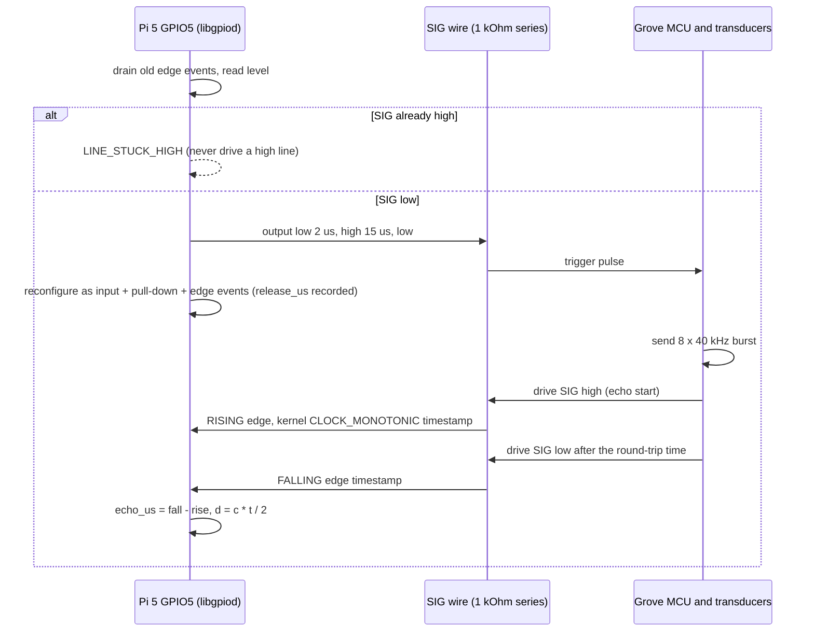
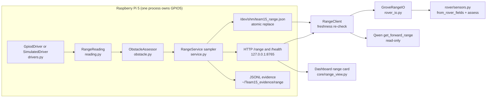
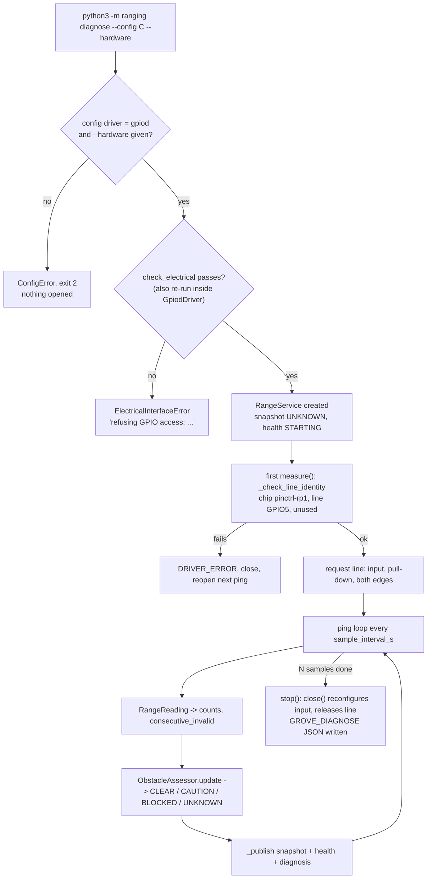
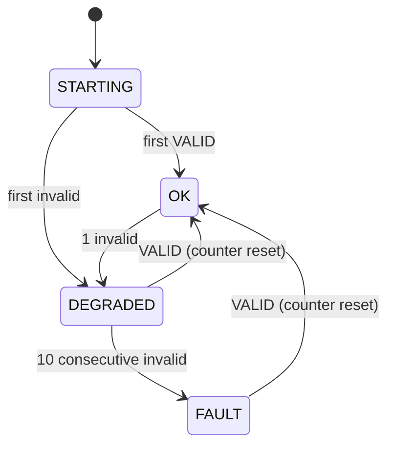

# 14 Grove ultrasonic ranger

The Grove Ultrasonic Ranger was the ground robot's first forward obstacle sensor. It is a single-wire time-of-flight sonar that measures the distance to the nearest echo in a narrow cone in front of the robot. The `ranging/` package wraps it in a fail-closed service. A simulator and a Raspberry Pi 5 libgpiod driver produce one record type. A rolling filter turns readings into CLEAR / CAUTION / BLOCKED / UNKNOWN. One process owns the sensor and publishes snapshots, and the navigation, dashboard and Qwen consumers read those snapshots. Two layers stop the hardware driver touching GPIO until a two-person wiring checklist is recorded. This document covers the physics, the code, the electrical risk and what actually happened on hardware. The only real-hardware runs (2026-11-08) produced **0 of 50 valid readings, twice**. The root cause is **unknown**.

**Status:** Implemented. Simulation-tested (126 tests). **Hardware: attempted, NOT working.** Two real diagnose runs on the Pi 5 got no echo at all (`NO_RESPONSE_EVER`). No real distance has ever been measured. `floor-check` and `calibrate` have never run on hardware.

**Related:** [15 RPLIDAR C1](15_RPLIDAR_C1.md) · [17 Safety architecture](17_SAFETY_ARCHITECTURE.md) · [18 Simulation](18_SIMULATION.md) · [12 RoverC motor control](12_ROVERC_MOTOR_CONTROL.md) · [16 Dashboard](16_DASHBOARD.md) · [22 Experiments and failures](22_EXPERIMENTS_AND_FAILURES.md) · package docs: [README](../ranging/README.md), [WIRING](../ranging/WIRING.md), [INTEGRATION](../ranging/INTEGRATION.md), [HARDWARE_VALIDATION](../ranging/HARDWARE_VALIDATION.md) · [Grove → LiDAR migration](lidar/GROVE_TO_LIDAR_MIGRATION.md)
**Experiment reports:** [RNG-HW-01/02 real diagnose runs](experiments/reports/RNG-HW-01-grove-real-hardware-diagnose.md) · [RNG-PF preflight and gate runs](experiments/reports/RNG-PF-01-grove-preflight-gate-runs.md) · [RNG-SIM ranging test suite](experiments/reports/RNG-SIM-01-ranging-simulation-test-suite.md)

---

## Contents

1. [Problem](#1-problem)
2. [Why this technology](#2-why-this-technology)
3. [Concept: one wire, two directions](#3-concept-one-wire-two-directions)
4. [Math](#4-math)
5. [Implementation in the repo](#5-implementation-in-the-repo)
6. [Key files, symbols and interfaces](#6-key-files-symbols-and-interfaces)
7. [Inputs and outputs](#7-inputs-and-outputs)
8. [Data structures and schemas](#8-data-structures-and-schemas)
9. [Configuration](#9-configuration)
10. [Dependencies](#10-dependencies)
11. [Execution flow](#11-execution-flow)
12. [Error handling, measurement statuses and health](#12-error-handling-measurement-statuses-and-health)
13. [Safety and security: the 3.3 V / 5 V problem](#13-safety-and-security-the-33-v--5-v-problem)
14. [Tests and observed results](#14-tests-and-observed-results)
15. [Limitations](#15-limitations)
16. [How to reproduce](#16-how-to-reproduce)
17. [How to extend, and the Grove → LiDAR migration](#17-how-to-extend-and-the-grove--lidar-migration)

---

## 1. Problem

The RoverC-Pro ground robot must never drive into something in front of it. The camera pipeline (see [06 Obstacle mapping](06_OBSTACLE_MAPPING.md)) gives only uncalibrated, advisory distances. The navigator ([12](12_ROVERC_MOTOR_CONTROL.md)) needs one cheap, direct measurement that answers a single question every ~100 ms: **is the space directly ahead free for at least the stopping distance?**

That question has a safety-critical twist. When the sensor hears no echo, the answer is not "free". It is "I don't know". A sonar hears nothing when the target is soft, angled or out of range, **and also when it is unplugged**. The software must not be able to confuse those cases with open space.

## 2. Why this technology

| Option | Pros | Cons | Outcome |
|---|---|---|---|
| **Grove Ultrasonic Ranger (Seeed, V2.0)** | In the kit; cheap; 2–350 cm datasheet range; one GPIO; simple physics | 15° cone only; soft/angled targets give no echo; single shared SIG wire; 3.3 V support only on V2.0 | **Chosen first** (PR #7) |
| Camera monocular distance | Already running | Uncalibrated, scale-ambiguous, advisory only | Not a safety input |
| RPLIDAR C1 | 360°, 12 m spec, many points per revolution | Needs a USB-UART adapter, more power (≈0.8 A start current per the C1 datasheet as read in the 2026-11-08 session), a more complex protocol | Added later as an opt-in source ([15](15_RPLIDAR_C1.md)) |

Ultrasonic time of flight needs only a timer: the sensor's MCU drives a pulse whose **width** is the round-trip time. On a Pi 5 the kernel can timestamp GPIO edges in nanoseconds, so Python scheduling jitter does not enter the distance (`ranging/drivers.py`, `GpiodDriver`).

## 3. Concept: one wire, two directions

Most hobby sonars (HC-SR04) have separate TRIG and ECHO pins. The Grove board has **one** signal pin, SIG, which is both the trigger input and the echo output (Seeed wiki FAQ, cited in `ranging/WIRING.md` §1). The Pi must therefore:

1. drive SIG **low → high (> 10 µs) → low** as an output (the trigger);
2. **release** SIG, switching it back to an input, before the sensor starts answering;
3. timestamp the **rising** edge (echo start) and the **falling** edge (echo end).



**Why this matters for the hardware result.** In both real runs the Pi released SIG within 65–96 µs after the trigger and then saw **zero edges of any kind** in a ~32 ms window per ping. In other words, the sensor never drove SIG high (see [§14](#14-tests-and-observed-results)).

## 4. Math

### 4.1 Time of flight

Sound travels out to the target and back, so the one-way distance is half the path:

$$ d = \frac{c \cdot t_{\text{echo}}}{2} $$

`ranging/drivers.py` `classify_echo` implements exactly `d = echo_us * 1e-6 * cfg.speed_of_sound_mps / 2.0`.

| Target distance | Round trip `t = 2d/c` (c = 343 m/s) |
|---|---|
| 0.03 m (`min_range_m`) | 175 µs |
| 0.50 m | 2.92 ms |
| 1.00 m (the 2026-11-08 target) | 5.83 ms |
| 3.00 m (`max_range_m`) | 17.5 ms |
| 3.50 m (datasheet max) | 20.4 ms |

The driver waits at most `echo_start_timeout_s = 0.002` s for the echo to **start**. Seeed's own code rejects starts later than about 530 µs (`ranging/config.py` comment). It then waits up to `echo_end_timeout_s = 2·3.5/c·1.5 ≈ 30.6 ms` for the echo to **end** (`SensorConfig.echo_end_timeout_s`).

### 4.2 Temperature dependence of the speed of sound

For dry air, `c(T) ≈ 331.3·√(1 + T/273.15) ≈ 331.3 + 0.606·T` m/s (T in °C), which gives 343.4 m/s at 20 °C. The code uses a **fixed** `SPEED_OF_SOUND_MPS = 343.0` (`ranging/config.py`, "~20 C dry air"). Seeed's `cm = µs/29/2` implies c ≈ 345 m/s.

Sensitivity: `∂d/d = ∂c/c ≈ 0.606/343 ≈ 0.18 % per °C`. At 1 m, a room 10 °C warmer or colder than 20 °C shifts the reading by about **±1.8 cm**. Humidity adds a smaller positive term. This is why `calibrate` fits `true ≈ a·measured + b` and reports `suggested_speed_of_sound_mps = 343·a` (`ranging/cli.py` `fit_and_thresholds`). It is also why `validate()` only accepts 300–360 m/s. **No temperature-compensated or calibrated value exists**, because calibration never ran on hardware.

### 4.3 Timing resolution

The edges are kernel-timestamped (`event_clock=CLOCK_MONOTONIC`), so a 1 µs timing error is only `343e-6/2 ≈ 0.17 mm`. The practical resolution limit is the sensor itself: the Seeed spec is 1 cm.

### 4.4 Beam geometry and floor echoes

The datasheet beam is a **15° full cone** (`SPEC_BEAM_ANGLE_DEG`). With the axis at height `h` and pitch `p`, the lower beam edge meets the floor at

$$ x_{\text{floor}} = \frac{h}{\tan(7.5^\circ - p)} $$

With the placeholder `mount_height_m = 0.08` and `p = 0`, that is `0.08/tan 7.5° = 0.608 m` (`ObstacleConfig.geometry()`, `floor_intercept_m`). This lies **inside** the CAUTION band (≤ 0.68 m), so floor echoes may appear as obstacles. `floor-check` exists to test this on the real floor. It never ran.

### 4.5 Stopping distance and thresholds

`ObstacleConfig.stopping_distance_m()`:

$$ s = v\,(t_{\text{latency}} + t_{\text{sample}}) + \frac{v^2}{2a} = 0.3\,(0.2+0.1) + \frac{0.3^2}{2\cdot 0.5} = 0.18\ \text{m} $$

`blocked_m = s + safety_margin_m + sensor_setback_m = 0.28 m`. `caution_m = blocked_m + 0.40 = 0.68 m`. **Every input is a placeholder.** RoverC-Pro speed, deceleration and latency were never measured, because real wheel movement is NOT TESTED ([12](12_ROVERC_MOTOR_CONTROL.md)).

### 4.6 The SIG-idle voltage divider (the ≤ 1.2 V gate)

The Seeed schematic (dated 8-Nov-2017, includes C14) shows SIG going straight to the MCU pin, with **R2 = 10 kΩ pull-down** to GND. Finding first reported by the robotics workstream, session console log 2026-11-08 ~01:00 UTC; recorded in `ranging/WIRING.md` §1. At boot the Pi's GPIO5 has its default ~50 kΩ pull-up (`pinctrl get 5` → `no pu`). With the 1 kΩ series resistor:

$$ V_{\text{SIG,idle}} \approx 3.3 \cdot \frac{10}{10 + 1 + 50} \approx 0.54\ \text{V} $$

So the expected meter reading is about 0.3–0.9 V. A reading near 3.3 V means there is no pull-down, so the board is **not the documented one**. `check_electrical` refuses `sig_idle_measured_v > SIG_IDLE_MAX_V = 1.2` V, and refuses anything above 3.4 V as unsafe.

> Note: after any range run, the driver leaves GPIO5 as **input with pull-down** (`pinctrl get 5` → `ip pd | lo`, session console log 2026-11-08 10:43 UTC). An idle measurement taken then reads ≈ 0 V and does not test R2. `WIRING.md` §5 step 6 already says to measure in the boot state.

### 4.7 Filter decision range

`ObstacleAssessor.assess`: decision range `= min(latest valid, median of the valid readings in a 5-sample window)`. A single **short** reading stops immediately, which is the safe direction. A single **long** spike cannot clear a block. Relaxing to a less restrictive state needs the range to exceed `threshold + hysteresis_m (0.05)` for `clear_confirm_samples = 3` consecutive readings.

## 5. Implementation in the repo

The package came in with **PR #7** (`feature/grove-distance`, merged 2026-11-08 01:48 UTC as `691addb`, author `machackgo`). It is stdlib-only apart from the system `python3-libgpiod` on the Pi. `ranging/` is byte-identical between `06a69b9` (the commit deployed to the Pi for the real runs) and `d1b607a` (`git diff --stat 06a69b9 d1b607a -- ranging` is empty).



The design rules (from `ranging/obstacle.py` and `ranging/INTEGRATION.md`):

- An invalid reading **cannot carry a distance**. `RangeReading.__post_init__` raises if a non-VALID reading has `distance_m` set, or a VALID one lacks it.
- One process owns the sensor. Consumers never open GPIO.
- Freshness is re-checked on the **consumer** side (`apply_freshness`), so a crashed service turns into UNKNOWN within `stale_after_s = 0.5` s.
- UNKNOWN never allows forward motion (`FORWARD_ALLOWED[UNKNOWN] = False`).

## 6. Key files, symbols and interfaces

| File | Symbols | Role |
|---|---|---|
| `ranging/reading.py` | `MeasurementStatus`, `RangeReading`, `SCHEMA = "team15.range_reading/1"` | One ping. The status enum is in [§12](#12-error-handling-measurement-statuses-and-health) |
| `ranging/config.py` | `SensorConfig`, `ElectricalConfig`, `check_electrical`, `ElectricalInterfaceError`, `SIG_IDLE_MAX_V`, `RESERVED_BCM`, `SPEED_OF_SOUND_MPS` | Config and the **electrical gate** |
| `ranging/drivers.py` | `RangeDriver`, `SimulatedDriver`, `GpiodDriver`, `classify_echo`, `echo_from_events`, `make_driver` | Drivers. `echo_from_events` is a pure function, so the edge logic is testable without a Pi |
| `ranging/obstacle.py` | `ObstacleConfig`, `ObstacleAssessor`, `ObstacleStatus`, `Assessment`, `FORWARD_ALLOWED` | Filter, hysteresis, thresholds, geometry |
| `ranging/service.py` | `RangeService` (`FAULT_AFTER = 10`, `DEGRADED_AFTER = 1`, `ECHO_EVIDENCE`, `_diagnosis`, `_health`), `apply_freshness`, `RangeClient`, `make_http_server`, `unknown_snapshot` | Sampler, snapshots, HTTP, the consumer client |
| `ranging/rover_io.py` | `GroveRangeIO`, `snapshot_to_rover_fields`, `ROVER_FIELDS_SCHEMA = "team15.rover_range_fields/1"`, `ROVER_SOURCE = "grove-ultrasonic"` | Navigation adapter |
| `ranging/preflight.py` | `run_preflight`, `main_preflight`, `READ_ONLY_NOTE` | Read-only Pi checks: never requests a line |
| `ranging/cli.py` | `main`, `cmd_check_config`, `cmd_read`, `cmd_serve`, `cmd_watch`, `cmd_calibrate`, `cmd_floor_check`, `cmd_diagnose`, `fit_and_thresholds` | `python3 -m ranging …` |
| `ranging/configs/` | `simulated.json`, `pi5_gpio5.UNVERIFIED.json` | The template is refused by design (all checklist fields `null`) |
| `ranging/examples/range_panel.html` | — | Stand-alone dashboard panel. Shows UNKNOWN on fetch failure |
| `ranging/tests/test_ranging.py` | 58 test functions, 126 cases | Simulation and fake-libgpiod tests |

## 7. Inputs and outputs

| Direction | What | Format |
|---|---|---|
| In (hardware) | GPIO5 edge events on `/dev/gpiochip0` (`pinctrl-rp1`) | libgpiod v2 edge events (`read_edge_events`), ns CLOCK_MONOTONIC timestamps |
| In (sim) | A scene: a constant distance, a `t → distance` function, a list, or a forced status | `SimulatedDriver(scene=…)` |
| In | JSON config | [§9](#9-configuration) |
| Out | `team15.range_reading/1` per ping | [§8](#8-data-structures-and-schemas) |
| Out | `team15.range_snapshot/1` (file, HTTP, in memory) | `ranging/INTEGRATION.md` "Snapshot schema" |
| Out | `team15.rover_range_fields/1` | `GroveRangeIO.read_fields()` |
| Out | Evidence JSONL `range_<boot_id>.jsonl` | `{"reading": …, "status": …, "nearest_range_m": …}` per line |
| Out | CLI reports `GROVE_DIAGNOSE`, `GROVE_FLOOR_CHECK`, `GROVE_RANGE_CALIBRATION`, `GROVE_PREFLIGHT` | JSON |

**Semantics warning.** `range_m` is the nearest echo in a 15° beam. It is **never a distance to a person** (`Assessment.to_dict()` `range_semantics`). Range snapshots must not be POSTed to `/observations`.

## 8. Data structures and schemas

`team15.range_reading/1` (`RangeReading.to_dict`):

```json
{"schema": "team15.range_reading/1", "sensor_type": "GROVE_ULTRASONIC",
 "measurement_type": "FORWARD_OBSTACLE_RANGE", "sensor_id": "grove-us-front",
 "distance_m": null, "valid": false, "timestamp": "2026-11-08T10:43:21.827+00:00",
 "obs_time": 1794134601.827657, "mono_ns": 1296041635901, "seq": 50, "sensor_mount": "FRONT",
 "measurement_status": "NO_ECHO", "echo_us": null, "source": "RASPBERRY_PI_5",
 "driver": "gpiod", "detail": "no rising edge",
 "extra": {"release_us": 96.1, "edges": 0, "echo_start_us": null}}
```

That is the **real** last reading of run 1 (REAL HARDWARE, session console log 2026-11-08 10:43 UTC), copied from the diagnose report printed in the log.

`team15.rover_range_fields/1` (`snapshot_to_rover_fields`) carries the six fields `rover/sensors.py` `RangeReading` expects (`t, status, range_m, max_range_m, source, seq`), plus `schema`, `clock` (`time.monotonic@<host>`), `forward_motion_allowed`, `obstacle_status`, `measurement_status`, `reason`, `blocked_threshold_m`, `diagnosis` and `source_mode`. The mapping is in the `ranging/rover_io.py` docstring:

| Our state | rover `status` | `range_m` | `forward_motion_allowed` |
|---|---|---|---|
| fresh VALID + CLEAR/CAUTION | `OK` | decision range | true |
| fresh VALID + BLOCKED | `OK` | decision range | **false** |
| VALID but UNKNOWN (window not full) | `ERROR` | null | false |
| `NO_ECHO`, `OUT_OF_RANGE` | `NO_ECHO` | null | false |
| anything else, stale, other host, unreachable | `ERROR` | null | false |

## 9. Configuration

Defaults are in `SensorConfig` and `ObstacleConfig`. The two shipped files:

- `ranging/configs/simulated.json`: `"driver": "simulated"`, `"source": "SIMULATED"`.
- `ranging/configs/pi5_gpio5.UNVERIFIED.json`: `"driver": "gpiod"`, GPIO BCM 5 on `/dev/gpiochip0`, `sensor_vcc_v` 3.3 on header pin 1, `series_resistor_ohm` 1000, **every checklist field `null`**. `check-config --hardware` therefore refuses it, and CI (`.github/workflows/ranging.yml`) asserts the refusal.

| Key | Default | Note |
|---|---|---|
| `sample_interval_s` | 0.10 | ≥ `MIN_SAMPLE_INTERVAL_S` 0.06, so a late echo is not read as the next ping's |
| `min_range_m` / `max_range_m` | 0.03 / 3.00 | inside the 0.02–3.50 m spec. At 3.3 V the real maximum must be **measured** (`recommended_max_range_m`) |
| `trigger_pulse_us` | 15 | spec "> 10 µs"; validated to 10–100 µs |
| `echo_start_timeout_s` | 0.002 | |
| `speed_of_sound_mps` | 343.0 | 300–360 accepted |
| `obstacle.window_size` / `min_valid_in_window` | 5 / 3 | |
| `obstacle.stale_after_s` | 0.5 | the navigator's own `sensor_max_age_s = 0.20` is stricter and wins |

**The real-run config** (`~/Team15_config/grove_range.json` on the Pi, private, not in Git) was the template plus these values supplied in chat by the team on 2026-11-08 (session console log, 10:33–10:43 UTC): `sensor_revision "V2.0"` (from a PCB photo), `revision_evidence_ref` (a PNG screenshot of that photo, sha256 `cd2a6e6529a34bdd39500c951d7f582f3e9a3ed24336f34b3d60958f251035ad`), `powered_off_while_wiring true`, `continuity_checked true`, `vcc_measured_v 3.25`, `sig_idle_measured_v 0.8`, `mount_verified true` (0.08 m height, 0° pitch, 0 m setback), and named wiring and independent verifiers. `series_resistor_ohm` stayed at the **design value 1000**: the measured resistance was **never provided**. The service logged `config_sha256 = 0a05117747dca7ef` (a 16-hex prefix) for run 1.

## 10. Dependencies

- Python ≥ 3.11 (CI) / 3.13 (local), stdlib only.
- On the Pi: `python3-libgpiod` 2.x, imported lazily in `GpiodDriver._mod`. The Pi had **2.2.0** (preflight `libgpiod_v2` PASS, 2026-11-07 and 2026-11-08). Classic `RPi.GPIO` does not support the Pi 5's RP1 chip and is not used (`WIRING.md` §4).
- Kernel ≥ 6.6: the 40-pin header is `gpiochip0` labelled `pinctrl-rp1`. The driver refuses any other label (`_check_line_identity`).

## 11. Execution flow



`RangeService._run` keeps a fixed cadence. After a `DRIVER_ERROR` it backs off from 0.2 s up to 2 s. If it overruns, it does not burst to catch up.

## 12. Error handling, measurement statuses and health

### 12.1 Measurement statuses (`MeasurementStatus`)

| Status | Produced by | Meaning | Echo evidence? |
|---|---|---|---|
| `VALID` | `classify_echo` | echo inside `[min_range_m, max_range_m]` | yes |
| `NO_ECHO` | `echo_from_events` ("no rising edge" / "echo started N us after trigger"), simulator | **no echo started.** No target, absorbing or angled target, **or disconnected/unpowered/wrong pin** | no |
| `ECHO_TIMEOUT` | `echo_from_events` | rising edge, but no falling edge before ~30 ms | yes |
| `MISSED_ECHO_START` | `echo_from_events` | falling edge with no rising edge: SIG was released too late | yes |
| `OUT_OF_RANGE` | `classify_echo` | echo longer than `max_range_m` | yes |
| `BELOW_MIN_RANGE` | `classify_echo` | echo shorter than `min_range_m` | yes |
| `LINE_STUCK_HIGH` | `GpiodDriver.measure` | SIG high **before** the trigger: short to VCC, wrong pin, or a long echo still running. The Pi never drives a high line | no |
| `DRIVER_ERROR` | any GPIO exception | open/request/read failed; the line is closed and reopened next ping | no |
| `NOT_STARTED` | — | no reading yet | no |

"Echo evidence" is `RangeService.ECHO_EVIDENCE`. It proves the sensor drove SIG high at least once, so it is powered and connected.

### 12.2 Health and diagnosis



`RangeService._health()`: `FAULT_AFTER = 10` consecutive invalid readings gives `FAULT`, and `DEGRADED_AFTER = 1`. `_diagnosis()` names a likely cause only as far as the evidence supports it, and **every code means STOP (UNKNOWN)**:

| `diagnosis.code` | Condition |
|---|---|
| `NO_RESPONSE_EVER` | current run is `NO_ECHO` and **no echo evidence since the service started**. "Consistent with an unplugged/unpowered sensor or a wrong pin" |
| `NO_RESPONSE_AFTER_ECHOES` | `NO_ECHO`, but the sensor answered earlier |
| `TARGET_BEYOND_RANGE` / `TARGET_TOO_CLOSE` | `OUT_OF_RANGE` / `BELOW_MIN_RANGE` |
| `ECHO_NOT_ENDING` | `ECHO_TIMEOUT` |
| `RELEASE_TOO_SLOW` | `MISSED_ECHO_START` |
| `LINE_FAULT` | `LINE_STUCK_HIGH` |
| `DRIVER_FAULT` | `DRIVER_ERROR` |

### 12.3 NO_ECHO is UNKNOWN, never CLEAR, on hardware

This is enforced at three independent layers:

1. **ranging:** an invalid latest reading gives UNKNOWN (`ObstacleAssessor.assess`), and `rover_io` maps `NO_ECHO`/`OUT_OF_RANGE` to rover status `NO_ECHO`, `forward_motion_allowed = false`.
2. **rover:** `rover/sensors.py` `RangeReading.hardware` ("real sensor: NO_ECHO is always UNKNOWN, whatever the policy"). `NoEchoPolicy.CLEAR_TO_MAX` applies to simulated sources only. `hardware` is true unless `source_mode == "SIMULATED"`, so it fails safe (`ranging/INTEGRATION.md`, "Integration status").
3. **dashboard:** `core/range_view.py` shows "unknown (no echo)", never clear.

The real runs exercised exactly this path: 50/50 `NO_ECHO` → `FAULT` / `NO_RESPONSE_EVER` / `motion: "STOP (UNKNOWN)"`. The motors were not connected, so this was a sensor-only test. Nothing moved.

## 13. Safety and security: the 3.3 V / 5 V problem

**Raspberry Pi GPIO is 3.3 V logic and is not 5 V tolerant.** According to the Seeed schematic, the board's MCU, MAX232 and LM324 all run from J1 VCC, and SIG is driven by that MCU. So **SIG high ≈ VCC**. Power the board from 5 V and the echo comes back at about 5 V into the Pi's pin (`WIRING.md` §2; `$ROBOT_WORKSPACE/GROVE_ULTRASONIC_WIRING.md` §2–3, the private robotics workspace, not in Git).

| Wiring | Verdict | Why |
|---|---|---|
| **VCC from Pi 3V3 (pin 1 or 17)**, V2.0 board, 1 kΩ series on SIG | **Chosen default** | A powered device cannot drive its output above its own rail. Needs V2.0, since V1.0 is not documented as 3.3 V compatible. 3.3 V is only 0.1 V above the 3.2 V minimum, and MAX232/LM324 at 3.3 V may reduce range |
| VCC 5 V + **bidirectional MOSFET level shifter** (BSS138: HV 5 V, LV 3.3 V) | Allowed fallback | `check_electrical` refuses 5 V unless `signal_level_shifter` is set |
| VCC 5 V + resistor divider | **Not acceptable** | SIG is bidirectional: the divider would also attenuate the Pi's trigger |
| VCC 5 V + 1 kΩ series only | **Not acceptable** | A 1 kΩ resistor does not convert 5 V to 3.3 V. About `(5 − 3.3 − 0.3)/1 kΩ ≈ 1.4 mA` would flow continuously into the pin's protection diode (`GROVE_ULTRASONIC_WIRING.md` §3) |
| Into the RoverC-Pro Grove port | **Never** | That port is I²C (SDA/SCL) for the motor controller |

**Why the 1 kΩ is still required.** It limits contention current if the Pi and the sensor ever drive SIG at the same time during the trigger/echo turnaround: `3.3 V / 1 kΩ = 3.3 mA` worst case. The driver also avoids contention: it reads SIG low before every trigger, and it keeps SIG as an input with a pull-down between pings.

**The electrical gate** (`check_electrical`, run in `SensorConfig.validate()` **and again** in `GpiodDriver.__init__`) refuses GPIO unless all of these hold:
- GPIO is a non-reserved header pin (0–27; not 0/1/2/3/14/15);
- VCC is in spec and matches the header pin;
- 5 V only with a shifter;
- the revision is V2.x with a photo reference;
- wiring was done powered off;
- continuity was checked and the mount measured;
- measured VCC is 3.20–3.45 V (or 4.75–5.25 V);
- SIG idle is ≤ 1.2 V;
- a wiring verifier with a time;
- a **different** independent verifier with a time.

Two layers of opt-in also apply: the config must select `"driver": "gpiod"` **and** the CLI needs `--hardware` (`cli._load`).

**What the gate cannot check.** The gate trusts what people type into the config. It does **not** check `series_resistor_ohm` at all, and it cannot know whether a person really measured a value. In the real run, the measured resistance was never provided, and the wiring was not photographed after the fix (see [§14.2](#142-the-real-hardware-attempt-2026-11-08)). The stricter wrapper `$ROBOT_WORKSPACE/scripts/sensor_only_test.py` requires a measured 900–1100 Ω, SIG idle ≤ 1.0 V and Hailo header-pin protrusion. It **was not** the command used for the real runs: those used `python3 -m ranging diagnose` directly.

**Security.** The HTTP server binds `127.0.0.1` by default and is read-only (GET `/range`, `/health`). CORS is opt-in (`--cors-origin`). No consumer can command the sensor.

## 14. Tests and observed results

### 14.1 Simulation and mocks

| ID | What | Date | Result | Label |
|---|---|---|---|---|
| RNG-SIM-01 | `pytest ranging/tests` on PR #7 branch (README "Test results") | 2026-11-07 | 126 passed | SIMULATED + MOCKED (fake libgpiod) |
| RNG-SIM-02 | `pytest -q ranging/tests` at `d1b607a`, macOS, Python 3.13.5, pytest 8.3.4 (this audit) | 2026-11-08 | **126 passed** in 3.6 s | SIMULATED + MOCKED |
| RNG-SIM-03 | `ranging/tests` inside PR #8 tree at `09333d3` (`INTEGRATION.md`) | 2026-11-07 | 118 passed (older copy without the 1.2 V gate) | SIMULATED |
| RNG-SIM-04 | `sensor_only_test.py --simulate` **on the Pi**, 10:04:42 UTC | 2026-11-08 | 50/50 VALID; min 97.26, median 99.56, max 102.03 cm, SD 1.11 cm (simulated 1.00 m target) | **SIMULATED** (on real Pi CPU; no sensor) |
| RNG-SIM-05 | `sensor_only_test.py --simulate` on the Mac (`$ROBOT_WORKSPACE/TEST_REPORT.md`, round 3) | 2026-11-07 ~20:05 ET | 20/20 VALID, median 99.9 cm, SD 1.07 cm | SIMULATED |

Details are in [RNG-SIM-01](experiments/reports/RNG-SIM-01-ranging-simulation-test-suite.md). **Passing these tests says nothing about physical accuracy.** The simulator's noise is a Gaussian the code adds itself. A simulated "99.56 cm" is not a measurement.

### 14.2 The real-hardware attempt (2026-11-08)

All times are UTC, from the session console log of the robotics session. The Pi was on local time UTC−5. Raw JSON lives on the Pi under `~/Team15_evidence/range/` (private, not in Git). The Pi was **unreachable during this audit**, so those files could not be hashed. The numbers below are transcribed from the command output printed in the log.

**Timeline**

| UTC | Event | Evidence |
|---|---|---|
| 09:33 | Ranging code from `main` `06a69b9` deployed to a separate Pi folder via `git archive`. Preflight 9/10 PASS; **electrical gate FAIL** (11 items unrecorded) | session console log |
| 09:41 | **Photo review of the existing wiring** (2 photos). Red possibly on **pin 2 (5 V)** rather than pin 1, because the row couldn't be resolved. Yellow apparently on the **wrong pin** (about a third along the header, not pin 29). **No 1 kΩ resistor visible.** Recommendation: shut down, rewire with power off, re-measure | session console log 09:41 |
| 09:46, 09:57 | Team reports wiring "corrected/reset" and then "fixed". Preflight still FAIL: no measurements or sign-offs submitted. Pi uptime 0 min at 09:57 (rebooted) | session console log |
| 10:00 | Preflight + `check-config --hardware` with the template: refused, 9 items | session console log |
| 10:04 | `sensor_only_test.py --hardware` **REFUSED** (no checklist file) → simulation fallback (RNG-SIM-04) | session console log |
| 10:26–10:28 | Third request; no evidence on the Pi or in the repo. The assistant refuses to fill fields from a verbal "fixed" | session console log |
| 10:33 | The team pastes values: `V2.x`, "actual PCB photo", pins 1/9/29, "series_resistor_ohm: 900–1100 Ω" (a range, not a reading), VCC 3.25 V, SIG idle 0.8 V, mount 0.08 m / 0° / 0 m, wiring verifier blank, independent verifier the project owner at 05:25 local | session console log 10:33 |
| 10:38 | Photo of the PCB: silkscreen "Ultrasonic Distance Sensor V2.0". It proves the revision only, not the supply, pins, resistor or continuity (stated by the team) | session console log 10:38 |
| 10:39–10:40 | Screenshot copied to the Pi with sha256 recorded. Config written from the supplied values, with a `.PROVENANCE.txt` sidecar noting that `series_resistor_ohm` is the **design value** and the measured value is **outstanding**. The first try failed with "unknown config keys: ['_provenance']" (strict schema), so the note moved to the sidecar. Gate: one refusal left, "wiring not verified" | session console log |
| 10:42 | Wiring verifier named by the team (the wiring teammate, 05:23 local). The project owner, asked directly, answers "Yes, personally measured" to confirm that he repeated the meter checks himself | session console log 10:42 |
| **10:43:08** | `check-config --hardware` → `ok: true`; `preflight` → `ok: true`. `throttled=0x0`; no USB serial device attached (no motor path) | RNG-PF, session console log |
| **10:43:15–10:43:22** | **Run 1 (RNG-HW-01):** `diagnose --hardware --samples 50`, tape-measured target at 100 cm (as reported by the team). **0 VALID / 50 NO_ECHO**, 0 of every other status; `release_us` 96.1 on the last ping; `edges` 0; `echo_start_us` null. Health **FAULT** (reached at the 10th ping, 10:43:16.542). Diagnosis **NO_RESPONSE_EVER**. Pi 48.3 → 48.8 °C, `throttled=0x0` before and after. GPIO5 released (left as input with pull-down) | REAL HARDWARE |
| **10:50:24–10:50:31** | **Run 2 (RNG-HW-02)**, "try again" with no reported hardware change: gate ok again; **0 VALID / 50 NO_ECHO**; `release_us` 64.8; `edges` 0; **NO_RESPONSE_EVER**; 46.6 °C, `throttled=0x0`; GPIO5 released | REAL HARDWARE |

**What the result tells us, and what it doesn't**

- **Ruled in (software works as designed):** both gates opened, so the electrical gate and preflight do their job. The line was claimed on the correct chip and line. The trigger was issued and SIG released quickly (65–96 µs, well before an expected 200–500 µs echo start). The fail-closed chain reported NO_ECHO → FAULT → NO_RESPONSE_EVER → STOP. GPIO was released afterwards. No `DRIVER_ERROR`, so libgpiod, permissions and line identity were all fine. No `LINE_STUCK_HIGH`, so SIG was low before every trigger: not shorted to VCC.
- **Ruled out (by the zero-edge pattern):** a release that is too slow. That would show `MISSED_ECHO_START`, with a falling edge and no rising edge. Also ruled out: an echo that starts but never ends, which would be `ECHO_TIMEOUT`. **No edge of any kind** was seen, so the sensor never drove SIG high in any of 100 pings.
- **Not distinguishable by software:** unplugged or open SIG path; VCC not reaching the sensor; SIG on a different header pin than GPIO5; open resistor or loose jumper; a board that does not respond at 3.3 V; a trigger level that does not register. The driver's own text says software cannot tell these apart from "nothing in range" until `floor-check` records the board's no-target behaviour (`WIRING.md` 6.2). Note that a flat target at 1 m is well inside range. Seeing no echo at all with such a target is **consistent with a connection fault** but **does not prove one**.
- **Evidence weaknesses:** the gate's inputs were self-reported in chat. The series resistance was never measured. No photo of the **corrected** header wiring exists. The only photo of the header (09:41) showed apparent faults. The SIG-idle 0.8 V reading's measurement point (sensor side or pin side) is not recorded. The independent verification was confirmed by a yes/no answer, not an independent written record.

**Root cause: UNKNOWN.** The next step recommended in the log: with the Pi off, measure continuity from the sensor's SIG pin **at its connector** to header pin 29 (expect ≈ 1 kΩ). With the Pi on, measure VCC **at the sensor connector** (expect 3.20–3.45 V). Then re-take VCC and idle-SIG readings, because any moved wire invalidates the recorded values. **No record exists of this being done.** Full report: [RNG-HW-01/02](experiments/reports/RNG-HW-01-grove-real-hardware-diagnose.md).

**Never run on hardware:** `floor-check`, `calibrate`, any reading with a valid echo, a "Test 2" (chair moved aside), latency measurements. `release_us` has a real value (65–96 µs), but `echo_start_us` has none.

## 15. Limitations

- **15° forward cone only.** There is no side, rear or turning coverage (`geometry().blind_spots`).
- **Soft, angled and narrow targets** (people's clothing, chair legs, mesh) may return no echo. That reads UNKNOWN, which is safe but can stall the robot.
- **Floor echoes** are predicted at 0.61 m with the placeholder mount. Unmeasured.
- **All thresholds are placeholders.** Speed, deceleration, latency and safety margin were never measured.
- **Fixed speed of sound**, so ±0.18 %/°C error. No temperature sensor.
- **3.3 V operation** of a board whose MAX232/LM324 are normally 5 V parts may shorten the range. The real maximum range is unmeasured.
- **Physical verification is human-entered.** The software cannot validate a meter reading.
- `ranging/README.md` "Hardware gate" still says "SIG idle ≤ 3.4 V", but the code refuses > 1.2 V (`SIG_IDLE_MAX_V`). The code is authoritative (see the contradictions list in [22](22_EXPERIMENTS_AND_FAILURES.md)).
- Default `pytest.ini` `testpaths` omits `ranging/tests`, so a plain `pytest` doesn't run them. They run in the `ranging` CI workflow, path-filtered to `ranging/**`.

## 16. How to reproduce

Simulation (safe anywhere; verified against `python3 -m ranging --help` at `d1b607a`):

```bash
python3 -m pytest -q ranging/tests                                     # 126 passed
python3 -B -m ranging read --count 20 --sim-scenario approach          # wall approaching at 0.25 m/s
python3 -B -m ranging diagnose --sim-scenario disconnected --samples 12  # FAULT / NO_RESPONSE_EVER (SIMULATED)
python3 -B -m ranging check-config --config ranging/configs/simulated.json   # ok + geometry
python3 -B -m ranging check-config --config ranging/configs/pi5_gpio5.UNVERIFIED.json --hardware  # refused, exit 2
python3 -B -m ranging serve --sim-scenario approach &                  # HTTP 127.0.0.1:8765
python3 -B -m ranging watch --url http://127.0.0.1:8765/range
```

The simulated disconnected scenario reproduces the **shape** of the real failure (`FAULT`, `NO_RESPONSE_EVER`, all `NO_ECHO`), labelled `SIMULATED`. It does not reproduce its cause.

Hardware (only after `WIRING.md` §5 is physically done and **both** people have signed `HARDWARE_VALIDATION.md`; robot stationary, motors off, wheels off the ground; **never** bypass the gate):

```bash
# on the Pi ($PI_HOST); config and evidence stay outside Git
CFG=~/Team15_config/grove_range.json; EV=~/Team15_evidence/range
python3 -B -m ranging preflight --config $CFG                 # read-only, must be ok: true
python3 -B -m ranging check-config --config $CFG --hardware   # must be ok: true
python3 -B -m ranging diagnose   --config $CFG --hardware --samples 50 --out $EV/diagnose_1m.json
python3 -B -m ranging floor-check --config $CFG --hardware --samples 200 --out $EV/floor_check.json
python3 -B -m ranging calibrate  --config $CFG --hardware --targets 0.30,0.50,1.00,1.50,2.00 --samples 30 --out $EV/calibration.json
```

## 17. How to extend, and the Grove → LiDAR migration

**Next hardware steps (in order):**
1. Power off and photograph the header from directly above.
2. Measure continuity sensor-SIG → pin 29 (≈ 1 kΩ, **record the reading**), red → pin 1, black → GND, and red open to pins 2 and 4.
3. Power on with no range code, and measure VCC and SIG idle **at the sensor connector** in the boot state.
4. Have a second person repeat this and write down their own numbers.
5. Re-run `diagnose`.
6. Only if echoes appear, run `floor-check` and then `calibrate`.
7. Set `max_range_m` from `recommended_max_range_m`.

**Software extensions:**
- Add `series_resistor_ohm` (measured, 900–1100) to `check_electrical`, matching the stricter robotics wrapper.
- Add an optional temperature input for `speed_of_sound_mps`.
- Add a "no-target signature" field once `floor-check` runs.
- A new driver must subclass `RangeDriver`, never raise from `measure()`, and keep the invariant that invalid readings carry no distance.

**Migration to LiDAR.** `docs/lidar/GROVE_TO_LIDAR_MIGRATION.md` defines stages A–F. **A** (both drivers exist, Grove the default) and **B** (LiDAR opt-in SIMULATED) are done. **C** (real stationary LiDAR calibration) is **blocked**: the checklist is not done ([15](15_RPLIDAR_C1.md)). **D–F** (rover allowlist for `rplidar-c1`, LiDAR as default, Grove deprecation) are blocked or not started. Grove stays the default range source in code. Deprecating Grove is an explicit user decision that has not been made. Both sensors share the snapshot contract. The LiDAR's compatibility snapshot always sets `forward_motion_allowed: false` and refuses to write to the Grove path `/dev/shm/team15_range.json` (`lidar/adapters.py` `write_range_snapshot`), so the two sources cannot be confused into motion.
