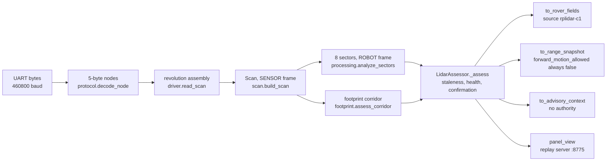
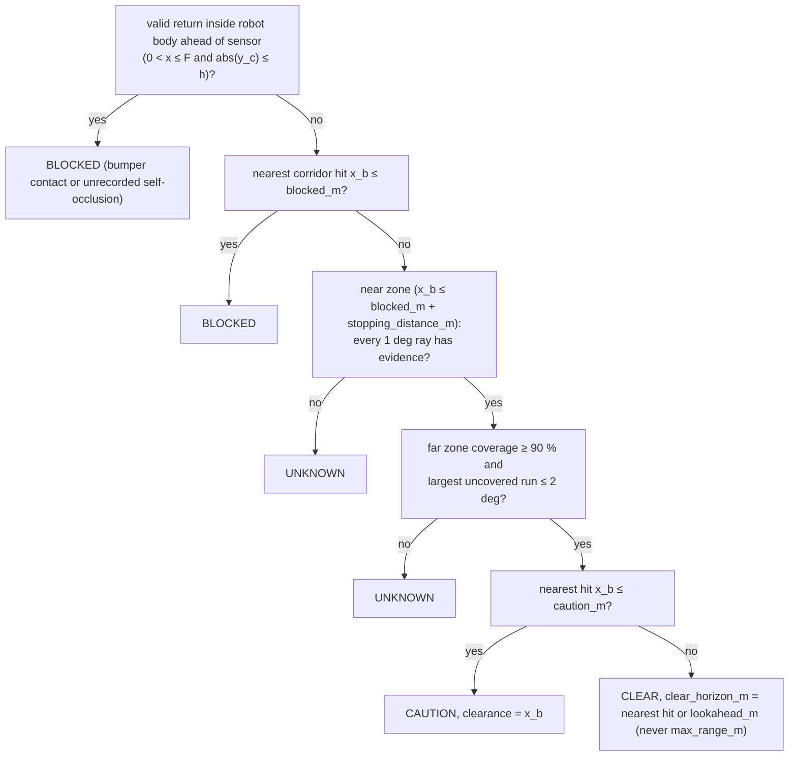
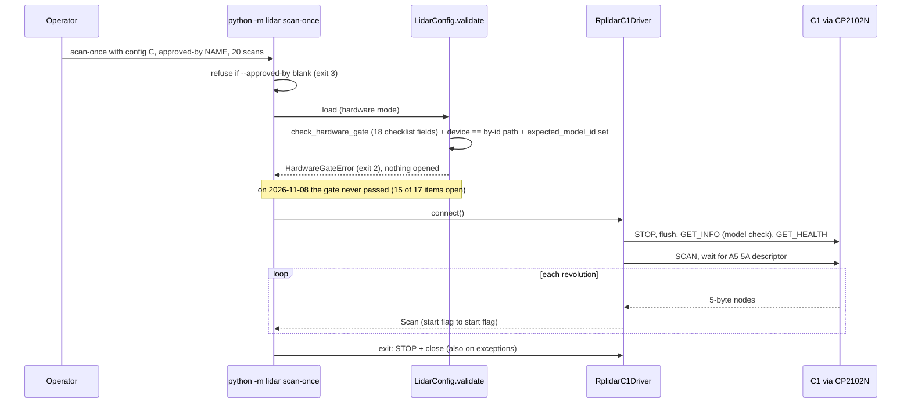

# 15 RPLIDAR C1

The SLAMTEC RPLIDAR C1 (label C1M1-R2) is a 360° laser range scanner that was added as a second, much richer obstacle sensor for the ground robot. The `lidar/` package (PR #11) does the following:

- implements the legacy serial protocol from first principles;
- assembles timestamped revolutions;
- classifies every sample;
- reduces each scan to eight robot-frame sectors and a **robot-width forward corridor** measured from the bumper;
- publishes the result through fail-closed adapters to the rover, the dashboard and Qwen.

This document explains the protocol, the geometry (polar → Cartesian, sector minima, the footprint corridor), the staleness rules and the code. It summarises the ten existing documents in `docs/lidar/` and links to them instead of repeating them. **The C1 has never produced a real scan.** The USB-UART adapter enumerated on the Pi on 2026-11-08, but the LiDAR itself was never queried. The hardware gate stayed closed on 15 of 17 checklist items.

**Status:** Implemented. **Simulation-tested** (124 tests, 23 deterministic scenarios, mock serial device). **Real scan: NOT VERIFIED.** No GET_INFO, GET_HEALTH or SCAN was ever sent to a physical unit. Real-device output is labelled `HARDWARE_UNVERIFIED` by design and **never** allows motion.

**Related:** [14 Grove ultrasonic](14_GROVE_ULTRASONIC.md) · [17 Safety architecture](17_SAFETY_ARCHITECTURE.md) · [18 Simulation](18_SIMULATION.md) · [16 Dashboard](16_DASHBOARD.md) · [11 AI agent and tools](11_AI_AGENT_AND_TOOLS.md) · [12 RoverC motor control](12_ROVERC_MOTOR_CONTROL.md) · existing LiDAR docs: [architecture](lidar/LIDAR_C1_ARCHITECTURE.md), [data contract](lidar/LIDAR_C1_DATA_CONTRACT.md), [driver](lidar/LIDAR_C1_DRIVER.md), [demo runbook](lidar/LIDAR_C1_DEMO_RUNBOOK.md), [hardware checklist](lidar/LIDAR_C1_HARDWARE_CHECKLIST.md), [stationary scan procedure](lidar/LIDAR_C1_STATIONARY_SCAN_PROCEDURE.md), [test report](lidar/LIDAR_C1_TEST_REPORT.md), [merge audit](lidar/LIDAR_C1_MERGE_AUDIT.md), [Grove → LiDAR migration](lidar/GROVE_TO_LIDAR_MIGRATION.md), [implementation journal](lidar/IMPLEMENTATION_JOURNAL.md)
**Experiment reports:** [LDR-SIM scenario suite and tests](experiments/reports/LDR-SIM-01-lidar-simulation-scenario-suite.md) · [LDR-HW USB enumeration and gate attempts](experiments/reports/LDR-HW-01-lidar-usb-enumeration-and-gate.md)

---

## Contents

1. [Problem](#1-problem)
2. [Why this technology](#2-why-this-technology)
3. [Concept](#3-concept)
4. [Math](#4-math)
5. [Implementation in the repo](#5-implementation-in-the-repo)
6. [Key files, symbols and interfaces](#6-key-files-symbols-and-interfaces)
7. [Inputs and outputs](#7-inputs-and-outputs)
8. [Data structures and schemas](#8-data-structures-and-schemas)
9. [Configuration](#9-configuration)
10. [Dependencies](#10-dependencies)
11. [Execution flow](#11-execution-flow)
12. [Error handling](#12-error-handling)
13. [Safety and security](#13-safety-and-security)
14. [Tests and observed results](#14-tests-and-observed-results)
15. [Limitations](#15-limitations)
16. [How to reproduce](#16-how-to-reproduce)
17. [How to extend](#17-how-to-extend)
18. [Map of the existing docs/lidar documents](#18-map-of-the-existing-docslidar-documents)

---

## 1. Problem

The Grove sonar ([14](14_GROVE_ULTRASONIC.md)) sees a 15° cone and goes silent on soft or angled targets. A rover with mecanum wheels and a gripper is wider than a 15° cone close to the robot. An obstacle at a wheel edge 30 cm ahead can be invisible to a sensor pointing straight forward. We wanted the following:

- 360° awareness for the operator display;
- a forward clearance test that uses the **robot's real width**, not a wedge;
- the same honesty rules as the sonar: a missing return is **not** free space, stale data is UNKNOWN, and nothing about a scan is a person or a position.

## 2. Why this technology

| Option | Notes | Decision |
|---|---|---|
| RPLIDAR C1 (in the kit) | 360°, datasheet 0.05–12 m (white target), ≈ 10 Hz typical, ≈ 5 kHz sampling, UART 460800 baud at 3.3 V TTL via a USB-UART adapter | **Used** |
| More Grove sonars | cheap, but each adds a cone, cross-talk and another GPIO | Not pursued |
| Camera depth | uncalibrated and advisory ([05](05_DEPTH_AND_DISTANCE_ESTIMATION.md)) | Not a safety input |

**Driver choice** (`docs/lidar/LIDAR_C1_DRIVER.md` §1). The official C++ `rplidar_sdk` (BSD-2) is used as the **reference for protocol constants**, not linked: it would need a native build plus FFI, and it can't run in CI. PyPI `rplidar` is unmaintained and toggles DTR to drive the motor. The team wrote **its own legacy-protocol codec with pyserial**: small, auditable and fully mockable. The risk this carries is explicit. **Whether our C1M1-R2 answers the legacy `SCAN` (0x20) with standard 5-byte nodes at 460800 baud is unverified** (`lidar/protocol.py` docstring). The fallback is to wrap the SDK's `ultra_simple` as a transport.

## 3. Concept

A spinning laser rangefinder reports a stream of **(angle, distance, quality)** samples. One full turn is a **revolution**. The first sample of each revolution carries a **start flag**. The software has to:

1. **frame** bytes into 5-byte nodes and check their check bits;
2. **assemble** nodes from one start flag to the next into a `Scan`, and timestamp it by the **first** node's arrival (the conservative capture time);
3. **classify** each sample: `VALID`, `NO_RETURN` (distance 0), `LOW_QUALITY`, `BELOW_MIN_RANGE`, `BEYOND_MAX_RANGE`, `NON_FINITE` or `SELF_OCCLUDED`;
4. **rotate** sensor angles (clockwise, from the sensor's own 0 mark) into the robot frame (counter-clockwise, 0 = forward) using a **measured** mount offset;
5. **reduce** the scan to sector minima and a footprint corridor, with coverage requirements, because "no return" is not "free";
6. **age** the result. Motion needs a scan less than 0.20 s old, measured from capture **start**.



## 4. Math

### 4.1 The legacy serial protocol

Every request is two bytes, `A5 <cmd>` (`protocol.request`): `STOP 0x25`, `RESET 0x40`, `SCAN 0x20`, `GET_INFO 0x50`, `GET_HEALTH 0x52`. Every response starts with a 7-byte **descriptor** (`parse_descriptor`):

```
A5 5A | 30-bit length + 2-bit mode (little-endian u32) | data type
```

`mode` 0 means a single response and 1 means streaming. The expected descriptors are: GET_INFO `len 20, type 0x04`; GET_HEALTH `len 3, type 0x06`; SCAN `len 5, mode 1, type 0x81` (i.e. `A5 5A 05 00 00 40 81`, `LIDAR_C1_DRIVER.md` §5).

**Measurement node (5 bytes, `decode_node`):**

| Byte | Bits | Field |
|---|---|---|
| b0 | `quality[5:0] << 2 \| !S << 1 \| S` | 6-bit quality; `S` = start of a new revolution; `!S` must be its inverse |
| b1 | `angle_q6[6:0] << 1 \| C` | `C` (check bit) must be 1 |
| b2 | `angle_q6[14:7]` | |
| b3, b4 | `distance_q2` little-endian | |

$$ \theta_{\text{deg}} = \frac{\text{angle\_q6}}{64}, \qquad d_{\text{m}} = \frac{\text{distance\_q2}}{4 \cdot 1000} $$

So the angle resolution is 1/64° and the distance resolution 0.25 mm. `distance_q2 = 0` means **no valid return** (`NO_RETURN`), never "nothing there". An angle ≥ 360° or a failed check bit raises `ProtocolError`. After corruption the driver searches for an offset where two consecutive nodes decode cleanly (`find_node_alignment`) and counts the dropped nodes. If more than `MAX_CORRUPT_FRACTION = 5 %` of a revolution is corrupt, the scan becomes `PARTIAL`.

GET_INFO (20 bytes, `parse_info`): `model`, firmware `major.minor`, hardware, and a 16-byte serial. GET_HEALTH (3 bytes, `parse_health`): status `0 GOOD / 1 WARNING / 2 ERROR` plus a 16-bit error code.

**Link budget.** 460800 baud with 8N1 framing is 46,080 bytes/s, which is at most 9,216 nodes/s. The C1's ≈ 5 kHz sampling needs ≈ 25 kB/s, about 54 % of the link. At ≈ 10 Hz that is ≈ 500 points per revolution, or ≈ 0.72° between samples. The simulator uses `POINTS_PER_REV = 500` for the same reason (datasheet typical, **not measured**).

### 4.2 Polar → Cartesian, and the two frames

The protocol angle increases **clockwise** seen from above. Mathematical angles increase counter-clockwise. In the sensor frame (`Sample.xy_sensor`, display only):

$$ x = d\cos(-\theta), \quad y = d\sin(-\theta) $$

To get the **robot frame** (0° = forward, CCW positive, the same as `rover/sensors.py`), `MountConfig.robot_bearing` applies:

$$ \beta_{\text{robot}} = (\text{sign}\cdot\theta_{\text{sensor}} + \text{forward\_offset\_deg}) \bmod 360, \qquad \text{sign} = -1 \text{ for a CW sensor} $$

Because `sign = ±1`, the inverse is the same formula (`sensor_angle`). Robot-frame Cartesian is then `x = d cos β`, `y = d sin β` (x forward, y left). **`forward_offset_deg` has no default.** Until a named person records a measured alignment (`alignment_verified_by/_at`), `MountConfig.aligned` is false and every sector is UNKNOWN. The simulator mounts its virtual sensor with 0° facing the robot's **rear** (`SIM_MOUNT`, offset 180°), so any "sensor 0 = forward" bug fails the tests.

**Worked example (SIMULATED, scenario `02_obstacle_ahead`, session console log 2026-11-08 08:57 UTC).** Closest return at sensor bearing 189.43°. Robot bearing `= (−189.43 + 180) mod 360 = 350.57°`, which is 9.4° right of forward, so it falls in the **FRONT** sector, at 0.2409 m. That is ≤ `blocked_m` 0.35, so FRONT is BLOCKED.

### 4.3 Sector minima and coverage

Eight 45° sectors are centred on 0, 45, …, 315°. The index of a robot bearing is (`sector_of`):

$$ i = \left\lfloor \frac{(\beta + 22.5) \bmod 360}{45} \right\rfloor $$

For each sector, `analyze_sectors` keeps:
- `min_range_m`: the **minimum** distance over valid, non-occluded samples, of **any** quality ≥ `min_quality`. Weak returns still count as obstacles.
- `coverage`: the fraction of the sector's 45 one-degree bins that hold at least one valid return with quality ≥ `clearance_min_quality` (20). Weak returns are **never** evidence of free space.

The rules are applied in order: `min ≤ blocked_m` → BLOCKED; `coverage < 0.60` → UNKNOWN; `min ≤ caution_m` → CAUTION; otherwise CLEAR.

**Why the minimum, not the median?** For a safety decision the nearest surface is what matters. One real close return must stop the robot. The filtering against noise comes from the coverage rule and the two-scan confirmation, not from discarding near points.

**Why a wedge is not enough.** At range r a 45° wedge is ±r·tan 22.5° ≈ ±0.414·r wide, which is only ±0.14 m at 0.35 m. An obstacle at a wheel edge close to the robot falls into FRONT_LEFT/FRONT_RIGHT, outside the FRONT wedge. That gap motivated the corridor (`GROVE_TO_LIDAR_MIGRATION.md`, "History").

### 4.4 The robot-footprint corridor

`lidar/footprint.py` `assess_corridor`. The geometry was agreed with the rover owner on 2026-11-08. Returns are transformed into the robot frame and measured from the **front bumper**:

$$ x_b = x - F, \qquad y_c = y + o $$

where `F = sensor_to_front_m` and `o = sensor_lateral_offset_m`. The corridor is the rectangle

$$ 0 < x_b \le L, \qquad |y_c| \le h = \frac{W}{2} + m $$

with `L = lookahead_m` (1.0), `W = robot_width_m` (**no default**) and `m = width_margin_m` (0.05).



**Evidence per ray.** For each 1° bin-centre ray, `_ray_box` uses the slab method to compute where the ray enters and exits the near and far zone boxes. Per axis, `t ∈ [lo/d, hi/d]`; the intersection of the intervals gives `(t_in, t_out)`. A ray counts as **covered** if either:
- (a) a valid return lies **inside** the corridor (an observed obstacle), or
- (b) a valid return of quality ≥ `clearance_min_quality` lies at or beyond `t_out − EXIT_TOL_M` (1 cm). The laser travelled through the whole crossing, so nothing nearer was there.

Misses, weak returns, occluded rays and returns short of the corridor are **uncovered**.

**Zones.** The near zone, `x_b ≤ min(L, blocked_m + stopping_distance_m) = 0.35 + 0.18 = 0.53 m`, must be **100 %** covered. The far zone must reach `corridor_min_coverage = 0.90`, with no contiguous uncovered run wider than `corridor_max_gap_deg = 2°` (`_max_run`).

**Precondition failures give UNKNOWN:**
- alignment unverified;
- orientation monitor FAILED;
- footprint not measured or signed;
- self-occlusion windows not signed off;
- `F < min_range_m` (0.08 m): the bumper sits inside the sensor's blind zone.

**Orientation monitor** (`check_orientation`). A fixed body feature, for example the camera mast, is measured with tape and protractor **independently of the LiDAR**. It must appear in every scan where the configured mount predicts (± `fiducial_tol_deg` 4°, ± `fiducial_tol_m` 3 cm). Otherwise the monitor reports FAILED and the corridor and every sector are UNKNOWN. The fiducial is placed at a bearing other than 0° or 180°, so a CW/CCW sign error also moves it and is caught. Without a fiducial the monitor reports `NOT_CONFIGURED`, which means display only, no motion.

**Worked example (SIMULATED, `SIM_FOOTPRINT`).** `W = 0.20` (a SYNTHETIC placeholder from `rover/simrun.py`), `m = 0.05`, so `h = 0.15 m`. `F = 0.10`, `L = 1.0`. Take a pole placed 0.30 m ahead of the bumper and 0.14 m left of centre. Its nearest return in the simulation is at `x_b = 0.29 m`, `y_c = +0.14 m`. Then `|y_c| ≤ 0.15` and `x_b ≤ 0.35`, so the corridor is **BLOCKED** (scenario `21_edge_obstacle_left`, re-run in this audit). The FRONT wedge alone said CAUTION. The tests check the edges: ±0.149 m gives BLOCKED and ±0.161 m gives CLEAR (`LIDAR_C1_TEST_REPORT.md`).

### 4.5 Staleness, timing and confirmation

The age is measured from **capture start** (`Scan.age_s`), because the oldest sample in a revolution is about that old:

| Rule | Value | Effect |
|---|---|---|
| `motion_max_age_s` | 0.20 s | older → `stale_for_motion`, no motion. Equals the rover's `sensor_max_age_s` |
| `display_max_age_s` | 0.50 s | older → every sector and the corridor UNKNOWN, `closest` null (same as Grove `stale_after_s`) |
| `max_future_skew_s` | 0.05 s | a timestamp more than 50 ms in the future is a **clock fault**, all UNKNOWN |
| scan rate | `(n−1)/(t_last − t_first)` over the last 6 capture starts (`scan_rate_hz`) | must be in 7–13 Hz (PLACEHOLDER around the 10 Hz typical). Unknown until 2 scans |
| `clear_confirm_scans` | 2 | consecutive candidate-clear scans before `forward_motion_allowed` turns true |

**Timing budget (SIMULATED/estimated).** A revolution takes ≈ 100 ms at 10 Hz. Processing on the Mac is p50 1.13 ms / p95 1.18 ms for 500 points (`LIDAR_C1_TEST_REPORT.md`). This audit measured p50 1.159 / p95 1.265 ms (`python3 -B -m lidar bench -n 50`, 2026-11-08, `d1b607a`, SIMULATED). The age at assessment is therefore ≈ 0.10–0.13 s, under the 0.20 s limit. **Pi 5 latency is unmeasured.**

### 4.6 Visual tracking (display only)

`lidar/tracking.py` `cluster_scan` groups adjacent valid points into blobs when the Cartesian gap between them is ≤ 0.15 m (minimum 3 points), merging across the 359°/0° seam. `VisualTracker` associates blobs frame-to-frame by nearest centroid (max jump 0.35 m). **No safety decision uses it.** A track is not a person. Its motion is not the robot's motion: there is no odometry.

## 5. Implementation in the repo

PR #11 (`feature/rplidar-c1-ground-robot`, author `machackgo`) added it, merged 2026-11-08 12:11 UTC as `4ed7722`. It is purely additive: `lidar/`, `docs/lidar/` and `.github/workflows/lidar.yml`, with zero edits to `ranging/`, `rover/`, `dashboard/` and `core/` (`docs/lidar/IMPLEMENTATION_JOURNAL.md`). Code commits: `9041c05` (driver, processing, adapters), `9027320` (footprint corridor, orientation monitor), `7e61595` (fixture mount override, Stage D NOT READY). `lidar/` is unchanged between `7e61595` and `d1b607a`.

## 6. Key files, symbols and interfaces

| File | Key symbols | Role |
|---|---|---|
| `lidar/protocol.py` | `request`, `parse_descriptor`, `build_descriptor`, `decode_node`, `encode_node`, `parse_info`, `parse_health`, `find_node_alignment`, `ProtocolError`, `Node`, `DeviceInfo`, `Health` | Pure codec, no I/O |
| `lidar/transport.py` | `SerialTransport` (pyserial, `exclusive=True`, DTR/RTS unused), `MockLidarDevice` (fault injection: disconnect, stall, corrupt, garbage prefix, health, model), `TransportClosed` | Byte transports |
| `lidar/discovery.py` | `discover`, `KNOWN_ADAPTER_CHIPS` | **Lists** candidates. Never opens a port or auto-selects; `is_rplidar_c1` is always `None` |
| `lidar/driver.py` | `RplidarC1Driver` (`connect`, `check_health`, `start_scan`, `read_scan`, `stop_scan`, `disconnect`, context manager), `DriverState`, `LidarDisconnected`, `LidarTimeout`, `LidarHealthError` | Lifecycle, revolution assembly |
| `lidar/scan.py` | `Scan`, `Sample`, `SampleStatus`, `ScanCompletion`, `SourceMode`, `classify_sample`, `build_scan` | `team15.lidar_scan/1` |
| `lidar/processing.py` | `LidarAssessor`, `LidarAssessment`, `analyze_sectors`, `sector_of`, `SectorStatus`, `Connection`, `SECTORS` | `team15.lidar_sectors/1`, the fail-closed assessment |
| `lidar/footprint.py` | `assess_corridor`, `check_orientation`, `CorridorResult`, `_ray_box` | Corridor and orientation monitor |
| `lidar/tracking.py` | `cluster_scan`, `VisualTracker` | `team15.lidar_tracks/1`, visualization only |
| `lidar/adapters.py` | `to_range_snapshot`, `write_range_snapshot`, `to_rover_fields`, `to_advisory_context` | Compatibility adapters |
| `lidar/panel.py`, `lidar/server.py`, `lidar/static/lidar_panel.html` | `panel_view`, `badge`, `ReplaySource`; `ReplayApp`, `make_server` | `team15.lidar_panel/1`; SIMULATED replay server: `/`, `/api/lidar`, `/api/range`, `/api/advisory`, `/api/scenarios` |
| `lidar/simulation.py` | `SCENARIOS` (23), `BYTE_LEVEL_SCENARIOS` (13, 14, 19), `SIM_MOUNT`, `SIM_FOOTPRINT`, `sim_config`, `generate`, `cast` | Deterministic 2D ray-cast scenarios (seed 15) |
| `lidar/config.py` | `LidarConfig`, `MountConfig`, `FootprintConfig`, `ProcessingConfig`, `HardwareChecklist`, `check_hardware_gate`, `HardwareGateError` | Config and the hardware gate |
| `lidar/cli.py` | `discover`, `check-config`, `replay`, `export-fixtures`, `bench`, `scan-once` | `python -m lidar …` |

## 7. Inputs and outputs

| In | Out |
|---|---|
| UART bytes (hardware) or `MockLidarDevice` bytes (CI); SIMULATED scenarios | `team15.lidar_scan/1`, `team15.lidar_sectors/1` (with `forward_corridor`, `orientation_monitor`), `team15.range_snapshot/1` (compatibility, display only), `team15.rover_range_fields/1` (`source: "rplidar-c1"`), `team15.lidar_advisory_context/1`, `team15.lidar_panel/1`, `team15.lidar_tracks/1` |

Full field tables: [`docs/lidar/LIDAR_C1_DATA_CONTRACT.md`](lidar/LIDAR_C1_DATA_CONTRACT.md). This document does not duplicate them.

## 8. Data structures and schemas

The essentials (see the data contract for every field):

- **`Scan`**: `seq`, `capture_start_mono_ns` (the age reference), `capture_end_mono_ns`, `capture_start_wall`, `samples[]` (`bearing_deg` SENSOR, `range_m` null unless VALID, `raw_distance_m`, `quality` 0–63, `status`), `completion` (`COMPLETE` / `PARTIAL` if fewer than `min_points` 200, less than 300° swept, or more than 5 % corrupt / `INTERRUPTED`), `source_mode` (`SIMULATED` / `HARDWARE_UNVERIFIED` / reserved `HARDWARE_VERIFIED`, which **nothing sets**).
- **`LidarAssessment.to_dict()`** always includes `motion_authority: "NONE: input to the rover's deterministic safety layer only (Issue #9)"`, `person_distance_m: null`, `range_semantics`, and a `frames` note: sector bearings are ROBOT, `closest.sensor_bearing_deg` is SENSOR, and there is no world frame.
- **Rover fields** come from the **corridor**, not the wedge. `range_m` is bumper-referenced: the nearest corridor obstacle, or `clear_horizon_m = lookahead_m` when verified free, never `max_range_m`. A corridor UNKNOWN gives `ERROR`. Additive fields: `range_reference: "FRONT_BUMPER"`, `clear_horizon_m`, `corridor`.
- **Advisory context** for Qwen: `association: "NOT_ESTABLISHED"`, `person_distance_cm: null`, `localization: "NONE"`, `may_authorize_motion: false`, `may_authorize_release: false`.

## 9. Configuration

`lidar/configs/simulated.json` contains `mode: simulated` only. `lidar/configs/c1_pi5.UNVERIFIED.json` is the Pi 5 template: `mode: hardware`, `baudrate 460800`, `device null`, `expected_model_id null`, and the mount, footprint and **18 checklist fields** all `null`. It is refused by design (the CI `lidar` job asserts this).

| `ProcessingConfig` key | Default | Status |
|---|---|---|
| `min_quality` / `clearance_min_quality` | 10 / 20 | PLACEHOLDER |
| `min_range_m` / `max_range_m` | 0.08 / 8.0 | inside the 0.05–12 m spec; dark targets fail sooner than 12 m |
| `blocked_m` / `caution_m` | 0.35 / 0.75 | PLACEHOLDER (taken from the Grove stopping distance + margin, not measured) |
| `min_sector_coverage` | 0.60 | PLACEHOLDER |
| `min_points` | 200 | PLACEHOLDER (≈ 500 expected) |
| `scan_hz_min/max` | 7 / 13 | PLACEHOLDER |
| `motion_max_age_s` / `display_max_age_s` | 0.20 / 0.50 | aligned with rover / Grove |
| `stopping_distance_m` | 0.18 | PLACEHOLDER (Grove defaults) |
| `corridor_min_coverage` / `corridor_max_gap_deg` | 0.90 / 2.0 | |

`FootprintConfig`: `robot_width_m` (no default), `width_margin_m` 0.05, `lookahead_m` 1.0, `sensor_to_front_m` (no default), `sensor_lateral_offset_m` 0, `rover_max_required_clear_m` (unset, so **Stage D NOT READY**). `LidarConfig`: `read_timeout_s` 0.25, `scan_timeout_s` 0.6, `reconnect_backoff_s` (0.5, 1, 2, 4).

## 10. Dependencies

- Python stdlib for all processing. `networkx` and `pytest` only for the CI test job (`.github/workflows/lidar.yml`, Python 3.11).
- `pyserial==3.5` **only on the Pi**, imported lazily inside `SerialTransport`. It is deliberately not in `requirements.txt`. The Pi already had pyserial 3.5 (session console log 2026-11-08 08:31 UTC).
- Hardware: the C1 plus a USB-UART adapter. On our Pi this enumerated as a **Silicon Labs CP2102N** (`10c4:ea60`, driver `cp210x`). `discovery.py` notes that a VID:PID identifies only the **adapter**, never proves a C1.

## 11. Execution flow



There is **no command that sends only GET_INFO/GET_HEALTH**. `scan-once` always continues to `SCAN` after connecting. The bounded "communication only" test the team authorized on 2026-11-08 would have needed a new, reviewed command.

## 12. Error handling

| Condition | Driver | Assessment |
|---|---|---|
| Gate incomplete | `HardwareGateError` before any transport is built | `Connection.GATE_LOCKED` |
| Open fails / unplug / power loss | `LidarDisconnected`; port closed; partial revolution dropped | `DISCONNECTED` → all UNKNOWN |
| No full revolution in `scan_timeout_s` (0.6 s) | `LidarTimeout`; nothing half-built kept | `TIMEOUT` |
| Health not GOOD / GET_INFO model ≠ `expected_model_id` | `LidarHealthError`; scanning refused | `HEALTH_ERROR` |
| Junk before the scan descriptor | resync on `A5 5A` within 4096 bytes | — |
| Corrupt nodes | resync; > 5 % → `PARTIAL` | non-COMPLETE → CLEAR/CAUTION become UNKNOWN |
| Stale > 0.5 s, or future timestamp | — | all UNKNOWN |

`disconnect()` is idempotent and never raises. `__exit__` always sends STOP and closes the port, even after an exception.

## 13. Safety and security

- **Hardware gate** (`check_hardware_gate`), mirroring the Grove gate. It requires: the label read as `C1M1-R2` plus a photo; the adapter identified, its pinout verified and its VID:PID recorded; the supply measured at 4.9–5.25 V; the start-up current measured (0–1.5 A); Pi supply headroom with `throttled 0x0` after a test; the scan plane clear; strain relief; stable USB enumeration with an explicit `/dev/serial/by-id/` path; an emergency power cut-off; the test location; and a verifier plus a **different** independent inspector. `LidarConfig.validate` additionally requires `device == checklist.device_path_by_id` and a recorded `expected_model_id`.
- **Second opt-in:** `scan-once` needs `--approved-by`.
- **No actuation imports:** an AST test enforces that `lidar/` imports no GPIO, motor, servo, I²C or rover-actuation module.
- **Exclusive port:** `SerialTransport` opens with `exclusive=True` (flock), so another process can't read the same LiDAR. This also matters because the planned StickC bridge is also a USB-serial device.
- **Never motion from real data in this PR:** `HARDWARE_UNVERIFIED` never sets `forward_motion_allowed`. The rover still rejects `source == "rplidar-c1"` (`rover/sensors.py` `from_rover_fields` accepts only `GROVE_SOURCE`). The compatibility snapshot always sets `forward_motion_allowed: false`, and `write_range_snapshot` refuses the Grove path.
- **Laser:** Class 1 per the vendor. The checklist still requires nobody's eyes at scan-plane height.
- **Power:** the C1 datasheet, read during the 2026-11-08 session, gives ≈ 800 mA typical start current and 230–260 mA running, at 4.8–5.2 V with ≤ 150 mV ripple. On the earlier 3 A supply the Pi capped all USB ports at ≈ 600 mA combined, below that start current. After the switch to a 5 A supply the Pi reported `usb_max_current_enable=1` (≈ 1.6 A). **The gate's 5.25 V upper bound is looser than the datasheet's 5.2 V maximum**, an inconsistency noted in the session log and left unchanged.

## 14. Tests and observed results

### 14.1 Simulation and mocks (summary of [LDR-SIM-01](experiments/reports/LDR-SIM-01-lidar-simulation-scenario-suite.md))

| ID | What | Date | Result | Label |
|---|---|---|---|---|
| LDR-SIM-01 | `pytest lidar/tests`, branch head after the footprint round (`LIDAR_C1_TEST_REPORT.md`) | 2026-11-08 | 124 passed; with default 340 + ranging 126 = 590; coverage 89 % of 1828 statements | SIMULATED + MOCKED |
| LDR-SIM-02 | First round at `9041c05` (`$ROBOT_WORKSPACE/IMPLEMENTATION_JOURNAL.md`) | 2026-11-08 ~04:00 UTC | 92 LiDAR, 558 total; coverage 88 % | SIMULATED + MOCKED |
| LDR-SIM-03 | `pytest -q lidar/tests` at `d1b607a` (this audit, macOS, Python 3.13.5) | 2026-11-08 | **124 passed** in 2.0 s | SIMULATED + MOCKED |
| LDR-SIM-04 | 23 committed scenario fixtures, re-evaluated by the tests against their recorded expectations | fixtures from `export-fixtures`, seed 15 | all match (part of the 124) | SIMULATED |
| LDR-SIM-05 | `bench`: processing latency, 500-point scan | 2026-11-08 | report: p50 1.13 / p95 1.18 ms; this audit: p50 1.159 / p95 1.265 ms (n = 50) | SIMULATED |

What the simulation **does** establish: the codec round-trips; check bits are enforced; revolution assembly, disconnect, timeout and corruption are handled; frames are converted correctly (CW sensor with a 180° offset); every UNKNOWN path holds; the corridor edges behave; contracts are honoured; and no actuation imports exist. What it does **not** establish: that our unit speaks legacy SCAN, real quality distributions, real specular behaviour (mirrors and glass are modelled only as **weak** returns), real scan rate or latency, power behaviour, or any physical distance accuracy.

### 14.2 Hardware attempts (summary of [LDR-HW-01](experiments/reports/LDR-HW-01-lidar-usb-enumeration-and-gate.md))

All read-only. Times UTC, from the session console log of 2026-11-08 (Pi local time is UTC−5).

| Sub-run | UTC | Observation | Label |
|---|---|---|---|
| LDR-HW-01a | 08:21 | CP2102N `10c4:ea60` enumerated on bus 3 at 08:19:18 → `/dev/ttyUSB0`, stable by-id path, serial recorded, no kernel errors; `throttled=0x0`, EXT5V 5.25 V, 47.2 °C; 3 A supply, `usb_max_current_enable=0`. **Verdict INCONCLUSIVE**: an adapter enumerates the same with or without a C1 behind it | REAL HARDWARE (read-only) |
| LDR-HW-01b | 08:31–08:33 | After a Pi restart at ≈ 08:22 (later confirmed by the operator as intentional), the adapter was **not detected**. Gate refused 17/17. No serial command sent | REAL HARDWARE (read-only) |
| LDR-HW-01c | 08:37 | Adapter back, same serial, on bus 1. Kernel log shows a 4 s connect/disconnect at 08:34:57–08:35:01 and an incomplete enumeration at 08:35:21 before a clean attach at 08:36:05 | REAL HARDWARE (read-only) |
| LDR-HW-01d | 08:46 | After the switch to a **5 A** supply (`max_current 0x1388` = 5000 mA, `usb_max_current_enable=1`): adapter **not detected** at boot. Gate 17 blockers | REAL HARDWARE (read-only) |
| LDR-HW-01e | 08:47–08:54 | Adapter re-plugged (clean attach 08:46:15, same serial). Two checklist fields filled from diagnostics (`adapter_usb_vid_pid`, `device_path_by_id`) in a working copy outside Git. **Gate still refused, 15 items** | REAL HARDWARE (read-only) |
| LDR-HW-01f | 08:56–08:57 | Gate re-run once: 15 blockers, so the SIMULATED fallback was served on `127.0.0.1:8775`: `02_obstacle_ahead` FRONT BLOCKED 0.24 m; `04_obstacle_left` FRONT CLEAR, nearest 0.24 m LEFT. **Fixture values, not a chair at 1 m** | SIMULATED |
| LDR-HW-01g | 09:08 | Read-only recheck; adapter stable since 08:46:15. The C1 user manual says the head does not spin until a scan command, so "a lit LED and a still head" is the expected idle state. It proves neither a fault nor health | REAL HARDWARE (read-only) |

**Was the device ever detected?** The **USB-UART adapter** was: CP2102N serial `0cec01cd…c30f`, three clean enumerations, two ports. **The C1 itself was never detected or queried.** No GET_INFO, GET_HEALTH or SCAN was sent. Model, firmware, serial number and health are **unknown**. No real distance or bearing exists. LiDAR obstacle Tests 1 and 2 (chair at 1 m ahead, then to the side) were **not run**.

## 15. Limitations

- **Legacy SCAN on the C1 is unverified.** The whole hardware path rests on it.
- **Gate deadlock:** `LidarConfig.validate` refuses hardware mode while `expected_model_id is None`. But the model byte is meant to be **read** by GET_INFO during the first approved scan (`LIDAR_C1_HARDWARE_CHECKLIST.md`, "GET_INFO model byte … record it"). As written, the first connection cannot happen unless someone enters the model id from another source, such as the datasheet or SDK. This must be resolved, with review, before Stage C.
- **No GET_INFO-only probe command** (see [§11](#11-execution-flow)).
- **The 2D plane only:** curbs, overhangs and table tops are invisible. The corridor covers forward motion only, not turning or strafing.
- **Mirrors and glass** are rejected only because they are weak in simulation. A strong real phantom would read as free space.
- **Every threshold and footprint value is a placeholder**, and `rover_max_required_clear_m` is unset, so Stage D is NOT READY.
- **The orientation monitor resolves about tol + the fiducial half-width (≈ 8° with the simulated mast).**
- **Stale document status:** `LIDAR_C1_HARDWARE_CHECKLIST.md` still says "The LiDAR has not been powered". On 2026-11-08 the adapter, with its green LED lit, was plugged into the Pi from 08:19 UTC. Whether the C1 head was receiving power was not determined.

## 16. How to reproduce

```bash
python3 -m pytest -q lidar/tests                                            # 124 passed
python3 -B -m lidar replay --scenario 02_obstacle_ahead --serve              # http://127.0.0.1:8775/  (SIMULATED badge)
python3 -B -m lidar replay --scenario 21_edge_obstacle_left | head -1        # panel JSON per frame
python3 -B -m lidar bench -n 200                                             # processing latency, SIMULATED
python3 -B -m lidar export-fixtures --out /tmp/lidar_fixtures               # regenerate fixtures (seed 15) outside the repo
python3 -B -m lidar check-config --config lidar/configs/c1_pi5.UNVERIFIED.json --hardware   # refused, exit 2
python3 -B -m lidar scan-once --config lidar/configs/c1_pi5.UNVERIFIED.json  # refused without --approved-by, exit 3
python3 -B -m dashboard.serve --range-fixture lidar/fixtures/dashboard_range_series_approach.json  # existing range card, SIMULATED
python3 -B -m lidar discover                                                 # lists serial candidates; never opens one
```

Hardware: follow [`LIDAR_C1_STATIONARY_SCAN_PROCEDURE.md`](lidar/LIDAR_C1_STATIONARY_SCAN_PROCEDURE.md). It needs the complete checklist, an independent inspection, and an explicit user authorization of that specific test. **Not executed.**

## 17. How to extend

1. **Stage C (blocked):**
   - complete the checklist;
   - resolve the `expected_model_id` deadlock;
   - add a reviewed `probe` command (STOP, GET_INFO, GET_HEALTH, close; no SCAN);
   - run `scan-once` stationary and confirm the scan descriptor;
   - measure points per revolution, scan rate and `capture_start_to_processed_s` on the Pi;
   - measure the real footprint, occlusion windows and fiducial;
   - calibrate quality and coverage against real glass and mirrors;
   - check range accuracy at 0.3/0.5/1/2/3 m (±3 cm target, `GROVE_TO_LIDAR_MIGRATION.md`).
2. **Stage D:** the rover owner allowlists `rplidar-c1` (R1, after Issue #9). Combine sources worst-case (R2). Keep one latest reading per source in the supervisor (R4). Set `rover_max_required_clear_m` from shared config.
3. **SDK fallback:** if legacy SCAN is not answered, wrap SLAMTEC `ultra_simple` as a `Transport` and leave `processing` unchanged.
4. A new scenario goes in `lidar/simulation.py` `SCENARIOS`. Regenerate fixtures with `export-fixtures` and add the expectation test.

## 18. Map of the existing docs/lidar documents

| Document | What it gives you (summary) |
|---|---|
| [LIDAR_C1_ARCHITECTURE](lidar/LIDAR_C1_ARCHITECTURE.md) | Capability table (implemented vs proposed), data-flow diagram, frame definitions, safety boundaries |
| [LIDAR_C1_DATA_CONTRACT](lidar/LIDAR_C1_DATA_CONTRACT.md) | Every field of the 7 schemas, the sector and corridor rules, the timing rules, the rover/dashboard/Qwen mappings |
| [LIDAR_C1_DRIVER](lidar/LIDAR_C1_DRIVER.md) | Runtime choice (SDK vs PyPI vs own codec), API, states, what the driver never does, Stage C driver checks |
| [LIDAR_C1_HARDWARE_CHECKLIST](lidar/LIDAR_C1_HARDWARE_CHECKLIST.md) | The 10 pre-scan items mapped to config fields; Stage C footprint measurements; power-risk analysis. Its "not powered" status is stale, see [§15](#15-limitations) |
| [LIDAR_C1_STATIONARY_SCAN_PROCEDURE](lidar/LIDAR_C1_STATIONARY_SCAN_PROCEDURE.md) | Step-by-step first scan, with authorization record and abort criteria. **Prepared only, not executed** |
| [LIDAR_C1_DEMO_RUNBOOK](lidar/LIDAR_C1_DEMO_RUNBOOK.md) | SIMULATED demo commands, pre-scan steps, alignment, abort |
| [LIDAR_C1_TEST_REPORT](lidar/LIDAR_C1_TEST_REPORT.md) | Suites, coverage, what each test file establishes, footprint tests, safety-on-missing-data table, timing assumptions, known limitations |
| [LIDAR_C1_MERGE_AUDIT](lidar/LIDAR_C1_MERGE_AUDIT.md) | Merge-conflict and semantic-compatibility audit of PR #11 against main and active branches; re-audit after the footprint round |
| [GROVE_TO_LIDAR_MIGRATION](lidar/GROVE_TO_LIDAR_MIGRATION.md) | Stages A–F with exit criteria and status; interface requests R1–R4 (rover), D1–D3 (dashboard), Q1 (Qwen); the corridor history |
| [IMPLEMENTATION_JOURNAL](lidar/IMPLEMENTATION_JOURNAL.md) | The two implementation rounds, design decisions and findings |
