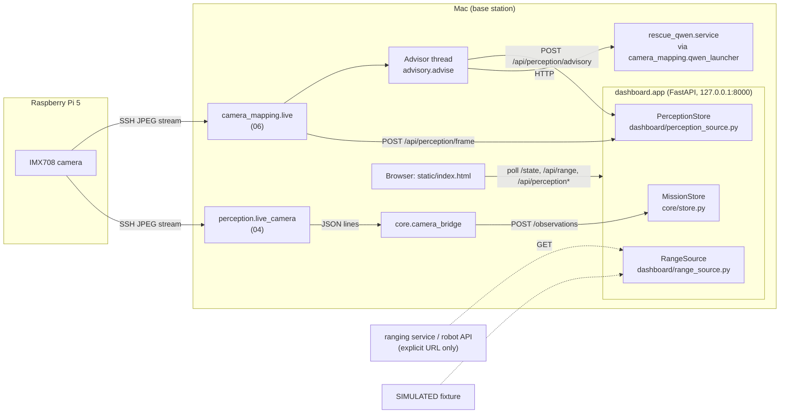
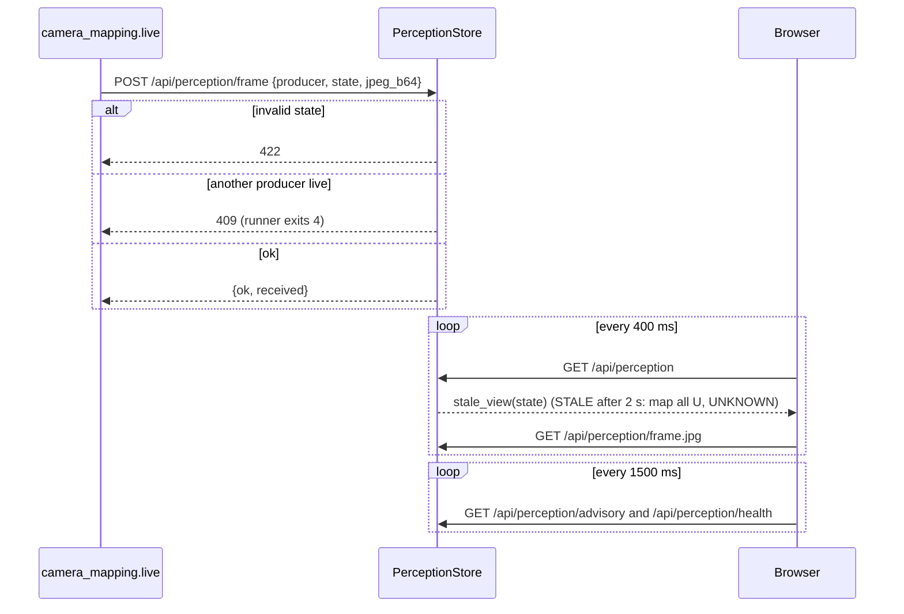

# 16 Dashboard (base-station operator view)

The dashboard is a FastAPI app on the Mac (`dashboard/app.py`), bound to `127.0.0.1` by default. It serves one browser page (`dashboard/static/index.html`) with three groups of views:

- the **mission view**: sector map, candidate, walking route and sighting history, backed by `core/store.py`;
- the **Forward obstacle range card**, backed by `dashboard/range_source.py` and `core/range_view.py`;
- the **camera-mapping panels A–D**: live camera, local map, rescue intelligence and system health, backed by `dashboard/perception_source.py`.

It is a **display and operator-review tool with no motor control**. Its main job is to show every value with its provenance, and to degrade to UNKNOWN or DISCONNECTED whenever the data is stale, missing or mislabelled.

**Status:**
- Implemented and tested (MOCKED/SYNTHETIC unit and e2e tests).
- Ran with real Pi camera sightings (PR #5, REAL HARDWARE) and with the live camera-mapping runner (2026-11-08, REAL HARDWARE).
- The range card has only ever shown SIMULATED fixtures or DISCONNECTED; no HARDWARE range reading exists.

**Related:** [04 Camera perception](04_CAMERA_PERCEPTION.md) · [05 Depth and distance](05_DEPTH_AND_DISTANCE_ESTIMATION.md) · [06 Obstacle mapping](06_OBSTACLE_MAPPING.md) · [07 Path planning](07_PATH_PLANNING.md) · [08 Qwen model](08_QWEN_MODEL.md) · [12 RoverC motor control](12_ROVERC_MOTOR_CONTROL.md) · [14 Grove ultrasonic](14_GROVE_ULTRASONIC.md) · [15 RPLIDAR C1](15_RPLIDAR_C1.md) · [17 Safety architecture](17_SAFETY_ARCHITECTURE.md) · [contracts/PI_CAMERA_CONTRACT.md](../contracts/PI_CAMERA_CONTRACT.md) · [perception/SIGHTING_FORMAT.md](../perception/SIGHTING_FORMAT.md)

---

## 1. Problem

The operator must decide, quickly and under stress, whether a camera candidate is a person, where they are, how to reach them and whether the robot's sensors can be trusted. A dashboard that shows a stale "CLEAR", a simulated reading as "HARDWARE", or one person twice is worse than having no dashboard. The design problem is **honest display**: every number must say where it came from and how old it is, and anything that can't be trusted must read UNKNOWN.

## 2. Why this technology

| Choice | Why |
|---|---|
| FastAPI + uvicorn | It was already a dependency of the Qwen service. Request handlers are plain functions, and the stack is easy to test with `TestClient` |
| One static HTML page, vanilla JS, polling | No build step, works offline at a venue, and is easy to audit. Polling (250–1,500 ms) is simple and robust to server restarts |
| In-memory stores | Hackathon scope. The `MissionStore` docstring notes that a SQLite store (§5.1 of the build guide) replaces it later. Camera frames stay in memory, so nothing private reaches the disk or Git |
| All safety rules on the server | The browser only renders. Badge, staleness and status rules live in `core/range_view.py`, `dashboard/perception_source.py` and `camera_mapping/pipeline.py` `stale_view`, where they are unit-tested |

## 3. Architecture



Two camera paths feed the dashboard. They have separate schemas and separate stores:

- **Sightings** (`perception.live_camera` → `core.camera_bridge` → `POST /observations` → `MissionStore`). A sighting is a person candidate in a sector cell, waiting for operator review. Schema: [perception/SIGHTING_FORMAT.md](../perception/SIGHTING_FORMAT.md).
- **Camera mapping** (`camera_mapping.live` → `POST /api/perception/frame` → `PerceptionStore`). This is the per-frame perception state, `team15.camera_perception/1` ([06](06_OBSTACLE_MAPPING.md) §8).

## 4. Endpoints (`dashboard/app.py` `create_app`)

| Method and path | Purpose | Failure behaviour |
|---|---|---|
| `GET /` | The page (`Cache-Control: no-store`) | — |
| `GET /state` | `MissionStore.state()`: tracks, history, routes, alerts, decisions, graph | — |
| `POST /observations` | Ingest one sighting (`core/ingest.py` `normalise`) | 422 `InvalidObservation` |
| `POST /operator_decision` | `{"obs_id", "decision": CONFIRM\|REJECT, "operator"}` | 422 invalid; 404 unknown `obs_id` |
| `GET /evidence/{obs_id}`, `GET /evidence/{obs_id}/frame` | Annotated / exact evidence photo | 404 unless the file is a JPEG/PNG inside a configured evidence directory. The browser never sends a path |
| `GET /api/range` | Forward obstacle range card, `team15.range_panel/1` | Any exception gives `disconnected(...)`: never CLEAR |
| `POST /api/perception/frame` | `{producer, state, jpeg_b64}` from `camera_mapping.live` | 422 `InvalidPerception`; **409 `ConflictingProducer`** |
| `POST /api/perception/advisory` | Rescue advisory (must be `advisory_only`, `authority: NONE`) | 422; 409 from a non-active producer |
| `POST /api/perception/health` | Camera heartbeat: `STREAMING`, `NO_FRAMES`, `DISCONNECTED`, `STOPPED` | 422 |
| `GET /api/perception` | Latest state through `stale_view` (STALE gives UNKNOWN) | `NO_DATA` if nothing has been posted |
| `GET /api/perception/frame.jpg` | Latest annotated frame (memory only) | 404 before the first frame |
| `GET /api/perception/advisory` | Latest advisory, with `age_s` and `evidence_current` | `NO_ADVISORY` |
| `GET /api/perception/health` | System-health panel data (camera, latency, map age, calibration, rover range source, labels) | The rover part reads DISCONNECTED if the range source throws |

## 5. Mission view (`core/store.py`, `core/ingest.py`, `core/camera_bridge.py`)

- **Ingest** (`normalise`). Required fields: `obs_id`, `drone_id`, `source_mode`, `sensor`, `kind`, `how`, `cell`, `obs_time`. Ingest fills `boot_id` and `seq` from `obs_id` (`{drone}-{boot}-{seq:06d}`), `rx_time`, and `stale_after_s` (RGB 300 s). A Pi sighting must satisfy the camera-provenance contract: transport `ssh-jpeg`, a Pi clock, `obs_time == camera.capture_time`, and no coordinates. See [contracts/PI_CAMERA_CONTRACT.md](../contracts/PI_CAMERA_CONTRACT.md).
- **Deduplication.** Sightings are deduplicated by `obs_id` and by `evidence.frame_sha256`. The same frame re-sent under a new ID is a duplicate, not a new person and not a new alert.
- **Tracks.** There is one track per sector cell (`T1`, `T2`, …). Every sighting is kept as that track's history, and the newest by `obs_time` is current.
- **Confirmation.** Every sighting starts `unconfirmed`. Only `POST /operator_decision` with a named operator can mark it `confirmed` or `rejected`; the sender can't set its own status.
- **Routes.** `MissionStore._replan` calls `planner.route.compute_route` from the responder node to the newest non-rejected sighting. A new version is made only when the start, destination or blocked set changes. The reference route is **v1 A→G 60 m** on the SYNTHETIC trail graph ([07](07_PATH_PLANNING.md) Part C). The graph is labelled *"SYNTHETIC trail map (§3.2): distances are not measured terrain"*.
- **Bridge.** `python3 -B -m perception.live_camera ... | python3 -B -m core.camera_bridge --post http://localhost:8000/observations` forwards each line unchanged. While the dashboard is down it retries for up to `--retry-s`, then reports NOT DELIVERED (exit code 4). The camera keeps its own `sightings.jsonl`.

## 6. Forward obstacle range card (`core/range_view.py`, `dashboard/range_source.py`)

The card shows the **nearest reflecting surface in a ~15° forward cone**. That is explicitly *not* the distance to a person candidate. Its rules:

- **Live sources only at explicit URLs** (`--range-url`, `--robot-url`). There is no default, because on the bench Mac `127.0.0.1:8765` belonged to an unrelated app. The Pi's ranging service is reached through an SSH tunnel to a free local port. Timeout: 0.3 s.
- **Badge.** It reads `HARDWARE` only when `hardware_verified()` passes exactly: `source_mode == "LIVE-HW"`, `driver == "gpiod"` and a non-blank `wiring_verified_by`, plus the robot-status claims. **Fixture data is always SIMULATED**, whatever it claims. Nothing has ever passed this check, because the only real Grove runs returned 0/50 valid readings ([14](14_GROVE_ULTRASONIC.md)).
- **Staleness and status.** Data is stale after the snapshot's own `stale_after_s` (0.5 s), or with future skew beyond 1 s. Stale, invalid, `NO_ECHO`, `OUT_OF_RANGE` or inconsistent data reads UNKNOWN or DISCONNECTED. **NO_ECHO is never "clear"**, and the card never says "motion allowed" (`_classify`).
- **Fixtures.** Three shapes are accepted: `{"series": [...]}` cycled at 0.1 s, `{"scenarios": {...}}` selected with `?scenario=`, or a single snapshot.

**LiDAR and rover views are not mounted in this app.**

- `lidar/panel.py` (`team15.lidar_panel/1`) is served by the LiDAR package's own server, `lidar/server.py`; see [15 RPLIDAR C1](15_RPLIDAR_C1.md). The dashboard session declined, pending owner approval, a LiDAR session's request to show LiDAR "clear" on the range card, because it would break the never-show-CLEAR rule (session console log, 2026-11-08 ~03:56 UTC).
- `rover/status_api.py` `rover_router` is an optional router (`GET /rover/status`, `POST /rover/estop`; deliberately no reset or start endpoint) that the dashboard owner *can* mount. `dashboard/app.py` does not include it at `d1b607a`. See [12 RoverC motor control](12_ROVERC_MOTOR_CONTROL.md).

## 7. Camera-mapping panels A–D (`dashboard/static/index.html`)

| Panel | Shows | Honesty rules |
|---|---|---|
| **A** Live camera | Annotated frame (`/api/perception/frame.jpg`), source badge (🟩 LIVE CAMERA / RECORDED FRAMES / 🟥 SYNTHETIC), calibration badge, and an object table: track, class, validity, score, distance, corridor position | Distance is shown as `~d ±2σ` with method and label, or as `UNKNOWN` with the reason and "nearer than …" when bottom-cut. A STALE badge appears if the state is not fresh |
| **B** Local map | Top-down SVG: FREE (green) and OCCUPIED (red) cells, range rings, FOV lines, dashed corridor rectangle, blind zone, footprints with uncertainty ellipses, unknown-range bearings (dashed orange), and the route (solid if `SUPPORTED`/`DIRECT`, dashed otherwise) | Note text: "Robot-relative only (no SLAM, no global pose)" plus `free_meaning`. When the mount is unmeasured it says in bold that free space is disabled |
| **C** Rescue intelligence | Potential-person badge ("UNCONFIRMED"), big assessment status with reasons, proposed action, and the Qwen (guarded, RAG) or deterministic summary, cited sources and an evidence list with timestamps | **The advisory is hidden if it refers to an older scene** (`|v.t − adv.state_t| > 5 s`, or the state is not fresh). The text says "Qwen never sends motor commands" |
| **D** System health | Camera status, perception latency (detector, mapping, depth, capture→rx), map freshness, calibration and mount, the rover range source badge, and source labels | **A producer-conflict banner** appears when a second runner was refused. Footer: "No motor control from this page" |

Polling intervals: `/state` every 500 ms, `/api/range` every 250 ms, `/api/perception` every 400 ms, and advisory plus health every 1,500 ms. **Client-side staleness:** if `/api/perception` has not answered for `P_STALE_S = 2.0 s`, `clientStale()` blanks the map to all U, forces UNKNOWN and `STALE_NOT_USABLE`, and says *"no answer from /api/perception: dashboard data not current"*. If the health request fails, panel D shows **DASHBOARD UNREACHABLE**.

## 8. Data validation (`dashboard/perception_source.py` `validate_state`)

A posted perception state is refused (422) unless:

- `schema == "team15.camera_perception/1"`;
- `data_source == "CAMERA_ESTIMATE"`, for the state and for every object;
- `motion_authority == "NONE"`;
- `source_mode` is one of `LIVE-HW`, `RECORDED`, `SYNTHETIC`;
- **no distance label contains `VERIFIED`**;
- `t` (capture time) is numeric.

JPEGs must be valid base64, start with `FFD8` and be under 4 MB. Freshness is judged on the **dashboard's** clock (`rx_time` is overwritten on receipt), so a skewed runner clock cannot make old data look fresh. An advisory must have `advisory_only: true` and `authority: "NONE"`.

## 9. The single-producer lock (duplicate-runner fix, commit `73539a7`)

**What happened** (REAL HARDWARE + RECORDED; session console log, 2026-11-08 11:52 UTC; report [DSH-02](experiments/reports/DSH-02-dashboard-duplicate-producer.md)):

- During the second live Pi run, a replay runner left over from an earlier `scripts/camera_demo.sh --replay --no-qwen` test was still posting to port 8000.
- Fifteen consecutive polls of `/api/perception` over 45 s flipped between `LIVE` and `RECORDED` states. The advisory status flipped between `QWEN_GUARDED` and `NOT_CONFIGURED`, because only one of the runners had Qwen.
- Both runners also shared the Mac GPU, so the live run's detector median rose to 246 ms, against about 186 ms alone.

**Root cause.** `PerceptionStore.post_frame` accepted any valid state from anyone. Nothing tied the dashboard to one producer.

**Fix.**

- Each runner sends `producer = "<hostname>:<pid>:<source>"`.
- `post_frame` remembers the active producer. While it is live (a frame within `2 × stale_after_s = 4 s`), a different producer gets **HTTP 409** (`ConflictingProducer`), and the conflict is recorded (`rejected_producer`, `active_producer`, count).
- `health_view` reports the conflict for 30 s, and panel D shows the banner *"Second camera runner refused (…); showing only …. Stop the extra runner."*
- Advisories from a non-active producer are also refused.
- On 409 the runner raises `ProducerConflict` and **exits with code 4**, so it stops burning the GPU.
- Test: `test_dashboard_refuses_second_live_producer`.

**Related shutdown fix.** In the same commit, `scripts/camera_demo.sh` was fixed so that its INT/TERM trap exits. Before, `trap cleanup EXIT INT TERM` ran cleanup and then *returned* into the runner-restart loop, which is how the stray runner survived. It is now `trap cleanup EXIT` plus `trap 'cleanup; exit 130' INT TERM`. Verification (2026-11-08 11:55 UTC, session console log): a **SIGTERM** to the script left **0** demo processes. An earlier SIGINT check sent to the script *started in the background* left 3 processes. Non-interactive shells ignore SIGINT for background jobs, so that check was inconclusive. **An interactive Ctrl-C in a foreground terminal has not been verified in any record (UNVERIFIED).**

## 10. Qwen advisory threading issue (`camera_mapping/qwen_launcher.py`)

Panel C's Qwen text comes from the Team-15-Qwen workspace's `rescue_qwen.service` (config `C_QWEN_RAG`, Ollama `qwen3.5:2b-q4_K_M`). On 2026-11-08 (~11:20 UTC, session console log) **every** HTTP `C_QWEN_RAG` request failed with HTTP 500:

```
sqlite3.ProgrammingError: SQLite objects created in a thread can only be used in that same thread.
```

**Root cause.** The service builds its in-memory SQLite FTS index in the main thread. FastAPI runs synchronous endpoints in worker threads, and Python's `sqlite3` connections refuse cross-thread use by default. The service's own tests exercised only `B_QWEN_BASE`, which never touches the index, so the RAG path had never been tested over HTTP.

**Workaround in this repo.** `camera_mapping/qwen_launcher.py` patches `sqlite3.connect` to default `check_same_thread=False` before importing the service. It refuses to run unless `sqlite3.threadsafety == 3` (serialised build). That is safe because the index is read-only after it is built.

**Proper fix.** It is on the local branch `fix/rag-index-threading` (`9619bf9`) of the Team-15-Qwen workspace, with 2 regression tests. That branch is **not merged** into that workspace's `main` (checked during this audit). The workspace has no remote.

After the workaround, real calls returned `QWEN_GUARDED` in 4.0–5.9 s, and in 5.2–5.7 s while the detector was running ([MAP-04](experiments/reports/MAP-04-full-stack-resource-check.md)). Qwen is documented in [08 Qwen model](08_QWEN_MODEL.md). The live demo uses **base Qwen3.5-2B + RAG + guard; the LoRA adapter is not deployed**.

The advisor runs in its own thread (`camera_mapping/live.py` `Advisor`). It is triggered when the assessment or person-presence signature changes, or every `--advise-every-s` (10 s). It never blocks the frame loop, and since `c7ed6c5` it catches every exception, so it cannot die silently (review finding 8).

## 11. Execution flow: one perception frame



## 12. Error handling summary

| Condition | What the operator sees |
|---|---|
| No camera-mapping runner ever posted | `NO_DATA`; assessment UNKNOWN "no camera perception data"; camera `NOT_CONNECTED` |
| Runner posts stop for more than 2 s | STALE badge; map all UNKNOWN; route `STALE_NOT_USABLE`; camera `STALE` |
| Runner reports `DISCONNECTED` / `NO_FRAMES` / `STOPPED` | Shown in panel D |
| Dashboard unreachable from the browser | Panels go UNKNOWN on the client clock; panel D shows "DASHBOARD UNREACHABLE" |
| Second runner | 409 to that runner; banner in panel D |
| Range source missing, wrong schema, non-200 or exception | Range card DISCONNECTED |
| Advisory older than the scene | Hidden, with "Advisory hidden: it refers to an older scene" |
| Mislabelled state (VERIFIED, `motion_authority` ≠ NONE, wrong `data_source`) | 422; never displayed |

## 13. Safety and security

- **No actuation.** The app has no motor, gripper or bridge endpoint. The optional rover router (not mounted) exposes only status and a latched e-stop *trip*.
- **Bound to 127.0.0.1** by default (`--host`).
- **Photos** are served only from the configured evidence directories (`TEAM15_EVIDENCE_DIR`), with suffix and `is_relative_to` checks. `/state` publishes file names, never local paths. `test_no_photos_tracked_in_git` guards the repo.
- **Provenance can't be upgraded by the sender.** Fixtures are always SIMULATED, VERIFIED distances are refused, and an operator decision needs a named operator.

## 14. Tests and observed results

| Suite (local, Python 3.13, `d1b607a`, this audit) | Result | Label |
|---|---|---|
| `dashboard/tests/test_dashboard.py` | 16 passed: ingest contract, sector-G candidate, sighting age, **route v1 A→G 60 m**, idempotent duplicates, 422s, synthetic trail map, photo serving rules, page elements, no photos in Git | MOCKED / SYNTHETIC |
| `dashboard/tests/test_range_panel.py` | 54 passed: badge allowlist, spoof resistance, staleness, NO_ECHO is never clear, DISCONNECTED paths | MOCKED / SIMULATED fixtures |
| `tests/e2e` (`test_live_camera_integration.py`, `test_pi_camera_integration.py`) | 31 passed: camera → bridge → `/state`, deduplication, operator review, a fake upside-down Pi sender | MOCKED |
| Perception API tests in `camera_mapping/tests/test_advisory_rover_dashboard.py` | Pass (within the 97 `camera_mapping` tests): NO_DATA → UNKNOWN, roundtrip and staleness, mislabelled states refused, non-JPEG refused, advisory authority, camera disconnect, existing endpoints unchanged, second producer refused | MOCKED |

Real runs:

| ID | What | Result | Label |
|---|---|---|---|
| DSH-01 (= [CAM-18](experiments/reports/CAM-15-pi-transport-and-first-e2e.md), registered by the camera writer) | PR #5 Pi → bridge → dashboard run (2026-11-07 22:28–22:29 UTC, 90 s, dashboard copy on port 8001), per the PR #5 description | 448 frames at 4.97 fps, capture→Mac 0.264 s, 0 malformed, 0 reconnects; **no sighting** (camera pointed at a close object) | REAL HARDWARE |
| DSH-02 | Duplicate producer during live Pi run 2 (2026-11-08 11:52 UTC) | States flipped LIVE/RECORDED; fixed by the 409 lock | REAL HARDWARE + RECORDED HARDWARE |
| MAP-05 | Camera loss → STALE → UNKNOWN within 2 s; auto-restart 9.98 s | Behaves as designed | RECORDED HARDWARE |
| MAP-08 | Post-merge smoke on merged main (2026-11-08 12:16 UTC, replay) | Perception RECORDED / UNKNOWN; health STREAMING, UNCALIBRATED, mount unmeasured, rover SIMULATED DISCONNECTED; Qwen `QWEN_GUARDED` `ABSTAIN_INSUFFICIENT_EVIDENCE`; `/state` 0 tracks; `/api/range` DISCONNECTED | RECORDED HARDWARE |

Tests prove the display rules. They do not prove that any displayed distance or detection is physically correct.

## 15. Limitations

- In-memory only: a restart loses all sightings and decisions (unless `--observation` files are preloaded).
- There is no authentication; localhost binding is the only protection.
- The rover status router and the LiDAR panel are not integrated into this page.
- The browser JS has no automated tests. Client-side staleness was checked by headless-Chrome screenshots during development (session console log), not by CI.
- The real range card has never displayed a HARDWARE reading.

## 16. How to reproduce

```bash
python3 -B -m dashboard.serve --port 8000                              # then open http://localhost:8000/
python3 -B -m dashboard.serve --observation "$TEAM15_EVIDENCE/camera/<obs>.json"   # preload a sighting
python3 -B -m dashboard.serve --range-fixture <SIMULATED fixture.json>  # range card from a fixture (always SIMULATED)
python3 -B -m dashboard.serve --range-url http://127.0.0.1:18765/range  # after: ssh -L 18765:127.0.0.1:8765 "$PI_HOST"
# camera mapping into panels A–D
python3 -B -m camera_mapping.live --source replay --replay "$TEAM15_EVIDENCE/camera_pi_validation/*.png" --dashboard http://127.0.0.1:8000
# Qwen RAG advisor (needs the private Qwen workspace and Ollama)
python3 -B -m camera_mapping.qwen_launcher --qwen-root "$QWEN_WORKSPACE" --port 8090
# tests
python3 -B -m pytest -q dashboard/tests tests/e2e camera_mapping/tests
```

`$TEAM15_EVIDENCE` and `$QWEN_WORKSPACE` are private local stores, not in Git. Other `dashboard.serve` flags: `--evidence-dir`, `--robot-fixture`, `--robot-url`, `--responder`, `--host`.

## 17. How to extend

- **Mount the rover router:** `app.include_router(rover_router(get_navigator), prefix="/rover")` (see the `rover/status_api.py` docstring). Keep the reset and start actions at the robot console.
- **LiDAR card:** add it as a separate card that uses only an explicit URL, with the badge rules from `lidar/panel.py`. Do not merge it into the Grove card's status.
- **Persistence:** replace `MissionStore` with the planned SQLite store, keeping `state()` as the contract.
- Any new panel should get its safety rule on the server, with a unit test, before the JS renders it.
