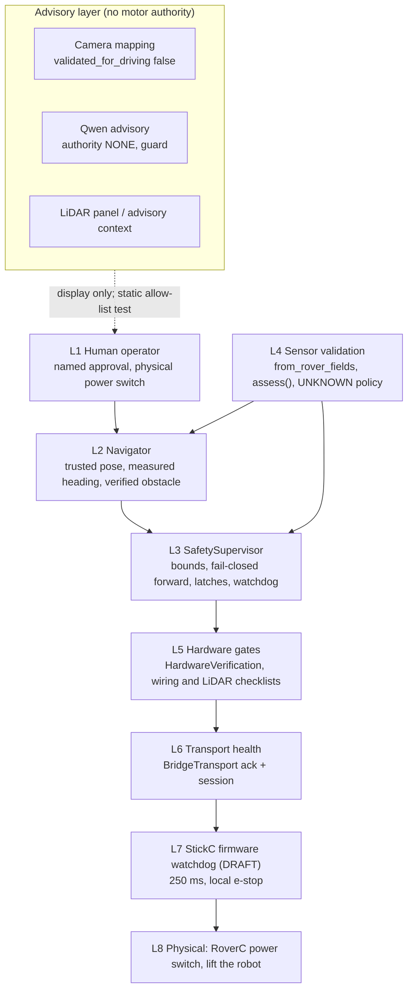
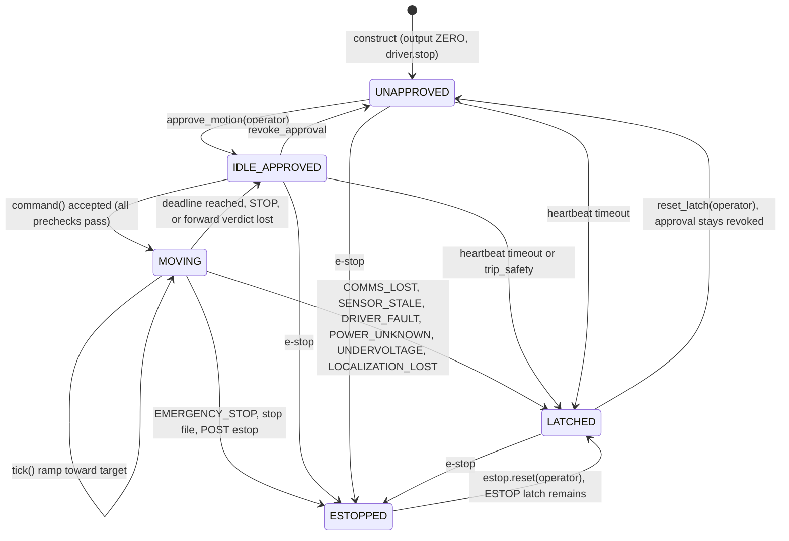

# 17 Safety architecture

This document describes how the whole Team-15 system is meant to stay safe. The rules are: nothing moves unless several independent layers all agree; every doubtful input is treated as "unknown", and unknown always means "stop"; the AI components can advise but can never command a motor; and no physical actuator is enabled until a named person has measured and signed off its hardware gate. It covers the `SafetySupervisor` state machine, the fail-closed forward-motion rule (Issue #9, PR #14), the e-stop, controller-link health, stale-data latches, the ranging and LiDAR UNKNOWN policies, camera and Qwen advisory boundaries (with the static allow-list test that enforces them), the hardware gates, and the human in the loop. Throughout, it separates three levels of evidence: **implemented** (the code exists), **simulation-tested** (tests pass against simulators or mocks), and **hardware-verified** (measured on the real device). **None of the motion-safety layers is hardware-verified.**

**Status:** Implemented and **simulation/mock-tested**. Hardware-verified: **none of the motion layers**. Only read-only hardware inspections and a stationary Grove sensor diagnostic (which returned 0/50 valid readings) have touched real devices ([14](14_GROVE_ULTRASONIC.md)). Real wheel movement: **NOT TESTED**.

**Related:** [12 RoverC motor control](12_ROVERC_MOTOR_CONTROL.md) · [13 M5StickC bridge](13_M5STICKC_BRIDGE.md) · [14 Grove ultrasonic](14_GROVE_ULTRASONIC.md) · [15 RPLIDAR C1](15_RPLIDAR_C1.md) · [11 AI agent and tools](11_AI_AGENT_AND_TOOLS.md) · [Rover safety and limitations](rover/SAFETY_AND_LIMITATIONS.md) · [Hardware readiness](rover/HARDWARE_READINESS.md) · [Bench runbook](rover/BENCH_RUNBOOK.md) · [Qwen advisory contract](qwen/QWEN_ADVISORY_CONTRACT.md) · Report [ROV-01](experiments/reports/ROV-01-issue9-fail-closed-tests.md)

---

## Contents
1. [Problem and threat model](#1-problem-and-threat-model)
2. [Design principles](#2-design-principles)
3. [Defence in depth: the layers](#3-defence-in-depth-the-layers)
4. [Evidence matrix: implemented, simulated, hardware-verified](#4-evidence-matrix-implemented-simulated-hardware-verified)
5. [The SafetySupervisor state machine](#5-the-safetysupervisor-state-machine)
6. [Fail-closed forward motion (Issue #9, PR #14)](#6-fail-closed-forward-motion-issue-9-pr-14)
7. [Watchdogs, stale-data latches and controller-link health](#7-watchdogs-stale-data-latches-and-controller-link-health)
8. [Advisory-only components: camera, LiDAR, Qwen](#8-advisory-only-components-camera-lidar-qwen)
9. [Sensor UNKNOWN policies](#9-sensor-unknown-policies)
10. [Emergency stop](#10-emergency-stop)
11. [Hardware gates](#11-hardware-gates)
12. [Human in the loop](#12-human-in-the-loop)
13. [Tests and observed results](#13-tests-and-observed-results)
14. [Known gaps and limitations](#14-known-gaps-and-limitations)
15. [How to reproduce](#15-how-to-reproduce)
16. [How to extend without weakening safety](#16-how-to-extend-without-weakening-safety)

---

## 1. Problem and threat model

A small rescue robot near people can hurt someone, or itself, in a few concrete ways:

| Hazard | Example cause |
|---|---|
| Drives into a person or obstacle | stale or wrong range data; a sensor that silently returns "nothing"; a camera distance that was never calibrated |
| Keeps driving after something failed | the Pi crashes; the USB cable is pulled; the RoverC STM32 holds its last speed (no documented watchdog) |
| Moves when nobody asked | auto-restart after a fault; a model's text being treated as a command; a second process reusing an old arm |
| Moves the wrong way | unknown wheel mapping; no heading source; no localisation |
| Electrical damage | 5 V on a 3.3 V Pi GPIO (Grove SIG line); two I²C masters on one bus |
| Battery or power failure | unmeasured RoverC battery; Pi browning out on a weak supply |

Threats considered: software bugs, sensor failure modes, link failure, human error at the bench, and **an AI model producing persuasive but wrong instructions**. A malicious local attacker with shell access is out of scope (the bridge CRC is not authentication; see [13](13_M5STICKC_BRIDGE.md) §14).

## 2. Design principles

1. **Fail closed.** If any input is missing, stale, malformed, contradictory or unknown, the answer is "no motion". `UNKNOWN` is never `CLEAR`.
2. **Positive evidence is required for motion; any doubt is enough to stop.** Moving needs every check to pass. Stopping needs only one to fail.
3. **One choke point.** Every motor command goes through `SafetySupervisor.command`, the only route to a driver's `apply`.
4. **Latch, don't auto-recover.** Safety stops latch, revoke approval, and need a named operator to reset. The robot never restarts by itself when a fault clears.
5. **Independent layers on independent clocks.** The Pi's supervisor and the StickC firmware each stop the motors without the other.
6. **Advisory components have no authority.** Camera, LiDAR panels and Qwen produce display data. A static test proves they cannot import the motor path.
7. **Hardware is locked until measured.** A gate object stays incomplete until a named person fills it in from a real measurement. Code refuses to drive hardware while any field is missing.
8. **Honest labels.** Every status carries provenance (SIMULATED, SYNTHETIC, UNKNOWN), and claims flags are hard-coded false where nothing has been verified.

## 3. Defence in depth: the layers



| Layer | Mechanism | Code | Stops motion when… |
|---|---|---|---|
| L1 Human | named approval; physical power switch or lift | `approve_motion`, `Navigator.respond`/`resume`; runbook | the operator does not approve, denies, or physically intervenes |
| L2 Navigator | justified actions only | `rover/navigator.py` | pose untrusted, no heading, misaligned, person seen, obstacle unconfirmed |
| L3 Supervisor | the one route to the driver | `rover/motion.py` `SafetySupervisor` | any precheck fails; any latch |
| L4 Sensor validation | strict parsing and conservative assessment | `rover/sensors.py`, `ranging/obstacle.py`, `ranging/rover_io.py` | stale, malformed, contradictory, NO_ECHO on hardware, `forward_motion_allowed` false |
| L5 Hardware gates | refuse to construct or open until verified | `RoverCAdapter` + `HardwareVerification`; `ranging/config.py` electrical gate; `lidar/config.py` `check_hardware_gate` | any field missing |
| L6 Transport | fresh, matched acks; per-process session | `rover/bridge.py` `BridgeTransport.health` | no ack ≤ 0.30 s, refusal, not armed for this session |
| L7 Firmware | independent watchdog; local e-stop | `firmware/stickc_roverc_bridge/stickc_roverc_bridge.ino` (**DRAFT**) | 250 ms without an accepted frame; button A |
| L8 Physical | RoverC power switch; lifting the robot | [bench runbook](rover/BENCH_RUNBOOK.md) | always, and first |

The ordering matters. Layers L3–L7 are software and can have bugs. L8 is the only layer that works if everything else fails, which is why the runbook makes "reach the power switch within 1 s" a precondition. That rehearsal is **NOT DONE** ([hardware readiness](rover/HARDWARE_READINESS.md) §3).

## 4. Evidence matrix: implemented, simulated, hardware-verified

| Safety mechanism | Implemented | Simulation / mock-tested | Hardware-verified |
|---|---|---|---|
| Supervisor bounds (speed, duration, ramp, zero default) | yes | yes (`test_supervisor.py`) | **no** |
| Fail-closed forward motion (Issue #9) | yes (PR #14) | yes (`test_issue9_fail_closed.py`, 40 tests) | **no** |
| Heartbeat watchdog → `COMMS_LOST` | yes | yes | **no** |
| Stale range → `SENSOR_STALE` latch | yes | yes (scenario G) | **no** |
| Power unknown / undervoltage latch | yes | yes | **no** (no battery telemetry exists) |
| Driver health → `DRIVER_FAULT` | yes | yes | **no** |
| Latched e-stop + stop file | yes | yes | **no** (physical procedure not rehearsed) |
| `POST /rover/estop` | yes, in the optional `rover_router` | yes (`test_status_contract.py`) | **no**; and the router is **not mounted** in `dashboard/app.py` |
| Motor-path allow-list (no AI → motors) | yes (static test) | yes | n/a (a code property) |
| `RoverCAdapter` hardware gate | yes | yes (refuses when unverified) | the gate itself is honest: **never filled** |
| Bridge session / ack health | yes | yes (63 MOCKED tests) | **no**: controller **NOT DETECTED** |
| Firmware watchdog 250 ms | DRAFT `.ino` | modelled in Python only | **no**: never compiled or flashed |
| Grove ranging UNKNOWN policy | yes (PR #7) | yes (ranging/tests) | partly: a real diagnostic ran and returned **NO_RESPONSE_EVER** (0/50 valid), so the policy correctly reported FAULT/UNKNOWN; no real obstacle was ever ranged ([14](14_GROVE_ULTRASONIC.md)) |
| Grove electrical gate | yes (`ranging/config.py`) | yes | hardware access needs the gate to pass **and** `--hardware`; the 2026-11-08 gpiod diagnostic runs therefore ran behind it ([14](14_GROVE_ULTRASONIC.md)) |
| LiDAR fail-closed adapters | yes (`lidar/adapters.py`) | yes (lidar/tests) | **no**: a real scan is **NOT VERIFIED** ([15](15_RPLIDAR_C1.md)) |
| Camera advisory-only | yes | yes | camera capture ran live; distances **UNCALIBRATED** ([05](05_DEPTH_AND_DISTANCE_ESTIMATION.md)) |
| Qwen authority NONE + guard | yes | yes (`qwen_advisory/tests`, 23 tests) | n/a for motion; Qwen has no motor path at all |
| Physical power switch / lift | procedure only | n/a | **not rehearsed** |

## 5. The SafetySupervisor state machine

`rover/motion.py` has no explicit state enum. Its state is the tuple (`estop.tripped`, `latched`, `approved_by`, `target`/`output`, `active`, `deadline`). Reduced to the states that matter:



Key properties, each enforced by code and tests:

- **Entering LATCHED** zeroes the output, sets `target` to ZERO, clears the deadline and **sets `approved_by = None`** (`_latch`).
- **Leaving LATCHED** needs `reset_latch(operator)`, and *then* a fresh `approve_motion(operator)`. `approve_motion` refuses while any latch or e-stop is active.
- **Leaving ESTOPPED** needs `EmergencyStop.reset(operator)`, which is refused while the stop file still exists. The supervisor's own `ESTOP` latch also stays until `reset_latch`. So an e-stop needs three named actions: e-stop reset, latch reset and re-approval. A running mission additionally needs `Navigator.resume(operator)`.
- **A forward-verdict loss while moving** (assessment not CLEAR, or `forward_allowed` not `True`) is a `stop()`, not a latch. The robot halts and the navigator decides what to do next. Stale, missing or invalid *readings* are a `SENSOR_STALE` latch.
- **In LATCHED and ESTOPPED, every `tick()` re-asserts zero** through `_zero_never_raise`, which never raises: a dead link must not crash the control loop.

The order of checks in `_precheck` decides which reason is reported first: e-stop → latch → approval → `MOVE_TO_WAYPOINT` refusal → unsupported command → duration → speed → driver health → power → range freshness → forward check → evidence for unsensed directions. The order in `tick()` while moving: e-stop → heartbeat → deadline → driver health (evaluated **once** per tick, because `health()` may poll a live link) → range freshness → forward verdict → power.

## 6. Fail-closed forward motion (Issue #9, PR #14)

### 6.1 The problem Issue #9 raised

After PR #8, `MOVE_FORWARD` was refused only if `forward_allowed` was **explicitly** `False`. A reading with `forward_allowed=None` ("not asserted") passed that check. It wasn't an active hazard: real Grove readings always carried a bool, and CLEAR was still required. But the guarantee depended on every present and future producer of `RangeReading` behaving. Issue #9 (opened 2026-11-07, closed by PR #14 at 2026-11-08 12:11 UTC) asked that the motion gate itself refuse "unknown". It also stated: "Qwen or other model output must never set or influence `forward_allowed`."

### 6.2 The rule now

`SafetySupervisor._forward_problem` and `_range_problem`: `MOVE_FORWARD` is accepted, **and keeps running**, only while **all** of these hold:

| # | Condition | Failure reason (verbatim from code) |
|---|---|---|
| 1 | `forward_assessment == CLEAR` | `forward not CLEAR: <assessment> (<reason>)` |
| 2 | `range.forward_allowed is True` | `ranging service forward_motion_allowed=false`, or `forward_motion_allowed not asserted` |
| 3 | the reading has a finite timestamp, is ≤ 0.20 s old, and is not more than 50 ms in the future | `no fresh range reading: ...` |
| 4 | if `range.hardware`, then `status == "OK"` | `hardware range status <s> cannot authorize forward motion` |

Plus a construction-time rule in `RangeReading.__post_init__`: `forward_allowed` must be a real `bool` or `None`, and `hardware=True` with `forward_allowed=None` **raises**. So a hardware reading without an explicit verdict cannot exist.

As a truth table, the forward command is accepted only in the first row:

| assessment | forward_allowed | fresh | hardware status | Result |
|---|---|---|---|---|
| CLEAR | True | yes | OK (or sim) | **accept** |
| CLEAR | None | yes | n/a | refuse ("not asserted") |
| CLEAR | False | yes | any | refuse |
| BLOCKED/UNKNOWN | True | yes | any | refuse |
| CLEAR | True | no | any | refuse; while moving, latch `SENSOR_STALE` |
| CLEAR | True | yes | NO_ECHO/ERROR | refuse (a forged hardware verdict) |

### 6.3 Defence in depth inside the forward rule

`forward_motion_allowed` is enforced **twice**: once in `rover.sensors.assess()` (which never returns CLEAR when the service says false), and again in the supervisor (which refuses even if a caller claims CLEAR). Before either, `from_rover_fields` rejects contradictory payloads as ERROR. Examples are `forward_motion_allowed=true` with a non-OK status, or a range below the blocked threshold. An ERROR reading gets `t = -inf`, so it is never fresh.

The simulator was changed to **assert** its verdict too (`SimWorld.read_range`: `True` when range ≥ `sim_blocked_m` = 0.35 m, `False` below it). Simulations keep working because the sim says yes, not because a missing value defaults to yes.

## 7. Watchdogs, stale-data latches and controller-link health

| Latch (`SafetyStop`) | Trigger | Where |
|---|---|---|
| `COMMS_LOST` | no `heartbeat()` for > 0.25 s | `tick()` |
| `SENSOR_STALE` | while moving: range missing, stale (> 0.20 s), NaN, inf or future-dated; or a navigator stale stop | `tick()`, `Navigator._stale_stop` |
| `DRIVER_FAULT` | while moving: `health()` missing (physical), non-empty or raising; or `apply()` raised | `tick()`, `_apply` |
| `POWER_UNKNOWN` | while moving: power reading missing, non-finite, stale (> 5 s) or future | `tick()` |
| `UNDERVOLTAGE` | while moving: voltage < `min_voltage_v` | `tick()` |
| `LOCALIZATION_LOST` | the pose becomes untrusted or leaves the edge, including during a scan | `Navigator` via `trip_safety` |
| `ESTOP` | an e-stop from any source | `command(EMERGENCY_STOP)`, `tick()` |

**Controller-link health** (PR #14). A *physical* driver must implement `health() -> str`. The supervisor refuses motion if it is missing, returns a non-empty reason, or raises ("a health check that fails is a fault, never healthy"). `RoverCAdapter.health()` delegates to the transport. `BridgeTransport.health()` returns `""` only while the latest matched ack answers a frame sent ≤ 0.30 s ago, the state is ARMED **for this session**, and the last frame was not refused ([13](13_M5STICKC_BRIDGE.md) §8).

**Two freshness limits, kept apart on purpose.** Motion uses **0.20 s** (`MotionLimits.sensor_max_age_s`). Display, dashboard and delivery snapshots use **0.5 s** (`stale_after_s` in the ranging service). A reading can be fresh enough to show but too old to drive on.

## 8. Advisory-only components: camera, LiDAR, Qwen

### 8.1 The rule

Advisory components may **inform** a human or a deterministic policy. They may **never** reach a motor. That is enforced in three ways:

1. **Static allow-list test.** `rover/tests/test_issue9_fail_closed.py` `test_nothing_outside_the_allow_list_can_reach_the_motor_path` walks every `*.py` file in the repository except `.git`, `.claude`, `site-packages` and test directories. It fails if any file not in `MOTOR_PATH_ALLOWED` contains any of the strings in `MOTOR_PATH_NAMES`.

   ```
   MOTOR_PATH_ALLOWED = rover/motion.py, rover/hardware.py, rover/protocol.py, rover/navigator.py,
                        rover/sim.py, rover/simrun.py, rover/bridge.py
   MOTOR_PATH_NAMES   = rover.motion, rover.hardware, rover.protocol, rover.bridge, SafetySupervisor,
                        RoverCAdapter, BridgeTransport, open_serial, encode_motor_block, approve_motion
   ```

   It is a plain substring scan, so it even catches those names in comments and docstrings. Commit `1f5c8db` (camera mapping, merged in PR #16: "avoid motor-path symbol names in prose (PR #14 allow-list guard)") is an example of the guard firing on harmless text and the text being reworded. The scan covers Qwen glue, the dashboard, perception, ranging, LiDAR, camera mapping, `rover/pi_io.py`, `rover/status_api.py` and any new rover module. It passes at d1b607a.
2. **Data contracts that carry no authority.** Advisory outputs are records with `authority: "NONE"` (Qwen) or `advisory: true, validated_for_driving: false` (camera routes).
3. **Interfaces that cannot be mistaken for the forward gate.** The camera adapter refuses to produce a `RangeReading`, and the LiDAR adapters never impersonate the Grove source (below).

### 8.2 Camera (`camera_mapping/`)

- Corridor assessment (`camera_mapping/assess.py`) and A* routes are `advisory: true`, `validated_for_driving: false`, `frame: "ROBOT_RELATIVE"`.
- `camera_mapping/rover_adapter.py` produces only `CameraDetection` (bearing only) and **UNCONFIRMED** `ObservationLog` entries. UNCONFIRMED never blocks routing and never clears an edge. It refuses to produce a `RangeReading`, to use the Grove source name, to claim `hardware=True` range data, or to talk to the motor controller or bridge (`NotARangeSensor`).
- All camera distances are **UNCALIBRATED**: the tape calibration was not done ([05](05_DEPTH_AND_DISTANCE_ESTIMATION.md), [camera calibration](camera_mapping/CALIBRATION.md)).
- In the navigator, a camera **person** is a reason to stop and ask (`HUMAN_REVIEW`), never evidence of clear space. A person in a scan view forces the view to UNKNOWN.

### 8.3 LiDAR (`lidar/adapters.py`)

- `to_range_snapshot` builds a dashboard-compatible `team15.range_snapshot/1` with `forward_motion_allowed` **always False**. If a Grove consumer is pointed at it by mistake, the mistake can stop the robot but never move it. It also refuses to write to the Grove snapshot path `/dev/shm/team15_range.json`.
- `to_rover_fields` uses `source = "rplidar-c1"`. `rover.sensors.from_rover_fields` accepts only `"grove-ultrasonic"`, so LiDAR fields read as ERROR → UNKNOWN → no motion. Allow-listing LiDAR as a motion source is a separate, reviewed change that has not been made.
- `to_advisory_context` feeds the Qwen advisory: display only.
- The first physical scan is refused unless the hardware checklist gate passes **and** `--approved-by` names a person (`python -m lidar scan-once`). A real scan is **NOT VERIFIED** ([15](15_RPLIDAR_C1.md)).

### 8.4 Qwen (`qwen_advisory/`, camera advisory)

- `qwen_advisory.client.lidar_advisory` always returns a displayable advisory with `authority` "NONE". On timeout (8 s by default), any exception, an invalid schema or a critical guard finding, it falls back to the deterministic `reference_policy`.
- The motion vocabulary is limited to `MOTION_REC`: `REQUEST_DETERMINISTIC_STOP`, `DO_NOT_REQUEST_MOTION`, and `OPERATOR_MAY_CONSIDER_BOUNDED_MOVE` ("operator still decides"). There is no "drive" action.
- `qwen_advisory.lidar.guard` rejects outputs that state person distances or recommend over-permissive motion. `is_unsafe_request` flags questions asking it to drive, turn and so on.
- The static allow-list test above proves no Qwen module imports the motor path.
- The live demo uses base Qwen + RAG rather than the LoRA adapter ([08](08_QWEN_MODEL.md)). That changes advisory quality, not authority: in either case Qwen has no motor authority.

## 9. Sensor UNKNOWN policies

### 9.1 Grove ultrasonic service (`ranging/obstacle.py`)

`ObstacleAssessor` outputs CLEAR, CAUTION, BLOCKED or UNKNOWN, and `FORWARD_ALLOWED` maps them to True, True, False, False:

- the latest reading invalid, or older than `stale_after_s` → UNKNOWN;
- too few valid readings in the window → UNKNOWN;
- **getting closer is believed immediately; getting farther is not.** The decision range is `min(latest valid, rolling median)`, so one short reading can cause a (safe) stop but one long reading cannot clear one;
- leaving BLOCKED, CAUTION or UNKNOWN needs the range above threshold + `hysteresis_m` for `clear_confirm_samples` (3) consecutive readings;
- all thresholds are placeholders until calibration (`max_speed_mps` 0.30, `decel_mps2` 0.5, `control_latency_s` 0.20 and `safety_margin_m` 0.10 are "PLACEHOLDERS, RoverC-Pro not yet measured").

### 9.2 Ranging → rover (`ranging/rover_io.py` → `rover/sensors.py`)

- `snapshot_to_rover_fields` maps VALID with CLEAR/CAUTION/BLOCKED to OK; VALID with UNKNOWN to ERROR; NO_ECHO and OUT_OF_RANGE to NO_ECHO; anything else, stale or unreachable, to ERROR. `forward_motion_allowed` is true only if the service said so **and** the status is OK **and** the reading is from the same host **and** it is not stale.
- `from_rover_fields` (rover side) re-validates schema, clock domain (`time.monotonic@<this host>`), source, types and contradictions. Any problem → ERROR with `t = -inf`.
- **Real-hardware NO_ECHO is UNKNOWN under every policy.** `CLEAR_TO_MAX` exists for the wall-less simulator only, and `Navigator` refuses it with physical IO. The reason: soft, thin or angled objects absorb or deflect sound, so "no echo" is not evidence of empty space.
- **Why this mattered on hardware.** On 2026-11-08 the real Grove sensor returned NO_ECHO on 50/50 pings in each of two runs (driver verdict NO_RESPONSE_EVER, health FAULT). Under this policy those readings can never authorise forward motion. A naive "no echo = clear to max range" rule would have read a dead sensor as an empty corridor. That is the clearest demonstration in the project of why the UNKNOWN policy exists ([14](14_GROVE_ULTRASONIC.md)).

### 9.3 Open item carried from the contract

`contracts/ROVER_NAV_CONTRACT.md` §2, open point 1: when `latest.mono_ns` is missing on the same host, `snapshot_to_rover_fields` sets `t = now_mono_s`, so the reading looks fresh. At d1b607a the code still does this. The `stale` flag and the other checks still apply, but the rover's own freshness check cannot catch it. **Status: OPEN** (not fixed in PR #14 or #15).

## 10. Emergency stop

| Path | Mechanism | Status |
|---|---|---|
| `Command.EMERGENCY_STOP` | trips `EmergencyStop` and latches `ESTOP` | implemented, tested |
| Stop file | `EmergencyStop(stop_file=...)`: `poll_stop_file()` on every tick; any process can `touch` it; reset is refused while it exists | implemented, tested (`test_stop_file_trips_estop`) |
| `POST /rover/estop` | `rover.status_api.rover_router`: trips and ticks; there is **deliberately no** reset, approve or start endpoint | implemented, tested; **not mounted** in `dashboard/app.py` |
| StickC button A | firmware: zero + ESTOP; only a local long press on B clears it | DRAFT firmware, model-tested |
| RoverC power switch / lifting the robot | physical | **procedure not rehearsed** |

`EmergencyStop.trip` runs **every** registered stop function, even if one raises, and records the errors. One failing path must not block the others.

## 11. Hardware gates

| Gate | Object / check | What must be measured | State |
|---|---|---|---|
| RoverC motors | `rover.protocol.HardwareVerification` → `RoverCAdapter` | controller model, firmware, RoverC revision, link, wiring verifier, power verifier, `stop_on_link_loss_ms` > 0, `WheelMapping` signs + evidence | **empty** |
| Motor power | `MotionLimits.min_voltage_v` | battery voltage at rest and under load | `None` → physical motion refused |
| Grove ultrasonic | `ranging/config.py` electrical gate (VCC, SIG-idle ≤ 1.2 V, wiring and independent verification) + the `--hardware` flag | wiring checklist, meter readings | required for the 2026-11-08 gpiod diagnostic runs ([14](14_GROVE_ULTRASONIC.md)) |
| RPLIDAR C1 | `lidar/config.py` `check_hardware_gate` + `--approved-by` | hardware checklist | not passed for a scan ([15](15_RPLIDAR_C1.md)) |
| Simulation-only switches | `NavConfig.auto_approve`, `no_echo_policy=CLEAR_TO_MAX` | n/a | refused with physical IO (`Navigator.__init__`) |

The rover programme's gates ([safety report](rover/SAFETY_AND_LIMITATIONS.md) §0):

| Gate | Status |
|---|---|
| 1 Protocol understood | documentation only |
| 2 Simulated motor commands + watchdog | PASS (sim) |
| 3 Dynamic shortest-path rerouting | PASS (sim) |
| 4 Sensor integration with fake readings | PASS (sim + PR #7 interface) |
| 5 Physical motor tests | **NOT STARTED: blocked** (controller not detected, firmware not flashed, battery not measured) |
| 6 Supervised movement with real sensors | NOT STARTED |
| 7 Localization/odometry validation | NOT POSSIBLE with current hardware |

## 12. Human in the loop

The operator is a safety layer with specific, named actions. None of them is available over HTTP.

| Action | API | Notes |
|---|---|---|
| Approve motion | `SafetySupervisor.approve_motion(operator)` | refused while latched or e-stopped; revoked by any latch |
| Approve a route or reroute | `Navigator.respond(req_id, approve, operator)` | `START_ROUTE`, `REROUTE`; `auto_approve` is simulation only |
| Confirm a person | `ObservationLog.review(obs_id, operator, confirm)` | camera persons start UNCONFIRMED |
| Clear a blocked edge | `ObservationLog.clear_edge(edge, source, operator, evidence)` | needs a source independent of every blocker |
| Evidence for backward/strafe | `DirectionEvidence(command, t, given_by)` | max age 2 s |
| Reset after a fault | `reset_latch(operator)`, `EmergencyStop.reset(operator)`, `Navigator.resume(operator)` | each needs a non-empty name |
| Arm the bridge | `BridgeTransport.arm(operator)` | firmware also needs a confirmed zero |
| Physical stop | power switch / lift | always first |

Every operator request the navigator raises (for example `POSE_UNKNOWN`, `HEADING_UNAVAILABLE`, `SENSOR_UNKNOWN`, `HUMAN_REVIEW`, `DETOUR_UNVERIFIED`) **stops** the robot and ends the mission generator. Waiting for a human is always a stopped state.

## 13. Tests and observed results

| Evidence | Label | Result | Report |
|---|---|---|---|
| `rover/tests` at d1b607a | MOCKED / SIMULATED | 284 passed (local, 2026-11-08) | [SIM-01](experiments/reports/SIM-01-rover-scenario-suite.md), [ROV-01](experiments/reports/ROV-01-issue9-fail-closed-tests.md), [BRG-01](experiments/reports/BRG-01-bridge-watchdog-mocked-tests.md) |
| Issue #9 suite (`test_issue9_fail_closed.py`) | MOCKED / SIMULATED | 40 passed | [ROV-01](experiments/reports/ROV-01-issue9-fail-closed-tests.md) |
| Motor-path allow-list | static | pass at d1b607a | ROV-01 |
| Scenario G (stale ultrasonic) | SIMULATED | SAFE_STOP, `SENSOR_STALE` at t = 8.20 s, no restart after the sensor returns | SIM-01 |
| Controller detection | REAL HARDWARE (read-only) | **NOT DETECTED** (8 checks, 2026-11-07/08) | [ROV-02](experiments/reports/ROV-02-controller-connectivity-inspection.md) |
| First wheel test | n/a | **NOT RUN**: two attempts blocked at detection | ROV-02 |
| A separate robotics workspace (`t15robot`, not in this repo) run on the Pi with a hardware guard | SIMULATED, on real Pi hardware | 30 × 90 = 2700 passed; the guard blocked `/dev/i2c-1`, `/dev/gpiochip0` and `gpiod`; 0 hardware access attempts; `pinctrl` identical before and after | `$TEAM15_EVIDENCE/robot_pi_sim_run/guarded_tests.json` (sha256 `af12bd0b…ac978`) |

**What the tests do not prove.** They prove the decision logic refuses and stops in the modelled cases. They do not prove that a real RoverC-Pro stops, how far it travels while stopping, that the firmware compiles, or that the real sensors return sensible values. Passing unit tests never establish physical motor safety.

## 14. Known gaps and limitations

1. **No motion layer is hardware-verified**; L7 (firmware) has never run, and L8 (physical) has not been rehearsed.
2. **The supervisor trusts the caller's `Assessment`.** Its only caller is the navigator, which recomputes it every step. The PR #14 independent review noted this and left it unchanged.
3. **The allow-list test is a substring scan.** It can be defeated by dynamic imports (`importlib` with a computed string). It is a guard against accidents, not against deliberate circumvention.
4. **The `t = now` fallback in `ranging/rover_io.py`** (§9.3) is open.
5. **At a 0.1 s ping interval with a 0.20 s limit,** one or two missed pings latch `SENSOR_STALE`, which then needs an operator reset ([contract](../contracts/ROVER_NAV_CONTRACT.md) §2, open point 3). That is safe, but could be disruptive on hardware.
6. **The dashboard e-stop endpoint is not mounted** in the main dashboard.
7. **The bridge CRC is not authentication.**
8. **Power:** the RoverC battery has no telemetry, and the Pi rebooted twice on a 3 A source during the 2026-11-08 attempts (cause UNVERIFIED; the journal does not persist across reboots).

## 15. How to reproduce

```bash
python3 -m pytest -q rover/tests/test_issue9_fail_closed.py          # 40 passed
python3 -m pytest -q rover/tests/test_issue9_fail_closed.py -k allow_list
python3 -m pytest -q rover/tests                                      # 284 passed
python3 -m pytest -q ranging/tests lidar/tests qwen_advisory/tests    # ranging 126, lidar 124, qwen 23 at d1b607a
python3 -m rover.simrun G                                             # stale-sensor SAFE_STOP (SIMULATED)
```

## 16. How to extend without weakening safety

- **Never** relax a check to get hardware moving, for example by setting `min_voltage_v` without a measurement, filling `HardwareVerification` by hand, or using `CLEAR_TO_MAX` on hardware. Measure, record evidence, then fill the gate.
- New motion sources (LiDAR, camera) must enter through `from_rover_fields`-style strict validation, with an explicit, reviewed source allow-list and tests for every failure mode.
- New motor-path files need review **and** an entry in `MOTOR_PATH_ALLOWED`.
- Keep the advisory vocabulary free of commands. If an advisory ever needs to trigger something, it should trigger a *stop* request into the supervisor (which is always safe), never a move.
- Any change to the bridge protocol must update the `.ino`, `rover/tests/bridge_model.py` and `rover/bridge.py` together.
