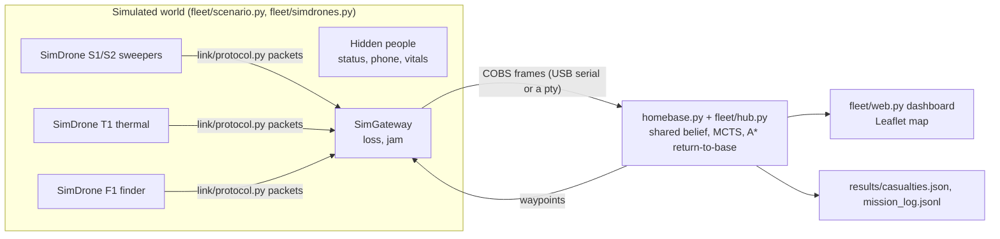

# 18 Simulation

Team-15 used simulation for two reasons. Most of the hardware (motors, motor controller, LiDAR) never reached a verified working state during the hackathon, and safety logic has to be exercised against failures you cannot safely stage on a real robot. This document covers every simulator in the repository and how far each one can be trusted:

- the **rover navigation simulator** (`rover/sim.py`, `rover/simrun.py`; scenarios A–H);
- the **Grove ranging simulated driver** (`ranging/drivers.py` `SimulatedDriver`);
- the **RPLIDAR C1 scan simulator** (`lidar/simulation.py`; 25 named scenarios);
- the **Qwen advisory SIMULATED fixtures** (`qwen_advisory/fixtures/lidar_advisory_cases.json`);
- the separate **drone-fleet simulation** in `team15_starter/` (project name "Aurora", merged as PR #17). The project began as a drone-search idea, and this is its continuation.

It also explains how the drone simulation relates to the ground-robot stack, and summarises the drone simulation's committed result CSVs. All of those results are labelled **SIMULATED**.

**Status:** Implemented and exercised. Every result on this page is **SIMULATED** (or SYNTHETIC fixture data). None establishes physical performance. The rover simulator is deterministic (re-run for this document at d1b607a: identical outcomes). The drone fleet evaluation is deterministic at a fixed commit, but **its committed CSVs do not reproduce at d1b607a**, because they were generated by earlier code ([SIM-02](experiments/reports/SIM-02-drone-fleet-eval.md)).

**Related:** [12 RoverC motor control](12_ROVERC_MOTOR_CONTROL.md) · [17 Safety architecture](17_SAFETY_ARCHITECTURE.md) · [14 Grove ultrasonic](14_GROVE_ULTRASONIC.md) · [15 RPLIDAR C1](15_RPLIDAR_C1.md) · [19 Testing and benchmarks](19_TESTING_AND_BENCHMARKS.md) · [Drone search build guide](../TEAM15_DRONE_SEARCH_BUILD.md) · [Drone hardware notes](../team15_starter/HARDWARE.md) · [Drone role changes](../team15_starter/CHANGES_ROLES.md) · Reports [SIM-01](experiments/reports/SIM-01-rover-scenario-suite.md), [SIM-02](experiments/reports/SIM-02-drone-fleet-eval.md), [SIM-05](experiments/reports/SIM-05-sarenv-bench.md)

---

## Contents
1. [Why simulate, and what simulation can and cannot show](#1-why-simulate-and-what-simulation-can-and-cannot-show)
2. [Map of the simulators](#2-map-of-the-simulators)
3. [Rover navigation simulator](#3-rover-navigation-simulator)
4. [Grove ranging simulated driver](#4-grove-ranging-simulated-driver)
5. [RPLIDAR C1 scan simulator](#5-rplidar-c1-scan-simulator)
6. [Qwen advisory SIMULATED fixtures](#6-qwen-advisory-simulated-fixtures)
7. [The drone-fleet simulation (team15_starter, "Aurora")](#7-the-drone-fleet-simulation-team15_starter-aurora)
8. [How the drone work relates to the ground robot](#8-how-the-drone-work-relates-to-the-ground-robot)
9. [Drone simulation results (SIMULATED)](#9-drone-simulation-results-simulated)
10. [Limitations](#10-limitations)
11. [How to reproduce](#11-how-to-reproduce)
12. [How to extend](#12-how-to-extend)

---

## 1. Why simulate, and what simulation can and cannot show

**Can show:** that the decision logic is correct *for the modelled world*. For example: a stale sensor latches a stop; Dijkstra picks the right detour; a malformed LiDAR scan reads UNKNOWN; a coordinated drone fleet finds simulated people faster than an uncoordinated one. Simulators are deterministic, so a regression is a test failure rather than an anecdote.

**Cannot show:** anything about the physical world. Examples are wheel slip, real ultrasonic echoes off soft objects, real LiDAR noise, battery sag, radio propagation, or whether a person is really there. Every number on this page is a property of the model. The project's rule, repeated in every simulator's labels: **SIMULATED results never stand in for hardware results** ([README](README.md) status labels).

## 2. Map of the simulators

| Simulator | Package | Models | Driven by | Label |
|---|---|---|---|---|
| Rover world | `rover/sim.py`, `rover/simrun.py` | topological graph world, edge-local ultrasonic, ground-truth heading, camera persons | `Navigator` + `SafetySupervisor` (the real control code) | SIMULATED, SYNTHETIC distances |
| Ranging | `ranging/drivers.py` `SimulatedDriver` | scripted or callable distance scene, Gaussian noise, dropouts, spikes, disconnected SIG | the real ranging service and `ObstacleAssessor` | SIMULATED |
| LiDAR | `lidar/simulation.py` | 2D ray cast of segments in the robot frame, a deliberately rotated mount, a fiducial, faults | the real `lidar` processing and adapters | SIMULATED |
| Qwen fixtures | `qwen_advisory/fixtures/lidar_advisory_cases.json` | 8 LiDAR advisory contexts with deterministic expected policy | `qwen_advisory` client and guard | SIMULATED |
| Drone fleet | `team15_starter/` | belief-grid search, simulated drones and gateway, real byte-level radio protocol, packet loss, jamming, EMCON | `homebase.py` (the real homebase code) | SIMULATED |
| SAREnv bench | `team15_starter/bench/sarenv_bench.py` | external SAREnv lost-person heatmaps and evaluator | MCTS vs 5 SAREnv baselines | SIMULATED (external dataset) |

A common design idea runs through all of them: **the simulator replaces the sensors and actuators, and the production decision code runs unchanged on top.** The rover sim drives the real `Navigator` and `SafetySupervisor`. The ranging sim feeds the real service. The LiDAR sim produces `Scan` objects for the real processing. `fleet_eval.py` calls the real `homebase.simulate`.

## 3. Rover navigation simulator

### 3.1 World model (`rover/sim.py`)

- **Topological and edge-local.** The robot is always on an edge (a, b) at distance `s` from a. Distances are the **SYNTHETIC** graph weights from `fixtures/trail_graph_synthetic.json` (26 nodes A–Z, 15 edges, from the drone build guide §3.2).
- **`SIM_NODE_XY`** is a made-up layout used only to give each edge a bearing, so that in-place rotation and scanning have something to aim at. The module says plainly that it "is not a map".
- **Dynamics** (`SimWorld.step`, dt = 0.05 s): heading += wz · 90°/s · dt; forward distance = vx · 2 m/s · dt (both synthetic scales). Driving more than 5° off an edge bearing leaves the graph and sets `lost`. **Any vy ≠ 0 sets `lost`** ("strafing is not modelled on the graph").
- **Ultrasonic model** (`_range_at`): a beam ±7.5° wide; obstacles have a half-width; side clearances are per edge; nothing in view → NO_ECHO; 3.5 m range (the Grove datasheet). Since Issue #9 the simulated ranging service **asserts** its verdict: `forward_allowed = (range ≥ 0.35 m)`, and NO_ECHO asserts `True` with reason "SIMULATED: no echo within sensor range".
- **Camera model** (`read_camera`): ±33° field of view, 8 m range; reports `person` obstacles only, as bearing-only `CameraDetection`s.
- **Fault injection:** `heading_feedback`, `localization_ok`, `range_dropout`, `power_v`, and `SimDriver.fail`. Time-based hooks are in `Sim.hooks`.
- **Collision check:** `collision` is set if the robot comes within obstacle half-width + 0.10 m (the robot radius placeholder). Every scenario test asserts that no collision happened.

`SimIO` (in `rover/simrun.py`) adapts `SimWorld` to the `RobotIO` protocol. Pose comes back as `SIM_TRUTH`, the only trusted source. `traveled` is `SIMULATED_GROUND_TRUTH` (the odometer). `build()` wires world, driver, supervisor, log and navigator. It uses `auto_approve=True` and `no_echo_policy=CLEAR_TO_MAX`, both refused on physical IO.

### 3.2 Scenarios A–H

Run locally at d1b607a on 2026-11-08 (macOS, Python 3.13.5). **SIMULATED**; distances in **SYNTHETIC** graph metres; `t` is simulated seconds.

| Scenario | Set-up | Final state | Final route (length) | Reroutes | Traveled (sim truth) | Sim time |
|---|---|---|---|---|---|---|
| A | all clear, A→G | ARRIVED | A-B-C-D-E-F-G (60) | 0 | 59.97 | 102.25 |
| B | box on D-E 5 m from D; side clearances 0.6/2.0 m | ARRIVED | D-K-L-M-G (46) | 1 | 83.895 | 187.20 |
| C | same world as B (the test checks the detour details) | ARRIVED | D-K-L-M-G (46) | 1 | 83.895 | 187.20 |
| D | boxes on D-E and D-K | ARRIVED | D-C-J-K-L-M-G (64) | 2 | 105.885 | 266.00 |
| E | boxes on D-E and M-G | SAFE_STOP: "no verified route after G-M blocked" | none | 1 | 74.955 | 211.65 |
| F | start at D; D-E blocked earlier, then cleared by an independent source | ARRIVED | D-E-F-G (30) | 0 | 29.955 | 59.80 |
| G | ultrasonic drops out at t = 8 s | SAFE_STOP, latch `SENSOR_STALE` | (A-B-C-D-E-F-G planned) | 0 | 4.665 | 8.20 |
| H | person on C-D | CONTINUE_OR_REQUEST_OPERATOR (`HUMAN_REVIEW`) | (planned) | 0 | 20.03 | 34.55 |

No scenario had a collision. B and C build identical worlds. They exist as separate scenario names because `test_scenarios.py` checks different properties: B checks how the blockage was justified, and C checks the detour lengths and retreat. The full analysis, including what these do *not* prove, is in [SIM-01](experiments/reports/SIM-01-rover-scenario-suite.md).

### 3.3 Determinism

There are no random numbers in the rover simulator. `test_scenarios_are_deterministic` runs D twice and compares `reroutes` and `t`. Re-running all eight for this document reproduced the PR #8 description's results (A 60, B/C 46 after a 4 m retreat, D 64, E SAFE_STOP, F 30, G latch, H review).

## 4. Grove ranging simulated driver

`ranging/drivers.py` `SimulatedDriver(cfg, scene, noise_sd_m, dropout_p, spike_p, seed, disconnected, clock)`:

- `scene` is a callable `t → Scene`, or a sequence consumed one value per ping, or a fixed distance;
- seeded Gaussian noise, random dropouts (NO_ECHO) and spikes;
- `disconnected=True` models an unplugged SIG line: no echo, ever. That is the same *symptom* the real sensor showed on 2026-11-08 (0/50 valid, NO_RESPONSE_EVER). The simulator reproduces the symptom; it cannot say why the real sensor failed ([14](14_GROVE_ULTRASONIC.md)).

The CLI defaults to it. `python3 -m ranging read` takes simulated readings unless both a verified gpiod config and `--hardware` are given. The simulator flags are `--sim-distance`, `--sim-noise`, `--sim-dropout` and `--sim-scenario {static,approach,open,disconnected}`. A separate robotics workspace used it for a 20-reading sensor-only rehearsal: 20/20 VALID, median 99.9 cm against a simulated 100 cm, SD 1.07 cm (`$ROBOT_WORKSPACE/TEST_REPORT.md`, round 3, 2026-11-07, SIMULATED).

## 5. RPLIDAR C1 scan simulator

`lidar/simulation.py` ray-casts line segments in the **robot** frame (x forward, y left). It converts to **sensor** angles through `SIM_MOUNT`, a simulated mount whose 0° mark faces the robot's *rear*, rotating clockwise. That is deliberate: any "sensor 0 = forward" bug shows up in tests. A 2 cm mast at robot (−0.10, +0.10) m acts as an asymmetric orientation fiducial, which catches CW/CCW sign errors. Every scan, fixture and payload is labelled `SIMULATED`, and the mount's "verified by" fields say `SIMULATION (not a person)`.

`SCENARIOS` has 25 named generators (`00_clear_room_control` … `25_mirror_across_corridor`). They cover:

- obstacles ahead, behind, left, multiple, approaching, at the corridor edges, a pole just outside the corridor;
- a doorway, and a door narrower than the robot;
- invalid values, missing sectors, partial scans, stale timestamps;
- the wrong orientation and an unexpected scan rate;
- reflective/transparent and mirror cases, and a moving robot.

Three further cases are byte-level and live in the tests (`BYTE_LEVEL_SCENARIOS`: serial disconnect, device timeout, corrupted packets). `00_clear_room_control` is "the only case that should read CLEAR". Fixtures are exported to `lidar/fixtures/*.json`.

```bash
python3 -m lidar replay --scenario 02_obstacle_ahead     # SIMULATED panel JSON: front BLOCKED at 0.2409 m
python3 -m lidar export-fixtures --out <dir>
```

Details: [15 RPLIDAR C1](15_RPLIDAR_C1.md), [LiDAR test report](lidar/LIDAR_C1_TEST_REPORT.md).

## 6. Qwen advisory SIMULATED fixtures

`qwen_advisory/fixtures/lidar_advisory_cases.json` has top-level `label: "SIMULATED"`, `hardware: false`, and 8 cases. Its provenance string says the cases come from the Team-15-Qwen LiDAR agent simulator and fixture generator, with "expected = deterministic policy". `qwen_advisory/tests/test_lidar_contract.py` checks:

- that the fixtures are labelled SIMULATED;
- that the deterministic `reference_policy` matches every expected output;
- that unusable or blocked LiDAR never allows motion;
- that the guard rejects person distances and over-permissive motion;
- that the client falls back on error, timeout or unsafe output.

These are contract tests of the advisory boundary, not of model quality ([11](11_AI_AGENT_AND_TOOLS.md), [Qwen advisory contract](qwen/QWEN_ADVISORY_CONTRACT.md)).

## 7. The drone-fleet simulation (team15_starter, "Aurora")

### 7.1 What it is

A multi-drone search-and-rescue system in which **everything except the bytes is simulated**:



| Part | Files | Role |
|---|---|---|
| Homebase | `homebase.py`, `team15_starter/fleet/hub.py`, `team15_starter/fleet/planner.py` | the "Jetson" brain: shared belief grid, fleet MCTS with cell claims, A* return-to-base, contact tracking, casualty list |
| Simulated hardware | `team15_starter/fleet/simdrones.py` (`SimDrone`, `SimGateway`), `team15_starter/fleet/scenario.py` | drones, sensors, people, radio loss and jamming; `summarize_truth` scores against hidden ground truth |
| Radio protocol | `team15_starter/link/protocol.py`, `team15_starter/link/transport.py`, `team15_starter/firmware/t15_protocol.h` | 14-byte header, payload, optional 8-byte HMAC-SHA256 tag, CRC-16/CCITT-FALSE; COBS framing on serial. `team15_starter/tests/test_link.py` compiles the C header (`team15_starter/tests/xcheck.c`) and checks byte-for-byte agreement |
| Firmware (not flashed in this project) | `team15_starter/firmware/gateway/gateway.ino`, `team15_starter/firmware/drone_node/drone_node.ino` | ESP32-S3 gateway (ESP-NOW ⇄ USB) and drone node (telemetry, detections, link-loss failsafe). PR #17's review: "firmware only drives the LED and radio" |
| Dress rehearsal | `fleet_sim.py --pty` | fake gateway and drones on a virtual serial port, so `homebase.py --port <pty>` exercises the real serial path |
| Evaluation | `fleet_eval.py` | many seeded missions; mean ± 95 % CI; CSV per study |
| Single-searcher research | `team15_starter/sar/` (`sar_core.py`, `planners.py`, `sensors.py`, `waypoint.py`), `run_compare.py`, `team15_starter/mujoco/fly_mcts.py` | belief grid, lawnmower/greedy/MCTS, a GPS-denied comparison, a MuJoCo flight of an MCTS plan |
| Benchmark | `team15_starter/bench/sarenv_bench.py` | MCTS against SAREnv's official baselines on SAREnv heatmaps |
| Dashboard | `team15_starter/fleet/web.py`, `team15_starter/fleet/web/index.html`, vendored Leaflet (BSD-2 licence in `team15_starter/fleet/web/leaflet/LICENSE`) | live map; `team15_starter/fleet/terrain.py` fetches OpenStreetMap terrain in the background |

### 7.2 Concept and math

**Belief grid.** The search area is an n × n grid (default 24 × 24 cells of 20 m). Each cell holds the probability mass that a person is there, starting from a prior (`--prior multi|ring|bimodal|uniform|<heatmap.npy>`).

**Bayesian no-detection update.** When a sensor with probability of detection *p* looks at cell *c* and sees nothing, the belief there should drop. By Bayes' rule, P(person in c | no detection) ∝ P(no detection | person in c) · P(person in c) = (1 − p) · b(c). The code applies this without normalising (`team15_starter/fleet/planner.py` `apply_look`: `mass *= (1 − pod · coverage)`), so `1 − mass.sum()` is the cumulative probability that the search has succeeded. In the GPS-denied mode, the look is smeared over where the drone might really have been (`sigma_cells`), instead of over-trusting its position estimate.

**MCTS planning.** At each decision the planner simulates many short futures. It picks the first move by UCB1: Q(m) + c·√(ln N / n(m)), with c = 1.4 in `team15_starter/sar/planners.py`. Each rollout is scored by the discounted probability mass it would sweep. In the fleet version, drones **claim** their next cells (`claim_path`) so teammates don't duplicate effort, and share one map over the mesh. `--no-allocate` and `--no-share` turn those off for ablations.

**Sensor PODs are not measured.** `team15_starter/sar/sensors.py` presets (thermal 0.90, depth/AI camera 0.82, NoIR 0.40, mmWave 0.95, acoustic 0.55) are described in the code as "demo-calibrated starting points — tune against real gear". They are assumptions, so every result that depends on them is conditional on them.

### 7.3 History (git and PR evidence)

| When | Who (GitHub handle) | Commit | What |
|---|---|---|---|
| 2026-11-07 14:43 −0500 | hafsaah1 | `6b832fd` | GPS-denied multi-person search (MCTS) |
| 2026-11-07 15:33 −0500 | hafsaah1 | `7ed29a5` | SAREnv benchmark, 60 scenarios, 30 km budget |
| 2026-11-07 15:39 −0500 | hafsaah1 | `4018ff9` | SAREnv benchmark re-run; summary now 10 km budget |
| 2026-11-07 17:02 −0500 | hafsaah1 | `ea5016f` | Jetson homebase + ESP32 firmware + 3-drone planner; `team15_starter/results/fleet_eval_fleet.csv` |
| 2026-11-07 20:45 −0500 | hafsaah1 | `e47c1bf` | live satellite dashboard, personnel-recovery mission, battery fix; `team15_starter/results/fleet_eval_emcon.csv` |
| 2026-11-08 09:36 UTC | Gavopian | `eddef53` | drone roles (sweeper/thermal/finder), signal areas, ~80× faster planner ([CHANGES_ROLES.md](../team15_starter/CHANGES_ROLES.md)) |
| 2026-11-08 12:13 UTC | machackgo | `95b6f67`, `159c678` | merged main into the branch; exempted the 5 vendored Leaflet icons from the no-photos test; untracked a 10 MB generated GIF |
| 2026-11-08 12:14 UTC | (PR #17 by GavinPrescott) | `d1b607a` | merged to main |

PR #17's integration comment says the branch "forked from the initial commit". Its review notes are: "no motor/GPIO paths (the serial link is the radio; firmware only drives the LED and radio), no credentials", and `team15_starter/tests`: 5 passed.

## 8. How the drone work relates to the ground robot

The project **started as a drone-search plan**. PR #1 (merged 2026-11-07 18:41 UTC) added `TEAM15_DRONE_SEARCH_BUILD.md`. That build guide was converted from a PDF, and its "bottom line" committed to "three SIMULATED scouts plus a live laptop camera detector, an explicit synthetic trail graph with Dijkstra routing, a timestamped observation/track store, and Qwen as a validated, optional tool-caller". It treated real aircraft as a "staff-flown, daylight-only upgrade path".

From there the main line of work became the **ground robot**: Pi camera perception, the RoverC-Pro navigation stack, Grove ranging, LiDAR and the dashboard (PRs #2–#16). It kept the guide's core ideas:

- **the synthetic trail graph.** `fixtures/trail_graph_synthetic.json` says in its own `_note` that it comes "from TEAM15_DRONE_SEARCH_BUILD.md section 3.2". The rover's A→G 60 m route is the guide's G→K worked-example graph reused;
- **honest provenance badges** (SIMULATED, RECORDED, LIVE-HW), which became the labels used throughout these docs;
- **Qwen as a validated, optional advisor**, never an actuator.

In parallel, teammates developed the drone idea itself as the "Aurora" fleet simulation in `team15_starter/`, on a branch that forked from the initial commit. It was merged as PR #17 at the end of the hackathon. **The two stacks share no code.** There are no imports from `rover`, `planner` or `ranging` in `team15_starter/`. `team15_starter/` is not in `pytest.ini` `testpaths`, and no CI workflow runs it. Its 5 tests are run by hand (`python3 -m pytest -q team15_starter/tests`). Its MCTS and belief-grid ideas are conceptually relevant to a future ground-robot coverage search, but nothing in the rover stack uses them today.

## 9. Drone simulation results (SIMULATED)

**Every figure in this section is SIMULATED.** It comes from the team's own simulator with assumed sensor PODs, a simulated radio and synthetic people. None of it involved a real drone, ESP32, Jetson or person. Each row belongs to one revision and run; rows from different revisions are not combined.

### 9.1 `fleet_eval.py` committed CSVs

Method (`fleet_eval.py`): 20 seeds per configuration; 3 hidden people; 24 × 24 cells of 20 m; 900 s time limit. Every drone carries thermal + mmWave, so the comparison is about coordination, not sensors. Unfinished missions count at the time limit (a censored mean). The 95 % CI is 1.96 · s/√n. `done` means every person was matched to a confirmed track with an observation or assessment.

**`team15_starter/results/fleet_eval_fleet.csv`**: committed at `ea5016f` (2026-11-07 17:02 −0500); 80 rows; sha256 `637794af…f7f483`. The time to find all three is the mean ± 95 % CI.

| Configuration | n | Time to find all 3 (s) | Mission success | Vitals | Detections delivered | Radio emissions (packets) | Battery deaths |
|---|---|---|---|---|---|---|---|
| 1 drone | 20 | 215.7 ± 79.5 | 95 % | 95 % | 100 % | 474 | 0 |
| 3 drones, no shared map | 20 | 147.1 ± 51.2 | 95 % | 95 % | 100 % | 1099 | 0 |
| 3 drones, shared map | 20 | 100.8 ± 19.8 | 90 % | 97 % | 100 % | 1117 | 0 |
| 3 drones, shared + claims | 20 | 93.2 ± 15.5 | 90 % | 95 % | 100 % | 1091 | 0 |

**`team15_starter/results/fleet_eval_emcon.csv`**: committed at `e47c1bf` (2026-11-07 20:45 −0500); 40 rows; sha256 `2dbb5b58…1904c`.

| Configuration | n | Time to find all 3 (s) | Mission success | Vitals | Emissions | Battery deaths |
|---|---|---|---|---|---|---|
| civilian radio | 20 | 91.6 ± 14.1 | 90 % | 95 % | 1064 | 0 |
| military EMCON + signed | 20 | 130.1 ± 21.2 | 90 % | 95 % | 425 | 1 |

The **radio** study (`--study radio`: clean, 30 % loss, and 30 % loss + a 60 s jam) is defined in `fleet_eval.py`, but **no CSV is committed**. Its result is **NOT MEASURED** (no evidence found).

### 9.2 Re-run at d1b607a (for this document)

Run on 2026-11-08 on an Apple M4 Pro (14 cores), Python 3.13.5, in a scratch copy of `team15_starter` from `git archive d1b607a`, so the repository was not modified. Same command and defaults: `python3 fleet_eval.py --study fleet --seeds 20` and `--study emcon --seeds 20`. The fleet study took 85 s of wall time. **Running it twice gave byte-identical CSVs**, so the evaluation is deterministic at a fixed commit.

| Study / configuration | Committed CSV (older code) | Re-run at d1b607a |
|---|---|---|
| fleet: 1 drone, time to find all | 215.7 ± 79.5 s, success 95 % | 218.4 ± 65.9 s, success 85 % |
| fleet: 3, no shared map | 147.1 ± 51.2 s, 95 % | 149.4 ± 50.0 s, 90 % |
| fleet: 3, shared map | 100.8 ± 19.8 s, 90 % | 128.0 ± 66.3 s, 85 % |
| fleet: 3, shared + claims | 93.2 ± 15.5 s, 90 % | 91.1 ± 15.4 s, 90 % |
| emcon: civilian | 91.6 ± 14.1 s, 90 % | 80.4 ± 11.5 s, 80 % |
| emcon: military EMCON + signed | 130.1 ± 21.2 s, 90 % | 174.1 ± 89.0 s, 65 % |

**Finding: the committed CSVs are not reproducible at d1b607a.** The code changed after they were generated (`e47c1bf`, `eddef53`: battery fix, roles, the faster planner). The qualitative ordering "shared map + claims is fastest" holds in both. The size of the shared-map benefit, the military-mode penalty and the success rates all moved. Treat the committed CSVs as results of *their* commit only. Details are in [SIM-02](experiments/reports/SIM-02-drone-fleet-eval.md).

### 9.3 SAREnv benchmark

`team15_starter/bench/sarenv_bench.py` scores our MCTS as a path generator against five SAREnv baselines (Spiral, ConcentricCircles, PizzaZigzag, Greedy, RandomWalk). It uses SAREnv's own `PathEvaluator`, on SAREnv lost-person probability heatmaps, with 100 sampled victims per scenario, 1 drone, 45° field of view at 80 m altitude, and a 3 km radius. There are 60 scenarios × 6 planners = 360 rows per run. Metrics are the accumulated probability of detection ("likelihood"), the time-discounted POD (discount 0.999), and victims found (%).

| Run | Budget | MCTS likelihood | Best baseline (Greedy) likelihood | MCTS victims found | Greedy victims found | Evidence |
|---|---|---|---|---|---|---|
| `7ed29a5` (2026-11-07 15:33 −0500) | 30 km | 0.170 ± 0.023 | 0.126 ± 0.015 | 17.4 ± 2.5 % | 11.3 ± 1.5 % | git history only (overwritten) |
| `4018ff9` (2026-11-07 15:39 −0500), committed at d1b607a | 10 km | 0.069 ± 0.010 | 0.051 ± 0.008 | 6.95 ± 1.25 % | 4.78 ± 0.93 % | `team15_starter/results/sarenv_bench_summary.csv` (sha256 `3af5f7da…0e6c`), `team15_starter/results/sarenv_bench_raw.csv` (sha256 `8a00b608…eae58`) |

In both runs MCTS has the highest mean on all three metrics. The commit message of `4018ff9` says "60 scenarios x 2 budgets", but the committed CSVs contain **only** the 10 km run (every `path_km` is 10.0). The 30 km run survives only in git history. SAREnv itself is not vendored (`--sarenv ../SAREnv`), so **this benchmark could not be re-run for this document**. Details are in [SIM-05](experiments/reports/SIM-05-sarenv-bench.md).

## 10. Limitations

- **Rover sim:** topological only; no wheel dynamics, slip or strafing; perfect heading and pose (`SIM_TRUTH`); NO_ECHO = open space (`CLEAR_TO_MAX`) because the world has no walls, which would be wrong on hardware; synthetic speed scales; robot width is a 0.20 m placeholder.
- **Ranging and LiDAR sims:** idealised geometry and noise. They reproduce failure *symptoms* (no echo, missing sectors), not physical causes.
- **Drone sim:** sensor PODs are assumed; people and radio are modelled; results depend on those assumptions. The committed CSVs are from older code (§9.2). The radio study has no committed results. Mean ± CI with n = 20 is wide for the single-drone and EMCON configurations.
- **SAREnv:** the heatmaps are SAREnv's statistical lost-person models, and the victims are sampled from them. Good performance means good performance *against that model*.
- **Nothing on this page** has been validated against a physical robot, drone or person.

## 11. How to reproduce

```bash
# Rover (deterministic; SYNTHETIC distances)
python3 -m rover.simrun --list
for s in A B C D E F G H; do python3 -m rover.simrun $s > /dev/null; echo "$s exit $?"; done
python3 -m pytest -q rover/tests/test_scenarios.py rover/tests/test_scanning.py rover/tests/test_distances.py

# Ranging simulator (no GPIO)
python3 -m ranging read --count 10 --sim-distance 1.0 --sim-noise 0.01

# LiDAR simulator
python3 -m lidar replay --scenario 00_clear_room_control

# Drone fleet (writes team15_starter/results/*.csv; run in a scratch copy to keep the committed CSVs)
cd team15_starter && python3 -m pytest -q tests && python3 fleet_eval.py --study fleet --seeds 20
python3 homebase.py --sim                     # one simulated mission in the terminal
# SAREnv bench needs an external SAREnv checkout:
python3 bench/sarenv_bench.py --sarenv ../SAREnv --scenarios 1-60 --budget 10000
```

`fleet_eval.py` **overwrites** `team15_starter/results/fleet_eval_<study>.csv`. To keep the committed evidence intact, run it in a copy (for example `git archive HEAD team15_starter | tar -x -C <scratch>`).

## 12. How to extend

- **Rover:** add a scenario in `rover.simrun.scenario` with an explicit expected outcome, and a test in `rover/tests/test_scenarios.py` that asserts `collision is None`. Model a hardware limitation (for example `heading_feedback=False`) rather than a capability the hardware lacks.
- **A wall-ful world** would let the rover sim keep `no_echo_policy=UNKNOWN` (the hardware setting), so scenarios would exercise the real policy.
- **Drone:** commit the CSVs *with* the commit that generated them, add the radio study, and record the command line inside the CSV (or next to it) so a future reader can tie numbers to code.
- **Keep labels.** Every new fixture or result must carry `SIMULATED` or `SYNTHETIC`. The dashboard's no-photos test and the docs check (`scripts/check_docs.py`) guard parts of this.
