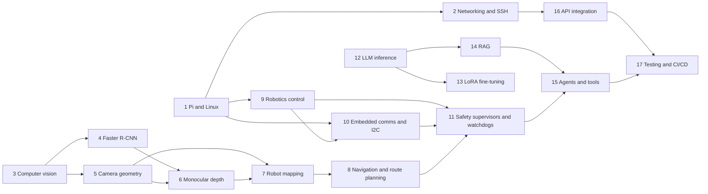

# 24 Learning guide

This is a study guide for a developer who wants to understand the Team-15 search-and-rescue robot stack from first principles. It has 17 modules, from Raspberry Pi and Linux basics to LoRA fine-tuning, retrieval, safety supervisors and CI. Each module states its learning goals and prerequisites, explains the concept (with the maths where it matters), points to the exact files and symbols in this repository, works through an example with real numbers from the project (each carrying a provenance label), and ends with safe hands-on exercises, review questions with answers, and further reading. Every exercise runs in simulation, against tests, on recorded data, or read-only. **No exercise drives a motor, flashes firmware or writes to a GPIO pin.**

**Status:** Reference and teaching document. Every file and symbol named here exists at `d1b607a`. Commands were checked against each module's `--help`. Example outputs come from local runs during the documentation audit (macOS, Python 3.13.5, 2026-11-08) unless another source is given.

**Related:** [Documentation index](README.md) · [00 Project overview](00_PROJECT_OVERVIEW.md) · [01 System architecture](01_SYSTEM_ARCHITECTURE.md) · [17 Safety architecture](17_SAFETY_ARCHITECTURE.md) · [19 Testing and benchmarks](19_TESTING_AND_BENCHMARKS.md) · [23 Design decisions](23_DESIGN_DECISIONS.md) · [25 Limitations and future work](25_LIMITATIONS_AND_FUTURE_WORK.md) · [Experiment summary](experiments/EXPERIMENT_SUMMARY.md)

> **A rule for the whole guide.** Passing a unit test shows that the code does what it was written to do. It does **not** show that the camera measures distance correctly, that a detector finds people reliably, or that the robot stops safely. Wherever this guide quotes a test result, keep that distinction in mind. The hardware truth at `d1b607a` is short: the camera ran live on the Pi, camera distances are **UNCALIBRATED**, real wheel movement is **NOT TESTED**, the Grove ultrasonic gave **0/50 valid readings twice**, and a real LiDAR scan is **NOT VERIFIED**.

---

## Contents

- [Recommended reading order](#recommended-reading-order)
- [Module dependency map](#module-dependency-map)
- [How each module is laid out](#how-each-module-is-laid-out)
- [Module 1: Raspberry Pi and Linux fundamentals](#module-1-raspberry-pi-and-linux-fundamentals)
- [Module 2: Networking and SSH](#module-2-networking-and-ssh)
- [Module 3: Computer vision](#module-3-computer-vision)
- [Module 4: Object detection with Faster R-CNN](#module-4-object-detection-with-faster-r-cnn)
- [Module 5: Camera geometry](#module-5-camera-geometry)
- [Module 6: Monocular depth estimation](#module-6-monocular-depth-estimation)
- [Module 7: Robot mapping](#module-7-robot-mapping)
- [Module 8: Navigation and route planning](#module-8-navigation-and-route-planning)
- [Module 9: Robotics control](#module-9-robotics-control)
- [Module 10: Embedded communication and I²C](#module-10-embedded-communication-and-i2c)
- [Module 11: Safety supervisors and watchdogs](#module-11-safety-supervisors-and-watchdogs)
- [Module 12: LLM inference](#module-12-llm-inference)
- [Module 13: LoRA fine-tuning](#module-13-lora-fine-tuning)
- [Module 14: Retrieval-augmented generation (RAG)](#module-14-retrieval-augmented-generation-rag)
- [Module 15: Agent and tool architecture](#module-15-agent-and-tool-architecture)
- [Module 16: API integration](#module-16-api-integration)
- [Module 17: Automated testing and CI/CD](#module-17-automated-testing-and-cicd)
- [Capstone exercises](#capstone-exercises)

---

## Recommended reading order

Read the overview first, then pick a track. The tracks share the safety and testing documents, which everyone should read.

| Step | Read | Why | Modules that use it |
|---|---|---|---|
| 1 | [00 Project overview](00_PROJECT_OVERVIEW.md) | The problem, the pivot, the capability matrix | all |
| 2 | [01 System architecture](01_SYSTEM_ARCHITECTURE.md) | Hosts, processes, data flows, contracts | all |
| 3 | [17 Safety architecture](17_SAFETY_ARCHITECTURE.md) | The rules everything else obeys | 9–11, 15 |
| 4 | [19 Testing and benchmarks](19_TESTING_AND_BENCHMARKS.md) | What the tests prove and don't | 17 |
| **Perception track** | | | |
| 5 | [02 Raspberry Pi setup](02_RASPBERRY_PI_SETUP.md) | IMX708 capture and the Pi→Mac stream | 1, 2 |
| 6 | [03 Mac AI inference](03_MAC_AI_INFERENCE.md) | Why inference runs on the Mac | 4, 12 |
| 7 | [04 Camera perception](04_CAMERA_PERCEPTION.md) | Faster R-CNN, HOG, sightings | 3, 4 |
| 8 | [05 Depth and distance estimation](05_DEPTH_AND_DISTANCE_ESTIMATION.md) | Pinhole model, ground plane, known height, mono depth | 5, 6 |
| 9 | [06 Obstacle mapping](06_OBSTACLE_MAPPING.md) | Tracks and the three-state grid | 7 |
| 10 | [07 Path planning](07_PATH_PLANNING.md) | Corridor verdict, grid A\*, Dijkstra | 8 |
| 11 | [16 Dashboard](16_DASHBOARD.md) | FastAPI endpoints, validation, panels | 16 |
| **AI track** | | | |
| 12 | [08 Qwen model](08_QWEN_MODEL.md) | The model and why the demo uses base + RAG | 12 |
| 13 | [09 LoRA training](09_LORA_TRAINING.md) | Six runs, selection, frozen evaluation | 13 |
| 14 | [10 RAG pipeline](10_RAG_PIPELINE.md) | FTS5 BM25, context budget, quarantine | 14 |
| 15 | [11 AI agent and tools](11_AI_AGENT_AND_TOOLS.md) | Bounded tool loops, guard, fallback | 15 |
| **Robotics track** | | | |
| 16 | [12 RoverC motor control](12_ROVERC_MOTOR_CONTROL.md) | Mecanum kinematics, navigator | 9 |
| 17 | [13 M5StickC bridge](13_M5STICKC_BRIDGE.md) | Serial protocol, CRC-8, firmware watchdog | 10, 11 |
| 18 | [14 Grove ultrasonic](14_GROVE_ULTRASONIC.md) | Time of flight, GPIO timing, the 0/50 result | 1, 10 |
| 19 | [15 RPLIDAR C1](15_RPLIDAR_C1.md) | LiDAR protocol, footprint corridor | 7, 10 |
| 20 | [18 Simulation](18_SIMULATION.md) | Every simulator and what it can't show | 8, 11 |
| **Operating and history** | | | |
| 21 | [20 Deployment and runbook](20_DEPLOYMENT_AND_RUNBOOK.md) | Verified commands | 1, 2, 16 |
| 22 | [21 Troubleshooting](21_TROUBLESHOOTING.md) | Symptom → cause → fix | all |
| 23 | [22 Experiments and failures](22_EXPERIMENTS_AND_FAILURES.md) | What went wrong and what we learned | all |
| 24 | [23 Design decisions](23_DESIGN_DECISIONS.md) | Why each choice was made | all |
| 25 | [25 Limitations and future work](25_LIMITATIONS_AND_FUTURE_WORK.md) | What is missing | all |
| 26 | [26 Hackathon demo guide](26_HACKATHON_DEMO_GUIDE.md) | The demo and honest talking points | — |
| 27 | [27 Project timeline](27_PROJECT_TIMELINE.md), [28 Contributors](28_CONTRIBUTORS.md) | History and roles | — |
| **Evidence** | | | |
| 28 | [Experiment summary](experiments/EXPERIMENT_SUMMARY.md) → [Experiment registry](experiments/EXPERIMENT_REGISTRY.md) → [Benchmark results](experiments/BENCHMARK_RESULTS.md) → [Dataset inventory](experiments/DATASET_INVENTORY.md) | Every number with its conditions | all |
| 29 | [Detailed experiment reports](experiments/reports/) | One standalone report per major experiment | cited per module |

The component documents that already existed (for example [camera_mapping/CALIBRATION.md](camera_mapping/CALIBRATION.md), [rover/BENCH_RUNBOOK.md](rover/BENCH_RUNBOOK.md), [ranging/WIRING.md](../ranging/WIRING.md)) are linked from the numbered documents and from the modules below.

## Module dependency map

An arrow from A to B means "study A before B".



Suggested paths:

- **Beginner (about one week):** 1 → 2 → 3 → 16 → 17.
- **Perception engineer:** 3 → 4 → 5 → 6 → 7 → 8.
- **Robotics and safety engineer:** 1 → 9 → 10 → 11, then 8.
- **AI engineer:** 12 → 13 → 14 → 15, then 11 to see why the AI has no motor authority.

## How each module is laid out

1. **Learning goals**: what you should be able to do afterwards.
2. **Prerequisites**: earlier modules.
3. **Concept**: first principles, with the maths.
4. **Where it lives in our code**: files and symbols.
5. **Worked example from our project**: real numbers, each with a provenance label (REAL HARDWARE, RECORDED HARDWARE, SIMULATED, MOCKED, SYNTHETIC).
6. **Hands-on exercises**: safe ones only. Run them from the repository root.
7. **Review questions**: answers in a collapsible block.
8. **Further reading**: well-known public references.

Install the Mac environment first ([20](20_DEPLOYMENT_AND_RUNBOOK.md) §1.1). Most exercises need only `requirements.txt`; the detector and depth exercises also need torch.

---

## Module 1: Raspberry Pi and Linux fundamentals

**Learning goals**

- Explain what the Raspberry Pi 5 does in this project, and what it deliberately does not do.
- Read a Linux system's health: throttling, temperature, kernel version, USB devices, GPIO line state.
- Understand processes, standard input and output, and why the camera sender is a script piped over SSH.
- Explain what a GPIO line is, why the Pi 5 needs libgpiod, and why a 5 V signal can damage it.

**Prerequisites:** none.

### Concept

**What a single-board computer is.** The Pi 5 is a full Linux computer: four ARM Cortex-A76 cores, RAM, USB, Ethernet and Wi-Fi, plus a 40-pin header of **general-purpose input/output (GPIO)** pins. On the Pi 5, those pins are driven by a separate I/O chip, the **RP1**, not by the main processor. That is why old libraries such as RPi.GPIO do not work on it, and why our code uses **libgpiod v2**, the kernel's character-device GPIO interface (`/dev/gpiochip0`).

**Everything is a file.** Linux exposes hardware as files: `/dev/gpiochip0` for GPIO, `/dev/ttyUSB0` or `/dev/serial/by-id/...` for serial adapters, `/dev/shm` for shared memory. A program opens the file and reads or writes it. Two consequences matter here:

1. Device names such as `/dev/ttyACM0` depend on plug-in order. A by-id path (`/dev/serial/by-id/usb-<vendor>_<serial>-if00`) is stable. Our bridge code refuses anything else (`rover/bridge.py` `open_serial`).
2. Only one process should own a device. Our ranging service owns the GPIO line and publishes snapshots for everyone else ([Module 10](#module-10-embedded-communication-and-i2c)).

**Processes and streams.** Every process has standard input (stdin), standard output (stdout) and standard error (stderr). `python3 -` reads a Python program from stdin and runs it. Our Mac sends the camera sender script into `python3 -` on the Pi through SSH, so nothing has to be installed on the Pi ([Module 2](#module-2-networking-and-ssh)).

**Power is a first-class concern.** The Pi 5 wants 5 V at up to 5 A. On a weaker supply it limits USB current (about 600 mA combined) and can brown out. `vcgencmd get_throttled` reports under-voltage and throttling as bit flags; `0x0` means none since boot. In this project the Pi rebooted twice on a 3 A source during the controller checks (F-ROV-2 in [22](22_EXPERIMENTS_AND_FAILURES.md)), and its journal was not persistent, so the cause could not be proved.

**Voltage levels.** Pi GPIO is a 3.3 V system and is **not 5 V tolerant**. If a sensor powered at 5 V drives a signal line high, about 5 V reaches the pin. A 1 kΩ series resistor alone still pushes about (5 − 3.3 − 0.3) / 1000 ≈ 1.4 mA into the pin's protection diode continuously. That is why the Grove ranger runs at 3.3 V ([ADR-SEN01](23_DESIGN_DECISIONS.md#adr-sen01-power-the-grove-ranger-from-33-v)).

### Where it lives in our code

| What | File and symbol |
|---|---|
| Read-only Pi checks (model, gate, libgpiod, chip and line identity, pinctrl, NTP) | `ranging/preflight.py`; CLI `python3 -m ranging preflight` |
| GPIO via libgpiod, chip identity check | `ranging/drivers.py` `GpiodDriver` |
| Pin tables and the electrical gate | `ranging/config.py` `HEADER_BCM`, `RESERVED_BCM`, `check_electrical` |
| Camera exposure and sharpness check | `perception/orientation_check.py` `frame_stats` |
| Stable serial-device paths | `rover/bridge.py` `open_serial` |
| Pi-side I/O for the rover (returns UNKNOWN where nothing is measured) | `rover/pi_io.py` `PiRobotIO` |

### Worked example from our project

On 2026-11-08 at 10:43 UTC (REAL HARDWARE, session console log), before the first Grove run, the read-only preflight on the Pi reported `ok: true` and `throttled=0x0`, with no USB serial device attached. After each run the driver left GPIO5 as an input with pull-down (`pinctrl get 5` → `ip pd | lo`). The Pi's temperature was 48.3 → 48.8 °C across run 1. On the LiDAR day, the Pi reported a 3 A supply with `usb_max_current_enable=0` (about 600 mA of USB budget, below the C1's about 800 mA start current); after switching to the 5 A supply it reported `usb_max_current_enable=1` (about 1.6 A) ([15](15_RPLIDAR_C1.md) §13). Details: [RNG-HW-01](experiments/reports/RNG-HW-01-grove-real-hardware-diagnose.md), [LDR-HW-01](experiments/reports/LDR-HW-01-lidar-usb-enumeration-and-gate.md).

### Hands-on exercises

1. **Validate a config without touching GPIO.** On your Mac:
   ```bash
   python3 -B -m ranging check-config --config ranging/configs/simulated.json
   python3 -B -m ranging check-config --config ranging/configs/pi5_gpio5.UNVERIFIED.json --hardware; echo "exit $?"
   ```
   The first prints the geometry with every electrical field `null`. The second refuses (exit 2) and lists the missing fields. Write down why each field is needed.
2. **Camera health without a camera.** Run `frame_stats` on synthetic images:
   ```bash
   python3 -B -c "import numpy as np; from perception.orientation_check import frame_stats; print(frame_stats(np.zeros((720,1280,3),np.uint8)))"
   ```
   A black frame gives `exposure_ok: False` with three problems listed. Try a uniform grey image and a random-noise image and explain the `laplacian_var` values.
3. **(Optional, read-only, on a Pi you own.)** Run `vcgencmd get_throttled`, `uname -r`, `lsusb`, `ls -l /dev/serial/by-id/` and `gpioinfo gpiochip0 | head`. These only read state. Do **not** run any `gpioset` command or any `--hardware` command.

### Review questions

1. Why does this project use libgpiod instead of RPi.GPIO on the Pi 5?
2. What does `throttled=0x0` tell you, and what does it not tell you?
3. Why is `/dev/ttyACM0` a bad path to hard-code?
4. Why must a 5 V-powered sensor never drive a Pi GPIO directly?

<details>
<summary>Answers</summary>

1. The Pi 5's header is driven by the RP1 I/O chip, which RPi.GPIO does not support. libgpiod v2 is the kernel's supported interface and also gives kernel timestamps on edges ([Module 10](#module-10-embedded-communication-and-i2c)).
2. No under-voltage or throttling has been recorded since boot. It says nothing about events before the last reboot, which matters when the reboot itself was caused by a brown-out.
3. The number depends on enumeration order and can point at a different device after a re-plug. `/dev/serial/by-id/` names are tied to the device's vendor and serial number.
4. Pi GPIO is a 3.3 V input and is not 5 V tolerant; current flows through the protection diode and can damage the pin. Use 3.3 V power or a bidirectional level shifter.

</details>

### Further reading

- Raspberry Pi Ltd, *Raspberry Pi 5 documentation* and *RP1 peripherals* datasheet.
- The Linux kernel documentation, *GPIO character device userspace API* (libgpiod).
- W. Richard Stevens and Stephen Rago, *Advanced Programming in the UNIX Environment*, for processes, file descriptors and pipes.

---

## Module 2: Networking and SSH

**Learning goals**

- Explain why the Mac could not reach the Pi directly on the venue Wi-Fi, and how an overlay network fixed it.
- Describe how our Pi→Mac camera stream is built from one SSH command.
- Compute the bandwidth and latency budget of a JPEG stream.
- Reason about two clocks: why a "delay" between two machines is not a pure measurement.

**Prerequisites:** Module 1.

### Concept

**IP networks and isolation.** Two devices on the same Wi-Fi can usually talk to each other directly. Guest networks often enable **client isolation**, which blocks device-to-device traffic. That is what we hit on 7 November (F-CAM-06 in [22](22_EXPERIMENTS_AND_FAILURES.md)). An **overlay network** such as Tailscale gives each device a stable private address and tunnels traffic over encrypted WireGuard connections. When a direct path is blocked, traffic goes through a relay (DERP), which adds latency.

**SSH as a transport.** SSH is usually used for an interactive shell, but it is really an authenticated, encrypted byte pipe with stdin, stdout and stderr. `ssh -T -o BatchMode=yes host python3 -u - W H FPS Q` means: no terminal (`-T`), never prompt for a password and keep host-key checking (`BatchMode=yes`), run `python3 -u -` (unbuffered, program from stdin) with four arguments. The Mac writes the sender script to stdin and closes it. The script then writes a framed binary stream to stdout.

**Framing.** A byte stream has no message boundaries, so the sender adds them. Each frame is a text header line `T15FRAME {json}\n` that includes a `len` field, followed by exactly `len` bytes of JPEG. The reader reads one line, parses the JSON, then reads exactly `len` bytes (`_read_exact`). Size limits (`MAX_HEADER_BYTES`, `MAX_JPEG_BYTES`) stop a corrupted stream from allocating unbounded memory.

**Bandwidth.** Bit rate = frame size × 8 × fps. Latency through a relay adds a fixed delay per frame, but because we keep only the newest frame ([ADR-CAM09](23_DESIGN_DECISIONS.md#adr-cam09-keep-only-the-newest-frame)), delay never accumulates.

**Two clocks.** A delay "capture on the Pi → arrival on the Mac" subtracts a Pi timestamp from a Mac timestamp. Even with NTP the clocks differ by some offset ε, so the measured delay is (true delay + ε). The Pi maps its sensor clock to wall time with the midpoint trick:

$$\text{off} = \frac{a + c}{2} - b,\quad a = \text{time()},\ b = \text{monotonic()},\ c = \text{time()}$$

Taking the tightest of 5 samples bounds the error by (c − a)/2.

### Where it lives in our code

| What | File and symbol |
|---|---|
| The SSH command line | `perception/pi_source.py` `build_ssh_command` |
| The sender program piped to the Pi | `perception/pi_source.py` `SENDER_SCRIPT` |
| Stream framing and limits | `perception/pi_source.py` `HELLO_TAG`, `FRAME_TAG`, `MAX_HEADER_BYTES`, `MAX_JPEG_BYTES`, `read_message`, `_read_exact` |
| Reader thread, newest-frame buffer, reconnects | `perception/pi_source.py` `PiCameraSource` |
| Capture time vs arrival time | `contracts/camera_provenance.py`, `core/ingest.py` `_check_camera` |
| Network contract | [contracts/PI_CAMERA_CONTRACT.md](../contracts/PI_CAMERA_CONTRACT.md) |

### Worked example from our project

A 1280×720 JPEG at quality 80 measured about 1.4 Mbit/s at 4.86 fps (REAL HARDWARE, session console log 2026-11-07 22:15 UTC). That is 1.4 × 10⁶ / 8 / 4.86 ≈ 36 KB per frame. The Tailscale relay sustained about 7 Mbit/s, so the stream used about a fifth of it. The Pi and Mac clocks agreed to within the SSH round trip, about 0.19 s (session console log 2026-11-07 23:08 UTC). Live capture → dashboard receive was 0.499 / 0.593 / 0.508 s in three Pi runs (REAL HARDWARE, CAM-27/28/29). Read those as "about half a second, ± the clock offset". See [CAM-15](experiments/reports/CAM-15-pi-transport-and-first-e2e.md) and [02](02_RASPBERRY_PI_SETUP.md) §4.

### Hands-on exercises

1. **Print the SSH command without running it.**
   ```bash
   python3 -B -c "from perception.pi_source import build_ssh_command as b; print(b('pi.example', user='op', remote_args=['1280','720','5','80']))"
   ```
   Identify each flag and explain what `BatchMode=yes` protects against.
2. **Run the MOCKED transport tests.** `python3 -B -m pytest -q perception/tests/test_pi_source.py` (16 tests). Read `test_capture_timestamp_preserved_not_arrival_time` and explain why the sighting keeps the Pi's capture time.
3. **Budget exercise.** At 1920×1080 the JPEG would be about 2.25× larger. Estimate the bit rate at 5 fps and decide whether the 7 Mbit/s relay would still have headroom.

### Review questions

1. Why did the Mac need Tailscale to reach the Pi?
2. What is the purpose of the `len` field in `T15FRAME`?
3. Why is "capture → Mac" delay not a pure measurement?
4. What happens to latency if the detector is slower than the stream, given the newest-frame rule?

<details>
<summary>Answers</summary>

1. The venue Wi-Fi isolated clients, so direct device-to-device traffic was blocked. Tailscale tunnels through an encrypted overlay and a relay.
2. It marks the message boundary, so the reader knows exactly how many JPEG bytes follow the header.
3. It subtracts timestamps from two different clocks; any offset between them is included.
4. Latency stays bounded: older frames are dropped (`frames_dropped_stale`) and only the newest is processed, so the processed rate drops instead of the delay growing.

</details>

### Further reading

- Daniel J. Barrett, Richard E. Silverman and Robert G. Byrnes, *SSH, The Secure Shell: The Definitive Guide*.
- Jason A. Donenfeld, "WireGuard: Next Generation Kernel Network Tunnel", NDSS 2017.
- David L. Mills, *Network Time Protocol* (RFC 5905).

---

## Module 3: Computer vision

**Learning goals**

- Represent an image as an array and compute simple statistics: brightness, clipping, sharpness.
- Explain the HOG + linear SVM pedestrian detector and why it failed on rescue-relevant poses.
- Explain why Haar cascades produce false positives on textures.
- Understand JPEG compression and colour orders well enough to debug a pipeline.

**Prerequisites:** none (a little NumPy helps).

### Concept

**Images are arrays.** A colour frame is an H × W × 3 array of 8-bit values. OpenCV uses BGR channel order; many other libraries use RGB. Mixing them up silently swaps red and blue.

**Simple statistics catch real problems.** Mean luma (brightness) near 0 means a covered or dark lens. The fraction of pixels at 0 or 255 measures clipping. The **variance of the Laplacian** is a standard sharpness measure: the Laplacian ∇²I = ∂²I/∂x² + ∂²I/∂y² responds to edges, so a blurred or blocked image has low variance.

**HOG (histogram of oriented gradients).** Compute image gradients; divide the image into 8 × 8 pixel cells; build a histogram of gradient orientations per cell; normalise over 2 × 2 blocks of cells; concatenate. A linear SVM, w·x + b > 0, then classifies each 64 × 128 window as "pedestrian" or not, and a sliding window over an image pyramid finds people at different scales. The model learned the **silhouette of an upright pedestrian**. A seated, lying or back-turned person has a different silhouette, so the detector misses them.

**Haar cascades.** Very fast rectangle-difference features evaluated in a cascade of boosted classifiers (Viola–Jones). They are tuned for faces or upper bodies and fire on repetitive textures such as wall patterns and ceiling ducts.

**JPEG.** Lossy compression in 8 × 8 blocks via the discrete cosine transform. Quality 80 is a good trade between size and detail. Evidence frames are saved as **PNG** (lossless) so that a stored frame is exactly the frame the detector saw ([ADR-X07](23_DESIGN_DECISIONS.md#adr-x07-no-photos-in-git-evidence-outside-the-work-tree)).

### Where it lives in our code

| What | File and symbol |
|---|---|
| Detector families, HOG and Haar | `perception/detectors.py` `OpenCVDetectors`, `FULL_BODY_HOG`, `UPPER_BODY_HAAR`, `FACE_ONLY`, `FAMILIES` |
| Black-frame check | `perception/live_camera.py` `is_black`, `BLACK_MEAN_THRESHOLD` |
| Exposure and sharpness | `perception/orientation_check.py` `frame_stats`, `MIN_SHARPNESS`, `MEAN_RANGE` |
| Lossless evidence with SHA-256 | `perception/sightings.py` `save_evidence` |
| Rotation of received frames | `perception/pi_source.py` `rotate`, `DEFAULT_PI_ROTATION` |

### Worked example from our project

On the MacBook bench (REAL HARDWARE, 2026-11-07, [CAM-03](experiments/reports/CAM-03-mac-bench-person-poses.md)), HOG found a standing person in 61/97 frames and a person seated with their back to the camera in **0/98** frames. On the Pi (REAL HARDWARE, 2026-11-08), HOG found 0/94 for seated-facing, lying feet-first and lying side-on poses, while Faster R-CNN found 94/94 in each. The face cascade fired on a blank wall in 80/97 frames. Nearly black Pi frames had a mean of about 16/255 with exposure at its 66.7 ms cap (F-CAM-17): a covered lens, caught by these simple statistics.

### Hands-on exercises

1. **Statistics by hand.** Compute mean, clipping and Laplacian variance for a black image, a uniform grey image and a noise image with `frame_stats`. Then blur the noise image with `cv2.GaussianBlur(img, (21, 21), 0)` and watch `laplacian_var` fall.
2. **HOG on a blank frame.** Read and run `perception/tests/test_live_camera.py::test_blank_image_no_person`. Then run OpenCV's HOG people detector (`cv2.HOGDescriptor_getDefaultPeopleDetector`) on a public pedestrian image of your choice, and then on the same image rotated by 90°. Count detections.
3. **Colour order.** Load an image with OpenCV, swap channels with `img[..., ::-1]`, save both, and compare. Find where `perception/pi_source.py` decodes JPEG and confirm which order it produces.

### Review questions

1. What does a low Laplacian variance indicate?
2. Why did HOG miss seated and lying people?
3. Why are evidence frames PNG and not JPEG?
4. Why must HOG and face hits never be reported as "person" sightings?

<details>
<summary>Answers</summary>

1. Few strong edges: blur, a smudged or blocked lens, or a featureless scene.
2. It was trained on upright pedestrian silhouettes in 64 × 128 windows; other poses produce different gradient patterns.
3. PNG is lossless, so the saved pixels and their SHA-256 match exactly what the detector processed.
4. Their false-positive rates are high (the face cascade fired on a wall in 80/97 frames). Reporting them as people would create false alerts.

</details>

### Further reading

- Navneet Dalal and Bill Triggs, "Histograms of Oriented Gradients for Human Detection", CVPR 2005.
- Paul Viola and Michael Jones, "Rapid Object Detection using a Boosted Cascade of Simple Features", CVPR 2001.
- Richard Szeliski, *Computer Vision: Algorithms and Applications*, 2nd ed.

---

## Module 4: Object detection with Faster R-CNN

**Learning goals**

- Explain the two-stage Faster R-CNN architecture: backbone and FPN, region proposal network, RoI Align, heads, non-maximum suppression.
- Explain why a detector score is not a probability.
- Understand intersection over union (IoU) and how it is used in training, NMS and tracking.
- Measure detector latency correctly (warm-up, median and maximum).

**Prerequisites:** Module 3.

### Concept

**Two stages.** Faster R-CNN first proposes regions that may contain objects, then classifies and refines each proposal.

1. **Backbone + FPN.** A ResNet-50 turns the image into feature maps at several resolutions. A **feature pyramid network** combines them top-down so that every level has strong semantics; small objects are detected on fine levels and large ones on coarse levels.
2. **Region proposal network (RPN).** At every feature-map position, a small convolution scores a set of **anchor boxes** of fixed sizes and aspect ratios for "objectness" and regresses offsets (Δx, Δy, Δw, Δh) from the anchor to a better box. The top proposals are kept after NMS.
3. **RoI Align.** Each proposal is cropped from the feature map with bilinear sampling into a fixed-size grid (for example 7 × 7). Unlike RoI Pooling, it does not round coordinates, which matters for small objects.
4. **Heads.** Fully connected layers output class scores (softmax over the 91 COCO categories) and per-class box refinements.
5. **Post-processing.** Per class, discard scores below a threshold, then apply **non-maximum suppression**: keep the highest-scoring box, remove any box whose IoU with it exceeds a threshold, and repeat.

**IoU.** For boxes A and B, IoU = |A ∩ B| / |A ∪ B|. It is 1 for identical boxes and 0 for disjoint ones.

**Why a score is not a probability.** The softmax output is trained to rank classes, not to be calibrated. A detector can be confidently wrong on inputs unlike its training data. Calibration would require a labelled held-out set and a method such as temperature scaling; we have neither ([ADR-CAM03](23_DESIGN_DECISIONS.md#adr-cam03-confidence-null-raw-scores-labelled-as-not-a-probability)).

**Measuring latency.** The first call on a GPU compiles kernels and is slow. Warm up first, then report the median and the maximum over many frames, not the mean of a few.

### Where it lives in our code

| What | File and symbol |
|---|---|
| Person detector (torchvision Faster R-CNN R50-FPN v2) | `perception/detectors.py` `TorchPersonDetector`, `DNN_MODELS`, `DEFAULT_DNN_MODEL`, `COCO_PERSON_LABEL` |
| Obstacle classes for mapping | `camera_mapping/detector.py` `TorchObstacleDetector`, `SUPPORTED_CLASSES` |
| Warm-up | `perception/live_camera.py` `warm_up` |
| One sighting per presence | `perception/sightings.py` `SightingGate` |
| IoU in tracking | `camera_mapping/tracking.py` `iou`, `Tracker` |

### Worked example from our project

Faster R-CNN R50-FPN v2 on the Mac's MPS took a median of 195–200 ms per live 720p frame, maximum 223–241 ms, inside the person pipeline (REAL HARDWARE, CAM-27/28/29). The first call took **3.71 s** (kernel compilation, CAM-19), which made the first live run report only 0.68 fps until `warm_up` was added. In an empty room on the Pi it produced 0 person boxes in 96 frames (REAL HARDWARE, CAM-25); by the rule of three the 95 % upper bound on the per-frame false-positive rate is about 3/96 ≈ 3.1 %. In front of windows on the MacBook it produced a false sighting at score **0.991** from reflections (REAL HARDWARE, CAM-12). An empty chair was never labelled "person", but other COCO labels such as "surfboard" reached 0.99 (CAM-24). Reports: [CAM-01](experiments/reports/CAM-01-detector-latency-benchmark.md), [CAM-09](experiments/reports/CAM-09-mac-empty-scene-60s.md), [CAM-24](experiments/reports/CAM-24-pi-live-empty-and-object.md).

### Hands-on exercises

1. **IoU by hand.** Using `camera_mapping.tracking.iou`, compute IoU for `(0, 0, 100, 200)` and `(50, 0, 100, 200)` (boxes are x, y, w, h). Check your hand calculation (expect 1/3).
2. **Write NMS.** Implement greedy NMS in 15 lines of NumPy and test it on overlapping boxes. Compare with `torchvision.ops.nms` if torch is installed.
3. **(Optional, needs torch.)** Load `torchvision.models.detection.fasterrcnn_resnet50_fpn_v2(weights="COCO_V1")` and time 20 inferences on a public image (no people, or only consenting people) with and without a warm-up call. Report median and maximum.
4. **Gate logic.** Read `perception/tests/test_sightings.py` and explain the test that shows an empty scene never fires.

### Review questions

1. What does the RPN output at each anchor?
2. Why use RoI Align instead of RoI Pooling?
3. A reflection scored 0.991. What does that tell you about the score?
4. Why do we report the median and maximum latency after a warm-up?

<details>
<summary>Answers</summary>

1. An objectness score and four box-regression offsets relative to the anchor.
2. It avoids quantising the proposal's coordinates, which keeps small-object features aligned.
3. Scores are not calibrated probabilities; the detector can be confidently wrong on unusual inputs.
4. The first GPU call includes one-time compilation (3.71 s here). The median is robust to outliers; the maximum bounds worst-case frame time.

</details>

### Further reading

- Shaoqing Ren, Kaiming He, Ross Girshick and Jian Sun, "Faster R-CNN: Towards Real-Time Object Detection with Region Proposal Networks", NeurIPS 2015.
- Tsung-Yi Lin et al., "Feature Pyramid Networks for Object Detection", CVPR 2017.
- Kaiming He, Georgia Gkioxari, Piotr Dollár and Ross Girshick, "Mask R-CNN", ICCV 2017 (introduces RoI Align).
- Tsung-Yi Lin et al., "Microsoft COCO: Common Objects in Context", ECCV 2014.
- Chuan Guo et al., "On Calibration of Modern Neural Networks", ICML 2017.

---

## Module 5: Camera geometry

**Learning goals**

- Use the pinhole model: intrinsics (fx, fy, cx, cy) and extrinsics (height, pitch).
- Derive focal length in pixels from a datasheet, including the sensor crop.
- Back-project a pixel to a ray and intersect it with the floor (ground-plane ranging).
- Derive known-height ranging and explain why it overestimates on truncated boxes.
- Show why ground-plane error grows with the square of distance.

**Prerequisites:** Module 3.

### Concept

**Pinhole projection.** A point (X, Y, Z) in the camera frame (right, down, forward) projects to pixel

$$u = f_x \frac{X}{Z} + c_x,\qquad v = f_y \frac{Y}{Z} + c_y$$

The focal length in pixels is f_x = f / p, where f is the lens focal length and p the size of one output pixel on the sensor. If the output image is a **crop** of the sensor that has been scaled, p = (sensor pixel) × (crop width / output width).

**Back-projection.** Normalised coordinates a = (u − c_x)/f_x and b = (v − c_y)/f_y define the ray direction (a, b, 1). For a camera at height h pitched down by θ, the ray in the robot frame is

$$\text{forward}(t) = t(\cos\theta - b\sin\theta),\quad \text{down}(t) = t(\sin\theta + b\cos\theta),\quad \text{left}(t) = -t\,a$$

**Ground plane.** The ray reaches the floor when down(t) = h:

$$x = h\,\frac{\cos\theta - b\sin\theta}{\sin\theta + b\cos\theta},\qquad y = \frac{-h\,a}{\sin\theta + b\cos\theta}$$

The **horizon** row is where the denominator is zero: v_h = c_y − f_y tan θ. Pixels above it never meet the floor. The bottom image row gives the nearest visible floor; anything nearer is a **blind zone**.

**Error growth.** On the optical-axis column, x = h / tan α with α the depression angle. Then dx/dα = −(x² + h²)/h ≈ −x²/h. An angle error δα gives a distance error of about x²·δα/h. A low camera (small h) is a poor rangefinder at distance.

**Known-height ranging.** An upright object of height H spanning h_px rows is at range Z = f_y·H / h_px. If the box is cut by the frame edge, h_px is too small, so Z is too large: the object reads **farther** than it is, which is the dangerous direction.

### Where it lives in our code

| What | File and symbol |
|---|---|
| Intrinsics from the datasheet and crop | `camera_mapping/config.py` `nominal_imx708_fx`, `CameraModel`, `IMX708_PIXEL_UM`, `IMX708_FOCAL_MM` |
| Mount extrinsics and the measured-mount gate | `camera_mapping/config.py` `MountGeometry` (`usable`) |
| Projection maths | `camera_mapping/geometry.py` `normalized`, `ground_point`, `ground_row`, `horizon_row`, `nearest_visible_floor`, `bearing_rad`, `known_height_range` |
| Distance methods and refusals | `camera_mapping/distance.py` `ground_plane`, `known_height`, `_ground_sigma`, `EDGE_MARGIN_PX`, `HEIGHT_PRIORS` |
| Calibration tooling | `camera_mapping/calibrate.py` (`set-mount`, `capture`, `fit-pitch`, `report`) |
| Shipped config | `camera_mapping/configs/imx708_robot.json` |

### Worked example from our project

**Intrinsics (derived from REAL HARDWARE measurements).** On 2026-11-08 the Pi reported that a 1280×720 stream selects a ScalerCrop of 3072×1728 sensor pixels. With 1.4 µm pixels and a 4.74 mm lens: p = 1.4 µm × 3072/1280 = 3.36 µm, so f_x = 4.74 mm / 3.36 µm = **1410.7 px** and HFOV = 2·atan(640/1410.7) = **48.8°**. Using the full 4608-pixel width instead would give f_x ≈ 940 px, which is 1.5× wrong.

**The truncated-chair bug (REAL HARDWARE, [MAP-06](experiments/reports/MAP-06-live-pi-run-2-person-chair.md), 2026-11-08 ~11:52 UTC).** A chair cut by the left frame edge had h_px = 156.9. Known-height ranging gave 1410.7 × 0.88 / 156.9 = **7.91 m**, which is obviously too far for a chair in a small room. The edge check then covered only the top and bottom. Commit `73539a7` extended it to all four edges.

**Error growth (SYNTHETIC, hypothetical mount h = 0.135 m, θ = 4°; not our robot).** The repo's own functions give a horizon at row 260.9, a blind zone ending at 0.41 m, and 1.0 m at row 450.4. One degree of pitch error turns 2.0 m into 1.59 m and 4.0 m into 2.64 m ([05](05_DEPTH_AND_DISTANCE_ESTIMATION.md) §4.4).

**What is missing.** The real mount height and pitch have never been measured, so `GROUND_PLANE` has never produced a distance from real data, and all camera distances are **UNCALIBRATED** ([MAP-09](experiments/reports/MAP-09-tape-distance-calibration.md)).

### Hands-on exercises

1. **Reproduce the numbers.**
   ```bash
   python3 -B -c "
   from camera_mapping.config import CameraModel, nominal_imx708_fx
   from camera_mapping import geometry as g
   print(nominal_imx708_fx(1280))
   cam = CameraModel(1280, 720, 1410.71, 1410.71, 639.5, 359.5)
   print(g.horizon_row(cam, 4.0), g.nearest_visible_floor(cam, 0.135, 4.0))
   print(g.ground_point(cam, 639.5, 450.4, 0.135, 4.0))
   print(g.known_height_range(cam, 100.0, 256.9, 0.88))"
   ```
   Expect about 1410.71, 260.85, 0.408, (1.000, 0.0) and 7.91.
2. **Error table.** Perturb pitch by ±1°, height by ±1 cm, and the contact row by ±4 px at 0.5, 1, 2, 3 and 4 m, and reproduce the table in [05](05_DEPTH_AND_DISTANCE_ESTIMATION.md) §4.4. Plot error against x and fit a quadratic.
3. **Head clipping.** With the same hypothetical mount, compute the distance beyond which a 1.70 m person's head is in frame (expect about 8.6 m). Then read `test_low_rover_camera_cuts_off_standing_person`.
4. **Run the geometry tests.** `python3 -B -m pytest -q camera_mapping/tests/test_geometry_distance.py` (35 tests, SYNTHETIC).

### Review questions

1. Why does the crop matter for focal length in pixels?
2. Why does `ground_point` return `None` for some pixels?
3. A box is cut by the frame bottom. Is its known-height range too large or too small?
4. Why does the code refuse ground-plane ranging when the mount is unmeasured instead of assuming a typical value?

<details>
<summary>Answers</summary>

1. The output pixel covers several sensor pixels; with a crop of 3072 of 4608 columns scaled to 1280, one output pixel is 2.4 sensor pixels, not 3.6.
2. The ray is level or points upward (at or above the horizon), or the intersection lies behind the camera.
3. Too large: the visible height in pixels is smaller than the object's true image height.
4. Error grows as x²·δα/h. An assumed pitch can easily be off by a degree or more, which at 2 m is about half a metre for a low camera. A guessed number would look like a measurement.

</details>

### Further reading

- Richard Hartley and Andrew Zisserman, *Multiple View Geometry in Computer Vision*, 2nd ed., chapters 6–7.
- Zhengyou Zhang, "A Flexible New Technique for Camera Calibration", IEEE TPAMI 2000.
- Raspberry Pi Ltd, *Camera Module 3* product brief and the *Picamera2 library manual* (ScalerCrop).

---

## Module 6: Monocular depth estimation

**Learning goals**

- Explain why a single image cannot determine absolute scale.
- Distinguish relative (affine-invariant) depth from metric depth.
- Explain domain shift and why a low robot viewpoint is a problem for indoor-trained models.
- Combine independent estimates by inverse-variance weighting, and reject them when they disagree.

**Prerequisites:** Modules 4 and 5.

### Concept

**Scale ambiguity.** A photograph of a room and a photograph of a perfect 1:10 model of the same room are identical. Projection divides by Z, so multiplying every coordinate by s leaves every pixel unchanged. No algorithm can recover absolute scale from one image without prior knowledge.

**Relative depth.** Many models predict inverse depth up to an unknown scale and shift: d_pred = s/Z + t. They can say "A is nearer than B" but not by how many metres. Our code never converts relative depth to metres.

**Metric depth.** A metric model resolves the ambiguity by learning typical sizes from its training data. Its metres are only as good as the match between our scene and that data. Our camera sits about 10–15 cm above the floor, a viewpoint that is rare in indoor datasets, so the metric output is a hypothesis to test against a tape measure.

**Fusing estimates.** For independent estimates d_i with standard deviations σ_i, the minimum-variance combination is

$$w_i = \frac{1}{\sigma_i^2},\qquad \hat d = \frac{\sum w_i d_i}{\sum w_i},\qquad \hat\sigma = \sqrt{\frac{1}{\sum w_i}}$$

This is only valid if the estimates measure the same thing. If two confident estimates disagree, at least one assumption is broken. Our rule rejects the fusion unless **every pair** satisfies |d_a − d_b| ≤ 2·sqrt(σ_a² + σ_b²).

### Where it lives in our code

| What | File and symbol |
|---|---|
| Depth Anything V2 wrapper | `camera_mapping/depth.py` `MonoDepth`, `RELATIVE_SMALL`, `METRIC_INDOOR`, `UNVALIDATED_REL_SIGMA`, `box_depths` |
| Fusion and rejection | `camera_mapping/distance.py` `fuse`, `estimate`, `label_for` |
| Fusion gate flag | `camera_mapping/configs/imx708_robot.json` `depth_model_validated` |
| Calibration gate that could set it | `camera_mapping/calibrate.py` `GATE`, `cmd_report` |

### Worked example from our project

On one recorded Pi frame (RECORDED HARDWARE, 2026-11-08 ~11:26 UTC, Mac M4 Pro, [MAP-03](experiments/reports/MAP-03-mono-depth-recorded-frame.md)), the metric-indoor model gave the person **0.41 m** (whole frame 0.31–1.95 m), median latency about 117 ms. The relative model gave a unitless 2.16. There is no ground truth for that frame, so these numbers show only that the code runs and returns plausible values. The dashboard shows the depth result as `METRIC_UNVALIDATED` with `used_in_fusion: false`.

**Fusion arithmetic (SYNTHETIC).** Suppose ground-plane says 1.00 ± 0.18 m and known-height says 1.10 ± 0.10 m. The pair test gives |1.00 − 1.10| = 0.10 ≤ 2·sqrt(0.18² + 0.10²) = 0.41, so they agree. Weights are 30.9 and 100, so d̂ = (30.9 × 1.00 + 100 × 1.10)/130.9 = 1.076 m with σ̂ = 0.087 m. If known-height had said 1.60 ± 0.10 m, the gap 0.60 would exceed 0.41 and the estimate would be `REJECTED`.

### Hands-on exercises

1. **Scale ambiguity.** Project the 3-D point (0.2, 0.1, 2.0) and (0.4, 0.2, 4.0) with the camera model from Module 5. Show they land on the same pixel.
2. **Fusion.** Read `camera_mapping/distance.py` `fuse` and run `test_inconsistent_methods_are_rejected` and `test_three_methods_fuse_only_if_all_agree`. Write a third test case with three methods in which one pair disagrees.
3. **(Optional, needs torch and a one-time model download.)** Run `MonoDepth` on a photo of an empty corridor you took yourself, at two heights (on a table and on the floor). Compare the median depths for the same object and discuss domain shift.

### Review questions

1. Why can't a single image give absolute depth?
2. What is the difference between a relative and a metric depth model?
3. Why is the metric output never fused at `d1b607a`?
4. Why reject disagreeing estimates instead of averaging them?

<details>
<summary>Answers</summary>

1. Scaling the whole scene by s leaves every projected pixel unchanged.
2. A relative model predicts depth up to unknown scale and shift; a metric model outputs metres using priors learned from its training data.
3. `depth_model_validated` is false: no tape calibration has validated it, and our low viewpoint is unlike its training data.
4. A disagreement means an assumption is broken (a wrong height prior, a truncated box, a wrong mount). Averaging would hide the fault behind a plausible number.

</details>

### Further reading

- Lihe Yang et al., "Depth Anything V2", NeurIPS 2024.
- René Ranftl et al., "Towards Robust Monocular Depth Estimation: Mixing Datasets for Zero-shot Cross-dataset Transfer" (MiDaS), IEEE TPAMI 2022.
- David Eigen, Christian Puhrsch and Rob Fergus, "Depth Map Prediction from a Single Image using a Multi-Scale Deep Network", NeurIPS 2014.

---

## Module 7: Robot mapping

**Learning goals**

- Build a robot-relative occupancy grid with UNKNOWN, FREE and OCCUPIED states.
- Explain why UNKNOWN, not FREE, is the default, and what FREE means for a camera.
- Track objects across frames with IoU association, confirmation and expiry.
- Explain the difference between expiry and positive invalidation, and why safety needs the latter.
- Know what SLAM is and why this project does not do it.

**Prerequisites:** Modules 5 and 6.

### Concept

**Occupancy grids.** Divide the floor into cells and store what is known about each. Classical grids store a log-odds probability per cell and update it with a sensor model: l ← l + log(p(z|occ)/p(z|free)). That needs a calibrated sensor model and a known robot pose. We have neither, so our grid has three discrete states instead, and every state has a written meaning.

**UNKNOWN is the default.** A cell is FREE only if it was observed within the last 1.5 s, it is inside the field of view, beyond the blind zone and within 3 m, and no detection or shadow covers it. Anything else is UNKNOWN. A camera FREE means "no **detected** obstacle", which says nothing about glass, holes, cables or objects outside the detector's classes.

**Tracking.** Frame-to-frame association stops one chair becoming 30 obstacles. Our tracker matches detections to tracks of the same class greedily by IoU (≥ 0.3), confirms a track after 2 matched frames, coasts it while unmatched and drops it after 2 s. The distance of a track is the median of its last 5 accepted estimates, and a jump bigger than max(0.5 m, 35 %) and 3σ is rejected unless it persists for 3 frames.

**Expiry versus invalidation.** If a new obstacle appears, the cells behind it are now hidden. If you only stop refreshing them, they stay FREE until their time-to-live runs out. Positive invalidation sets their "last observed" time to −∞ in the same frame, so FREE disappears immediately.

**SLAM** (simultaneous localisation and mapping) estimates the robot's pose and the map together, typically from odometry plus a range sensor. The RoverC-Pro has no wheel encoders and no working range sensor, so we keep the map in the robot frame and clear it when the robot moves.

### Where it lives in our code

| What | File and symbol |
|---|---|
| Tracker | `camera_mapping/tracking.py` `Tracker`, `iou` |
| Grid and footprints | `camera_mapping/local_map.py` `LocalMap` (`update`, `footprint`, `reset`, `blind_zone_m`) |
| Pipeline (reset on motion) | `camera_mapping/pipeline.py` |
| Dashboard staleness | `dashboard/perception_source.py` |
| LiDAR sector and corridor processing | `lidar/processing.py` `LidarAssessor`, `lidar/footprint.py` `assess_corridor` |

### Worked example from our project

The grid is 40 × 40 cells of 0.1 m (`LocalMap(cfg, res_m=0.1, y_half_m=2.0, free_ttl_s=1.5, free_max_m=3.0)`). In every real run so far the mount was unmeasured, so the blind zone is unknown and **no cell can be FREE**. All five recorded runs on the Pi validation frame (1,026 states, RECORDED HARDWARE) and live Pi run 2 (266 states, REAL HARDWARE, [MAP-06](experiments/reports/MAP-06-live-pi-run-2-person-chair.md)) produced all-UNKNOWN maps and an UNKNOWN corridor.

The independent review on 2026-11-08 reproduced a positive-invalidation bug with SYNTHETIC data: 96 cells behind a chair at 1.0 m stayed FREE for up to 1.5 s (F-MAP-3). The fix (`c7ed6c5`) sets `last_obs[masked] = −inf` in the same frame. A second bug let a tracked obstacle that later filled the frame bottom read CLEAR, because the track's old far median outlived its latest estimate (F-MAP-2).

**A documentation mismatch to notice.** The `camera_mapping/tracking.py` module docstring says association "falls back to centre distance for small boxes". The code in `Tracker.update` uses only IoU ≥ `iou_min`; there is no centre-distance fallback. Small boxes that move a lot can therefore start new tracks ([25](25_LIMITATIONS_AND_FUTURE_WORK.md)).

### Hands-on exercises

1. **Run the mapping tests.** `python3 -B -m pytest -q camera_mapping/tests/test_tracking_map_assess.py` (36 tests, SYNTHETIC). Read `test_free_space_expires_without_new_observations` and `test_space_behind_new_obstacle_loses_old_free_immediately`.
2. **Find the mismatch.** Read `Tracker.update` and confirm that no centre-distance fallback exists. Write a failing test that shows a small, fast-moving box creating a second track, then decide whether to fix the docstring or the code.
3. **LiDAR in simulation.** `python3 -B -m lidar replay --scenario 02_obstacle_ahead` prints a SIMULATED panel. Find the FRONT status and `min_range_m`. Try `21_edge_obstacle_left` and explain why a 45° wedge would have missed it ([ADR-SEN07](23_DESIGN_DECISIONS.md#adr-sen07-robot-width-footprint-corridor-and-orientation-fiducial-for-the-lidar)).

### Review questions

1. Why is our grid three-state instead of log-odds?
2. What does FREE mean for a camera-built map?
3. Why is positive invalidation safer than expiry?
4. Why does the map reset when the robot moves?

<details>
<summary>Answers</summary>

1. Log-odds needs a calibrated sensor model and a pose; we have neither, so probabilities would be invented.
2. Observed recently, with no detected obstacle there. It is not a clearance for undetected objects.
3. Expiry keeps stale FREE cells for the TTL after they become hidden; invalidation removes them in the same frame.
4. There is no odometry or pose, so the map cannot be shifted into the new robot frame.

</details>

### Further reading

- Sebastian Thrun, Wolfram Burgard and Dieter Fox, *Probabilistic Robotics*, chapters 9 (occupancy grids) and 10 (SLAM).
- Hans Moravec and Alberto Elfes, "High Resolution Maps from Wide Angle Sonar", ICRA 1985.
- Alex Bewley et al., "Simple Online and Realtime Tracking" (SORT), ICIP 2016.

---

## Module 8: Navigation and route planning

**Learning goals**

- Implement and prove Dijkstra's algorithm on a weighted graph with blocked edges.
- Explain A\*, admissibility, and the ALT landmark heuristic for graphs without coordinates.
- Run grid A\* with cost layers and footprint inflation.
- Explain the navigator's state machine and when it reroutes.

**Prerequisites:** Module 7.

### Concept

**Dijkstra.** Keep a priority queue of (distance so far, node). Pop the closest unsettled node u; for each neighbour v, relax dist[v] = min(dist[v], dist[u] + w(u, v)). With non-negative weights, a popped node's distance is final: any other path to it would pass through a node at least as far away. With a binary heap the cost is O((V + E) log V). Blocked edges are simply skipped.

**A\*.** Order the queue by g(n) + h(n), where h estimates the remaining cost. If h never overestimates (it is **admissible**), A\* returns an optimal path while expanding fewer nodes. On a grid, the number of remaining rows is admissible when every cell costs at least 1.

**ALT.** Our trail graph has no coordinates, so a straight-line heuristic is impossible. Pick landmarks L and precompute d(L, ·). By the triangle inequality, d(n, t) ≥ |d(L, t) − d(L, n)|, so h(n) = max_L |d(L, t) − d(L, n)| is admissible. Blocking edges only lengthens paths, so it stays admissible under any blocked set.

**Grid planning with cost layers.** Give FREE cells cost 1, UNKNOWN cells either ∞ (`SUPPORTED` mode) or 25 (`NEEDS_OBSERVATION` mode), and make OCCUPIED cells impassable after inflating them by the robot's half-width.

**The navigator.** A state machine: plan, turn to heading, check sensors, advance in 0.15 s pulses if the corridor is CLEAR, and on an obstacle verify it with 3 fresh readings (spread ≤ 0.15 m), mark the edge blocked, scan, retreat to the previous node and replan.

### Where it lives in our code

| What | File and symbol |
|---|---|
| Dijkstra (route of record) | `planner/route.py` `compute_route`, `RouteResult`, `_normalise_blocked` |
| A\* with ALT (benchmark only) | `planner/astar.py` `AltHeuristic`, `astar_route` |
| Graph loading | `planner/graph.py` `load_graph`, `TrailGraph`; data `fixtures/trail_graph_synthetic.json` |
| Corridor verdict and grid A\* | `camera_mapping/assess.py` `assess`, `suggest_route`, `_astar` |
| Navigator | `rover/navigator.py` `Navigator`, `State`, `NavConfig` |
| Blocked-edge log | `rover/observations.py` `ObservationLog` |
| Scenarios | `rover/simrun.py` `scenario`, `SCENARIOS` |

### Worked example from our project

All distances below are **SYNTHETIC** graph metres; the trail graph has 26 nodes and 15 edges ([PLN-01](experiments/reports/PLN-01-trail-graph-route-tests.md)).

- `A → G`: A-B-C-D-E-F-G, **60 m**. A\* expands 7 nodes; ALT picks landmarks A, G and K and gives h(A, G) = 60, which is exact.
- `C → K`: C-J-K, 20 m. With J-K blocked: C-D-K, **22 m**.
- Scenario C in the rover simulator (SIMULATED): an obstacle on D-E is verified, D-E is blocked, the robot retreats to D and follows D-K-L-M-G (**46 m** planned). Simulated travel was 83.895 m because of the retreat and scans. Scenario E (D-E and M-G blocked) ends in `SAFE_STOP`: "no verified route after G-M blocked".
- Camera grid A\* has **never** produced a route from real data: with the mount unmeasured, `suggest_route` returns `NO_SUPPORTED_ROUTE` ([07](07_PATH_PLANNING.md) §8).

### Hands-on exercises

1. **Routes.**
   ```bash
   python3 -B -m planner.route A G
   python3 -B -m planner.route C K --block J-K
   python3 -B -m planner.route A Q; echo "exit $?"
   ```
   Explain why A → Q gives `NO_KNOWN_ROUTE`.
2. **Prove it.** Run `python3 -B -m pytest -q planner/tests` (19 tests). Read `test_heuristic_admissible_all_pairs` and `test_astar_matches_dijkstra`.
3. **Navigator in simulation.** `python3 -B -m rover.simrun --list`, then `python3 -B -m rover.simrun C` and `python3 -B -m rover.simrun E`. Find `route`, `distances` and `claims` in the JSON. Note `autonomous_navigation_operational: false`.
4. **Implement Dijkstra yourself** on `fixtures/trail_graph_synthetic.json` and compare with `compute_route` for every node pair.

### Review questions

1. Why is Dijkstra's popped distance final?
2. Why does ALT stay admissible when edges are blocked?
3. Why is Dijkstra the route of record while A\* exists?
4. Why does the navigator retreat instead of side-stepping an obstacle?

<details>
<summary>Answers</summary>

1. All edge weights are non-negative, so any alternative path would have to pass through a node with distance at least as large.
2. Blocking edges can only make true distances longer, so a lower bound computed on the unblocked graph is still a lower bound.
3. It is simple, exact and fast enough on a 26-node graph; A\* is kept only as a verified benchmark ([ADR-PLN02](23_DESIGN_DECISIONS.md#adr-pln02-dijkstra-on-the-synthetic-trail-graph-a-is-a-benchmark-only)).
4. One forward ranger cannot measure the obstacle's depth or the space beside it ([ADR-PLN03](23_DESIGN_DECISIONS.md#adr-pln03-reroute-by-retreating-to-the-previous-node-no-local-bypass)).

</details>

### Further reading

- Edsger W. Dijkstra, "A Note on Two Problems in Connexion with Graphs", Numerische Mathematik 1959.
- Peter Hart, Nils Nilsson and Bertram Raphael, "A Formal Basis for the Heuristic Determination of Minimum Cost Paths", IEEE TSSC 1968.
- Andrew V. Goldberg and Chris Harrelson, "Computing the Shortest Path: A\* Search Meets Graph Theory", SODA 2005 (ALT).
- Steven M. LaValle, *Planning Algorithms*, Cambridge University Press 2006.

---

## Module 9: Robotics control

**Learning goals**

- Derive mecanum-wheel inverse and forward kinematics.
- Understand saturation and why rotation keeps priority over translation in the vendor mixer.
- Explain ramping: speed up slowly, stop instantly.
- Explain why the code refuses to turn velocities into motor bytes until three signs are measured.

**Prerequisites:** Module 1.

### Concept

**Mecanum wheels.** Each wheel carries rollers at 45° to its axle. A wheel can only enforce velocity along one diagonal; the rollers slide freely in the other direction. Four wheels in an X layout can produce any planar motion.

**Inverse kinematics.** With body velocity (v_x forward, v_y left, ω counter-clockwise), wheel positions (±l_x, ±l_y), wheel radius R and L = l_x + l_y, the contact-point velocity of wheel i is (v_x − ω y_i, v_y + ω x_i), and the 45° roller constraint gives R w_i = v_ix + s_i v_iy with s = −1 for FL and RR and +1 for FR and RL:

$$\begin{bmatrix}w_{FL}\\w_{FR}\\w_{RL}\\w_{RR}\end{bmatrix} = \frac{1}{R}\begin{bmatrix}1&-1&-L\\1&1&L\\1&1&-L\\1&-1&L\end{bmatrix}\begin{bmatrix}v_x\\v_y\\\omega\end{bmatrix}$$

**Forward kinematics** (for odometry) uses the pseudo-inverse: v_x = R/4 (w_FL + w_FR + w_RL + w_RR), and so on. The RoverC-Pro has **no wheel encoders**, so this is never evaluated on hardware and distance travelled is UNKNOWN.

**Saturation.** Registers are clamped to ±100. A naive clamp distorts direction. The M5Stack mixer first scales translation by (100 − |z|)/100 when rotating, then clamps.

**Ramping.** Accelerate at a bounded rate, but drop to zero immediately on stop or on a sign reversal. A late stop is dangerous; a slow start only costs time.

**Unknown mappings.** The library does not document which register drives which wheel, or the sign conventions. Three signs (forward, strafe-left, CCW) must be measured with the wheels off the ground. Until then the conversion raises `PermissionError`.

### Where it lives in our code

| What | File and symbol |
|---|---|
| Vendor mixer port | `rover/protocol.py` `library_mix`, `LIBRARY_CLAMP` |
| Velocity to registers (gated) | `rover/protocol.py` `body_to_motor_speeds`, `WheelMapping` |
| Register bytes | `rover/protocol.py` `encode_motor_block`, `STOP_BLOCK`, `I2C_ADDRESS`, `REG_MOTOR` |
| Commands, limits, ramp | `rover/motion.py` `Command`, `BodyVelocity`, `MotionLimits`, `SafetySupervisor` (`_ramp`) |
| Gated hardware driver | `rover/hardware.py` `RoverCAdapter`, `RecordingTransport` |
| Simulator speed scale (synthetic) | `rover/sim.py` `SimConfig` |

### Worked example from our project

All values below are **SYNTHETIC** (computed, not measured) using the hypothetical mapping (+1, −1, +1) from [12](12_ROVERC_MOTOR_CONTROL.md) §5.2:

| Body command (v_x, v_y, ω) | Registers 0x00–0x03 |
|---|---|
| (0.30, 0, 0) forward | (30, 30, 30, 30) |
| (0, 0.30, 0) strafe left | (−30, 30, 30, −30) |
| (0, 0, 0.30) rotate CCW | (−30, 30, −30, 30) |
| (0.30, 0, 0.30) forward + rotate | (−9, 51, −9, 51): translation first scaled to int(30 × 0.7) = 21 |

With the default ramp (1.0 per second) and a 50 ms simulator tick, forward 0.30 is reached after 6 ticks (0.30 s). In the simulator 1.0 = 2 m/s, so 0.30 ≈ 0.6 m/s (SIMULATED). The real speed per register unit is **NOT MEASURED**, and real wheel movement is **NOT TESTED**.

### Hands-on exercises

1. **Mixer by hand.** Compute `library_mix(x, y, z)` for the rows above from the formula `(y + x − z, y − x + z, y − x − z, y + x + z)` and check with:
   ```bash
   python3 -B -c "from rover.protocol import library_mix as m; print(m(0,30,0), m(-30,0,0), m(0,0,30), m(0,30,30))"
   ```
2. **The gate.** Show that the default mapping refuses:
   ```bash
   python3 -B -c "from rover.protocol import body_to_motor_speeds as b, WheelMapping as W; b(0.3,0,0,W())"
   ```
   Expect `PermissionError: wheel mapping not verified: ...`.
3. **Forward kinematics.** Write the pseudo-inverse and check that it recovers (v_x, v_y, ω) from the inverse-kinematics wheel speeds.
4. **Bytes.** Run `rover/tests/test_protocol_hardware.py` (10 tests) and explain why `(1, −1, 127, −127)` encodes to `01 FF 7F 81`.

### Review questions

1. Why can't three measured signs fix a register permutation?
2. Why does the mixer shrink translation when rotating?
3. Why is "distance travelled" UNKNOWN on the real robot?
4. Why is the ramp asymmetric?

<details>
<summary>Answers</summary>

1. Signs flip a direction; a permutation sends a command to the wrong wheel, which needs a code change ([ADR-ROV05](23_DESIGN_DECISIONS.md#adr-rov05-port-the-vendor-mixer-and-require-three-measured-signs)).
2. To avoid saturating one wheel while others are not, which would distort the direction; rotation keeps priority.
3. There are no wheel encoders, so wheel speeds are never measured and forward kinematics cannot be evaluated.
4. A late stop is dangerous; a slow start only costs time.

</details>

### Further reading

- Kevin M. Lynch and Frank C. Park, *Modern Robotics: Mechanics, Planning, and Control*, chapter 13 (wheeled mobile robots, mecanum kinematics).
- Roland Siegwart, Illah Nourbakhsh and Davide Scaramuzza, *Introduction to Autonomous Mobile Robots*, 2nd ed.
- M5Stack, RoverC-Pro documentation and the `M5_RoverC` Arduino library.

---

## Module 10: Embedded communication and I2C

This module also covers UART/USB serial and GPIO timing.

**Learning goals**

- Explain I²C: master and slave, addresses, registers, ACK and NACK, and why two masters are a problem.
- Explain UART and USB-CDC serial, framing, and why DTR/RTS can reset an ESP32.
- Compute and verify a CRC-8, and explain what a CRC does and does not protect against.
- Measure time of flight with kernel-timestamped GPIO edges, and compute distance.

**Prerequisites:** Modules 1 and 9.

### Concept

**I²C.** A two-wire bus (SDA data, SCL clock) shared by one **master** and many **slaves**, each with a 7-bit address. A write is: start, address + write bit, ACK, register, ACK, data bytes each ACKed, stop. A slave NACKs if it is absent or busy. The RoverC's STM32 is a slave at `0x38`; registers `0x00–0x03` set the four motor speeds as signed bytes. The StickC is the master. A second master (the Pi) on the same bus would need multi-master arbitration, which is not supported here ([ADR-ROV01](23_DESIGN_DECISIONS.md#adr-rov01-usb-serial-stickc-bridge-with-a-firmware-watchdog)). A **partial write** (a NACK after the first data byte) leaves the motor outputs in an unknown state.

**UART and USB serial.** A UART sends bytes as a start bit, 8 data bits and a stop bit, so 10 bits per byte. At 115 200 baud that is 11 520 bytes/s. USB-CDC devices present the same interface as `/dev/ttyACM*` or `/dev/ttyUSB*`. Many ESP32 boards wire the DTR and RTS control lines to the chip's EN (reset) and GPIO0 (boot mode) pins, so opening a port carelessly can reset the controller or hold it in download mode, where nothing zeroes the motors. Our `open_serial` deasserts both.

**Framing and integrity.** Our bridge frames are ASCII lines such as `M,<seq>,<session>,<s0>,<s1>,<s2>,<s3>*CC\n`. The two hex digits after `*` are a **CRC-8** (polynomial x⁸ + x² + x + 1 = 0x07, initial value 0). A CRC treats the message as a polynomial over GF(2) and keeps the remainder of division by the generator. It detects every single-bit error, every odd number of bit errors and every burst of up to 8 bits; a random corruption beyond that passes with probability about 1/256. It is **not** authentication.

**GPIO timing and time of flight.** The Grove ranger uses one wire in both directions: the Pi pulses SIG high to trigger, then releases it; the sensor drives SIG high for a time equal to the round trip of the sound pulse. Distance is

$$d = \frac{c \cdot t_{\text{echo}}}{2},\qquad c \approx 331.3 + 0.606\,T\ \text{m/s}$$

Python's scheduler jitters by hundreds of microseconds, which is centimetres. libgpiod v2 instead records each edge with a kernel `CLOCK_MONOTONIC` timestamp, so 1 µs of error is only 0.17 mm.

### Where it lives in our code

| What | File and symbol |
|---|---|
| CRC-8, framing, parsing | `rover/bridge.py` `crc8`, `frame`, `parse`, `encode_motor` |
| Serial transport with acks and sessions | `rover/bridge.py` `BridgeTransport`, `Ack`, `open_serial`, `WATCHDOG_MS`, `ACK_TIMEOUT_S` |
| Firmware (draft, never flashed) | `firmware/stickc_roverc_bridge/stickc_roverc_bridge.ino` |
| Executable firmware model | `rover/tests/bridge_model.py` `BridgeFirmwareModel`, `FakeI2C` |
| Echo timing (pure function) | `ranging/drivers.py` `echo_from_events`, `classify_echo` |
| libgpiod driver | `ranging/drivers.py` `GpiodDriver` |
| Sensor constants | `ranging/config.py` `SPEED_OF_SOUND_MPS`, `SensorConfig` |
| LiDAR serial protocol | `lidar/protocol.py` `request`, `decode_node`, `parse_info`, `parse_health` |

### Worked example from our project

**Time of flight.** A target at 1.00 m gives a round trip of 2 × 1.00 / 343 = 5.83 ms. `classify_echo(5830 µs)` returns VALID with 0.9998 m (computed, SYNTHETIC). On real hardware on 2026-11-08 (REAL HARDWARE, [RNG-HW-01](experiments/reports/RNG-HW-01-grove-real-hardware-diagnose.md)), the Pi released SIG within 65–96 µs of the trigger, but **no edge of any kind** was seen in 100 pings, so every reading was NO_ECHO and the driver diagnosed `NO_RESPONSE_EVER`. Because no falling edge appeared, a slow release (`MISSED_ECHO_START`) and a stuck echo (`ECHO_TIMEOUT`) are ruled out; a wiring or power fault is consistent with the data but not proven.

**CRC.** `crc8(b"123456789") == 0xF4`, the standard check value, asserted in `test_crc_known_vector_and_roundtrip`. The zero frame is `Z,1*66`. A motor frame like `M,2,0a1b2c3d,30,30,30,30*1E` is 28 bytes, about 2.4 ms on the wire at 115 200 baud, so the 250 ms firmware watchdog tolerates many missed frames.

**A test that found a real gap (MOCKED).** During the PR #15 review, `test_partial_i2c_write_counts_as_unknown_output_and_zero_is_retried` failed because the fake I²C bus did not model a NACK after the first data byte (F-ROV-6). The model and the firmware were both changed to mark the output unknown on any failed write.

### Hands-on exercises

1. **CRC by hand.** Implement the bitwise CRC-8 loop in [13](13_M5STICKC_BRIDGE.md) §4.1 and check it against `rover.bridge.crc8` on `b"123456789"`.
2. **Corrupt a frame.**
   ```bash
   python3 -B -c "from rover.bridge import frame, parse; f=frame('Z,1'); print(f, parse(f)); b=f.replace(b'1*',b'2*'); print(b, parse(b))"
   ```
   The corrupted frame parses to `None`: it is silently dropped.
3. **Edges to distance, without a Pi.**
   ```bash
   python3 -B -c "from ranging.drivers import echo_from_events as e, RISING, FALLING; print(e(0, [(RISING, 300_000), (FALLING, 6_130_000)], 2_000_000)); print(e(0, [(FALLING, 100_000)], 2_000_000)); print(e(0, [], 2_000_000))"
   ```
   Map each result to a `MeasurementStatus` and explain which real fault would produce it.
4. **Simulated sensor.** `python3 -B -m ranging read --count 3 --sim-scenario disconnected` prints NO_ECHO readings and the diagnosis `NO_RESPONSE_EVER` with "motion: STOP (UNKNOWN)". Compare with `--sim-scenario approach`.
5. **Firmware model.** Run `python3 -B -m pytest -q rover/tests/test_bridge.py` (63 tests, MOCKED). Read `test_stopped_supervisor_keeps_the_firmware_watchdog_fed`.

### Review questions

1. Why is a partial I²C write treated as "output unknown"?
2. What does a CRC-8 protect against, and what doesn't it?
3. Why are DTR and RTS deasserted when the serial port is opened?
4. Why are kernel edge timestamps better than Python timing?
5. In the real Grove runs, why does "no edges at all" rule out a slow SIG release?

<details>
<summary>Answers</summary>

1. Some motor registers may hold new values and others old ones, so the motors' state is not known; the firmware keeps re-zeroing until a full write succeeds.
2. It detects line noise and garbage with high probability. It does not stop a deliberate forgery, because there is no key.
3. On StickC boards those lines drive the ESP32's reset and boot-mode pins; toggling them can reset the controller or leave it in download mode.
4. Python scheduling jitter of hundreds of microseconds would be centimetres of distance; kernel timestamps are independent of it.
5. A slow release would still show the echo's falling edge without a rising edge (`MISSED_ECHO_START`). No edge at all means the sensor never drove SIG high.

</details>

### Further reading

- NXP Semiconductors, *UM10204: I²C-bus specification and user manual*.
- Ross N. Williams, "A Painless Guide to CRC Error Detection Algorithms", 1993.
- Philip Koopman, *Better Embedded System Software*, and his CRC polynomial tables.
- Espressif, *ESP32 Technical Reference Manual* (boot modes and auto-reset circuit).
- Seeed Studio, *Grove – Ultrasonic Distance Sensor* wiki and schematic.

---

## Module 11: Safety supervisors and watchdogs

**Learning goals**

- Design a single choke point for motor commands with fail-closed prechecks.
- Explain latching, operator reset and why a system must never auto-restart after a safety stop.
- Explain watchdogs on independent clocks, and why both a host-side and a firmware-side watchdog are needed.
- Separate "implemented", "simulation-tested" and "hardware-verified" when you describe safety.

**Prerequisites:** Modules 8, 9 and 10.

### Concept

**Defence in depth.** Several independent layers, each able to stop the robot on its own: the operator and the physical power switch, the navigator, the supervisor, sensor validation, hardware gates, transport health, the firmware watchdog. Moving needs every layer to agree. Stopping needs only one.

**One choke point.** Every motor command passes through `SafetySupervisor.command`, the only route to the driver. It checks, in order: e-stop, latch, approval, command type, duration, speed, driver health, power, range freshness, the forward verdict, and evidence for directions no sensor covers.

**Fail closed.** Require positive evidence for motion. Issue #9 found that forward motion was refused only when `forward_allowed is False`; a missing verdict (`None`) passed. The fix requires `forward_allowed is True`.

**Latching.** A fault such as a stale sensor or a lost heartbeat **latches**: output goes to zero, approval is revoked, and only a named operator can reset it. A recovered sensor does not prove the situation is safe.

**Watchdogs.** A watchdog is a timer that the healthy system keeps resetting ("feeding"). If it expires, the system goes to a safe state. Our supervisor's heartbeat watchdog (0.25 s) catches a stalled control loop. The firmware watchdog (250 ms) catches a dead Pi, a pulled cable or a hung process, which the Pi cannot catch itself. They run on different clocks and protect against different failures. The firmware watchdog is fed only by **accepted** motion or zero frames; pings and malformed frames do not feed it.

**Never die from the fault you are handling.** The safety loop must not raise when the link it is trying to zero is dead. PR #14 found exactly that bug (`tick()` re-raised every cycle after the link died, F-ROV-3).

### Where it lives in our code

| What | File and symbol |
|---|---|
| Supervisor | `rover/motion.py` `SafetySupervisor` (`command`, `tick`, `heartbeat`, `approve_motion`, `reset_latch`, `_precheck`, `_latch`, `_zero_never_raise`) |
| E-stop | `rover/motion.py` `EmergencyStop`, `SafetyStop` |
| Range verdict parsing | `rover/sensors.py` `RangeReading`, `from_rover_fields`, `assess`, `NoEchoPolicy` |
| Ranging-side policy | `ranging/obstacle.py` `ObstacleAssessor`; `ranging/rover_io.py` `snapshot_to_rover_fields` |
| Hardware gate | `rover/protocol.py` `HardwareVerification`; `rover/hardware.py` `RoverCAdapter` |
| Bridge health | `rover/bridge.py` `BridgeTransport` (`health`) |
| Static allow-list test | `rover/tests/test_issue9_fail_closed.py` `MOTOR_PATH_ALLOWED` |
| Optional status and e-stop router (not mounted) | `rover/status_api.py` `rover_router` |

### Worked example from our project

**Scenario G (SIMULATED, [SIM-01](experiments/reports/SIM-01-rover-scenario-suite.md)).** The simulated ultrasonic stops updating at t = 8 s while the robot drives A → B. The supervisor latches `SENSOR_STALE` and the navigator ends in `SAFE_STOP` at t = 8.20 s, after 4.665 m of simulated travel. Recovery needs `reset_latch` and a fresh `approve_motion`.

**Issue #9 (MOCKED, [ROV-01](experiments/reports/ROV-01-issue9-fail-closed-tests.md)).** 40 tests in `rover/tests/test_issue9_fail_closed.py` check the fail-closed forward rule, including that the robot does not restart on its own when the verdict returns.

**Real hardware.** The Grove runs on 2026-11-08 (REAL HARDWARE) exercised the fail-closed chain end to end on the sensor side: NO_ECHO → health FAULT → `NO_RESPONSE_EVER` → motion STOP. **No motion layer has been hardware-verified.** The firmware watchdog has never run on a real controller, the controller was not detected on the team Pi or the main Mac in the reported checks, and the e-stop and power-switch rehearsal has not been done ([17](17_SAFETY_ARCHITECTURE.md) §4).

### Hands-on exercises

1. **Run the safety tests.** `python3 -B -m pytest -q rover/tests/test_issue9_fail_closed.py rover/tests/test_supervisor.py` (40 + 21 tests). Pick three tests and write, in one sentence each, which hazard they prevent.
2. **Simulate a sensor dropout.** `python3 -B -m rover.simrun G` and find the latch reason and `state`. Then `python3 -B -m rover.simrun H` (a person on C-D) and explain why the result is `CONTINUE_OR_REQUEST_OPERATOR`, not a reroute.
3. **Break it on purpose (in a scratch branch).** Change the forward check in `rover/motion.py` back to "refuse only if `is False`" and run the Issue #9 tests. Count the failures, then revert.
4. **Allow-list.** Add a harmless file outside `MOTOR_PATH_ALLOWED` that mentions a motor-path symbol name in a comment, run `test_nothing_outside_the_allow_list_can_reach_the_motor_path`, observe the failure, and delete the file. Discuss why a substring scan is a tripwire, not a proof.

### Review questions

1. Why does a fault latch instead of clearing itself?
2. What does the firmware watchdog catch that the supervisor cannot?
3. Why are pings not allowed to feed the firmware watchdog?
4. What is the difference between "simulation-tested" and "hardware-verified" for the e-stop?

<details>
<summary>Answers</summary>

1. A recovered input does not prove the situation is safe; a human must re-approve motion.
2. A dead Pi, a pulled USB cable or a hung host process: the supervisor cannot stop wheels without a working link.
3. A ping proves the link is alive, not that the commanding process is still issuing valid commands; only accepted motion or zero frames should keep the motors enabled.
4. Simulation-tested means the logic passes tests against mocks and simulators. Hardware-verified would mean someone measured the real wheels stopping. Only the former is true.

</details>

### Further reading

- Nancy G. Leveson, *Engineering a Safer World: Systems Thinking Applied to Safety*, MIT Press 2011.
- IEC 61508, *Functional safety of electrical/electronic/programmable electronic safety-related systems* (overview), and ISO 13850 (emergency stop).
- Philip Koopman, *Better Embedded System Software*, chapters on watchdog timers.

---

## Module 12: LLM inference

**Learning goals**

- Explain how a decoder-only transformer generates text: prefill and decode.
- Estimate decode speed from parameter count, bytes per weight and memory bandwidth.
- Explain quantisation (bf16 → 4-bit) and its trade-offs.
- Explain grammar-constrained decoding and why it changes benchmark results.

**Prerequisites:** none (Module 2 helps for remote services).

### Concept

**Generation.** A decoder-only model maps a token sequence to a probability distribution over the next token. **Prefill** runs the whole prompt through the network in parallel and fills the key-value cache; it is compute-bound. **Decode** produces one token at a time; each step reads every weight once, so it is memory-bandwidth-bound:

$$t_{\text{token}} \gtrsim \frac{P \cdot b}{B}$$

for P parameters, b bytes per parameter and memory bandwidth B. Total latency is roughly T ≈ N_prompt / r_prefill + N_out / r_decode.

**Quantisation.** Storing weights in about 4.5 bits instead of 16 cuts b by about 3.5×, which speeds up decode and saves memory at some accuracy cost.

**Sampling and grammars.** Greedy decoding picks the most likely token. A **grammar** (for example a JSON schema compiled to a finite-state constraint) masks every token that would make the output invalid, so the output always parses. That turns a model that cannot follow a format into one that can, which makes "with grammar" and "without grammar" results incomparable.

**Thinking mode.** Some models emit hidden reasoning before the answer. We disable it to save latency and because the parser expects exactly one JSON object.

### Where it lives in our code

Most Qwen code lives in the private Qwen workspace (`$QWEN_WORKSPACE/rescue_qwen/`). In this repository:

| What | File and symbol |
|---|---|
| Launch the Qwen service for the demo | `camera_mapping/qwen_launcher.py` `main` |
| Call it and keep the answer advisory | `camera_mapping/advisory.py` `http_qwen`, `advise`, `MOTOR_PATTERN` |
| LiDAR advisory client with a pluggable model | `qwen_advisory/client.py` `http_model`, `lidar_advisory` |
| Documentation | [08](08_QWEN_MODEL.md), [03](03_MAC_AI_INFERENCE.md), [docs/qwen/MODEL.md](qwen/MODEL.md) |

### Worked example from our project

Qwen3.5-2B has about 2.2 B parameters; at Q4_K_M its weights are about 1.2 GB (Ollama pull log). On the Pi with llama.cpp and 3 threads (REAL HARDWARE, [QWN-004](experiments/reports/QWN-004-runtime-benchmarks-mac-pi.md)), prefill was about 40 tok/s and decode 8.3 tok/s. A RAG advisory prompt of 1,965 tokens therefore needs about 1965/40 ≈ 49 s of prefill alone, consistent with the measured **47.6 s** median. On the Mac with Ollama the same advisory took **1.7 s** median, with 123–126 tok/s decode.

**Grammar effect (SYNTHETIC benchmark, [QWN-018](experiments/reports/QWN-018-runtime-comparison-audit.md)).** On the frozen 230-step mission benchmark, base Qwen produced **0/230** parseable steps under HF transformers without a grammar. That is a format failure, not 230 unsafe acts. Under Ollama's JSON grammar the same base model scored 39/230 without RAG and 56/230 with RAG.

### Hands-on exercises

1. **Back-of-envelope.** Using the formula above, estimate decode tok/s for a 2.2 B model at 4.5 bits per weight on hardware with 17 GB/s and 270 GB/s of memory bandwidth. Compare with the measured 8.3 and 123–126 tok/s and discuss why measured numbers fall below the bound.
2. **Latency budget.** For 2,000 prompt tokens and 300 output tokens, compute T on the Pi numbers above. How much would halving the prompt (smaller RAG context) save?
3. **(Optional, if you have Ollama.)** Run any small model with and without a JSON format constraint on the same prompt and compare parse rates over 20 tries. Use non-personal prompts.

### Review questions

1. Why is decode memory-bandwidth-bound?
2. Why did base Qwen score 0/230 under HF but 39/230 under Ollama?
3. Why is inference on the Mac and not the Pi?
4. Why disable thinking mode?

<details>
<summary>Answers</summary>

1. Each new token requires reading every weight once, and there is little arithmetic per byte read.
2. Ollama's JSON grammar forces valid output; without it the untuned model did not follow the protocol format at all.
3. Measured latency: 1.7 s on the Mac versus 47.6 s on the Pi ([ADR-X05](23_DESIGN_DECISIONS.md#adr-x05-heavy-inference-on-the-mac-not-the-pi)).
4. Latency, a parser that expects one JSON object, and not leaking reasoning text into the display.

</details>

### Further reading

- Ashish Vaswani et al., "Attention Is All You Need", NeurIPS 2017.
- Tim Dettmers et al., "LLM.int8(): 8-bit Matrix Multiplication for Transformers at Scale", NeurIPS 2022.
- Elias Frantar et al., "GPTQ: Accurate Post-Training Quantization for Generative Pre-trained Transformers", ICLR 2023.
- Brandon T. Willard and Rémi Louf, "Efficient Guided Generation for Large Language Models", 2023 (grammar-constrained decoding).
- The Qwen team, Qwen technical reports and model cards.

---

## Module 13: LoRA fine-tuning

**Learning goals**

- Derive LoRA: ΔW = BA with low rank r, the α/r scale, and why B = 0 at initialisation.
- Count trainable parameters for a given set of target modules.
- Explain assistant-only loss and why full-vocabulary logits can exhaust memory.
- Design a fair evaluation: frozen test sets, validation-only selection, safety eligibility, same-runtime comparisons.

**Prerequisites:** Module 12.

### Concept

**Low-rank adaptation.** A linear layer computes y = W₀x with W₀ ∈ ℝ^{d_out × d_in}. Full fine-tuning learns an update ΔW of the same size. LoRA assumes the useful update has low rank and writes it as a product of two thin matrices:

$$y = W_0 x + \frac{\alpha}{r} B A x,\qquad A \in \mathbb{R}^{r \times d_{in}},\ B \in \mathbb{R}^{d_{out} \times r},\ r \ll \min(d_{in}, d_{out})$$

W₀ is frozen. A is random and **B = 0**, so the adapted model starts exactly equal to the base. Each adapted matrix adds r(d_in + d_out) parameters instead of d_in·d_out. The scale α/r keeps the update's magnitude independent of r. At inference you can merge, W = W₀ + (α/r)BA, at no extra latency.

**Why rank is enough.** ΔW = BA has rank at most r; the hypothesis is that adapting to a narrow task (a protocol, a format) moves the weights in only a few directions.

**Loss.** Supervised fine-tuning uses cross-entropy only on the assistant tokens:

$$\mathcal{L} = -\frac{1}{|T|}\sum_{t \in T}\log p_\theta(y_t \mid y_{<t}, \text{prompt})$$

Computing logits for every position costs (vocabulary × sequence length) floats; computing them only for positions in T saves memory without changing the loss.

**Schedule.** AdamW, linear warm-up, cosine decay. A low training loss on short, regular JSON shows only that the format was memorised; behaviour is measured on held-out data.

**Fair evaluation.** Freeze and hash test sets before any run. Choose checkpoints on validation only, with rules written down before training. Make safety part of eligibility: a checkpoint that scores higher but is less safe must lose. Compare base and adapter under the same runtime, weights precision, grammar and sampler.

### Where it lives in our code

Training code is in the private Qwen workspace (`$QWEN_WORKSPACE/lora/train_v02.py`, `select_checkpoint.py`, `select_lidar_ckpt.py`). This repository holds the documentation ([09](09_LORA_TRAINING.md), [docs/qwen/MODEL.md](qwen/MODEL.md)) and `.gitignore` rules that keep `*.safetensors`, `*.gguf` and `lora/out/` out of Git. Reports: [QWN-013](experiments/reports/QWN-013-lora-run2.md), [QWN-017](experiments/reports/QWN-017-frozen-mission-230.md), [QWN-024](experiments/reports/QWN-024-lidar-lora-pilot.md).

### Worked example from our project

**Parameter count (from the model's safetensors shapes).** With r = 16, `in_proj_qkv` in a Gated-DeltaNet layer is 6144 × 2048, so it adds 16 × (2048 + 6144) = 131,072 parameters; 18 such layers add 2,359,296. Summed over all 150 adapted modules the total is **15,630,336 = 15.63 M**, about 0.7 % of the model, matching `trainable_params_M: 15.63` in every run's config.

**Memory.** Full-vocabulary logits are 248,320 × about 2,000 tokens. The smoke run peaked at 21.7–24.4 GB on MPS and swapped (F1). Assistant-only logits (`logits_to_keep`) brought run2 to a peak of 8.54 GB with an identical loss (1.782 vs 1.782) ([09](09_LORA_TRAINING.md) §4, §9).

**run2 (REAL HARDWARE compute on SYNTHETIC/SIMULATED data).** 89 optimizer steps, lr 1e-4, gradient accumulation 8, seed 7, 4,725.9 s. It trained on **689 unique records**: 617 tool steps, 41 fusion advisories, 20 synthetic advisories, 4 real-bench metadata advisories and **7** public Co-GLANCE images (the 7 frames are part of the 689). Selection on validation excluded ckpt-0022/0044/0066 for unsafe motion requests and chose ckpt-0088 (score 1.851, tied with ckpt-0089 and broken by list order). On the frozen mission set it scored **218/230** (94.8 %, Wilson 95 % CI 91.1–97.0 %) with 0/182 unsafe motion requests (SYNTHETIC).

**Why it is not deployed.** Ollama cannot load the adapter; it showed no transfer to the LiDAR advisory task (0/60 schema-valid, 14/60 over-permissive); the safety promotion gate failed; and accuracy without RAG was never measured ([ADR-QWN07](23_DESIGN_DECISIONS.md#adr-qwn07-the-live-demo-runs-base-qwen--rag-not-the-lora-adapter)).

### Hands-on exercises

1. **Count parameters.** Using the shapes table in [09](09_LORA_TRAINING.md) §3, write a 10-line script that reproduces 15,630,336. Then compute the count for attention-only LoRA (q, k, v, o only) and explain why it would leave 18 of 24 layers' token mixing untouched.
2. **Rank in NumPy.** Make random B (64 × 4) and A (4 × 128), form BA, and check `np.linalg.matrix_rank(B @ A) == 4`. Then initialise B = 0 and confirm the adapted output equals the base output.
3. **Cosine schedule.** Implement the warm-up + cosine schedule in [09](09_LORA_TRAINING.md) §4 for T = 89, η₀ = 1e-4, warm-up 10, floor 5 %. Check that step 1 is about 1e-5 and that the floor is 5e-6.
4. **Evaluation design.** For a new adapter of your own, write down the frozen set, the selection rule, the safety eligibility rule and the tie-break **before** training. Compare with the tie in run2.

### Review questions

1. Why is B initialised to zero?
2. Why does changing r not change the update's size at initialisation?
3. Why can a training loss near 0.02 be misleading?
4. Why was the LiDAR pilot not promoted despite better LiDAR scores?

<details>
<summary>Answers</summary>

1. So BA = 0 and the adapted model starts exactly equal to the base.
2. The update is scaled by α/r, so larger r with the same α gives a proportionally smaller multiplier.
3. The targets are short, regular JSON; a low loss shows the format was memorised, not that decisions are right.
4. Every checkpoint failed the pre-declared exclusions: over-permissive motion recommendations, unsafe mission motion, and a mission regression from 218 to 182/230 ([QWN-024](experiments/reports/QWN-024-lidar-lora-pilot.md)).

</details>

### Further reading

- Edward J. Hu et al., "LoRA: Low-Rank Adaptation of Large Language Models", ICLR 2022 (arXiv 2021).
- Tim Dettmers et al., "QLoRA: Efficient Finetuning of Quantized LLMs", NeurIPS 2023.
- Armen Aghajanyan, Luke Zettlemoyer and Sonal Gupta, "Intrinsic Dimensionality Explains the Effectiveness of Language Model Fine-Tuning", ACL 2021.
- Ilya Loshchilov and Frank Hutter, "Decoupled Weight Decay Regularization" (AdamW), ICLR 2019.
- Edwin B. Wilson, "Probable Inference, the Law of Succession, and Statistical Inference", JASA 1927 (the Wilson interval).

---

## Module 14: Retrieval-augmented generation (RAG)

**Learning goals**

- Explain the RAG pipeline: corpus, chunking, indexing, retrieval, context selection, prompt, citation check.
- Derive BM25 and explain IDF, term-frequency saturation and length normalisation.
- Evaluate retrieval with hit@k, recall@k and MRR.
- Defend against prompt injection in retrieved text, and require that citations were actually retrieved.

**Prerequisites:** Module 12.

### Concept

**Why retrieve.** A small model knows little about our robot or search-and-rescue procedure. RAG puts relevant reference text into the prompt so the model can ground its answer and cite sources.

**BM25.** For query q and chunk d,

$$\text{BM25}(q,d) = \sum_{t \in q} \text{IDF}(t)\cdot\frac{f(t,d)(k_1+1)}{f(t,d) + k_1\left(1 - b + b\,\frac{|d|}{\text{avgdl}}\right)},\qquad \text{IDF}(t) = \ln\!\left(\frac{N - n_t + 0.5}{n_t + 0.5} + 1\right)$$

Here f(t, d) is the count of term t in chunk d, |d| the chunk length, avgdl the mean chunk length, and n_t the number of the N chunks containing t. The IDF shown is one common form; implementations differ slightly in how they keep it positive. A rare term (small n_t) is worth more. Repeating a term helps with diminishing returns (k₁ controls saturation). Long chunks are penalised (b controls length normalisation). SQLite FTS5's built-in `bm25()` uses k₁ = 1.2 and b = 0.75 and returns negative scores (smaller is better).

**Metrics.** hit@k: was any gold document in the top k? recall@k: what fraction of gold documents were in the top k? MRR: the mean of 1/rank of the first relevant result.

**Bounded context.** Limit the number and size of chunks: it bounds latency and limits how much untrusted text the model sees.

**Injection.** Retrieved text is data, not instructions. Wrap it in tags that the system prompt declares to be data, quarantine chunks that look like instructions ("ignore previous instructions", "mark the person as confirmed"), and drop any citation of an id that was not retrieved.

### Where it lives in our code

The retriever and corpus are in the private Qwen workspace (`$QWEN_WORKSPACE/rescue_qwen/rag/corpus.py`, `index.py`). In this repository:

| What | File and symbol |
|---|---|
| Citation check against `retrieved_ids` | `qwen_advisory/lidar.py` `guard` |
| Client that passes retrieved ids | `qwen_advisory/client.py` `lidar_advisory` |
| Thread-safe SQLite for the RAG service | `camera_mapping/qwen_launcher.py` |
| Keeping `source_references` for display | `camera_mapping/advisory.py` |

### Worked example from our project

**Retriever comparison** ([QWN-002](experiments/reports/QWN-002-rag-retrieval-eval.md), 20 queries with gold documents labelled by hand before the run, corpus v0.2.0 with 34 documents and 202 chunks, 2026-11-07): SQLite FTS5 BM25 had hit@4 18/20, recall@4 0.762, MRR@10 0.852 and a 0.17 ms median query; MiniLM embeddings had 18/20, 0.729, 0.771 and 7.1 ms. FTS5 won or tied on every metric and needs only the standard library. Caveat: with 20 queries written by one person, lexical overlap may favour BM25. The corpus later grew to 47 documents and 253 chunks; the comparison was not re-run.

**Budget.** At most 4 chunks, 2,600 characters and 2 chunks per document. At about 4 characters per token, 2,600 characters is about 650 tokens of a prompt of about 2,000.

**RAG is not safety (SIMULATED).** For the untuned model, RAG **raised** forbidden or unsupported claims (delivery 24 → 34; LiDAR on Ollama 19 → 35) because retrieved text invites quoting numbers and medical vocabulary (F14). The guard and the deterministic policy remain the safety layer.

**A threading bug.** Every RAG request to the service returned HTTP 500 (`sqlite3.ProgrammingError`) because the in-memory index was built in the main thread and used from FastAPI worker threads. `camera_mapping/qwen_launcher.py` works around it; the root fix is unmerged ([ADR-QWN11](23_DESIGN_DECISIONS.md#adr-qwn11-launch-the-qwen-service-through-an-in-repo-launcher)).

### Hands-on exercises

1. **Build a BM25 index in 20 lines** with the standard library:
   ```python
   import sqlite3
   db = sqlite3.connect(":memory:")
   db.execute("CREATE VIRTUAL TABLE c USING fts5(id, text, tokenize='porter unicode61')")
   docs = {"a": "ultrasonic no echo means unknown never clear",
           "b": "window reflections can fool a person detector",
           "c": "lidar sectors front left right"}
   db.executemany("INSERT INTO c VALUES (?, ?)", docs.items())
   for row in db.execute("SELECT id, bm25(c) FROM c WHERE c MATCH ? ORDER BY bm25(c)", ("reflection OR detector",)):
       print(row)
   ```
   Explain the sign of the scores and why "reflection" matches "reflections".
2. **Compute BM25 by hand** for one query term over the three documents, using k₁ = 1.2 and b = 0.75, and check the ranking.
3. **Citation guard.** Read `qwen_advisory/lidar.py` `guard` and find where cited ids are compared with `retrieved_ids`. Write a fake model that cites an id that was not retrieved and pass it to `lidar_advisory` with `retrieved_ids={"x"}`; inspect `issues`.
4. **Metrics.** For rankings [d3, d1, d7] and [d2, d9, d4] with gold {d1} and {d4}, compute hit@2, recall@3 and MRR.

### Review questions

1. What does the IDF term reward?
2. Why bound the context?
3. Why can RAG make an untuned model less safe?
4. What does the citation check guarantee?

<details>
<summary>Answers</summary>

1. Terms that are rare in the corpus and therefore discriminative.
2. Latency, prompt length, and the amount of untrusted text the model sees.
3. Retrieved text gives it numbers and vocabulary to repeat as claims, even when the evidence packet does not support them.
4. That every cited id was actually retrieved and shown to the model. It does not guarantee that the citation supports the claim.

</details>

### Further reading

- Stephen Robertson and Hugo Zaragoza, "The Probabilistic Relevance Framework: BM25 and Beyond", Foundations and Trends in Information Retrieval 2009.
- Patrick Lewis et al., "Retrieval-Augmented Generation for Knowledge-Intensive NLP Tasks", NeurIPS 2020.
- Christopher D. Manning, Prabhakar Raghavan and Hinrich Schütze, *Introduction to Information Retrieval*, chapters 6 and 8.
- Kai Greshake et al., "Not What You've Signed Up For: Compromising Real-World LLM-Integrated Applications with Indirect Prompt Injection", AISec 2023.

---

## Module 15: Agent and tool architecture

**Learning goals**

- Design an observe → request → gate loop in which a language model proposes and deterministic code disposes.
- State and prove a safety property that holds for **every** model output.
- Classify tools by side effect: observe, request, motion.
- Build a deterministic fallback that fetches its own evidence.

**Prerequisites:** Modules 11 and 14.

### Concept

**Agents.** An LLM agent repeatedly chooses a tool, receives the result, and eventually produces an answer. Without bounds, an agent can loop, call dangerous tools, or invent results.

**Safety by construction.** Let each tool τ have a side-effect class s(τ) ∈ {observe, request, motion}. The property "no executed side effect is a motion the deterministic gate would refuse" holds for every model if (1) only tools the gate accepts are executed, (2) the gate depends only on world state, not on model text, and (3) the number of calls is bounded. If the tool set contains no motion tools at all, the property holds trivially. That is the design of our LiDAR agent contract.

**Bounded loops.** One tool call per step; a call budget (10 or 12) and a wall-clock limit (120 s); a first invalid step is rejected with feedback; a second invalid step or any repeat ends the loop.

**Guard and fallback.** Before anything is shown, a guard checks the schema, refuses over-permissive motion recommendations, removes citations that were not retrieved, and blocks forbidden claims (for example "person confirmed"). If the guard fails, the display shows a deterministic reference policy. The fallback must fetch its own minimum evidence, not just reuse what the model happened to look at.

**The display invariant:** displayed = guard(model) if the guard passes, else policy(evidence), with the model never more permissive than the policy about motion.

### Where it lives in our code

| What | File and symbol |
|---|---|
| LiDAR advisory schema, reference policy and guard | `qwen_advisory/lidar.py` `MODEL_SCHEMA`, `MOTION_REC`, `reference_policy`, `guard`, `is_unsafe_request`, `affirmative_search` |
| Advisory client with pluggable model and fallback | `qwen_advisory/client.py` `lidar_advisory` |
| Simulated test cases | `qwen_advisory/fixtures/lidar_advisory_cases.json` |
| Camera advisory (deterministic text, Qwen optional) | `camera_mapping/advisory.py` `deterministic_summary`, `advise`, `RECON_ACTIONS` |
| Agent loop, mission tools (private) | `$QWEN_WORKSPACE/rescue_qwen/agent.py`, `tools.py` |

### Worked example from our project

**Agent traces (SIMULATED, [QWN-028](experiments/reports/QWN-028-agentic-tool-traces.md)).** Across 120 episodes the model made 665 tool calls and **0** were forbidden. Model-driven episodes completed **0/120** without the fallback, so the value today is the bounded orchestration and the audit trail, not autonomy. The original fallback understated a hazard ("do not request motion" instead of STOP, F10); after it was changed to fetch minimum evidence itself, **0/120** displayed advisories were more permissive than the reference.

**The guard in action (SIMULATED, run during this audit).** On fixture case `lidar-0.1/lid-03-01` (FRONT CAUTION at 59.3 cm), the reference policy recommends `REQUEST_DETERMINISTIC_STOP`. A fake model that returns the same answer but with `OPERATOR_MAY_CONSIDER_BOUNDED_MOVE` is rejected with the issue *"unsafe_motion_recommendation: OPERATOR_MAY_CONSIDER_BOUNDED_MOVE (allowed at most REQUEST_DETERMINISTIC_STOP)"*, and the display source becomes `DETERMINISTIC_FALLBACK`. A model that returns exactly the reference answer is shown as `QWEN_GUARDED` with no issues.

**A known miss.** "Roll the rover over to him" is not caught by `is_unsafe_request` (it returns False; "drive forward to the person now" returns True). The regex was deliberately not patched to the frozen set's wording ([ADR-QWN10](23_DESIGN_DECISIONS.md#adr-qwn10-do-not-patch-the-guard-to-the-frozen-sets-wording)).

### Hands-on exercises

1. **Reproduce the guard example.**
   ```bash
   python3 -B -c "
   import json
   from qwen_advisory.lidar import reference_policy
   from qwen_advisory.client import lidar_advisory
   ctx = json.load(open('qwen_advisory/fixtures/lidar_advisory_cases.json'))['cases'][0]['context']
   def permissive(prompt):
       a = dict(reference_policy(ctx)); a['forward_motion_recommendation'] = 'OPERATOR_MAY_CONSIDER_BOUNDED_MOVE'; return a
   r = lidar_advisory(ctx, model=permissive); print(r['source'], r['issues'])"
   ```
2. **Negation.** Call `is_unsafe_request` on five phrasings of an unsafe request, and on "No person is confirmed" through the guard's claim check. Explain why negation handling (`affirmative_search`) was needed (F9).
3. **Run the contract tests.** `python3 -B -m pytest -q qwen_advisory/tests` (23 tests, SIMULATED cases and fake model callables).
4. **Design.** Write the tool list for a hypothetical "delivery advisor" with only observe and request tools. State the safety property and the fallback's minimum evidence.

### Review questions

1. Why does the safety property hold for every model, not just a good one?
2. Why must the fallback fetch its own evidence?
3. What does `DETERMINISTIC_FALLBACK` tell the operator?
4. Why is there no motion tool in the LiDAR agent contract?

<details>
<summary>Answers</summary>

1. Execution depends only on the deterministic gate over world state and a bounded budget; model text cannot add an accepted motion.
2. Otherwise a model that skipped a key observation can make the fallback understate a hazard, as happened in F10.
3. The model output was rejected and the displayed advisory comes from the reference policy.
4. So that no model output can cause motion even in principle; motion authority stays with the supervisor and the operator ([ADR-X02](23_DESIGN_DECISIONS.md#adr-x02-ai-is-advisory-only-and-has-no-motor-authority)).

</details>

### Further reading

- Shunyu Yao et al., "ReAct: Synergizing Reasoning and Acting in Language Models", ICLR 2023.
- Timo Schick et al., "Toolformer: Language Models Can Teach Themselves to Use Tools", NeurIPS 2023.
- Dario Amodei et al., "Concrete Problems in AI Safety", 2016.
- OWASP, *Top 10 for Large Language Model Applications*.

---

## Module 16: API integration

This module covers FastAPI services and JSON contracts.

**Learning goals**

- Build an HTTP service with FastAPI: routes, request validation, status codes.
- Design versioned JSON contracts and validate them strictly on the consumer side.
- Use the right status codes for invalid data (422) and conflicts (409).
- Judge data freshness on the consumer's clock.

**Prerequisites:** Module 2.

### Concept

**HTTP and REST.** A client sends a method (GET, POST), a path and an optional JSON body; the server answers with a status code and a body. 200 is success, 404 not found, 409 conflict, 422 "the request was well-formed but semantically invalid", 500 a server error.

**FastAPI** maps Python functions to routes with decorators (`@app.get("/state")`). It runs on an ASGI server (uvicorn). Synchronous endpoints run in a **thread pool**, which is how the Qwen service ended up using an SQLite connection from a different thread than the one that created it (Module 14).

**Contracts.** A JSON contract is a schema name plus version (`team15.camera_perception/1`) and a list of required fields with types and meanings. The consumer validates strictly and refuses (fails closed) on anything unknown. Versioning lets producer and consumer evolve separately.

**Single writer.** When several producers can post to one display, enforce a single writer at the sink (409 for the others), not by convention.

**Freshness.** Producers' timestamps can be wrong or stale. The consumer computes age on its own clock and degrades the display if data is too old.

### Where it lives in our code

| What | File and symbol |
|---|---|
| Dashboard app and routes | `dashboard/app.py` `create_app`, `app_from_env`; routes `/state`, `/observations`, `/operator_decision`, `/api/range`, `/api/perception`, `/api/perception/frame`, `/api/perception/advisory`, `/api/perception/health`, `/evidence/{obs_id}` |
| Server entry point | `dashboard/serve.py` (`python3 -B -m dashboard.serve`) |
| Perception validation and single-producer lock | `dashboard/perception_source.py` `validate_state`, `InvalidPerception`, `ConflictingProducer`, `PerceptionStore` |
| Sighting ingest | `core/ingest.py` `normalise`, `REQUIRED`, `COORDINATE_FIELDS` |
| Mission store, operator decisions, routes | `core/store.py` `MissionStore` (`add_observation`, `decide`, `_replan`) |
| Range service HTTP | `ranging/service.py` `make_http_server`, `RangeClient` |
| Optional rover status and e-stop router | `rover/status_api.py` `rover_router` (not mounted in the dashboard) |
| Contracts | [contracts/ROVER_NAV_CONTRACT.md](../contracts/ROVER_NAV_CONTRACT.md), [contracts/PI_CAMERA_CONTRACT.md](../contracts/PI_CAMERA_CONTRACT.md), [perception/SIGHTING_FORMAT.md](../perception/SIGHTING_FORMAT.md) |

### Worked example from our project

On 2026-11-08 at 06:52 ET (11:52 UTC, REAL HARDWARE plus RECORDED HARDWARE, [DSH-02](experiments/reports/DSH-02-dashboard-duplicate-producer.md)), a stray replay runner and the live Pi runner both posted perception states to the dashboard, which alternated LIVE and RECORDED and mixed advisories; the detector also slowed from 186 to 246 ms per frame while both ran. Commit `73539a7` added the single-producer lock: other producers get HTTP 409 and the runner exits with code 4. `validate_state` returns 422 for any state that claims a `VERIFIED` distance or a motion authority other than NONE ([16](16_DASHBOARD.md) §8–9).

### Hands-on exercises

1. **Run the dashboard locally** (no camera, no Pi):
   ```bash
   python3 -B -m dashboard.serve --port 8000
   # in another terminal
   curl -s http://127.0.0.1:8000/state | head -c 600
   curl -s http://127.0.0.1:8000/api/perception | head -c 600
   ```
   Explain why the perception view is empty or NO_DATA.
2. **Validation.** Read `validate_state` and list every rule. Then read `dashboard/tests/test_dashboard.py` and `camera_mapping/tests/test_advisory_rover_dashboard.py` for the tests that expect 422 and 409.
3. **Your own contract.** Write a JSON contract `team15.example_status/1` with five fields, a validator that refuses unknown fields, and three tests (valid, missing field, wrong version).
4. **Threading.** Write a tiny FastAPI app with a synchronous endpoint that uses an SQLite connection created at startup, call it, and reproduce `sqlite3.ProgrammingError`. Then fix it with a per-request connection.

### Review questions

1. When should a server answer 422 rather than 400 or 500?
2. Why does the dashboard judge freshness on its own clock?
3. Why did the Qwen service fail with an SQLite threading error?
4. Why is the single-writer rule enforced at the dashboard?

<details>
<summary>Answers</summary>

1. When the request parses but violates the contract's meaning (for example a forbidden label); 500 is for server bugs.
2. A producer's timestamp may be wrong or frozen; only the consumer knows how old the data is when it is displayed.
3. FastAPI runs synchronous endpoints in worker threads, and the SQLite connection had been created in the main thread with thread checks on.
4. Only the sink sees every producer; convention failed in practice (DSH-02).

</details>

### Further reading

- Roy T. Fielding, *Architectural Styles and the Design of Network-based Software Architectures*, PhD thesis, UC Irvine 2000 (REST).
- The FastAPI documentation (tiangolo.com), and RFC 9110 *HTTP Semantics* (status codes).
- JSON Schema specification (json-schema.org).
- Martin Kleppmann, *Designing Data-Intensive Applications*, chapter 4 (encoding and schema evolution).

---

## Module 17: Automated testing and CI/CD

**Learning goals**

- Organise tests into suites and run them with pytest.
- Write tests at the right level: pure functions, MOCKED devices, simulators, end-to-end.
- Build CI workflows with path filters and negative tests for safety gates.
- State precisely what a passing suite proves and what it does not.

**Prerequisites:** Modules 15 and 16.

### Concept

**The test pyramid.** Many fast unit tests of pure functions (geometry, CRC, Dijkstra), fewer integration tests against mocks (a fake serial port, a fake gpiod), a few end-to-end tests through real HTTP servers. Hardware tests sit outside the pyramid and need a human.

**Make hardware logic testable.** Split timing and decision logic into pure functions (`echo_from_events`), and write executable models of external systems (`rover/tests/bridge_model.py`, a Python model of the StickC firmware). These let CI exercise failure modes that are hard to reproduce on hardware.

**Negative tests.** A safety gate is only useful if it refuses. Our CI runs `check-config --hardware` on the shipped `*.UNVERIFIED.json` configs and passes only if the command **fails**.

**Static tests.** Some properties are about the code, not its behaviour: no images tracked in Git (`test_no_photos_tracked_in_git`), no motor-path names outside the allow-list.

**CI.** GitHub Actions workflows run on push and pull request. Path filters run a package's workflow only when its files change. Pinned dependencies make runs reproducible (an unpinned OpenCV 5 removed `HOGDescriptor` and broke the first run).

**What tests do not prove.** Physical accuracy, real sensor behaviour, motor safety. Name the provenance of each test's inputs.

### Where it lives in our code

| What | File |
|---|---|
| Default suite definition | `pytest.ini` |
| Workflows | `.github/workflows/ci.yml`, `perception.yml`, `lidar.yml`, `ranging.yml`, `qwen.yml`, `docs.yml` |
| Pinned dependencies | `requirements.txt` |
| End-to-end tests | `tests/e2e/test_pi_camera_integration.py`, `tests/e2e/test_live_camera_integration.py` |
| Firmware model | `rover/tests/bridge_model.py` |
| Privacy test | `dashboard/tests/test_dashboard.py` |
| Motor-path allow-list | `rover/tests/test_issue9_fail_closed.py` |
| Docs check | `scripts/check_docs.py` |

### Worked example from our project

At `d1b607a` (local, macOS, Python 3.13.5, 2026-11-08, [CI-002](experiments/reports/CI-002-local-test-suite-d1b607a.md)): the default `pytest -q` suite ran **540 passed** in 12.75 s; `lidar/tests` 124, `ranging/tests` 126, `qwen_advisory/tests` 23 and `team15_starter/tests` 5, all passed. In CI the default suite showed 532 passed and 8 skipped: the skipped tests need private fixtures, cached weights or recorded Pi frames, so the recorded-frame person-detection regression has **never run in CI**. The first CI run on 2026-11-07 failed 1/31 because OpenCV 5 had removed `HOGDescriptor`; pinning fixed it ([CI-001](experiments/reports/CI-001-ci-regression-history.md)). `team15_starter/tests` is in no workflow. Details in [19](19_TESTING_AND_BENCHMARKS.md).

### Hands-on exercises

1. **Run every suite.**
   ```bash
   python3 -B -m pytest -q -p no:cacheprovider
   python3 -B -m pytest -q -p no:cacheprovider lidar/tests ranging/tests qwen_advisory/tests team15_starter/tests
   ```
2. **Negative gate tests, as CI runs them.**
   ```bash
   python3 -B -m lidar check-config --config lidar/configs/c1_pi5.UNVERIFIED.json --hardware; echo "exit $?"
   python3 -B -m ranging check-config --config ranging/configs/pi5_gpio5.UNVERIFIED.json --hardware; echo "exit $?"
   ```
   Both must refuse (exit 2). Read the step in `.github/workflows/lidar.yml` that asserts this.
3. **Benchmark honestly.** `python3 -B -m lidar bench -n 20` times LiDAR scan processing on SIMULATED scans (a local run gave p50 1.108 ms, p95 1.22 ms). Explain why this says nothing about real scan rates.
4. **Add the missing CI.** Draft a workflow for `team15_starter/tests` with a path filter. Do not commit it without review.
5. **Docs check.** `python3 scripts/check_docs.py . docs/24_LEARNING_GUIDE.md` checks links, anchors, repository paths and privacy patterns in this file.

### Review questions

1. Why is `echo_from_events` a pure function?
2. Why does CI assert that a command fails?
3. Why do 8 tests skip in CI but pass locally?
4. What does a green CI run prove about motor safety?

<details>
<summary>Answers</summary>

1. So that the timing logic can be tested exhaustively without a Pi or a sensor.
2. To prove the hardware gate fires on unverified configs; a passing hardware command would mean the gate is broken.
3. They need private fixtures, cached weights or private recorded frames that are never committed.
4. Nothing physical. It proves the logic behaves as specified against mocks and simulators.

</details>

### Further reading

- Brian Okken, *Python Testing with pytest*, 2nd ed.
- Gerard Meszaros, *xUnit Test Patterns: Refactoring Test Code*.
- Jez Humble and David Farley, *Continuous Delivery*.
- The GitHub Actions documentation (workflow syntax, path filters, concurrency).

---

## Capstone exercises

These combine several modules. All are safe.

1. **Trace a sighting end to end (Modules 2, 3, 4, 16).** Run `tests/e2e/test_pi_camera_integration.py` and follow one MOCKED frame from the upside-down sender, through rotation, detection, the sighting gate and ingest, into `MissionStore`. Write the sequence diagram.
2. **Calibrate on paper (Modules 5, 6).** Read [camera_mapping/CALIBRATION.md](camera_mapping/CALIBRATION.md) and the `GATE` in `camera_mapping/calibrate.py`. Write the measurement plan you would follow with a tape measure: distances, number of samples, which samples fit pitch and which evaluate. Explain why a missed detection counts as a failure.
3. **Audit a safety claim (Modules 9, 10, 11).** Pick one row of the evidence matrix in [17](17_SAFETY_ARCHITECTURE.md) §4. Find the code, the tests and the evidence. State precisely what is implemented, what is simulation-tested and what is hardware-verified.
4. **Design an evaluation (Modules 13, 14, 15).** Design the missing "no-RAG LoRA" evaluation from [25](25_LIMITATIONS_AND_FUTURE_WORK.md): frozen set, runtime, metrics with Wilson intervals, safety gates, and what result would change the deployment decision.
5. **Fix a documented gap (Modules 7, 17).** Resolve the `camera_mapping/tracking.py` docstring mismatch from Module 7 in a branch, either by implementing a bounded centre-distance fallback with tests or by correcting the docstring, and open a pull request for review.
