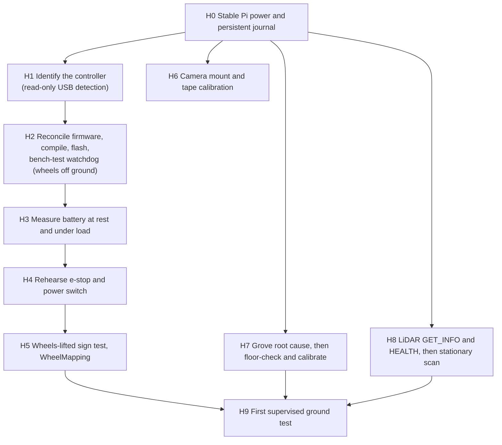

# 25 Limitations and future work

This document lists what the Team-15 stack cannot do at `d1b607a`, component by component, with a status label and a link to the evidence for each limitation. It then sets out a prioritised plan: the hardware gates in the order they must be passed, the software follow-ups found during the documentation audit, and the experiments still needed before any accuracy or safety claim can be made. Nothing here is a criticism of the work done in 48 hours. The point is to make the next step obvious and to stop anyone mistaking simulation results for hardware results.

**Status:** Reference document. At `d1b607a`: the camera pipeline is **Hardware-verified** for live capture and person detection on the bench (with known false-positive modes); camera distances are **UNCALIBRATED**; the rover navigation, supervisor and StickC bridge are **Simulation-tested** only; real wheel movement is **NOT TESTED**; the Grove ranger returned **0/50 valid twice**; a real LiDAR scan is **NOT VERIFIED**; the Qwen LoRA adapter is trained and published but **not deployed**.

**Related:** [17 Safety architecture](17_SAFETY_ARCHITECTURE.md) · [19 Testing and benchmarks](19_TESTING_AND_BENCHMARKS.md) · [22 Experiments and failures](22_EXPERIMENTS_AND_FAILURES.md) · [23 Design decisions](23_DESIGN_DECISIONS.md) · [24 Learning guide](24_LEARNING_GUIDE.md) · [Hardware readiness](rover/HARDWARE_READINESS.md) · [Bench runbook](rover/BENCH_RUNBOOK.md) · [Experiment summary](experiments/EXPERIMENT_SUMMARY.md)

---

## Contents

1. [Status labels used here](#1-status-labels-used-here)
2. [Limitations by component](#2-limitations-by-component)
3. [Future work, part 1: hardware gates, in order](#3-future-work-part-1-hardware-gates-in-order)
4. [Future work, part 2: software follow-ups from the audit](#4-future-work-part-2-software-follow-ups-from-the-audit)
5. [Future work, part 3: experiments](#5-future-work-part-3-experiments)
6. [Longer-term directions](#6-longer-term-directions)
7. [What would change the headline status](#7-what-would-change-the-headline-status)

---

## 1. Status labels used here

| Label | Meaning |
|---|---|
| **HARDWARE-VERIFIED** | Measured on the real device, with a record |
| **PARTIAL** | Some real-hardware evidence, but not enough for the claim people usually want |
| **SIMULATION-TESTED** | Passes tests against simulators or mocks only |
| **IMPLEMENTED** | Code exists; no meaningful test of the behaviour in question |
| **NOT TESTED / NOT MEASURED / UNVERIFIED** | No record exists |
| **BLOCKED** | Cannot proceed until a named prerequisite is done |
| **OPEN BUG** | A known defect in code or documentation |

Provenance labels for individual results (REAL HARDWARE, RECORDED HARDWARE, SIMULATED, MOCKED, SYNTHETIC) follow the [documentation index](README.md).

---

## 2. Limitations by component

### 2.1 Raspberry Pi, power and connectivity

| Limitation | Status | Evidence |
|---|---|---|
| The Pi dropped off Tailscale repeatedly (7 Nov, 8 Nov 06:55 ET, and during this audit). Cause UNKNOWN; the journal was not persistent | OPEN | F-PROC-1 in [22](22_EXPERIMENTS_AND_FAILURES.md); [02](02_RASPBERRY_PI_SETUP.md) §12 |
| The Pi rebooted twice on a 3 A source during the controller checks; it reported only 3000 mA available | OPEN | F-ROV-2; [ROV-02](experiments/reports/ROV-02-controller-connectivity-inspection.md) |
| Battery endurance of any robot-mounted power source | NOT MEASURED | [12](12_ROVERC_MOTOR_CONTROL.md) §12 |
| Direct (non-relayed) Pi↔Mac path at the venue | NOT TESTED | F-CAM-06 |

### 2.2 Camera perception (`perception/`)

| Limitation | Status | Evidence |
|---|---|---|
| Live capture and person detection on the Pi stream: works for one consenting person in standing, seated and lying poses | HARDWARE-VERIFIED (bench, small N) | [CAM-23](experiments/reports/CAM-23-pi-live-person-poses.md) |
| Detection recall and precision on a labelled dataset | NOT MEASURED | No labelled dataset exists ([Dataset inventory](experiments/DATASET_INVENTORY.md)) |
| Window reflections and people behind glass trigger false sightings (0.991); `--min-box-frac 0.15` removes only small ones; the ignore mask was proposed, not built | OPEN | F-CAM-03; [CAM-09](experiments/reports/CAM-09-mac-empty-scene-60s.md) |
| The 60 s empty-scene test never passed on the Mac (open office); it passed once on the Pi (0/96) | PARTIAL | [CAM-09](experiments/reports/CAM-09-mac-empty-scene-60s.md), [CAM-24](experiments/reports/CAM-24-pi-live-empty-and-object.md) |
| Scores are not calibrated (`confidence: null`) | BY DESIGN | [ADR-CAM03](23_DESIGN_DECISIONS.md#adr-cam03-confidence-null-raw-scores-labelled-as-not-a-probability) |
| `count_in_frame` counts boxes, not people (2 for one lying person) | OPEN | F-CAM-15 |
| No COCO class for drones; the drone test was inconclusive | OPEN | F-CAM-16 |
| An interrupted long run (Ctrl-C) leaves no summary; the summary is written only after the loop | OPEN BUG | F-CAM-18 |
| On `main`, `perception/live_camera.py` can save person images in any run; the consent-gated runner exists only on an unpushed local branch | OPEN | F-CAM-12; [ADR-CAM12](23_DESIGN_DECISIONS.md#adr-cam12-consent-gated-live-test-runner) |
| Distant people (box under 108 px at 720p) may not trigger | NOT TESTED | [ADR-CAM05](23_DESIGN_DECISIONS.md#adr-cam05-minimum-trigger-box-height-15-percent-of-the-frame) |
| Detection needs the Mac; the Pi cannot run it as built | BY DESIGN | [ADR-X05](23_DESIGN_DECISIONS.md#adr-x05-heavy-inference-on-the-mac-not-the-pi) |

### 2.3 Distance estimation and mapping (`camera_mapping/`)

| Limitation | Status | Evidence |
|---|---|---|
| Every camera distance is UNCALIBRATED; the tape calibration has not been done | BLOCKED (needs a measured mount and a tape session) | [MAP-09](experiments/reports/MAP-09-tape-distance-calibration.md); [05](05_DEPTH_AND_DISTANCE_ESTIMATION.md) |
| Mount height and pitch unmeasured, so `GROUND_PLANE` never ran on real data, no cell can be FREE, and corridor and route are always UNKNOWN / `NO_SUPPORTED_ROUTE` | BLOCKED | `camera_mapping/configs/imx708_robot.json`; [07](07_PATH_PLANNING.md) §8 |
| Intrinsics are nominal (datasheet + measured crop); lens distortion is unmodelled | IMPLEMENTED | [ADR-MAP01](23_DESIGN_DECISIONS.md#adr-map01-nominal-intrinsics-from-the-datasheet-and-the-measured-scalercrop) |
| Known-height ranging almost never applies to standing people on a low camera | BY DESIGN | [05](05_DEPTH_AND_DISTANCE_ESTIMATION.md) §4.6 |
| Monocular depth unvalidated; `UNVALIDATED_REL_SIGMA = 0.25` is a placeholder that would persist even after validation | IMPLEMENTED | [MAP-03](experiments/reports/MAP-03-mono-depth-recorded-frame.md) |
| `mount.lateral_offset_m` is defined in `MountGeometry` but not used by any computation | OPEN BUG | [05](05_DEPTH_AND_DISTANCE_ESTIMATION.md) §9 |
| The `camera_mapping/tracking.py` docstring promises a centre-distance fallback for small boxes; `Tracker.update` matches by IoU only | OPEN BUG (doc/code mismatch) | [24](24_LEARNING_GUIDE.md) Module 7 |
| Pending-jump samples in the tracker need not agree with each other before they replace the filter | OPEN | F-MAP-6 |
| The map is valid only while the robot is stationary; `camera_mapping/live.py` never passes `robot_moving` | BY DESIGN | [06](06_OBSTACLE_MAPPING.md) §4.5 |
| Robot width is a placeholder (0.20 m, `robot_width_measured: false`) | NOT MEASURED | [07](07_PATH_PLANNING.md) §3 |
| No CLEAR, CAUTION or BLOCKED verdict, and no alternate route, has ever come from real data | NOT TESTED | [07](07_PATH_PLANNING.md) §8 |
| The judge demo's BLOCKED and route steps cannot occur with the shipped config | OPEN | F-PROC-2; [26](26_HACKATHON_DEMO_GUIDE.md) |
| Dashboard JavaScript staleness logic is not tested in CI | OPEN | F-MAP-4 |
| Interactive Ctrl-C of the demo script is UNVERIFIED (SIGTERM verified) | UNVERIFIED | F-MAP-9 |

### 2.4 Planning (`planner/`, `camera_mapping/assess.py`)

| Limitation | Status | Evidence |
|---|---|---|
| The trail graph is SYNTHETIC; nothing is known about real terrain | SIMULATION-TESTED | [PLN-01](experiments/reports/PLN-01-trail-graph-route-tests.md) |
| Grid routes are robot-relative, recomputed per frame, and `validated_for_driving: false`; nothing executes them | BY DESIGN | [07](07_PATH_PLANNING.md) §9 |

### 2.5 Qwen, LoRA and RAG

| Limitation | Status | Evidence |
|---|---|---|
| The LoRA adapter (ckpt-0088) cannot be served by the production runtime (Ollama refuses adapters; no merge + GGUF; no HF backend in the service) | BLOCKED | [08](08_QWEN_MODEL.md) §5; [ADR-QWN07](23_DESIGN_DECISIONS.md#adr-qwn07-the-live-demo-runs-base-qwen--rag-not-the-lora-adapter) |
| Mission accuracy of the adapter **without** RAG | NOT MEASURED | [09](09_LORA_TRAINING.md) §14.5 |
| The adapter does not transfer to the LiDAR advisory task (0/60 schema-valid; 14/60 over-permissive, 9/60 with RAG) and drifts conservative on delivery | SIMULATION-TESTED (negative) | [QWN-022](experiments/reports/QWN-022-lidar-frozen-eval.md), [QWN-019](experiments/reports/QWN-019-delivery-frozen-eval.md) |
| Missed `request_stop` after a range TIMEOUT (2/230) | OPEN (mitigated by the supervisor) | F7; [QWN-017](experiments/reports/QWN-017-frozen-mission-230.md) |
| Every benchmark is SYNTHETIC or SIMULATED; no evaluation on real sensor data | NOT MEASURED | [Benchmark results](experiments/BENCHMARK_RESULTS.md) |
| Each selected checkpoint was run once; variance across seeds is unknown | NOT MEASURED | [09](09_LORA_TRAINING.md) §14 |
| A base-vs-adapter comparison under the same production runtime (Ollama + grammar) does not exist | NOT MEASURED | F4; [QWN-018](experiments/reports/QWN-018-runtime-comparison-audit.md) |
| The published score cannot be reproduced without the private corpus | BY DESIGN (licensing) | [QWN-031](experiments/reports/QWN-031-hf-publication.md) |
| The retriever comparison ran on the 34-document corpus, not the current 47 | OPEN | [10](10_RAG_PIPELINE.md) §8 |
| The SQLite threading bug is worked around in this repo; the root fix (`fix/rag-index-threading`) is unmerged in the Qwen workspace | OPEN | [ADR-QWN11](23_DESIGN_DECISIONS.md#adr-qwn11-launch-the-qwen-service-through-an-in-repo-launcher) |
| One reworded unsafe request is not caught by the guard regex | OPEN (deliberate) | [ADR-QWN10](23_DESIGN_DECISIONS.md#adr-qwn10-do-not-patch-the-guard-to-the-frozen-sets-wording) |
| The trainer's demo guard detects `perception.live_camera` but not the newer `camera_mapping.live` runner | OPEN BUG (Qwen workspace) | F21; [09](09_LORA_TRAINING.md) §15 |
| run2 skipped all 6 camera–range disagreement examples (length filter) | OPEN | F17 |
| One validation advisory is a byte-identical copy of a training row | DOCUMENTED | F20 |

### 2.6 Rover motion, safety supervisor and StickC bridge

| Limitation | Status | Evidence |
|---|---|---|
| Real wheel movement | NOT TESTED | [12](12_ROVERC_MOTOR_CONTROL.md); [hardware readiness](rover/HARDWARE_READINESS.md) |
| The StickC controller was not detected on the team Pi or the main Mac in the reported checks (2026-11-08 ~11:37 and ~12:28 UTC) | BLOCKED | [ROV-02](experiments/reports/ROV-02-controller-connectivity-inspection.md) |
| The bridge firmware (`firmware/stickc_roverc_bridge/stickc_roverc_bridge.ino`) is a draft: never compiled, flashed or run | NOT TESTED | [13](13_M5STICKC_BRIDGE.md) §5 |
| A second, separate StickC firmware and keyboard/Wi-Fi control path exists only on the unmerged PR #6 branch (roverc_usb firmware and a keyboard control script, PR #6 branch). Its README says a teammate uploaded a USB receiver image to a StickC Plus from their own Mac; its MOVE acknowledgements are register read-backs that "do not prove wheel rotation"; powered direction and stop behaviour is a pending gate | UNVERIFIED (not on `main`) | PR #6; [ADR-ROV01](23_DESIGN_DECISIONS.md#adr-rov01-usb-serial-stickc-bridge-with-a-firmware-watchdog) |
| Wheel signs and register-to-wheel mapping unmeasured, so `body_to_motor_speeds` refuses | BLOCKED | [ADR-ROV05](23_DESIGN_DECISIONS.md#adr-rov05-port-the-vendor-mixer-and-require-three-measured-signs) |
| No battery telemetry; `min_voltage_v` unset, so physical motion is refused | BLOCKED | [12](12_ROVERC_MOTOR_CONTROL.md) §12 |
| No heading source (StickC IMU never read), so scanning by rotation is refused; no encoders, so no odometry; pose is UNKNOWN on the Pi | BLOCKED | [ADR-ROV06](23_DESIGN_DECISIONS.md#adr-rov06-scan-by-rotating-the-chassis-on-its-wheels-closed-loop-heading-only), [ADR-ROV07](23_DESIGN_DECISIONS.md#adr-rov07-only-simulator-ground-truth-pose-authorises-autonomous-motion) |
| Speed in m/s per register unit, deceleration and stopping distance | NOT MEASURED | [14](14_GROVE_ULTRASONIC.md) §4.5 |
| Stop latency on link loss (`stop_on_link_loss_ms`) | NOT MEASURED | [13](13_M5STICKC_BRIDGE.md) §4.2 |
| The e-stop and power-switch rehearsal | NOT DONE | [17](17_SAFETY_ARCHITECTURE.md) §3 |
| `POST /rover/estop` exists in `rover/status_api.py` `rover_router`, but the router is not mounted in `dashboard/app.py` | OPEN | [17](17_SAFETY_ARCHITECTURE.md) §4 |
| One or two missed pings latch `SENSOR_STALE` (0.1 s ping vs 0.20 s freshness) | OPEN (design risk, untested on hardware) | F-ROV-10 |
| The motor-path allow-list test is a substring scan; it fires on prose and can be evaded by dynamic imports | BY DESIGN | [ADR-X02](23_DESIGN_DECISIONS.md#adr-x02-ai-is-advisory-only-and-has-no-motor-authority) |
| Every motion-safety mechanism is simulation- or mock-tested only | SIMULATION-TESTED | [17](17_SAFETY_ARCHITECTURE.md) §4; [SIM-01](experiments/reports/SIM-01-rover-scenario-suite.md) |

### 2.7 Grove ultrasonic (`ranging/`)

| Limitation | Status | Evidence |
|---|---|---|
| Two real diagnostic runs, 0/50 valid each, 50/50 NO_ECHO, 0 edges, `NO_RESPONSE_EVER`; root cause UNKNOWN | OPEN | [RNG-HW-01](experiments/reports/RNG-HW-01-grove-real-hardware-diagnose.md) |
| No real distance has ever been measured; `floor-check` and `calibrate` never ran on hardware | NOT TESTED | [14](14_GROVE_ULTRASONIC.md) §14.2 |
| The gate reachable through `python3 -m ranging diagnose` does not check `series_resistor_ohm`, header-pin protrusion or a stricter SIG idle | OPEN | F-SENS-05 |
| `ranging/rover_io.py` `snapshot_to_rover_fields` substitutes the current time when `mono_ns` is missing, so a reading can look fresh | OPEN BUG | F-ROV-9; [contracts/ROVER_NAV_CONTRACT.md](../contracts/ROVER_NAV_CONTRACT.md) §2 |
| Fixed speed of sound (343 m/s); no temperature compensation | BY DESIGN | [14](14_GROVE_ULTRASONIC.md) §4.2 |
| Thresholds (0.28 m blocked, 0.68 m caution) are derived from placeholder speed and deceleration | NOT MEASURED | [14](14_GROVE_ULTRASONIC.md) §4.5 |
| `ranging/README.md` gate summary says SIG idle ≤ 3.4 V; the code requires ≤ 1.2 V | OPEN (stale doc) | F-SENS-04, F-SENS-11 |

### 2.8 RPLIDAR C1 (`lidar/`)

| Limitation | Status | Evidence |
|---|---|---|
| A real scan, or even a GET_INFO/HEALTH reply | NOT VERIFIED | [LDR-HW-01](experiments/reports/LDR-HW-01-lidar-usb-enumeration-and-gate.md) |
| Whether the C1M1-R2 accepts the legacy SCAN command | UNVERIFIED | [ADR-SEN06](23_DESIGN_DECISIONS.md#adr-sen06-own-rplidar-codec-on-pyserial) |
| `LidarConfig.validate` requires `expected_model_id` before connecting, but the checklist says to read it via GET_INFO in the first approved session; no GET_INFO-only command exists (`scan-once` always proceeds to SCAN) | OPEN BUG (chicken-and-egg) | F-SENS-10; `lidar/config.py` |
| The gate accepts a supply up to 5.25 V; the C1 datasheet maximum is 5.2 V | OPEN BUG | `lidar/config.py`; [15](15_RPLIDAR_C1.md) §13 |
| Footprint, occlusion and orientation fiducial unmeasured, so the corridor is UNKNOWN on hardware | BLOCKED | [ADR-SEN07](23_DESIGN_DECISIONS.md#adr-sen07-robot-width-footprint-corridor-and-orientation-fiducial-for-the-lidar) |
| The USB adapter disappeared after two reboots and dropped for 4 s once | OPEN | F-SENS-08 |
| LiDAR data never authorises motion; migration Stage D needs a reviewed rover change | BY DESIGN | [ADR-SEN08](23_DESIGN_DECISIONS.md#adr-sen08-lidar-data-never-authorises-motion-grove-stays-the-default) |

### 2.9 Dashboard

| Limitation | Status | Evidence |
|---|---|---|
| Location is the operator-assigned sector; there is no map of real positions | BY DESIGN | [ADR-CAM06](23_DESIGN_DECISIONS.md#adr-cam06-location-is-the-operator-assigned-sector-only) |
| The range card reads DISCONNECTED unless a range service is configured; no real range data has been displayed | NOT TESTED | [16](16_DASHBOARD.md) §6 |
| No rover e-stop endpoint is exposed (router not mounted) | OPEN | §2.6 |

### 2.10 Testing, CI and repository

| Limitation | Status | Evidence |
|---|---|---|
| `team15_starter/tests` (5 tests) and the link script are in no workflow; `test_link.py` collects 0 under pytest | OPEN | F-CI-5; [19](19_TESTING_AND_BENCHMARKS.md) §3 |
| 8 tests skip in CI (private fixtures, cached weights, recorded Pi frames); the recorded-frame regression has never run in CI | OPEN | F-CI-6 |
| Every PR commit runs each workflow twice (push and pull request), with no concurrency groups | OPEN (cost) | F-CI-4 |
| Drone-fleet CSVs are not reproducible at the final commit; run parameters were not recorded | OPEN | F-ROV-7, F-ROV-8; [SIM-02](experiments/reports/SIM-02-drone-fleet-eval.md) |
| PR #6 is open and unmergeable (conflicts, tracked screenshots, committed evidence, no CI) | OPEN | [ADR-PRC04](23_DESIGN_DECISIONS.md#adr-prc04-leave-pr-6-open-at-the-deadline) |
| The local branch `test/camera-live-countdown` (consent-gated runner and live test reports) is not pushed | OPEN | [ADR-CAM12](23_DESIGN_DECISIONS.md#adr-cam12-consent-gated-live-test-runner) |

---

## 3. Future work, part 1: hardware gates, in order

The order matters: each gate depends on the ones before it. Every step needs the project owner's explicit approval, a named operator, and the procedures in the [bench runbook](rover/BENCH_RUNBOOK.md), [hardware readiness](rover/HARDWARE_READINESS.md), [ranging/WIRING.md](../ranging/WIRING.md) and [LiDAR checklist](lidar/LIDAR_C1_HARDWARE_CHECKLIST.md). **Wheels stay off the ground** until gate H5 passes. Never bypass a gate by editing a config by hand: fill it from measurements and record who measured what.

| # | Gate | What to do | Done when | Unblocks |
|---|---|---|---|---|
| H0 | **Stable power and logs** | Power the Pi from a verified 5 V / 5 A supply, never from a hub or power bank. Enable a persistent journal (`Storage=persistent`). Record `get_throttled` and `usb_max_current_enable` | 1 hour without reboot or Tailscale loss under the camera stream; journal survives a reboot | every later gate (F-PROC-1, F-ROV-2) |
| H1 | **Identify the controller** | With a known data cable plugged directly into the Pi, run the read-only detection commands in [docs/rover/BRIDGE_PROTOCOL.md](rover/BRIDGE_PROTOCOL.md). Record `lsusb`, the `/dev/serial/by-id/` path, the controller model (StickC or StickC Plus) and a photo | A stable by-id path for the controller, recorded with a photo | H2 (F-ROV-1) |
| H2 | **One reviewed firmware with a watchdog, flashed and bench-tested** | First reconcile the two firmware efforts (§4, item S1). Compile with a pinned toolchain, flash, and with the **wheels off the ground** measure: zero on boot, ARM refusal without an operator, the 250 ms watchdog after a cable pull (`stop_on_link_loss_ms`), the button-A local e-stop, refusal of a foreign session | Every check in the bench runbook's watchdog section recorded with times | H3–H5 |
| H3 | **Measure the battery** | Meter the RoverC battery at rest and with the wheels spinning (lifted). Decide a cut-off; determine whether the StickC PMIC reading reflects the RoverC battery | `min_voltage_v` and `power_verified_by` can be filled from measurements | physical motion (supervisor) |
| H4 | **Rehearse the e-stop** | Practise reaching the RoverC power switch within 1 s, lifting the robot, and the three-step software recovery (e-stop reset, latch reset, re-approval) | A recorded rehearsal | H5 |
| H5 | **Wheel signs** | Wheels lifted: forward, strafe-left and CCW at low speed; record what each wheel does. If the result is a register permutation, change the code rather than the signs ([ADR-ROV05](23_DESIGN_DECISIONS.md#adr-rov05-port-the-vendor-mixer-and-require-three-measured-signs)) | A complete `WheelMapping` with evidence; `HardwareVerification.missing()` empty | H9 |
| H6 | **Camera mount and tape calibration** | Measure mount height and pitch (`calibrate set-mount`), measure robot width, then follow [camera_mapping/CALIBRATION.md](camera_mapping/CALIBRATION.md): at least 4 distances, separate fit and evaluation samples | `calibrate report` passes the `GATE` (median ≤ 10 %, P90 ≤ 20 %, failures ≤ 20 %), or fails honestly | real FREE cells, CLEAR/BLOCKED, routes; the judge demo |
| H7 | **Grove root cause** | Pi off: continuity from the sensor's SIG pin **at its connector** to header pin 29 (expect about 1 kΩ). Pi on: VCC at the sensor connector (3.20–3.45 V). Photograph the header. Re-take VCC and idle-SIG readings in the boot state. Only then run `diagnose`, then `floor-check` and `calibrate` | At least one VALID reading against a tape-measured target, or a named root cause | a working forward range sensor |
| H8 | **LiDAR first contact** | Complete the physical checklist (label photo, adapter identity, supply at the connector, start current, strain relief, cut-off, two-person sign-off). Then send only GET_INFO and GET_HEALTH (after S6 below adds a command for it). Then a stationary scan per [docs/lidar/LIDAR_C1_STATIONARY_SCAN_PROCEDURE.md](lidar/LIDAR_C1_STATIONARY_SCAN_PROCEDURE.md) | A recorded GET_INFO model byte and health, then a stationary scan compared with tape | LiDAR migration Stage C |
| H9 | **First supervised ground test** | Only after H1–H5 and at least one working range sensor (H7 or H8): short single-axis pulses at the lowest speed, a target placed in front, the operator at the power switch | The robot stops on the range verdict, with a log | any claim of real motion |

---

## 4. Future work, part 2: software follow-ups from the audit

Ordered by safety impact, then by effort. Each is small and reviewable.

| # | Item | Why | Where | Effort |
|---|---|---|---|---|
| S1 | **Reconcile the two StickC firmware efforts** into one reviewed firmware with a link-loss watchdog: the PR #15 draft watchdog bridge on `main` and the roverc_usb receiver on the unmerged PR #6 branch | Two firmwares, one never flashed and one flashed without a reviewed watchdog, are a safety hazard and a confusion risk | `firmware/stickc_roverc_bridge/stickc_roverc_bridge.ino`; the roverc_usb firmware (PR #6 branch) | M |
| S2 | **Mount the rover router's e-stop in the dashboard** (with authentication considered), or remove the claim that a remote e-stop exists | `POST /rover/estop` exists only in an unmounted router | `rover/status_api.py` `rover_router`; `dashboard/app.py` `create_app` | S |
| S3 | **Never synthesise a timestamp on the safety path**: when `mono_ns` is missing on the same host, mark the reading stale instead of using `t = now` | A reading without a capture time currently looks fresh to the rover | `ranging/rover_io.py` `snapshot_to_rover_fields` | S |
| S4 | **Unify the Grove gates**: make `check_electrical` check `series_resistor_ohm`, pin protrusion and the stricter SIG-idle limit, or have the driver enforce the stricter gate | The less strict gate was the one used for the real runs | `ranging/config.py` `check_electrical` | S |
| S5 | **Tighten the LiDAR supply bound** from 5.25 V to the datasheet's 5.2 V (or document why not) | The gate is looser than the datasheet | `lidar/config.py` `HardwareChecklist` | S |
| S6 | **Resolve the `expected_model_id` chicken-and-egg**: allow a GET_INFO/HEALTH-only session that records the model byte without scanning | The config cannot be completed by the documented procedure | `lidar/config.py` `LidarConfig`; `lidar/cli.py` | M |
| S7 | **Fix the tracker docstring mismatch**: either implement a bounded centre-distance fallback for small boxes, with tests, or correct the docstring | Documentation promises behaviour the code lacks | `camera_mapping/tracking.py` `Tracker` | S |
| S8 | **Use or remove `lateral_offset_m`** | A config field that changes nothing invites false confidence | `camera_mapping/config.py` `MountGeometry`; `camera_mapping/distance.py` | S |
| S9 | **Add CI for `team15_starter/tests`** and convert `test_link.py` to pytest | An untested suite rots | `.github/workflows/`; `team15_starter/tests/` | S |
| S10 | **Merge the RAG threading fix at its source** (`fix/rag-index-threading` in the Qwen workspace), then retire or simplify the launcher | The workaround depends on the SQLite build mode | `$QWEN_WORKSPACE`; `camera_mapping/qwen_launcher.py` | S |
| S11 | **Push the `test/camera-live-countdown` branch and open a PR, or archive it with a note** | It holds the consent-gated runner and live test reports cited by the camera docs | local branch | S |
| S12 | **Extend the trainer's demo guard** to detect `camera_mapping.live` as well as `perception.live_camera` | Training could start during a live demo | `$QWEN_WORKSPACE/lora/train_v02.py` `demo_running` | S |
| S13 | **Choose a LoRA serving path**: merge the adapter into the base and convert to GGUF for Ollama, or add an HF/PEFT backend to `rescue_qwen.service`. Then re-run the camera advisory evaluation before any deployment | Without it the adapter can never be compared live | Qwen workspace; [08](08_QWEN_MODEL.md) §5 | M |
| S14 | **Write the run summary in a `finally` block** so interrupted runs leave one | Long runs lost their summary | `perception/live_camera.py` `run` | S |
| S15 | **Enforce consent mode in code on `main`** (from S11), so no-people runs can never store images | Convention failed once (F-CAM-12) | `perception/` | M |
| S16 | ✅ **Done in the documentation PR.** **Fix stale docs**: `ranging/README.md` SIG-idle limit (≤ 1.2 V, not ≤ 3.4 V); `ranging/WIRING.md` release time now measured (65–96 µs) | Readers act on the docs | `ranging/README.md`, `ranging/WIRING.md` | S |
| S17 | **CI hygiene**: trigger on `pull_request` plus `push` to `main`, or add `concurrency:` groups | Halves CI compute | `.github/workflows/*.yml` | S |
| S18 | **Public SIMULATED stand-ins** for the private fixtures so the 8 skipped tests run in CI (never commit real frames) | CI should cover the same tests as local | `dashboard/tests/`, `camera_mapping/tests/` | M |
| S19 | **Record argv and commit SHA in every result file** of the drone-fleet scripts, and include run parameters in filenames | Results were overwritten and are not reproducible | `team15_starter/` | S |
| S20 | **Tracker pending-jump consistency**: require pending samples to agree with each other before they replace the filter | A noisy sequence can reset the filter | `camera_mapping/tracking.py` `_accept_estimate` | S |

Effort: S = under half a day, M = one to two days.

---

## 5. Future work, part 3: experiments

None of the following has been run. Each needs a pre-registered protocol (what is measured, how, what counts as a pass) written **before** the data is collected, as the Qwen evaluations did.

| # | Experiment | Purpose | Design sketch | Prerequisites |
|---|---|---|---|---|
| E1 | **Labelled person-detection dataset** | Measure recall and precision instead of per-run frame counts | Consenting participants only; poses relevant to rescue (standing, seated, lying, partly occluded), distances 1–6 m, lighting conditions, empty scenes in front of glass. Store privately with consent records; annotate boxes; report recall/precision with Wilson intervals by pose and distance | Consent procedure (S15); storage outside Git |
| E2 | **Distance error study** | First real accuracy numbers for ground-plane, known-height and mono depth | After H6: tape-measured targets at ≥ 4 distances, separate fit and evaluation sets, per-method median and P90 relative error, failure rate; compare with the σ priors | H6 |
| E3 | **No-RAG LoRA evaluation** | Separate what the adapter learned from what retrieval supplies | ckpt-0088 vs base on the frozen v0.2 mission set without RAG, same HF runtime, greedy, same `max_tokens`; report with Wilson intervals | Qwen workspace access |
| E4 | **Variance across seeds** | Know whether 218/230 is stable | Retrain run2 with 3–5 seeds; same selection rule; report mean and spread on validation and one frozen run each | Mac time (about 80 minutes per run) |
| E5 | **Same-runtime comparison** | Remove the grammar confound | Base and adapter both under the production runtime once S13 exists (Ollama + grammar, or HF + grammar) | S13 |
| E6 | **Real-sensor Qwen evaluation** | Test advisories on real evidence packets, not synthetic ones | Build a small frozen set from recorded camera states (no images, only JSON summaries) and, later, real range and LiDAR snapshots; score with the same guard and metrics | H6, H7 or H8 |
| E7 | **Grove characterisation** | Real range accuracy, beam width, floor echoes, no-target signature | `floor-check` and `calibrate` per [ranging/HARDWARE_VALIDATION.md](../ranging/HARDWARE_VALIDATION.md) | H7 |
| E8 | **LiDAR stationary accuracy and orientation** | Validate sector minima, the footprint corridor and the fiducial | Stationary scans against tape, then the orientation check with the body fiducial | H8 |
| E9 | **Stop-latency measurement** | Replace the design estimate with a number | Wheels lifted; measure time from cable pull (and from e-stop) to zero wheel speed, repeated | H2 |
| E10 | **Empty-scene false-positive rate at scale** | Tighten the 3.1 % per-frame upper bound from 96 frames | Long empty-room runs (thousands of frames) in several rooms, including glass | Controlled room |
| E11 | **Retriever comparison on the current corpus** | Check that FTS5 still wins at 47 documents | Re-run the QWN-002 protocol with a larger, independently labelled query set | Qwen workspace |

---

## 6. Longer-term directions

These are directions, not plans. Each depends on the gates above.

- **Odometry and pose.** Wheel encoders or a calibrated IMU heading would allow the map to move with the robot and would let `OPERATOR_CONFIRMED` poses be replaced by measured ones. Until then autonomy stays at "operator-assisted waypoints".
- **Sensor fusion beyond Level A.** Camera–LiDAR association needs an extrinsic calibration; today `association` is always `NOT_ESTABLISHED`.
- **Detection on the robot.** If the network remains unreliable, a smaller detector on the Pi (or the fitted Hailo-8) would make person detection independent of the Mac. That needs its own latency and accuracy study.
- **Score calibration.** With E1's dataset, temperature scaling or isotonic regression could turn detector scores into calibrated probabilities.
- **Per-task adapters with regression gates.** The LiDAR pilot showed forgetting when tasks are mixed; separate adapters, each gated per task family, are the safer path.
- **Integrating the drone simulation.** The sighting format kept drone and sector fields; a deliberate hand-off design would be needed before the two halves can share results.

---

## 7. What would change the headline status

| Headline today | What would change it |
|---|---|
| Real wheel movement NOT TESTED | H1–H5 recorded, then H9 |
| Camera distances UNCALIBRATED | H6 passed and E2 reported |
| Grove 0/50 valid | H7 root cause found and a VALID reading against tape |
| LiDAR scan NOT VERIFIED | H8 GET_INFO/HEALTH recorded and a stationary scan |
| LoRA not deployed | S13 plus E3/E5 and a passed safety promotion gate |
| Motion safety simulation-tested only | H2, H4 and E9 measured on hardware |
