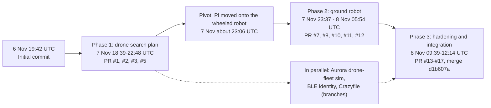

# 27 · Project timeline

This is the history of the Team-15 repository from its initial commit on 6 November 2026 to the final hackathon merge `d1b607a` on 8 November. It is reconstructed only from Git commit dates, GitHub pull-request and issue timestamps, GitHub Actions runs, and the engineering session console log. The log is cited by time, and covers events that left no Git trace, such as the Pi moving onto the robot. No meetings or decisions are invented. Times are given in **UTC** and in **local time (−0500, US Eastern)**.

**Status:** Complete for `main` and the pushed branches. Unpushed local work is out of scope except where noted.

**Related:** [00 Overview](00_PROJECT_OVERVIEW.md) · [28 Contributors](28_CONTRIBUTORS.md) · [19 Testing (CI history)](19_TESTING_AND_BENCHMARKS.md#5-ci-history) · [22 Experiments and failures](22_EXPERIMENTS_AND_FAILURES.md) · [23 Design decisions](23_DESIGN_DECISIONS.md)

---

## 1. How to read commit times

Git records each commit's *author date* in the author's own time zone. Most commits here are −0500. Some teammates' commits are +0000; for example, `eddef53` is stamped 09:36 +0000. Every time below is converted to UTC. An author date is when the commit was **created**, which may be earlier than when it was pushed or merged. PR timestamps (`createdAt`, `mergedAt`) come from GitHub and are exact.

Sources:

```bash
git log --all --format='%h %ad %an %s' --date=iso
gh pr list --state all --json number,title,author,createdAt,mergedAt,state,headRefName
gh issue list --state all --json number,title,createdAt,closedAt
gh run list --limit 200 --json createdAt,workflowName,conclusion,headBranch
```

## 2. The arc in three phases



### Phase 1: drone search plan (7 Nov, afternoon local)

The build guide `TEAM15_DRONE_SEARCH_BUILD.md` (PR #1) was converted from a PDF dated 2026-11-07. It committed the team to "three SIMULATED scouts plus a live laptop camera detector, an explicit synthetic trail graph with Dijkstra routing, a timestamped observation/track store, and Qwen as a validated, optional tool-caller". Real aircraft were a staff-flown upgrade path. The first three code PRs implement that plan:

- **#2** planner A→G = 60 m;
- **#3** a bench person detector on the MacBook camera, later extended with a Raspberry Pi 5 camera source;
- **#5** the base-station dashboard with operator review and routing.

This is why sightings still carry `drone_id`, `D1` and sector letters: they are inherited from the drone plan.

### The pivot to a ground robot (7 Nov, early evening local)

The session console log records three things:

- **2026-11-07 23:06 UTC (18:06 local):** the operator reported moving the Raspberry Pi onto the wheeled robot and asked for its connectivity to be re-checked.
- **23:26 UTC:** separate workstreams were opened for the Grove ultrasonic sensor, RoverC-Pro navigation, and ground-rescue Qwen + LoRA work.
- **8 Nov 00:24 UTC:** a "ground rescue robot" integration brief stated that the hardware had changed. It covered RoverC-Pro motion, Grove ranging, servo supply delivery, the Pi camera, Qwen and the dashboard.

Git shows the same turn. The first `ranging/` commit is at 23:37 UTC (`ff635ad`). The first `rover/` commit is at 23:45 UTC (`241faec`). Camera orientation was verified "on the wheeled-robot mount" at 23:43 UTC (`d847270`). Every code PR from #7 onwards targets the M5Stack RoverC-Pro. The servo/gripper delivery work stayed in the private robotics workspace and never reached `main`.

### Phase 2: ground-robot subsystems (7 Nov evening to 8 Nov early morning, local)

The Grove range service (#7) and rover navigation (#8) were developed as a stacked pair. #8 consumes #7's `team15.rover_range_fields/1`. PRs #2, #3, #7, #5 and #8 merged in that order between 01:47 and 02:02 UTC. The session console log at 02:04 UTC records "the merge sequence is COMPLETE". The RPLIDAR C1 driver (#11) and the Qwen LiDAR advisory contract (#12) followed overnight, still as drafts.

### Phase 3: hardening and integration (8 Nov morning, local)

- Fail-closed forward motion (#14, closing Issue #9) and the USB StickC bridge (#15, stacked on #14).
- Qwen model docs and the public Hugging Face adapter (#13).
- Camera-only obstacle mapping with panels A–D and the one-command judge demo (#16).

The real Grove diagnostic runs (about 10:43 and 10:50 UTC, 0/50 valid each) and the live camera-mapping runs (about 11:08–12:16 UTC) happened in this window. Between 12:10 and 12:12 UTC, PRs #13, #12, #11, #14, #15 and #16 merged. Teammates' Aurora drone-fleet simulation (#17) merged at 12:14 UTC as `d1b607a`.

## 3. Pull requests

| PR | State | Author | Branch | Created (UTC / local) | Merged (UTC / local) | Size | Title |
|---|---|---|---|---|---|---|---|
| #1 | merged | machackgo | `docs/drone-search-plan` | 11-07 18:39 / 13:39 | 11-07 18:41 / 13:41 | +564/−0 | Add Team 15 drone search build guide |
| #2 | merged | machackgo | `t1/route-a-to-g` | 11-07 18:50 / 13:50 | 11-08 01:47 / 11-07 20:47 | +372/−0 | T1 planner: Dijkstra route A→G = 60 m |
| #3 | merged | machackgo | `t1/camera-person` | 11-07 18:50 / 13:50 | 11-08 01:47 / 11-07 20:47 | +2128/−0 | T1 perception: live bench camera person detector |
| #5 | merged | machackgo | `t2/dashboard-a-to-g` | 11-07 19:00 / 14:00 | 11-08 01:54 / 11-07 20:54 | +2776/−2 | T2 dashboard: live Pi 5 / MacBook camera sightings → map, operator review, route A→G (issue #4) |
| #6 | **open** | ithlambelle | `culubo/sensor-id-specs` | 11-07 21:17 / 16:17 | — | +79891/−0 | Culubo/sensor id specs |
| #7 | merged | machackgo | `feature/grove-distance` | 11-07 23:37 / 18:37 | 11-08 01:48 / 11-07 20:48 | +3232/−0 | Grove ultrasonic forward-range service + obstacle gate |
| #8 | merged | machackgo | `feature/rover-navigation` | 11-07 23:46 / 18:46 | 11-08 02:02 / 11-07 21:02 | +4099/−1 | RoverC-Pro navigation in simulation |
| #10 | merged | machackgo | `ci/perception-workflow-name` | 11-08 02:07 / 11-07 21:07 | 11-08 02:10 / 11-07 21:10 | +1/−1 | rename perception workflow display name |
| #11 | merged | machackgo | `feature/rplidar-c1-ground-robot` | 11-08 03:53 / 11-07 22:53 | 11-08 12:11 / 07:11 | +5548/−0 | RPLIDAR C1 driver, 360° processing, fail-closed adapters |
| #12 | merged | machackgo | `qwen/advisory-integration` | 11-08 05:55 / 00:55 | 11-08 12:11 / 07:11 | +1302/−0 | Qwen advisory integration (draft) |
| #13 | merged | machackgo | `qwen/model-docs` | 11-08 09:40 / 04:40 | 11-08 12:10 / 07:10 | +169/−0 | Qwen model README, MODEL.md, HF adapter link |
| #14 | merged | machackgo | `feature/issue-9-fail-closed-forward` | 11-08 10:28 / 05:28 | 11-08 12:11 / 07:11 | +487/−21 | fail-closed forward motion + controller-link health (Issue #9) |
| #15 | merged | machackgo | `feature/stickc-usb-bridge` | 11-08 10:32 / 05:32 | 11-08 12:11 / 07:11 | +1316/−0 | USB-serial StickC bridge with firmware watchdog (draft, mocked) |
| #16 | merged | machackgo | `feature/camera-mapping` | 11-08 11:31 / 06:31 | 11-08 12:11 / 07:11 | +4182/−3 | Camera-only obstacle mapping + rescue intelligence |
| #17 | merged | GavinPrescott | `GavinPrescott-sim-roles` | 11-08 11:59 / 06:59 | 11-08 12:14 / 07:14 | +7976/−1 | Gavin prescott sim roles (Aurora fleet sim) |

There is no PR #4 or #9; those numbers are issues.

| Issue | Title | Opened (UTC) | Closed (UTC) |
|---|---|---|---|
| #4 | T2 integration: show the bench camera sighting and its walking route on the dashboard | 11-07 18:50 | 11-08 02:16 |
| #9 | Rover: fail-closed forward-motion policy (require explicit, fresh, validated `forward_motion_allowed=True`) | 11-08 02:00 | 11-08 12:11 (by PR #14) |

No PR received a formal GitHub review (`reviews` is empty on all 15). The "independent review" sections in the PR descriptions of #8, #14, #15 and #16 refer to review sessions recorded in the PR text, not GitHub review objects. Every merge was performed by `machackgo`.

## 4. Detailed chronology (`main`, plus key branch events)

UTC first. Local (−0500) is in parentheses where it helps. "S" marks a session-console-log event; all others are Git, GitHub or Actions.

| UTC | Local | Event | Ref |
|---|---|---|---|
| 11-06 19:42 | 11-06 14:42 | Initial commit (LICENSE) | `dbe4342`, dennisnahas |
| 11-07 18:39–18:41 | 13:39–13:41 | Build guide added and merged | PR #1, `7b5933c`, `45e2659` |
| 11-07 18:46 | 13:46 | Planner A→G 60 m; first camera detector | `77a3979`, `c324983` |
| 11-07 18:50 | 13:50 | PRs #2 and #3 opened; Issue #4 opened | |
| 11-07 18:56 | 13:56 | Pretrained person detector, detector families, one-sighting gate | `44b7031` |
| 11-07 18:59 | 13:59 | Dashboard bench sighting at G, route v1 A→G; **first CI run fails** (OpenCV 5, no HOGDescriptor) | `3797530`, run 42403983799 |
| 11-07 19:00 | 14:00 | Requirements pinned; CI green; PR #5 opened | `a36a658` |
| 11-07 ~19:10–19:45 | ~14:10–14:45 | Bench person trials on the MacBook camera (standing, seated, empty scene) | PR #3 results |
| 11-07 19:43–20:39 | 14:43–15:39 | Aurora drone-fleet search and SAREnv benchmark commits (later merged via #17) | `6b832fd`, `7ed29a5`, `4018ff9`, hafsaah1 |
| 11-07 19:45 | 14:45 | Start delay, min box-height filter, sighting format doc; `__pycache__` cleanup | `65684e3`, `9efbed7` |
| 11-07 20:10 | 15:10 | Live sightings via `POST /observations`, operator review | `757eeac` |
| 11-07 19:02–23:39 | 14:02–18:39 | BLE identity spec and C0–C5 checkpoints on `culubo/sensor-id-specs` (PR #6 opened 21:17) | ithlambelle, culubo |
| 11-07 22:02 | 17:02 | Aurora Jetson homebase + ESP32 firmware + 3-drone planner | `ea5016f` |
| 11-07 22:08 | 17:08 | `GavinPrescott-sarsim` branch: "Add files via upload" | `801dc9e` |
| 11-07 22:18–22:27 | 17:18–17:27 | Pi camera contract, Pi 5 camera source (`--source pi`), dashboard provenance | `4a50f32`, `4d3093d`, `69b8a5f`, `901c7e2` |
| 11-07 22:48 | 17:48 | Detector warm-up (live 0.68 → 4.36 fps) | `ae8b088` |
| **11-07 ~23:06** | **~18:06** | **S: Pi moved onto the wheeled robot; connectivity re-check requested** | session console log |
| 11-07 23:26 | 18:26 | S: Grove, rover-navigation and ground-Qwen workstreams briefed | session console log |
| 11-07 23:37 | 18:37 | Grove ranging service; PR #7 opened | `ff635ad` |
| 11-07 23:43 | 18:43 | Camera orientation verified on the robot mount (rotation 180) | `d847270` |
| 11-07 23:45–23:58 | 18:45–18:58 | Rover navigation in simulation; PR #8 opened; it adopts PR #7's `rover_io` fields | `241faec`, `6d3cf93`, `09333d3` |
| 11-08 00:00 | 11-07 19:00 | PR #8 integration review recorded on #7 as ACCEPTED | `662664a` |
| 11-08 00:24 | 19:24 | S: ground-rescue integration brief ("hardware has changed") | session console log |
| 11-08 ~00:50 | ~19:50 | Robotics-workspace sim suite run on the Pi: 30 × 90 = 2,700 passed (not in this repo) | `$ROBOT_WORKSPACE/TEST_REPORT.md` |
| 11-08 01:04–01:21 | 20:04–20:21 | SIG-idle pull-down gate from the Seeed schematic; rover contract test | `ee56359`, `a980eed`, `dac82f4` |
| 11-08 01:27–01:38 | 20:27–20:38 | SIMULATED range card; fixtures always SIMULATED; perception CI added and renamed to `perception.yml` | `853c241`, `7624788`, `cee428e`, `8f351fe` |
| 11-08 01:45 | 20:45 | Aurora live satellite dashboard and mission setup | `e47c1bf`, `8b5691b` |
| 11-08 01:47–02:02 | 20:47–21:02 | **Merge sequence #2 → #3 → #7 → #5 → #8** | `bbccb31`, `baa1804`, `691addb`, `790e3ae`, `f55833a` |
| 11-08 02:00 | 21:00 | Issue #9 opened (fail-closed forward motion) | |
| 11-08 02:04 | 21:04 | S: "merge sequence is COMPLETE and the merge lock is lifted" | session console log |
| 11-08 02:07–02:10 | 21:07–21:10 | PR #10 (workflow display name) opened and merged | `edb6756`, `06a69b9` |
| 11-08 02:16 | 21:16 | Issue #4 closed | |
| 11-08 ~02:45 | ~21:45 | S: hardware teammate mounting the Pi on the RoverC-Pro; Pi expected offline | session console log |
| 11-08 03:53–04:12 | 22:53–23:12 | RPLIDAR C1 driver, merge audit, footprint corridor; PR #11 opened | `9041c05` … `7e61595` |
| 11-08 05:54–05:55 | 00:54–00:55 | Qwen LiDAR advisory contract; PR #12 opened | `f36a0ea` |
| 11-08 06:28–06:40 | 01:28–01:40 | Crazyflie Bluetooth link; Jetson-relative tracking on `aurora-integration` | `059d0a0`, `8044d50` |
| 11-08 08:24–08:30 | 03:24–03:30 | `fly_to_phone` drone demo on `culubo/sensor-id-specs` | `220bf64`, `e55734a` |
| 11-08 09:36 | 04:36 | Aurora drone roles (sweeper/thermal/finder) | `eddef53`, `GavinPrescott` |
| 11-08 09:39–09:55 | 04:39–04:55 | Qwen README and MODEL.md; HF adapter made public (rev `21013d4`); PR #13 opened | `eb4b38f`, `ae88d55` |
| 11-08 10:27–10:45 | 05:27–05:45 | Fail-closed forward motion, dead-link `tick()` fix, StickC bridge, review fixes; PRs #14 and #15 opened | `1b942e3`, `14fde0d`, `530de47`, `7efa570`, `dbc17b3` |
| 11-08 ~10:43, ~10:50 | ~05:43, ~05:50 | S: **Grove real-hardware diagnose, two runs: 0/50 VALID each, NO_RESPONSE_EVER** | session console log; [14](14_GROVE_ULTRASONIC.md) |
| 11-08 11:08–11:30 | 06:08–06:30 | Camera facts probed on the Pi; live latency run (117 frames, 4.68 fps) | [EVALUATION §2–3](camera_mapping/EVALUATION.md) |
| 11-08 11:31 | 06:31 | Camera mapping; PR #16 opened | `f482f21` |
| 11-08 11:41–11:55 | 06:41–06:55 | Demo-script runs (RECORDED, then LIVE-HW 266 frames at 11:51–11:53); double-producer bug found; Pi drops off Tailscale at 11:55 | `$TEAM15_EVIDENCE/camera_mapping/20261108-0641…0655`; EVALUATION §3b |
| 11-08 11:51–12:09 | 06:51–07:09 | Review fixes, judge demo, single-producer lock, Ctrl-C exit, allow-list wording | `c7ed6c5`, `73539a7`, `1f5c8db` |
| 11-08 11:59 | 06:59 | PR #17 opened; **CI fails** on the no-photos test (Leaflet icons) | run 42478121738 |
| 11-08 12:10–12:12 | 07:10–07:12 | **Merges:** #13, #12, #11, #14, #15, #16 | `0a55e3c`, `205dbc4`, `4ed7722`, `5760eaf`, `89a0e81`, `0c9acc3` |
| 11-08 12:11 | 07:11 | Issue #9 closed by PR #14 | |
| 11-08 12:13 | 07:13 | PR #17 fix: icon allow-list, untrack the 10 MB GIF | `95b6f67`, `159c678` |
| 11-08 12:14 | 07:14 | **Merge PR #17 → `d1b607a`** (final hackathon `main`); CI green | `d1b607a`, runs 42479330397/…362 |
| 11-08 12:15 | 07:15 | PR #6 review comment: left open (conflicts, screenshots, `evidence/`, no CI) | PR #6 |
| 11-08 12:16 | 07:16 | Last recorded demo-script replay run | `$TEAM15_EVIDENCE/camera_mapping/20261108-071628` |

Activity by UTC hour, all branches (164 commits): the busiest hours were 22:00 on 7 Nov (21 commits) and 01:00 on 8 Nov (23 commits). There was a lull from about 05:00 to 09:00 UTC on 8 Nov (1–5 commits per hour).

## 5. Branches that did not land on `main`

| Branch | Last activity (UTC) | What | Status |
|---|---|---|---|
| `culubo/sensor-id-specs` (PR #6) | 11-08 08:30 | BLE authenticated identity (C0–C5), discovery dashboard, iPhone app, ESP32-C5 scanner, mission control, RoverC Wi-Fi/keyboard control, Crazyflie demos | **Open.** Blocked by merge conflicts, 5 tracked screenshots that fail the privacy test, a committed `evidence/` folder, and no CI run (review comment, 12:15 UTC) |
| `origin/aurora-integration` | 11-08 06:40 | Aurora + BLE + Crazyflie integration (merged into the PR #6 branch) | not merged |
| `origin/aurora-mapping` | 11-08 01:45 | Aurora dashboard and mission setup | **fully contained in `main`** (via #17) |
| `origin/GavinPrescott-sarsim` | 11-07 22:08 | single "Add files via upload" commit | not merged; superseded by `GavinPrescott-sim-roles` (#17) |
| `test/camera-live-countdown` (local) | 11-08 08:08 | consent-gated live camera test, typed consent, live IMX708 test reports (person, chair, empty room, drone, seated, lying) | **unpushed local branch**; its results are not on `main` |
| `integration/rover-nav-ranging-ee56359` (local) | 11-08 01:20 | alternative pin of the ranging contract | superseded by `dac82f4` |
| `local/bridge-rebased` (local) | 11-08 10:44 | rebased variant of the bridge commits | superseded by #15 |

## 6. What the timeline teaches

- **The pivot came late and was absorbed by contracts.** The ground-robot work started about 27 hours after the initial commit, and about 4.3 hours after the first code commit. It went fast because each new subsystem plugged into an explicit versioned contract (`team15.rover_range_fields/1`, `team15.camera_perception/1`), not into each other's internals.
- **The hardware window was the bottleneck.** The Pi was offline or being remounted several times (S at 02:45 UTC; 11:55 UTC). The only real ranging data arrived at about 10:43 UTC on the last morning, and it was all NO_ECHO.
- **Merging happened in two batches** (02:02 and 12:10–12:14 UTC). Stacked PRs (#8 on #5 on #3/#2; #15 on #14) had to be merged in a fixed order, and the descriptions record that order explicitly.
- **CI failed three times in 184 runs**, each for an environment or hygiene reason ([CI-001](experiments/reports/CI-001-ci-regression-history.md)).
