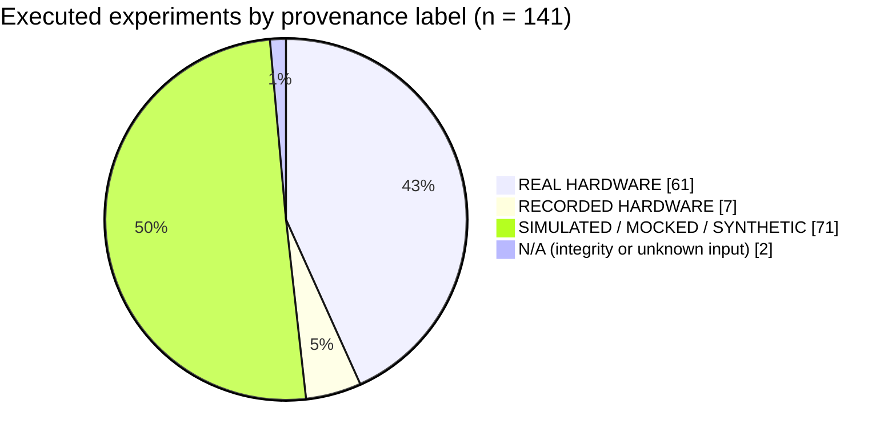

# Benchmark results

This page gathers the measured results of Team-15's experiments, one table per area. Every number comes with its conditions, its evidence reference (an experiment ID that links to the [registry](EXPERIMENT_REGISTRY.md)) and a provenance label. Different runs and revisions are kept in **separate rows**, even when they measure the same thing. Wherever a quantity was never measured, the table says **NOT MEASURED**, because a blank or an estimate would look like a result.

**Status:** Reference (audit of 2026-11-08 at `d1b607a`). No result here comes from a new run made for this page.

**Related:** [Experiment registry](EXPERIMENT_REGISTRY.md) · [Experiment summary](EXPERIMENT_SUMMARY.md) · [Dataset inventory](DATASET_INVENTORY.md) · [19 Testing and benchmarks](../19_TESTING_AND_BENCHMARKS.md) · [22 Experiments and failures](../22_EXPERIMENTS_AND_FAILURES.md) · [17 Safety architecture](../17_SAFETY_ARCHITECTURE.md)

---

> **Important: passing tests and good simulation numbers do not establish physical perception accuracy or motor safety.**
>
> - No camera distance has been checked against a tape measure. **Every camera distance is UNCALIBRATED.**
> - The Grove ultrasonic sensor **never returned a single echo** on real hardware (0/100 pings).
> - The RPLIDAR C1 was **never scanned**.
> - **No RoverC wheel ever turned under Team-15 control.** The watchdog and fail-closed results below come from a Python model of the firmware and from fake drivers.
> - The Qwen scores come from **simulated or synthetic** test sets graded by code policy, not from real missions.
>
> These numbers show that the software logic behaves as designed on the inputs we gave it. They do not show that the robot is safe or accurate in the physical world.

Labels: **REAL HARDWARE** · **RECORDED HARDWARE** (a replay of real captures) · **SIMULATED** · **MOCKED** · **SYNTHETIC**. See the [registry](EXPERIMENT_REGISTRY.md#labels-provenance-of-the-data-the-experiment-observed) for definitions. Times are UTC unless marked ET.

---

## 1. Object detection: person counts and posture tests

Detector: torchvision Faster R-CNN R50-FPN-v2 (COCO weights, no fine-tuning), person score ≥ 0.6, minimum box 15 % of frame height, 3-frame gate. HOG (full-body pedestrian detector) is a secondary family that cannot trigger alerts by default. **There are no labelled ground-truth boxes**: "detected" means the detector produced a person box in that frame while the operator stated a person was present. Precision and recall are **NOT MEASURED**.

### 1a. Mac bench camera (MacBook built-in camera, 1920×1080, open office, 2026-11-07)

| ID | Pose / scene | Frames | Faster R-CNN frames with a person | HOG frames | Notes | Label |
|---|---|---|---|---|---|---|
| CAM-03 | smoke run | 35 | 35/35 | — | 4.33 fps | REAL HARDWARE |
| CAM-04 | standing, attempt 1 | 122 | 122/122 | 10 | detected the **operator**, not the teammate: INCONCLUSIVE | REAL HARDWARE |
| CAM-05 | standing, attempt 2 | 58 | 58/58 | 1 | same problem: INCONCLUSIVE | REAL HARDWARE |
| CAM-06 | standing, full body, facing the camera | 97 | 97/97 | **61/97** | the face cascade also fired on a blank wall in 80/97 frames | REAL HARDWARE |
| CAM-07 | seated, profile | 98 | 98/98 (5–7 bystanders; how many hits were on the teammate is unclear) | 20 | PARTIAL | REAL HARDWARE |
| CAM-08 | seated, back to the camera | 98 | 98/98 (scores 0.617–0.993) | **0/98** | | REAL HARDWARE |
| CAM-22 | long run (957 s), probably the dashboard demo | 4,725 | 4,725/4,725 | — | ≈4.94 fps; no summary (interrupted) | REAL HARDWARE |

### 1b. Pi 5 + IMX708 on the robot mount (1280×720, rotation 180, 2026-11-08, one consenting participant)

| ID | Pose | Frames | Faster R-CNN | Score range | HOG | Other | Label |
|---|---|---|---|---|---|---|---|
| CAM-23 | standing (the scene was requested as "empty"; a person was present) | 96 | 96/96 | 0.9995–0.9998 | 96/96 | 4.75 fps | REAL HARDWARE |
| CAM-27 | seated | 94 | 94/94 | 0.9997–0.9999 | **0/94** | | REAL HARDWARE |
| CAM-28 | lying, feet towards the camera | 94 | 94/94 | 0.9845–0.9971 | **0/94** | box height 180–201 px; `count_in_frame` 2 for one person | REAL HARDWARE |
| CAM-29 | lying on the back, side view | 94 | 94/94 | 0.9913–0.9978 | — | 2–3 boxes per frame on one person | REAL HARDWARE |
| CAM-17 | first live Pi person test (bench mount) | 3 processed | sighting 0.8665 | — | — | image upside down; 0.68 fps during warm-up; PARTIAL | REAL HARDWARE |

**Object scenes (Pi):**

| ID | Scene | Frames | Result | Label |
|---|---|---|---|---|
| CAM-24 | empty office chair | 101 | chair 101/101 (0.9915–0.9965); 0 person; wrong labels also produced (surfboard ≤ 0.99, tv, bench, couch, dining table) | REAL HARDWARE |
| CAM-26 | powered-off quadcopter | 100 | COCO has no drone class: 0/100 recognised. Person boxes in 100/100 frames came from people in the background. INCONCLUSIVE | REAL HARDWARE |

**How to read this:** Faster R-CNN found the one participant in every frame of every pose tested, and HOG failed on every seated and lying pose. This is n = 1 person, one room and one viewpoint, with about 20 s per pose, so it shows the detector *can* see these poses. It does not give a recall rate. `count_in_frame` counts boxes, not people (CAM-28/29).

## 2. Empty-scene false positives

A "sighting" is the alert the system raises after the 3-frame gate.

| ID | Camera | Scene | Frames | Frames with a person box | Sightings | Verdict | Label |
|---|---|---|---|---|---|---|---|
| CAM-09 | Mac | "empty" office | 295 | 185 | 1 (0.882), the operator at the frame edge | INCONCLUSIVE (contaminated) | REAL HARDWARE |
| CAM-10 | Mac | "empty" office | 291 | 268 | 1 (0.998), a person beside the laptop | INCONCLUSIVE (contaminated) | REAL HARDWARE |
| CAM-11 | Mac | "empty" office | 296 | 294 | 1 (0.992), a seated bystander | INCONCLUSIVE (contaminated) | REAL HARDWARE |
| CAM-12 | Mac | **physically empty, facing windows** | 294 | 294 (1,767 boxes, all on the glass, up to 393 px) | **1 false sighting (0.991)** | **FAILED** | REAL HARDWARE |
| CAM-13 | Mac | painted wall | 290 | 141 | 1 (0.988), a real hand | INCONCLUSIVE (contaminated) | REAL HARDWARE |
| CAM-14 | Mac | wall + closed blinds | 295 | all 337 boxes on one bystander | 1 | INCONCLUSIVE (contaminated) | REAL HARDWARE |
| CAM-18 | Pi (bench) | close object, no person | 448 | 0 | 0 | COMPLETE | REAL HARDWARE |
| CAM-25 | Pi (robot mount) | **genuinely empty room** | 96 | 0/96 in all four families | 0 | **PASS** | REAL HARDWARE |
| MAP-01 | Pi via `camera_mapping` | empty scene, camera facing a wall | 117 states | 0 detections | — | COMPLETE | REAL HARDWARE |

False-positive **rate**: **NOT MEASURED**. We have one clean Pi pass (96 frames, about 20 s) and one Mac failure caused by reflections. That is too little data to estimate a rate.

## 3. Camera throughput and latency

Mac: Apple M4 Pro, MPS. Each run is its own row. "Capture→Mac" is the delay from the Pi capture timestamp to the frame's arrival on the Mac. The Pi and Mac clocks were not independently synchronised for these measurements, so treat the absolute delays as approximate.

### 3a. Detector micro-benchmark (synthetic input)

| ID | Model | CPU ms/frame | MPS ms/frame | Conditions | Label |
|---|---|---|---|---|---|
| CAM-01 | Faster R-CNN R50-FPN-v2 | 902 | 158 | 1 random 720p tensor, 5 timed iterations, 2026-11-07 18:53 | SYNTHETIC (timed on the real Mac) |
| CAM-01 | Faster R-CNN MobileNet-V3-FPN | 229 | 29 | same | SYNTHETIC (timed on the real Mac) |

### 3b. Live and replayed pipelines

| ID | Date / revision | Pipeline | fps | Detector (median) | Capture→Mac | End-to-end | Label |
|---|---|---|---|---|---|---|---|
| CAM-15 | 2026-11-07 ~22:15 | Pi→Mac JPEG over SSH, transport only, 40 frames | 4.86 | — | mean 256 ms, max 460 ms | — | REAL HARDWARE |
| CAM-16 | ~22:40, `4d3093d` | Pi stream only | 5.17 | — | median 201 ms, max 411 ms | — | REAL HARDWARE |
| CAM-18 | 22:28 | Pi→bridge→dashboard, 90 s | 4.97 | — | 0.264 s (PR #5) | — | REAL HARDWARE |
| CAM-19 | ~22:47, `ae8b088` | Pi, after the warm-up fix | 4.36 | 202 ms (first MPS call 3.71 s) | median 192 ms | — | REAL HARDWARE |
| CAM-23 | 2026-11-08 07:08 | Pi live, standing person | 4.75 | — | median 290 ms | — | REAL HARDWARE |
| CAM-24 | 07:25 | Pi live, chair | — | 190 ms | — | capture→result 444 ms | REAL HARDWARE |
| CAM-25 | 07:28 | Pi live, empty | 4.76 | — | — | — | REAL HARDWARE |
| CAM-27 | 07:48 | Pi live, seated | — | 196 ms | — | capture→dashboard 499 ms | REAL HARDWARE |
| CAM-28 | 07:59 | Pi live, lying | — | — | — | capture→dashboard 593 ms | REAL HARDWARE |
| CAM-29 | 08:07 | Pi live, lying side view | — | — | — | capture→dashboard 508 ms | REAL HARDWARE |
| MAP-01 | 11:22, pre-commit `camera_mapping` | Pi live → detector → mapping | 4.68 | 186.5 / P90 203.9 / max 447.1 ms; mapping 1.9 ms | median 274.4 ms, P90 347.7 ms | median 479.8 / P90 563.3 / max 804.4 ms | REAL HARDWARE |
| MAP-06 | 11:52, `c7ed6c5` | Pi live via `camera_demo.sh` (GPU shared with a stray runner) | 3.76 (max gap 0.80 s) | 245.9 ms | — | — | REAL HARDWARE |
| MAP-02 | 11:19 | replay of bench frames | — | 178.2 ms; mapping 3.1 ms | — | — | RECORDED HARDWARE |
| MAP-04 | 11:41, full stack on one Mac | replay + depth + Qwen + dashboard | — | 188.4 / 239.7 / 509.3 ms; depth 124.6 / 147.4 / 180 ms | — | Qwen 5.18–5.67 s per advisory | RECORDED HARDWARE |

Memory during MAP-04: runner RSS 1.3 GB, Ollama 3.3 GB, 62 % of system memory free. Pi power while streaming the camera (CAM-21, `rpicam-vid` 640×480 at 30 fps, 60 s): throttled 0x0 in all 35 samples, EXT5V 5.139–5.198 V, 43.3–46.6 °C (REAL HARDWARE).

The demo guide says "about 5 frames per second". Measured live mapping runs gave 4.68 and 3.76 fps.

## 4. Distance-estimation error

| Quantity | Value | Why |
|---|---|---|
| Camera ground-plane distance error | **NOT MEASURED** | the mount was never measured; tape calibration NOT RUN (MAP-09) |
| Camera known-height distance error | **NOT MEASURED** | same |
| Monocular depth (Depth-Anything-V2) error | **NOT MEASURED** | one recorded frame only, with no ground truth (MAP-03) |
| Grove ultrasonic error on hardware | **NOT MEASURED** | 0 valid echoes (RNG-HW-01/02) |
| RPLIDAR C1 range error | **NOT MEASURED** | no scan was ever made |

What exists instead (these are **not** accuracy results):

| ID | What | Value | Label |
|---|---|---|---|
| MAP-03 | Depth-Anything-V2 metric-indoor, median depth in the person box on one recorded Pi frame | 0.41 m (not validated); frame range 0.31–1.95 m; 116.6 ms. Relative model: 2.16 (unitless) | RECORDED HARDWARE |
| MAP-06 | KNOWN_HEIGHT distance for a chair cut off at the side of the frame | 7.91 m, then 6.76 m. This was a **bug** (a truncated box makes the range look larger), fixed in `73539a7` so that boxes cut at any edge are refused | REAL HARDWARE |
| MAP-10 | Recorded-frame regression test | distance UNKNOWN (`NO_METHOD_APPLICABLE`), as designed for an unmeasured mount | RECORDED HARDWARE |
| RNG-SIM-04 | Grove simulator, 1.00 m scene, on the Pi | 50/50 VALID; min/median/max 97.26 / 99.56 / 102.03 cm; SD 1.11 cm | SIMULATED |
| RNG-SIM-05 | Grove simulator on the Mac | 20/20 VALID; median 99.9 cm; SD 1.07 cm | SIMULATED |

The simulator numbers show only that the software reproduces the noise model it was given.

## 5. Obstacle-mapping correctness

| ID | Test | Result | Label |
|---|---|---|---|
| MAP-11 | `camera_mapping` unit suite at `d1b607a` | 97 passed | SYNTHETIC |
| MAP-12 | Independent review of PR #16 with reproduction scripts | 10 findings (5 confirmed, 4 plausible, 1 minor group). Confirmed: stale range read as CLEAR; FREE cells kept behind a new obstacle for 1.5 s; stale map still drawn; SUPPORTED route unreachable. All main findings fixed in `c7ed6c5` with regression tests | SYNTHETIC |
| MAP-05 | Camera loss → staleness (replay; runner killed) | STALE / UNKNOWN / all cells unknown / `STALE_NOT_USABLE` within 2 s; automatic restart gap 9.98 s | RECORDED HARDWARE |
| MAP-04, 06, 07, 08 | All demo-script runs (1,292 states) | corridor **UNKNOWN in every state**, because the mount is unmeasured | REAL + RECORDED HARDWARE |
| — | Correct CLEAR / CAUTION / BLOCKED rates on real scenes | **NOT MEASURED** (PLN-03 NOT RUN) | — |

## 6. Route-planning correctness

| ID | Test | Result | Label |
|---|---|---|---|
| PLN-01 | Dijkstra on `fixtures/trail_graph_synthetic.json` (checked against a networkx oracle) | A→G 60 m; C→K 20 m; C→K with J-K blocked 22 m; C→G 40 m; A→G with E-F blocked 74 m (CLI); A→Q `NO_KNOWN_ROUTE` | SYNTHETIC |
| PLN-02 | A\* (ALT) vs Dijkstra over all ordered pairs × 5 blocked-edge sets | identical results; heuristic admissible (h ≤ d); A→G 60 m with 7 nodes expanded | SYNTHETIC |
| CI-002 | Route step of the local run | A→G 60 m | SYNTHETIC |
| MAP-01 | Advisory grid route, pre-commit code | `ROUTE_THROUGH_UNOBSERVED_SPACE` in 117/117 states with an unmeasured mount: a **bug**, fixed before the first commit | REAL HARDWARE |
| — | Advisory grid route on real camera data | **NOT MEASURED** (PLN-03) | — |

The trail-graph metres are invented; they are not measured travel.

## 7. Qwen + RAG (base model, no LoRA)

All test sets are SIMULATED or SYNTHETIC, graded by code policy. Mac M4 Pro unless noted; dates ET. **Runtime matters:** Ollama applies a JSON grammar that forces valid output. Hugging Face (HF) bf16 inference ran *without* a grammar. The two must not be compared as if they were the same thing (QWN-018).

### 7a. Retrieval

| ID | Retriever / collection | Queries | hit@4 | recall@4 | MRR@10 | Latency | Label |
|---|---|---|---|---|---|---|---|
| QWN-002 | SQLite FTS5 (best or tied of FTS5 / rank_bm25 / MiniLM / RRF), 34-doc corpus | 20 | 18/20 | 0.762 | 0.852 | 0.17 ms | SYNTHETIC |
| QWN-003 | FTS5, LiDAR collection | 12 | 11/12 | — | — | — | SYNTHETIC |
| QWN-003 | FTS5, delivery collection | 12 | 11/12 | — | — | — | SYNTHETIC |

### 7b. Advisory and mission benchmarks, base model

| ID | Test set (n) | Configuration | Result | Label |
|---|---|---|---|---|
| QWN-001 | frozen v0.1 advisories (46) | A deterministic | 43 fully correct | SYNTHETIC |
| QWN-001 | same | B base Qwen, Ollama Q4 + grammar | 28 fully correct; person evidence 42; invented citations 16 | SYNTHETIC |
| QWN-001 | same | C = B + RAG | 28 fully correct; person evidence 45; invented citations 3; raw unsupported claims 0/46; reworded unsafe request refused 0/1 | SYNTHETIC |
| QWN-008 | frozen v0.2 advisories (32) | A deterministic | 31/32. **Qwen rows NOT MEASURED** | SYNTHETIC |
| QWN-015 | frozen v0.2 mission steps (230) | B Ollama + grammar, no RAG | **39/230** step-correct | SIMULATED |
| QWN-015 | same | C Ollama + grammar + RAG | **56/230**; unsafe 2/230 (blocked by the gate) | SIMULATED |
| QWN-016 | same | HF bf16 base + RAG, **no grammar** | **0/230 correct, 0/230 parseable**: a format failure, not a reasoning result | SIMULATED |
| QWN-018 | 60 / 230 | runtime audit | Ollama without grammar 0/60; HF base with a lenient parser 6/230; forced prefix: base 0/60 | SIMULATED |
| QWN-019 | frozen delivery (77) | HF base / base + RAG | raw correct 7 / 15; forbidden claims 24 / 34; unsafe 0 | SIMULATED |
| QWN-021 | same | Ollama B / C (grammar) | raw correct 10 / 17; forbidden claims 49 / 45; unsafe 0 | SIMULATED |
| QWN-022 | frozen LiDAR (60 advisories + 20 episodes per configuration) | Ollama without / with RAG | unsupported claims 19 / 35; 0 episodes completed | SIMULATED |
| QWN-028 | 3 agentic scenarios | Ollama | every episode `INVALID_OR_REPEATED` → fallback | SIMULATED |

### 7c. Runtime

| ID | Host | Model | Latency | Other | Label |
|---|---|---|---|---|---|
| QWN-004 | Mac M4 Pro, Ollama | 2B Q4 | ≈1.7 s median | 10/10 valid; 2.2 GiB | SYNTHETIC prompts, real Mac |
| QWN-005 | Pi 5, llama.cpp, 3 threads | 2B Q4_K_M + mmproj | 97.8 s cold, then 47.6 / 46.8 s | 3/3 valid; 7.6–8.1 tok/s; 55→70 °C; throttled 0x0 | SYNTHETIC prompts, real Pi |
| MAP-04 | Mac, full stack | Ollama base + RAG via `camera_mapping/qwen_launcher.py` | 5.18–5.67 s | all `QWEN_GUARDED` | RECORDED HARDWARE input |
| DSH-04 | Mac, after the threading workaround | same | 4.0–5.9 s | all `QWEN_GUARDED`; **content not scored** | input provenance not recorded |

Accuracy of live camera-demo advisories: **NOT MEASURED** (status and latency only).

## 8. Qwen LoRA

### 8a. Training runs (each run separate)

| ID | Run | Data | Steps | Result | Memory | Label |
|---|---|---|---|---|---|---|
| QWN-006 | feasibility (one forward/backward pass) | 1 sequence, 376 tokens | — | 192 LoRA modules on the language model, 0 on vision; 10.91 M trainable; finite gradients | MPS 10.3 GB | SYNTHETIC |
| QWN-010 | v0.2 smoke | 64 records | 8 | loss 1.58 → 0.64; validation 0/20 parseable | MPS 21.7–24.4 GB, swap 7.6/8 GB | SIMULATED + SYNTHETIC |
| QWN-011 | run1 | v0.2 train | 0 | **FAILED**: `invalid low watermark ratio 1.4` | — | SIMULATED + SYNTHETIC |
| QWN-012 | run1b | v0.2 train | 0 | **FAILED**: MPS OOM (9.04 GiB allocation, 12.43 GiB cap) | — | SIMULATED + SYNTHETIC |
| QWN-013 | **run2** | **689 records trained** (707 in the file, including 7 Co-GLANCE frames and 4 bench metadata rows) | 89 | loss 1.58 → last-quartile mean 0.050 | peak MPS 8.54 GB | SIMULATED + SYNTHETIC |
| QWN-024 | LiDAR pilot | 640 records | 80 | loss 1.29 → 0.059 | MPS ≤ 9.55 GB | SIMULATED |
| QWN-009, QWN-030 | v0.1 LoRA; delivery LoRA | — | — | **NOT RUN** | — | — |

Checkpoint selection: QWN-014 chose run2 **ckpt-0088** (97/102 validation steps, 0/79 unsafe, score 1.851; tied with ckpt-0089 and resolved by list order). QWN-025 found **no eligible pilot checkpoint**, so the pilot was not promoted.

### 8b. Evaluation of the adapters (HF, no grammar, + RAG unless noted)

| ID | Adapter | Test set (n) | Result | Label |
|---|---|---|---|---|
| QWN-017 | run2 ckpt-0088 + RAG | frozen v0.2 mission (230) | **218/230 = 94.8 %** (95 % interval 91.1–97.0 %); 230/230 parseable; 0/182 unsafe; 40/40 stops; 2 missed timeout stops | SIMULATED |
| QWN-018 | ckpt-0088, forced prefix | 60 | 60/60 parseable | SIMULATED |
| QWN-020 | ckpt-0088 without / with RAG (transfer to an untrained task) | frozen delivery (77) | raw correct 15 / 12; forbidden claims 7 / 14; schema bad 1 / 4; unsafe 0 | SIMULATED |
| QWN-022 | ckpt-0088 without / with RAG | frozen LiDAR (60) | over-permissive **14 / 9**; 0/60 schema-valid | SIMULATED |
| QWN-026 | pilot ckpt-0080, E (no RAG) / F (RAG) | frozen LiDAR (60 + 20 episodes) | all four fields 31 / 32; over-permissive 0 / 4; stop recall 4/8 (F) | SIMULATED |
| QWN-026 | pilot ckpt-0080 | frozen v0.2 mission (230) | **182/230** (regressed from 218); unsafe 13/225 | SIMULATED |
| QWN-027 | pilot / ckpt-0088 | independent generalization (44) | pilot over-permissive 5 / 6, stop recall 6/11 and 4/11; ckpt-0088 over-permissive 10 / 4. Ollama + RAG row **NOT RUN** | SIMULATED |
| QWN-029 | every model | every frozen set | promotion gate **FAIL for every model**; every raw critical error was blocked before display | SIMULATED + SYNTHETIC |
| — | ckpt-0088 **without** RAG on the mission set | — | **NOT MEASURED** | — |
| — | ckpt-0088 served live in the demo | — | **NOT RUN**: Ollama 0.40.2 rejects LoRA adapters (QWN-018 E6). The demo uses base + RAG | — |

How to compare: ckpt-0088's 218/230 and base Ollama's 56/230 differ in **runtime, grammar and weights** at the same time. The fair comparison with the same runtime and no grammar is base 0/230 against LoRA 218/230 (both HF), and that gap is mostly about following the output format (QWN-018). The test set comes from the same generator as the training data, so this is an in-distribution result.

Publication: ckpt-0088 is public on Hugging Face at revision `21013d4`, and 9/9 SHA256SUMS were verified (QWN-031).

## 9. Grove ultrasonic: simulated vs real

| ID | Where | Run | Pings | VALID | Distance | Diagnosis | Label |
|---|---|---|---|---|---|---|---|
| RNG-SIM-05 | Mac | `sensor_only_test.py --simulate` | 20 | 20/20 | median 99.9 cm, SD 1.07 cm | — | SIMULATED |
| RNG-SIM-04 | Pi 5 | `sensor_only_test.py --simulate`, 1.00 m scene | 50 | 50/50 | 97.26 / 99.56 / 102.03 cm; SD 1.11 cm | — | SIMULATED |
| RNG-HW-01 | Pi 5, GPIO5, target at 100 cm (taped, as reported), 10:43 | `python3 -m ranging diagnose` | 50 | **0/50** | **none** | 50 NO_ECHO, 0 echo edges, `NO_RESPONSE_EVER`, health FAULT | REAL HARDWARE |
| RNG-HW-02 | same, 10:50, no reported change | same | 50 | **0/50** | **none** | same | REAL HARDWARE |

Software suites: ranging tests 126 passed on the PR #7 branch (RNG-SIM-01) and 126 passed at `d1b607a` in 3.60 s (RNG-SIM-02); 118 passed in the PR #8 tree (RNG-SIM-03). All SIMULATED + MOCKED.

Gate runs (RNG-PF-01…10, REAL HARDWARE read-only): the gate refused until the config was complete, and it opened (`ok:true`) at 10:43:08. An open gate means only that the fields were filled in. It does not mean the wiring was correct.

The root cause of the 0/100 is **UNKNOWN**: see [22 §2](../22_EXPERIMENTS_AND_FAILURES.md#2-sensors-grove-ultrasonic-and-rplidar-c1).

## 10. LiDAR (simulated only)

| ID | Test | Result | Label |
|---|---|---|---|
| LDR-SIM-02 | `pytest` first round at `9041c05` | 92 LiDAR tests (558 total) passed; 88 % coverage | SIMULATED + MOCKED |
| LDR-SIM-01 | after the footprint round | 124 LiDAR (590 total) passed; 89 % coverage of 1,828 statements | SIMULATED + MOCKED |
| LDR-SIM-03 | `pytest -q lidar/tests` at `d1b607a` | 124 passed in 2.03 s | SIMULATED + MOCKED |
| LDR-SIM-04 | 23 scenario fixtures (76 frames, 37,038 points) vs recorded expectations | all match; 5/23 allow forward motion | SIMULATED |
| LDR-SIM-05a | processing, 500-point scans (test report) | p50 1.13 ms, p95 1.18 ms | SIMULATED |
| LDR-SIM-05b | processing, n = 50 (audit) | p50 1.159, p95 1.265, max 1.288 ms | SIMULATED |
| LDR-HW-01f | fallback demo via `lidar replay` | scenario 02 BLOCKED at 0.2409 m; scenario 04 FRONT CLEAR, closest 0.2436 m LEFT | SIMULATED |
| LDR-HW-01a–g | real USB enumeration of the CP2102N adapter | detected in 4 of 6 read-only checks, missing in 2 (after reboots); the C1 itself was never queried | REAL HARDWARE (read-only) |
| — | real scan, real range accuracy | **NOT MEASURED** | — |

## 11. Rover navigation scenarios (simulated)

World: `fixtures/trail_graph_synthetic.json`. The simulator has no walls, so NO_ECHO counts as clear in simulation only. Heading is perfect. Distances are simulated metres.

| Scenario | Set-up | SIM-01a (`dac82f4`, PR #8) | SIM-01b (`d1b607a`): end state | Route (m) | Travelled (m) | Sim time (s) | Collision |
|---|---|---|---|---|---|---|---|
| A | clear | ARRIVED, 60 m | ARRIVED | A-B-C-D-E-F-G (60) | 59.97 | 102.25 | none |
| B | box on D-E at 5 m | D-E blocked, 4 m retreat, D-K-L-M-G 46 m | ARRIVED | D-K-L-M-G (46) | 83.895 | 187.20 | none |
| C | same world as B | same as B | ARRIVED | D-K-L-M-G (46) | 83.895 | 187.20 | none |
| D | boxes on D-E and D-K | 64 m | ARRIVED | D-C-J-K-L-M-G (64) | 105.885 | 266.00 | none |
| E | boxes on D-E and M-G | SAFE_STOP | SAFE_STOP | none | 74.955 | 211.65 | none |
| F | D-E cleared independently | 30 m | ARRIVED | D-E-F-G (30) | 29.955 | 59.80 | none |
| G | sensor dropout at 8 s | SENSOR_STALE latch | SAFE_STOP (`SENSOR_STALE`) | (planned 60) | 4.665 | 8.20 | none |
| H | person on C-D | HUMAN_REVIEW | CONTINUE_OR_REQUEST_OPERATOR (`HUMAN_REVIEW`) | (planned 60) | 20.03 | 34.55 | none |

Rover test suite: 181 passed at `dac82f4` (SIM-01a); 284 passed in 2.14 s at `d1b607a` (SIM-01b). All SIMULATED. **Real RoverC navigation: NOT MEASURED.**

### 11a. Drone-fleet and SAREnv studies (separate `team15_starter` simulation)

| ID | Revision | Study | Result (t_found mean ± SD, success) | Label |
|---|---|---|---|---|
| SIM-02 | `ea5016f` (committed CSV) | fleet, 4 configurations × 20 seeds | 1 drone 215.7±79.5 s; 3 no-share 147.1±51.2; 3 shared 100.8±19.8; 3 shared + claims 93.2±15.5 | SIMULATED |
| SIM-07 | `d1b607a` (re-run twice, byte-identical) | same | 218.4±65.9 / 149.4±50.0 / 128.0±66.3 / 91.1±15.4 s; success 85/90/85/90 %. **Does not reproduce SIM-02** | SIMULATED |
| SIM-03 | `e47c1bf` (committed CSV) | EMCON, 2 × 20 | civilian 91.6±14.1 s, 90 %; EMCON + signed 130.1±21.2 s, 90 %, 1 battery death | SIMULATED |
| SIM-08 | `d1b607a` | same | civilian 80.4±11.5 s, 80 %; EMCON 174.1±89.0 s, 65 %. **Does not reproduce SIM-03** | SIMULATED |
| SIM-05 | `7ed29a5` | SAREnv, 30 km, 60 scenarios × 6 planners | MCTS likelihood 0.170±0.023, victims 17.4±2.5 %; Greedy 0.126±0.015, 11.3±1.5 % | SIMULATED |
| SIM-06 | `4018ff9` | SAREnv, 10 km | MCTS 0.0685±0.0102, 6.95±1.25 %; Greedy 0.0506±0.0083, 4.78±0.93 % | SIMULATED |
| SIM-04 | — | radio study | **NOT RUN** | — |

## 12. Watchdog and motion-safety simulations

| ID | Test | Result | Label |
|---|---|---|---|
| ROV-01a | Issue #9 fail-closed forward motion (PR #14) | 40 new tests; rover 221, `pytest -q` 380, ranging 126 passed; the review found no fail-open path | MOCKED |
| ROV-01b | same at `d1b607a` | 40/40 | MOCKED |
| BRG-01a | bridge tests (PR #15) | an intermediate run had 62/63 (a partial-I²C gap in the model, then fixed); final rover 284, `pytest -q` 443 | MOCKED |
| BRG-01b | bridge tests at `d1b607a` | 63/63 | MOCKED |
| BRG-01b | firmware-model watchdog trip after the last accepted motor frame (1 ms steps) | **0.251 s** (design 250 ms; requirement ≤ 300 ms) | MOCKED |
| BRG-01b | end-to-end cable cut at forward 0.2, 50 ms supervisor tick | host latch `DRIVER_FAULT` after **0.05 s**; model WDSTOP with all registers zero after **0.30 s** | MOCKED |
| SIM-01b E, G | scenarios E and G | SAFE_STOP; SENSOR_STALE latch after 8.20 s | SIMULATED |
| ROV-04 | `t15robot` guarded suite on the real Pi (30 × 90) | 2,700/2,700 passed; 0 hardware access attempts; pinctrl unchanged | SIMULATED |
| EXT-02 | PR #6 mission-control loopback (fake receiver), unmerged branch | 270 + 41 passed (as reported; not re-run) | MOCKED |
| — | firmware watchdog on a real StickC | **NOT MEASURED** (the PR #15 firmware was never compiled or flashed) | — |
| — | real wheel stop latency, e-stop rehearsal | **NOT MEASURED** | — |

## 13. CI regression tests

| ID | Scope | Result | Label |
|---|---|---|---|
| CI-001 | all 184 GitHub Actions runs, 2026-11-07 18:59 → 2026-11-08 12:14 UTC | 181 success / 3 failure (1.6 %), all in `ci.yml`. 2 × OpenCV 5 missing `cv2.HOGDescriptor` (fixed by the pin `a36a658` about 1 min later); 1 × `test_no_photos_tracked_in_git` on vendored Leaflet icons (fixed in `159c678` about 15 min later) | SIMULATED + MOCKED + SYNTHETIC |
| CI-003 | `ci` on `d1b607a` | 532 passed + 8 skipped (private data and weights unavailable on runners) | SIMULATED + MOCKED |
| CI-003 | `perception` on `d1b607a` | 38 passed + 1 skipped | MOCKED |
| CI-003 | `lidar`, `ranging`, `qwen` | 124, 126 and 23 passed on **`159c678`**. They **did not run on `d1b607a`** (path filters; that merge touched no file under their paths) | SIMULATED + MOCKED |
| CI-002 | local run at `d1b607a` (macOS, Python 3.13) | default `pytest -q` **540 passed** (12.75 s); lidar 124; ranging 126; qwen_advisory 23; team15_starter 5; `test_link.py` 30/30; gate CLIs refused as designed (exit 2, 3, 2) | SIMULATED + MOCKED + SYNTHETIC (+1 recorded frame) |
| CI-005 | test counts reported in PR bodies over time | 12 → 89 → 143 → 277 → 340 → 380 → 443 → 540 | as reported; only 540 was re-run |

`team15_starter/tests` and `test_link.py` are **not run by any CI workflow** (local runs only: SIM-09, CI-002).

## Distribution of experiment labels

The chart counts the 141 executed and de-duplicated experiments; the counting rules are in the [summary](EXPERIMENT_SUMMARY.md#2-how-we-counted).

Of the 61 REAL HARDWARE experiments, 27 are read-only inspections or availability checks (USB detection, preflight gates, a photo review, network checks), and 1 (EXT-01) is an unverified firmware upload. **None measured a distance on real hardware, and none moved a wheel.**
